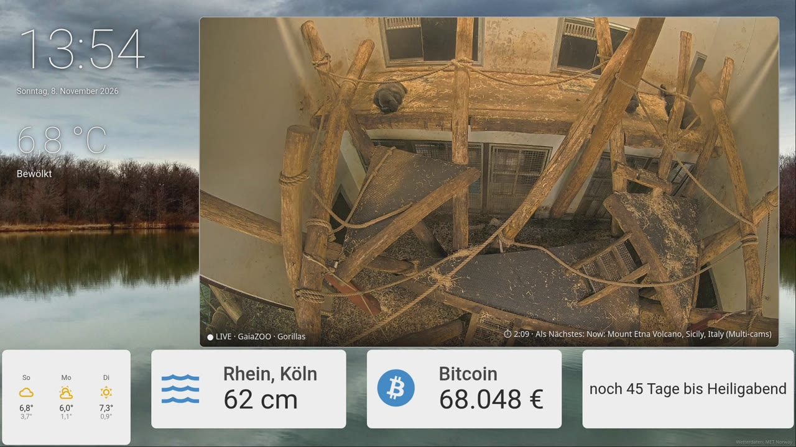
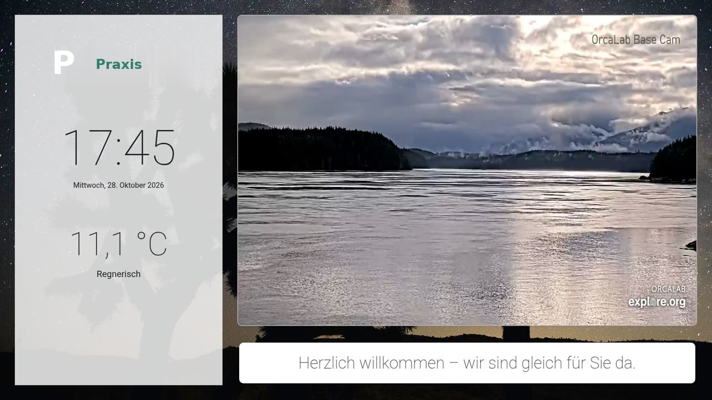
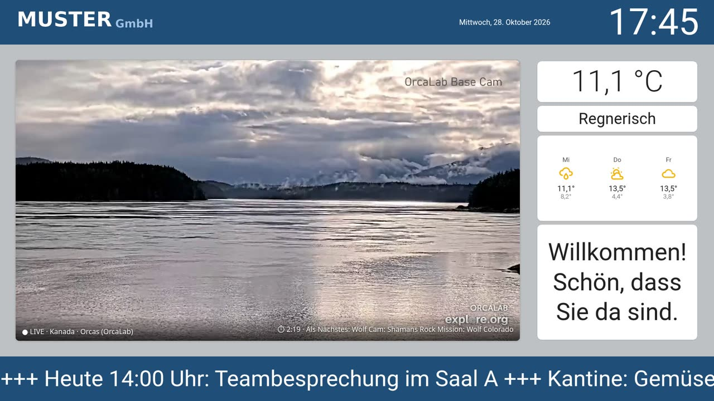
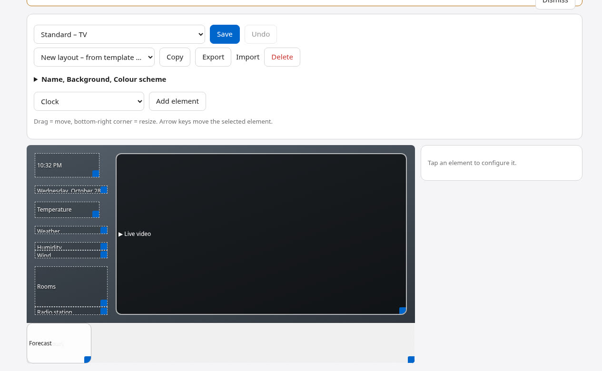
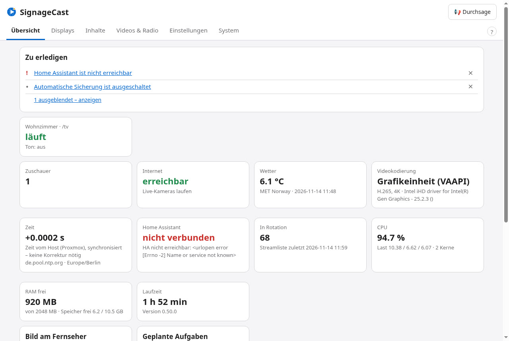

<p align="center">
  <picture>
    <source media="(prefers-color-scheme: dark)" srcset="docs/logo/signagecast-wortmarke-dunkel.svg">
    
  </picture>
</p>

<p align="center"><strong>Macht aus jedem Fernseher einen ruhigen Infobildschirm – mit Live-Kameras aus aller Welt.</strong></p>

<p align="center">
  <a href="https://github.com/thefrozn/signagecast/releases/latest"></a>
  <a href="https://github.com/thefrozn/signagecast/actions/workflows/tests.yml"></a>
  <a href="LICENSE"></a>
</p>

<p align="center">
  <a href="#installation"><b>Installieren</b></a> ·
  <a href="docs/TOUR.de.md"><b>Bildschirm-Tour</b></a> ·
  <a href="docs/PLAYER.md#deutsch-raspberry-pi-als-player">Player</a> ·
  <a href="docs/MANUAL.md#deutsch-kurz">Handbuch</a> ·
  <a href="docs/HOW-IT-WORKS.md#deutsch-kurz">Technik</a> ·
  <a href="CHANGELOG.md">Änderungen</a> ·
  <a href="README.md">English</a>
</p>



SignageCast zeigt Uhr, Wetter und auf Wunsch Werte aus **Home Assistant** neben einem großen Fenster mit
**Live-Kameras von Tieren und Natur** – immer von einem Ort, an dem gerade Tag ist. Das Bild gestaltest du im
**Layout-Editor** per Ziehen und Ablegen, verwaltet wird alles im Browser, auch vom Handy. Ein kleiner Linux-Container
zeichnet die Seite und schickt sie als Video an den Fernseher – oder ein Raspberry Pi bzw. PC am Fernseher zeigt sie
direkt.

Gemacht für Wohnzimmer, Wartezimmer und Firmenempfang. Selbst betrieben, ohne Cloud und ohne Konto – frei und quelloffen.

## Was es kann

<table>
<tr>
<td valign="top" width="50%">

**Der Bildschirm**
- Fenster zur Welt: YouTube-Live-Kameras, die wechseln und schlechte Streams selbst überspringen
- Uhr, Wetter, Vorhersage, amtliche Unwetterwarnungen (DWD)
- Hintergründe, die dem echten Sonnenstand an deinem Ort folgen
- Vorlagen für Wohnzimmer, Praxis, Firma und Nacht

</td>
<td valign="top" width="50%">

**Inhalte**
- Layout-Editor im Raster 48 × 27 mit Bedingungen, Schriften und Farben – oder Layout von einer KI bauen lassen
- Inhalte direkt von Claude & Co. verwalten lassen – Computer per Klick verbinden und wieder entfernen ([MCP-Schnittstelle](docs/MCP.md#deutsch-kurz))
- Werte aus Home Assistant, eigene JSON-/RSS-Quellen, Diagramme, Kalender
- IP-Kameras, Webseiten, PDFs, Internetradio, Einspieler zu festen Zeiten
- Meldungen, Durchsagen und ein rotes Notfall-Vollbild auf allen Fernsehern

</td>
</tr>
<tr>
<td valign="top">

**Player**
- Jeder Fernseher-Browser, der H.265 abspielt – nur eine Adresse öffnen
- Raspberry Pi oder PC aus einem fertigen Image, zentral verwaltet
- Direktmodus: der Player zeigt die Seite selbst, der Server muss nichts kodieren
- Browser-Gerät: ein geheimer Link für Smart-TV oder Kiosk-Browser
- Player an anderen Standorten über Tailscale oder Headscale ([REMOTE.md](docs/REMOTE.md#deutsch-kurz))

</td>
<td valign="top">

**Betrieb**
- Verwaltung in Cockpit, Deutsch und Englisch, mit Liste „Zu erledigen“
- Signierte Updates, die sich bei Problemen selbst zurückrollen
- Sicherung und Wiederherstellung, Benachrichtigung per Telegram, E-Mail oder Home Assistant
- Gezeichnet wird nur, während jemand zuschaut
- Bildprüfung, ruhiges Ersatzbild ohne Internet, Änderungsprotokoll und Layout-Versionen

</td>
</tr>
</table>

Alle Funktionen im Detail: [README (englisch)](README.md#what-it-does) und [Bildschirm-Tour](docs/TOUR.de.md).

<p align="center">
  
  
</p>
<p align="center">
  
  
</p>

## Installation

Nötig ist ein **x86-Rechner mit Intel-Grafik** (z. B. Mini-PC mit Intel N100) und ein Fernseher, dessen Browser H.265
abspielt – oder ein Raspberry Pi bzw. PC als Player. Ohne nutzbare Grafik läuft ein Notbetrieb in Full HD. Mehr:
[Hardware](docs/HARDWARE.md#deutsch-kurz).

| Wo | Wie | Anleitung |
|---|---|---|
| **Proxmox VE** | ein Befehl in der Shell des Proxmox-Hosts (unten) | [Installation](docs/INSTALL.md#proxmox-ve) |
| **Debian 13** (LXC, VM, PC) | `curl -fsSL https://raw.githubusercontent.com/thefrozn/signagecast/main/install.sh \| sh` | [Installation](docs/INSTALL.md#debian-13) |
| **Docker / Podman** | `docker run …` oder [`compose.yaml`](compose.yaml) | [Installation](docs/INSTALL.md#docker--podman) |
| **Windows-PC** | Docker Desktop + ein PowerShell-Befehl (Full HD) – *noch nicht auf echtem Windows getestet* | [Windows-Anleitung](docs/install/WINDOWS.md#deutsch) |
| **QNAP-NAS** | per Maus in der Container Station | [QNAP-Anleitung](docs/install/QNAP.md) |
| **Synology-NAS** | per Maus im Container Manager | [Synology-Anleitung](docs/install/SYNOLOGY.md) |

```bash
bash -c "$(curl -fsSL https://raw.githubusercontent.com/thefrozn/signagecast/main/proxmox/ct.sh)"
```

Danach die Verwaltung öffnen – **https://&lt;IP&gt;:9090** (Proxmox/Debian, Benutzer `tvadmin`) oder
**http://&lt;Host&gt;:19090** (Docker/NAS, Passwort im Container-Protokoll) –, dem kurzen Assistenten folgen und am
Fernseher **http://&lt;IP&gt;:8888/tv** öffnen.

## Grundsätze

Drei Ziele sind gleich wichtig – keins wird für ein anderes geopfert:

- **Stabil** – ein Bildschirm läuft monatelang ohne Betreuung; jeder Teil startet sich selbst neu, Updates rollen bei Fehlern zurück.
- **Sicher** – signierte Versionen, Geheimnisse bleiben auf dem Server, nichts lauscht ohne Grund, keine Cloud nötig.
- **Sparsam** – läuft auf einem kleinen Mini-PC; jede Version wird vor dem Veröffentlichen gemessen (CPU, Speicher, verlorene Bilder).

## Danke

Besonderer Dank an **[RaspiSignage](https://github.com/boschkundendienst/raspisignage)** von boschkundendienst – das
Raspberry-Pi-Signage-Projekt war die Inspiration für einen selbst betriebenen Bildschirm, den „normale“ Menschen im
Browser verwalten. SignageCast enthält keinen Code daraus, der Ansatz (Zeichnen und Streamen auf dem Server) ist ein anderer.

## Hilfe

Fragen, Fehler und Ideen: [GitHub-Issues](https://github.com/thefrozn/signagecast/issues).

## Lizenz

MIT – siehe [LICENSE](LICENSE). Bilder, Symbole und die Schrift des Logos: siehe [NOTICE.md](NOTICE.md).

## Haftung und Gewährleistung

SignageCast ist kostenlos und wird ohne Gegenleistung bereitgestellt; die Nutzung erfolgt auf eigene Gefahr. Gehaftet
wird nur für Vorsatz und grobe Fahrlässigkeit sowie für Schäden aus der Verletzung von Leben, Körper oder Gesundheit,
soweit das Gesetz dies zwingend vorschreibt (für Mängel nur bei arglistigem Verschweigen). Keine Gewähr für
Verfügbarkeit und Fehlerfreiheit, für Inhalte und Dienste Dritter (z. B. YouTube-Streams, Datenquellen, Wetter,
Tailscale) sowie für Schäden an Geräten, Daten oder Netzen. Vor Updates eine Sicherung anlegen; Fernzugriff,
Fernwartung und angebundene Dienste liegen in der Verantwortung des Betreibers. Die Haftungsregeln der
[MIT-Lizenz](LICENSE) gelten daneben, soweit sie nach deutschem Recht wirksam sind.
