<p align="center">
  <picture>
    <source media="(prefers-color-scheme: dark)" srcset="docs/logo/signagecast-wortmarke-dunkel.svg">
    
  </picture>
</p>

<p align="center"><strong>Macht aus jedem Fernseher einen ruhigen Infobildschirm – mit Live-Kameras aus aller Welt.</strong></p>

<p align="center">
  <a href="https://github.com/thefrozn/signagecast/releases/latest"></a>
  <a href="https://github.com/thefrozn/signagecast/actions/workflows/tests.yml"></a>
  <a href="LICENSE"></a>
</p>

<p align="center">
  <a href="#installation"><b>Installieren</b></a> ·
  <a href="docs/TOUR.de.md"><b>Tour</b></a> ·
  <a href="docs/TEMPLATES.de.md"><b>Vorlagen</b></a> ·
  <a href="docs/PLAYER.md#deutsch-raspberry-pi-als-player">Player</a> ·
  <a href="docs/MANUAL.md#deutsch-kurz">Handbuch</a> ·
  <a href="docs/HOW-IT-WORKS.md#deutsch-kurz">Technik</a> ·
  <a href="CHANGELOG.md">Änderungen</a> ·
  <a href="README.md">English</a>
</p>

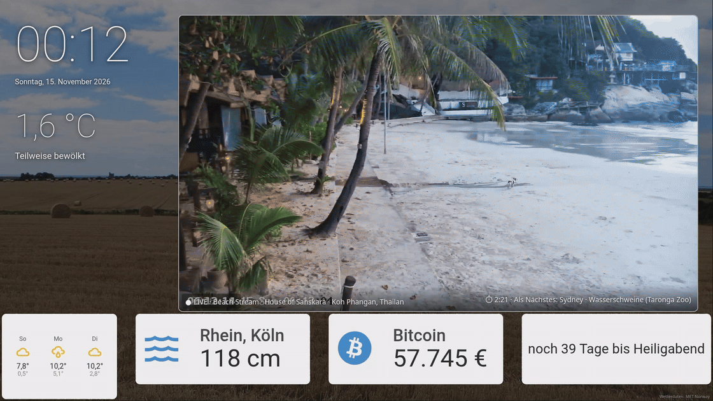

<p align="center"><sub>Aufgenommen auf einer Demo-Instanz, gekürzt: Live-Kamera und Werte wechseln von selbst. Animation läuft nicht? <a href="docs/tour/de/01-tv-wohnzimmer.jpg">Standbild</a>.</sub></p>

### Schnellstart

**Erst im Browser ausprobieren:** [**Live-Demo**](https://thefrozn.github.io/signagecast/?sprache=de) – die echte TV-Seite mit
Beispieldaten (vier Vorlagen, Tageszeit), ohne Installation, ohne Tracking. Die Verwaltung zeigt die
[Screenshot-Tour](docs/TOUR.de.md).

**Proxmox VE** – ein Befehl in der Shell des Proxmox-Hosts:

```bash
bash -c "$(curl -fsSL https://raw.githubusercontent.com/thefrozn/signagecast/main/proxmox/ct.sh)"
```

**Docker / Podman** – `SC_HOST_IP` ist die IP deines Docker-Hosts:

```bash
docker run -d --name signagecast --restart unless-stopped --device /dev/dri \
  -p 8888:8888 -p 19090:19090 -v signagecast:/data \
  -e TZ=Europe/Berlin -e SC_HOST_IP=192.168.1.20 ghcr.io/thefrozn/signagecast:latest
```

Zum Ausprobieren reicht Docker ohne `/dev/dri` (Software-Fallback) – einfach `--device /dev/dri` weglassen.

**Eigener Rechner (ISO)** – Mini-PC oder altes Notebook mit UEFI: `signagecast-server-vX.Y.Z.iso` aus dem
[neuesten Release](https://github.com/thefrozn/signagecast/releases/latest) auf einen USB-Stick schreiben und davon
starten. Der Rechner kann die TV-Seite auch selbst per HDMI zeigen – ohne zweites Gerät
([Details](docs/INSTALL.md#own-computer-installation-iso)).

Weitere Wege (Debian, Windows, QNAP, Synology) und was danach zu öffnen ist: [Installation](#installation).

SignageCast zeigt Uhr, Wetter und auf Wunsch Werte aus **Home Assistant** neben einem großen Fenster mit
**Live-Kameras von Tieren und Natur** – immer von einem Ort, an dem gerade Tag ist. Das Bild gestaltest du im
**Layout-Editor** per Ziehen und Ablegen, verwaltet wird alles im Browser, auch vom Handy. Ein kleiner Linux-Container
zeichnet die Seite und schickt sie als Video an den Fernseher – oder ein Raspberry Pi bzw. PC am Fernseher zeigt sie
direkt.

Gemacht für Wohnzimmer, Wartezimmer und Firmenempfang. Selbst betrieben, ohne Cloud und ohne Konto – frei und quelloffen.

## Was es kann

<table>
<tr>
<td valign="top" width="50%">

**Der Bildschirm**
- Fenster zur Welt: YouTube-Live-Kameras, die wechseln und schlechte Streams selbst überspringen
- Uhr, Wetter und Vorhersage weltweit (MET Norway), amtliche Unwetterwarnungen für Deutschland (DWD)
- Hintergründe, die dem echten Sonnenstand an deinem Ort folgen
- [Vorlagen für viele Orte](docs/TEMPLATES.de.md): Wohnzimmer, Wartezimmer, Empfang, Menütafel, Einkaufszentrum,
  Krankenhaus, Hotel, Fitnessstudio, Kantine, Bilderrahmen und Nacht

</td>
<td valign="top" width="50%">

**Inhalte**
- Layout-Editor mit Live-Vorschau: Bausteine aus einer Leiste ziehen, mehrere wählen, ausrichten, zoomen; Hinweise
  bei zu kleiner Schrift oder zu wenig Kontrast – oder das Layout von einer KI bauen lassen
- Inhalte direkt von Claude & Co. verwalten lassen – Computer per Klick verbinden und wieder entfernen ([MCP-Schnittstelle](docs/MCP.md#deutsch-kurz))
- Werte aus Home Assistant, eigene JSON-/RSS-Quellen (Assistent: Werte anklicken), Diagramme, Kalender
- IP-Kameras, Webseiten, PDFs, Internetradio, Einspieler zu festen Zeiten
- Meldungen, Durchsagen und ein rotes Notfall-Vollbild auf allen Fernsehern

</td>
</tr>
<tr>
<td valign="top">

**Player**
- Jeder Fernseher-Browser, der H.265 abspielt – nur eine Adresse öffnen
- Raspberry Pi oder PC aus einem fertigen Image, zentral verwaltet
- Direktmodus: der Player zeigt die Seite selbst, der Server muss nichts kodieren
- Offline-Kopie: fällt der Server oder das Netz aus, zeigt der Player sein letztes Layout weiter – auch nach einem Kaltstart ([Details](docs/PLAYER.md#offline-kopie-seit-051))
- Browser-Gerät: ein geheimer Link für Smart-TV oder Kiosk-Browser
- Player an anderen Standorten über Tailscale oder Headscale ([REMOTE.md](docs/REMOTE.md#deutsch-kurz))

</td>
<td valign="top">

**Betrieb**
- **Läuft offline:** keine Cloud, kein Konto; ohne Internet zeigt der Bildschirm eigene Medien oder ein ruhiges Bild
- **Installations-ISO** für einen eigenen Rechner, auf Wunsch mit Bild per HDMI
- Verwaltung in Cockpit, Deutsch und Englisch, mit Liste „Zu erledigen“
- Signierte Updates, die sich bei Problemen selbst zurückrollen
- Sicherung und Wiederherstellung, Benachrichtigung per Telegram, E-Mail oder Home Assistant
- Gezeichnet wird nur, während jemand zuschaut
- Bildprüfung, ruhiges Ersatzbild ohne Internet, Änderungsprotokoll und Layout-Versionen

</td>
</tr>
</table>

<details>
<summary><b>Alle Funktionen im Detail</b></summary>

- **Fenster zur Welt** – feste und automatisch gefundene YouTube-Livestreams (Safari, Meer, Vögel, Bären; auch Städte,
  Strände, Berge, Häfen, Flughäfen, Züge, Weltraum und Naturwunder – einschalten, was dir gefällt), wechseln alle paar
  Minuten, nur wo gerade Tag ist. Schlechte Streams (startet nicht, puffert, steht, niedrige Auflösung) werden
  übersprungen; Favoriten lassen sich schützen, unerwünschte ablehnen. Für den privaten Gebrauch – siehe
  [YouTube und gewerbliche Nutzung](#youtube-und-gewerbliche-nutzung).
- **Live-Videos** – ein eigener Bereich für die Sammlung (Liste mit Seitenfeld), Themen mit Suchbegriffen,
  automatische Stream-Suche mit Regeln, Einspieler.
- **Layout-Editor** – Uhr, Datum, Wetter, Vorhersage, Räume, Kacheln mit beliebigen Home-Assistant-Werten, Live-Video,
  Radio, freier Text und Laufband, Logo, Kamera, Kalender/Müllabfuhr, Meldungen aus Home Assistant. Bedingungen („nur
  zeigen, wenn …“), Schriften, Farben, 9 Textpositionen. Die Leinwand zeigt die **echte TV-Seite als Live-Vorschau**
  schon vor dem Speichern; Bausteine kommen aus einer Leiste (anklicken oder ziehen), mehrere lassen sich zusammen
  verschieben, ausrichten und verteilen, mit Rückgängig/Wiederholen und Tastenkürzeln. Die Einstellungen eines
  Bausteins sind in *Inhalt*, *Aussehen* und *Wann* geteilt, mit kurzer Hilfe je Feld; Zoom bis 200 %. **Hinweise (⚠)**
  markieren Schrift, die aus 3 m zu klein ist, wenig Kontrast oder Inhalt, der nicht passt.
- **Eigene Datenquellen** – beliebige JSON-API, RSS-/Atom-Feed oder Bildadresse, abgeholt in deinem Takt (`curl`-Befehl
  einfügen, Werte in der Antwort anklicken). Bausteine: Wert, Liste/Feed (auch als Laufband), Bild, Anzeige, Countdown,
  QR-Code, Platzhalter wie `{quelle:pfad}` in jedem Text.
- **Kameras, Diagramme, Kalender, Webseiten** – IP-Kameras (RTSP, HLS, MJPEG; z. B. die Türklingel nur, wenn es
  klingelt), Verlaufsdiagramme, Kalender aus iCal-Adressen oder hochgeladenen .ics/.csv-Dateien, Webseiten live oder
  als regelmäßiges Bildschirmfoto.
- **Vorlagen für viele Orte** – 16 fertige Layouts: Standard, Video groß, Nur Video, Info ohne Video, *Fenster zur
  Welt*, *Galerie Vollbild*, Nacht, *Praxis – ruhig*, *Praxis – Info*, *Firma – Corporate Design*, *Imbiss –
  Menütafel*, *Einkaufszentrum – Info*, *Krankenhaus – Foyer*, *Hotel / Pension – Lobby*, *Fitnessstudio / Verein* und
  *Kantine – Speiseplan*; jede ein Startpunkt, den du im Editor anpasst ([Bilder](docs/TEMPLATES.de.md)).
- **Listen** – Speisekarten mit Preisen, Öffnungszeiten, Wegweiser mit Etagen: im Editor getippt oder aus einer CSV-Datei.
- **Hintergründe nach Tageszeit** – Bildersets für Sonnenaufgang, Tag, Sonnenuntergang und Nacht, Wetterbilder,
  Diashow oder eigene Bilder.
- **Internetradio** – eigene Streams oder Vorschläge für deinen Ort; oder der Originalton der Kameras. An öffentlichen
  oder gewerblichen Orten braucht es eine Musiklizenz (z. B. GEMA) – siehe [YouTube und gewerbliche Nutzung](#youtube-und-gewerbliche-nutzung).
- **Einspieler zu festen Zeiten** – z. B. *tagesschau in 100 Sekunden* zur vollen Stunde.
- **Mehrere Fernseher** – jeder mit eigener Adresse, eigenem Layout, Zeitplan, Ton und eigenen Themen.
- **Raspberry Pi als Player** (experimentell) – ein fertiges SD-Karten-Image je Bildschirm (mit WLAN, Hotspot mit
  QR-Code als Rückfall) oder ein Image für viele Pis mit Kopplungscode; Zustand, Bildschirmfoto, Fernseher ein/aus per
  HDMI-CEC, Drehung, Updates; auf Wunsch ein Terminal im Browser. [PLAYER.md](docs/PLAYER.md)
- **PC als Player** (experimentell) – ein PC oder Thin Client (x86-64, UEFI, Secure Boot darf an bleiben) startet vom
  USB-Stick und zeigt die Seite selbst. [PLAYER.md](docs/PLAYER.md#pc-as-player-since-036-experimental)
- **Offline-Betrieb** – keine Cloud und kein Konto; alles läuft auf deinem eigenen Server. Ohne Internet zeigt das
  Videofenster eigene Medien oder ein ruhiges Bild zur Tageszeit (keine Fehlermeldung am Fernseher), Werte behalten
  ihren letzten Stand. **Offline-Kopie** (seit 0.51): Player im Direktmodus zeigen ihr letztes Layout weiter, wenn
  Server oder Netz ausfallen – auch nach einem Neustart – und markieren das mit einer kleinen durchgestrichenen
  Weltkugel ([Details](docs/PLAYER.md#offline-kopie-seit-051)).
- **Installations-ISO** (seit 0.52) – für einen Mini-PC oder ein altes Notebook ohne Proxmox: der offizielle
  Debian-13-Installer mit vorbereiteten Antworten auf einem USB-Stick (UEFI, Secure Boot darf an bleiben); auf Wunsch
  zeigt der Rechner einen Kanal selbst per HDMI ([Details](docs/INSTALL.md#own-computer-installation-iso)). Noch nicht
  auf vielen echten Rechnern getestet.
- **Meldungen und Benachrichtigungen** – DWD-Warnungen als Baustein (nur Deutschland; das Wetter selbst weltweit über MET Norway); Banner aus anderen Systemen per Webhook;
  Benachrichtigungen, wenn ein Fernseher ausfällt, ein Update oder eine Sicherung scheitert oder Home Assistant getrennt ist.
- **Bausteine mit Zeitraum** – z. B. „Vom 23.12. bis 2.1. geschlossen“ erscheint und verschwindet von selbst.
- **Notfall-Vollbild und Durchsage-Pult** – eine rote Vollbild-Meldung auf allen Fernsehern; eine eigene Empfangsseite,
  die Aufrufe wie „Frau Becker bitte in Raum 2“ schickt, offline vorgelesen (Piper) – und, wenn erlaubt,
  Laufband-Meldungen, ein Layout für eine Weile und Fernseher ein/aus.
- **Strom sparen** – Zeitpläne schalten einen Fernseher in den Nachtmodus oder auf Schwarz, über Home Assistant auch
  wirklich aus und an.
- **Läuft unbeaufsichtigt** – eine Bildprüfung bemerkt einen schwarzen oder stehenden Fernseher und repariert ihn
  (neu laden, neu starten, melden).
- **Änderungsprotokoll und Layout-Versionen** – wer wann was geändert hat (Verwaltung, Pult, Webhook, System – nie
  Werte); die letzten 10 Fassungen jedes Layouts, auch gelöschter.
- **KI-Assistenten per MCP** – Claude, Cursor, VS Code und andere Assistenten verwalten Layouts, Fernseher, Laufbänder,
  Bilder und Streams und schauen sich Vorschaubilder an; Computer per Klick in der Verwaltung verbinden (Claude
  Desktop: eine Datei zum Doppelklicken) und jederzeit wieder entfernen; jede Änderung landet im Protokoll
  ([MCP.md](docs/MCP.md#deutsch-kurz)). Seit 0.60 auch Vorlagen, Datenquellen, Dateien (PDF, Medien, Galerie), Themen,
  Stream-Suche, Einspieler und Radio – und `preview` liefert dieselben Lesbarkeits-Hinweise wie der Layout-Editor
  (Schriftgröße, Kontrast, Überlauf).
- **Layouts von einer KI** – die Anleitung mit dem vollständigen [Layout-Format](docs/LAYOUT-FORMAT.md) in ChatGPT,
  Claude oder Gemini kopieren und die Antwort einfügen; der Import repariert, was geht, und sagt was.

</details>

Rundgang mit Bildern aller Bereiche: [Tour](docs/TOUR.de.md).

### Vorlagen für viele Orte

<table>
<tr>
<td width="33%" align="center"><a href="docs/templates/praxis.de.md">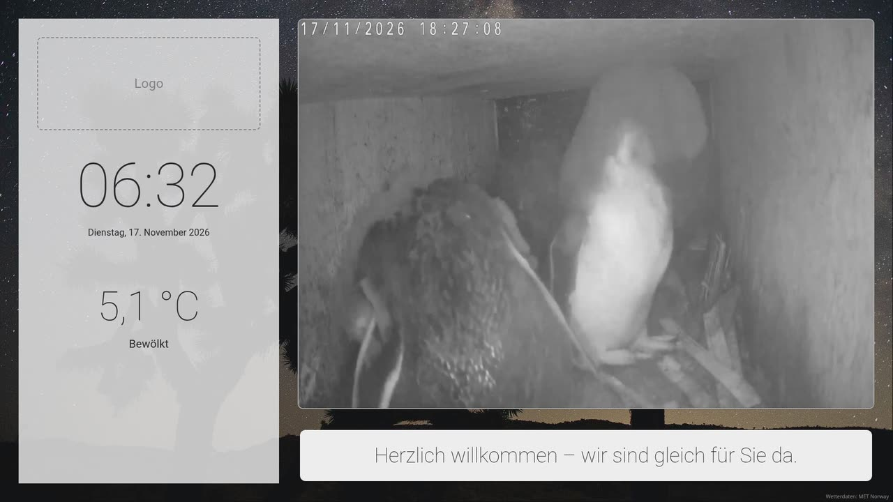</a><br><sub>Wartezimmer</sub></td>
<td width="33%" align="center"><a href="docs/templates/firma.de.md">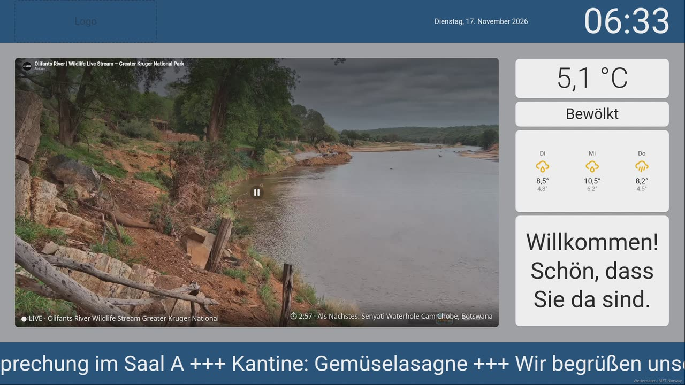</a><br><sub>Empfang</sub></td>
<td width="33%" align="center"><a href="docs/templates/imbiss.de.md">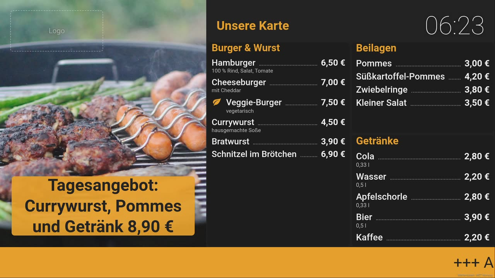</a><br><sub>Menütafel</sub></td>
</tr>
<tr>
<td align="center"><a href="docs/templates/klinik.de.md">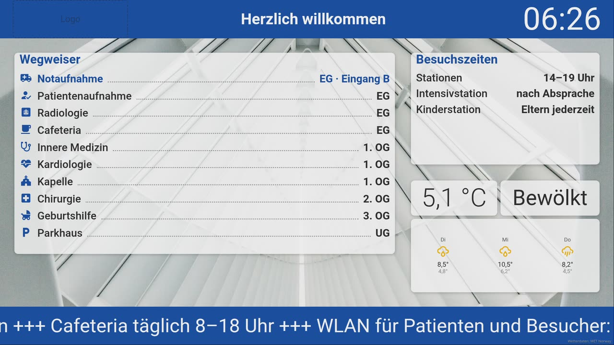</a><br><sub>Krankenhaus</sub></td>
<td align="center"><a href="docs/templates/hotel.de.md">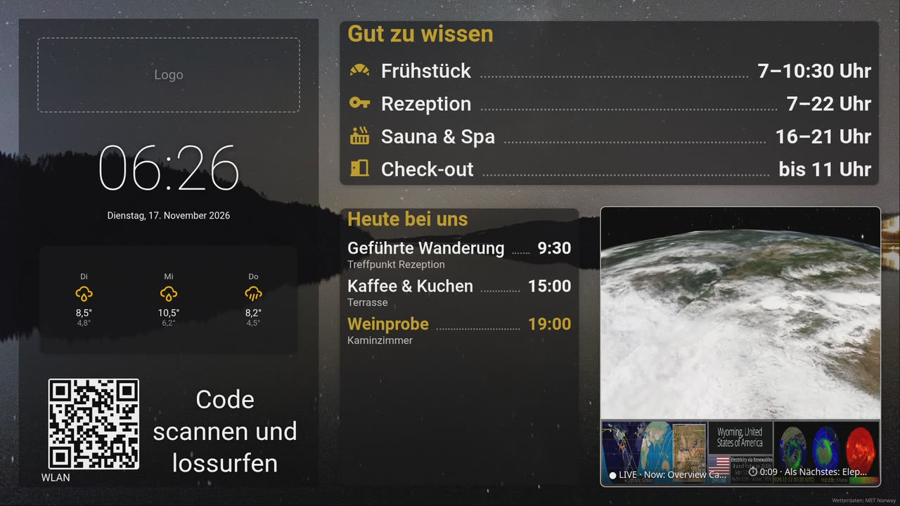</a><br><sub>Hotel-Lobby</sub></td>
<td align="center"><a href="docs/templates/kantine.de.md">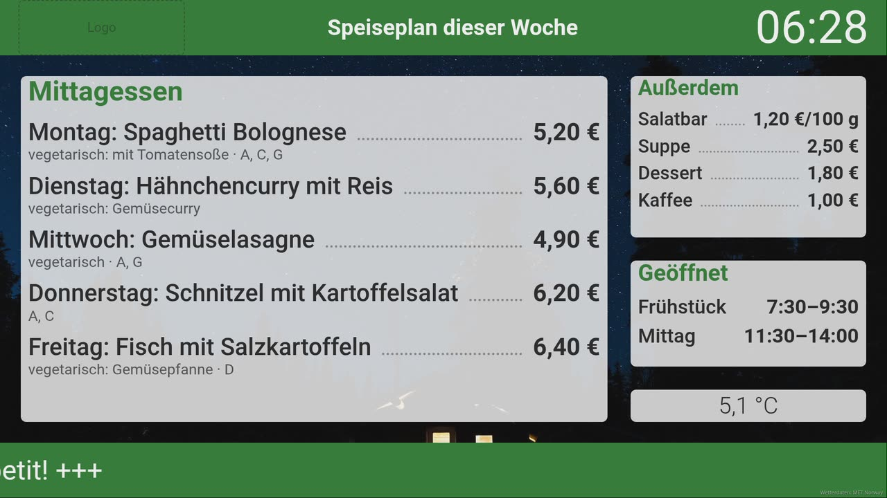</a><br><sub>Kantine</sub></td>
</tr>
</table>
<p align="center"><a href="docs/TEMPLATES.de.md">Alle 16 Vorlagen – jede mit bewegtem Bild und den verwendeten Bausteinen</a></p>

### Verwaltung, Offline und Installation

<table>
<tr>
<td width="50%" align="center">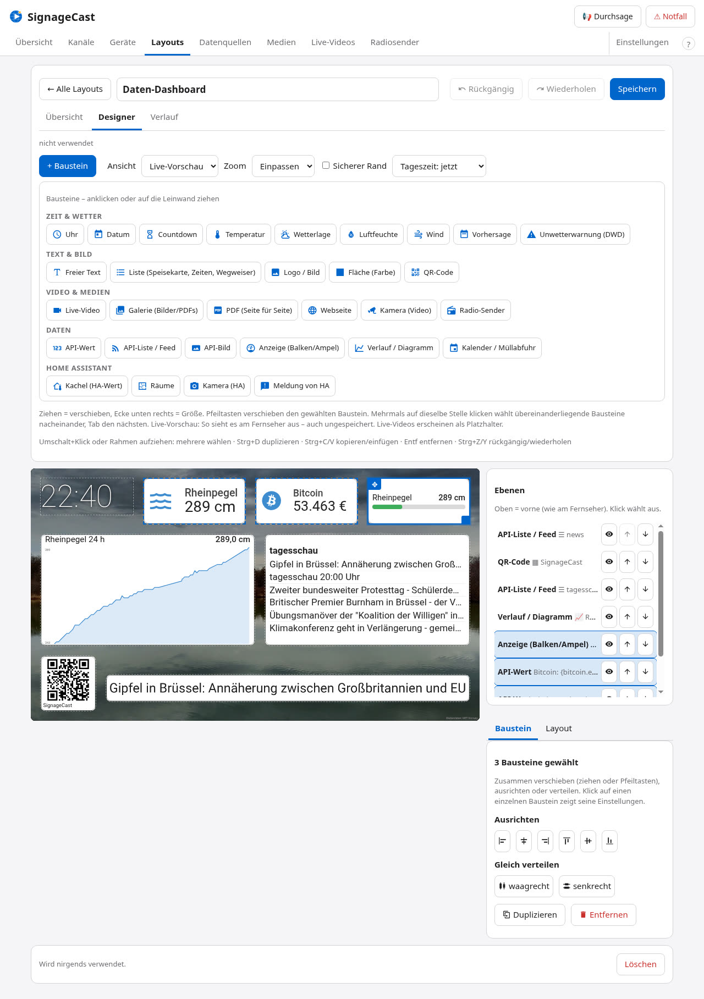<br><sub>Layout-Editor mit Live-Vorschau</sub></td>
<td width="50%" align="center">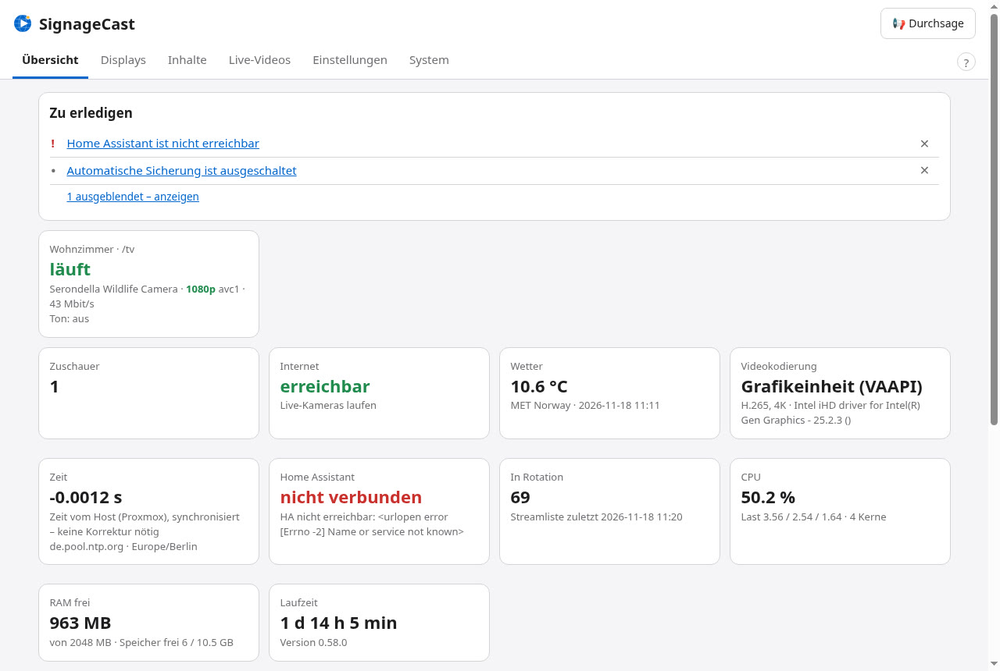<br><sub>Übersicht aller Bildschirme</sub></td>
</tr>
<tr>
<td align="center">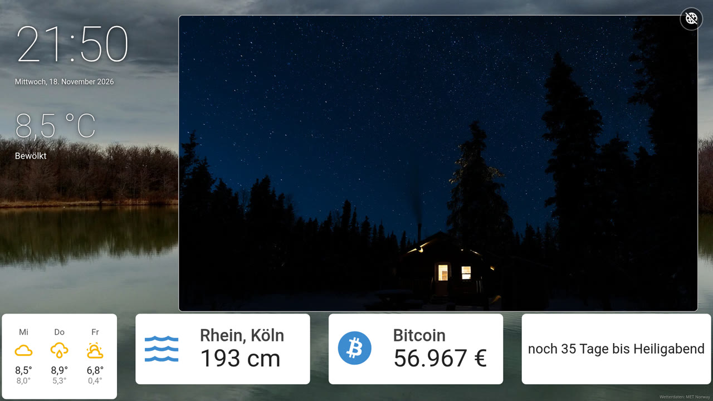<br><sub>Offline: der Player zeigt sein letztes Layout weiter</sub></td>
<td align="center">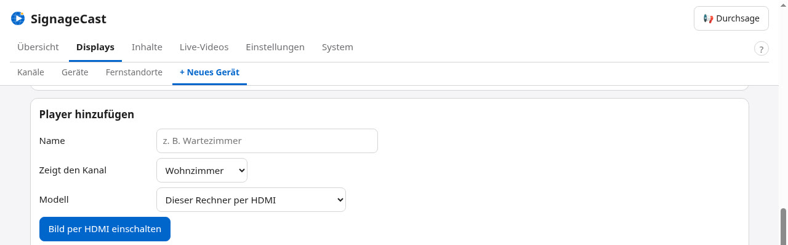<br><sub>Mit der ISO installiert: Bild per HDMI</sub></td>
</tr>
</table>

## Installation

Nötig ist ein **x86-Rechner mit Intel-Grafik** (z. B. Mini-PC mit Intel N100) und ein Fernseher, dessen Browser H.265
abspielt – oder ein Raspberry Pi bzw. PC als Player. Ohne nutzbare Grafik läuft ein Notbetrieb in Full HD. Mehr:
[Hardware](docs/HARDWARE.md#deutsch-kurz).

| Wo | Wie | Anleitung |
|---|---|---|
| **Proxmox VE** | ein Befehl in der Shell des Proxmox-Hosts (unten) | [Installation](docs/INSTALL.md#proxmox-ve) |
| **Eigener Rechner** (Mini-PC, Laptop) | Installations-ISO auf einen USB-Stick – Debian-Installer, auf Wunsch mit Bild per HDMI | [Installation](docs/INSTALL.md#own-computer-installation-iso) |
| **Debian 13** (LXC, VM, PC) | `curl -fsSL https://raw.githubusercontent.com/thefrozn/signagecast/main/install.sh \| sh` | [Installation](docs/INSTALL.md#debian-13) |
| **Docker / Podman** | `docker run …` oder [`compose.yaml`](compose.yaml) | [Installation](docs/INSTALL.md#docker--podman) |
| **Windows-PC** | Docker Desktop + ein PowerShell-Befehl (Full HD) – *noch nicht auf echtem Windows getestet* | [Windows-Anleitung](docs/install/WINDOWS.md#deutsch) |
| **QNAP-NAS** | per Maus in der Container Station | [QNAP-Anleitung](docs/install/QNAP.md) |
| **Synology-NAS** | per Maus im Container Manager | [Synology-Anleitung](docs/install/SYNOLOGY.md) |

```bash
bash -c "$(curl -fsSL https://raw.githubusercontent.com/thefrozn/signagecast/main/proxmox/ct.sh)"
```

Danach die Verwaltung öffnen – **https://&lt;IP&gt;:9090** (Proxmox/Debian, Benutzer `tvadmin`) oder
**http://&lt;Host&gt;:19090** (Docker/NAS, Passwort im Container-Protokoll) –, dem kurzen Assistenten folgen und am
Fernseher **http://&lt;IP&gt;:8888/tv** öffnen.

## Grundsätze

Drei Ziele sind gleich wichtig – keins wird für ein anderes geopfert:

- **Stabil** – ein Bildschirm läuft monatelang ohne Betreuung; jeder Teil startet sich selbst neu, Updates rollen bei Fehlern zurück.
- **Sicher** – signierte Versionen, Geheimnisse bleiben auf dem Server, nichts lauscht ohne Grund, keine Cloud nötig.
- **Sparsam** – läuft auf einem kleinen Mini-PC; jede Version wird vor dem Veröffentlichen gemessen (CPU, Speicher, verlorene Bilder).

## Danke

Besonderer Dank an **[RaspiSignage](https://github.com/boschkundendienst/raspisignage)** von boschkundendienst – das
Raspberry-Pi-Signage-Projekt war die Inspiration für einen selbst betriebenen Bildschirm, den „normale“ Menschen im
Browser verwalten. SignageCast enthält keinen Code daraus, der Ansatz (Zeichnen und Streamen auf dem Server) ist ein anderer.

## Hilfe

Fragen, Ideen und deinen Bildschirm zeigen: [GitHub Discussions](https://github.com/thefrozn/signagecast/discussions).
Fehler: [GitHub-Issues](https://github.com/thefrozn/signagecast/issues).

## Lizenz

MIT – siehe [LICENSE](LICENSE). Bilder, Symbole und die Schrift des Logos: siehe [NOTICE.md](NOTICE.md).

## YouTube und gewerbliche Nutzung

Die Live-Kameras kommen über den offiziellen Einbett-Player von YouTube. Die YouTube-Bedingungen erlauben **nur die
private, nicht-gewerbliche Nutzung**. Wer SignageCast in Praxis, Laden, Gaststätte, Hotel, Verein oder an einem anderen
öffentlichen oder gewerblichen Ort betreibt, ist für das Zeigen von YouTube-Streams dort selbst verantwortlich: YouTube-
Bedingungen, Bedingungen des Kamera-Betreibers und – bei Ton – GEMA prüfen. Der einfache Weg: **nur eigene Medien**
zeigen. Die Geschäftsvorlagen tun das ab 0.61 (Videofenster → *Was zeigen* → „nur eigene Medien“); bei anderen Layouts
dort einstellen oder je Kanal (Displays → Kanäle → *Videofenster zeigt*). Im **Stream-Modus** nimmt der Server das Bild
auf und gibt es an die Fernseher weiter; für den privaten Gebrauch zu Hause ist das in Ordnung – gewerblich oder
öffentlich besser den **Direktmodus** nehmen, dann spielt jeder Fernseher den offiziellen Player selbst, oder beim Kanal
*YouTube auch im Stream-Modus zeigen* ausschalten (seit 0.63; der Stream zeigt dann eigene Medien, Fernseher und Player
im Direktmodus behalten YouTube).

**Suche und Prüfung:** Ohne weitere Einrichtung ruft SignageCast öffentliche YouTube-Seiten automatisch ab (nächtliche
Suche, Live-Prüfung) – sparsam und mit Pause, wenn YouTube „zu viele Anfragen“ meldet, aber die YouTube-Bedingungen
erlauben automatisierten Abruf eigentlich nicht. Seit 0.63 lässt sich ein eigener, kostenloser Schlüssel für die
**YouTube Data API v3** eintragen (mit echtem Schlüssel noch ungetestet) (Live-Videos → Automatik): Suche und Prüfung laufen dann über die offizielle
Schnittstelle (etwa 100 Einheiten je Suchbegriff und Nacht, 10 000 am Tag frei). Oder die Suche ausschalten und nur
selbst eingetragene Streams behalten.

**Musik und Ton in der Öffentlichkeit:** Sobald SignageCast an einem öffentlichen oder gewerblichen Ort Ton abspielt –
Internetradio, Originalton der Live-Kameras, Einspieler oder eigene Videos –, ist das eine öffentliche Wiedergabe. Dafür
braucht es fast überall eine Lizenz der zuständigen Verwertungsgesellschaft, z. B. GEMA (Deutschland), AKM (Österreich),
SUISA (Schweiz), PRS for Music/PPL (Großbritannien), ASCAP, BMI, SESAC oder GMR (USA), SACEM (Frankreich) oder SIAE
(Italien). Dass ein Sender frei im Internet zu hören ist, ersetzt diese Lizenz nicht. Wer SignageCast öffentlich nutzt,
muss sich selbst darum kümmern – ohne Lizenz am besten den Ton ausschalten oder nur selbst lizenzierte Musik verwenden.
Zu Hause gilt das nicht. Das ist keine Rechtsberatung.

## Haftung und Gewährleistung

SignageCast ist kostenlos und wird ohne Gegenleistung bereitgestellt; die Nutzung erfolgt auf eigene Gefahr. Gehaftet
wird nur für Vorsatz und grobe Fahrlässigkeit sowie für Schäden aus der Verletzung von Leben, Körper oder Gesundheit,
soweit das Gesetz dies zwingend vorschreibt (für Mängel nur bei arglistigem Verschweigen). Keine Gewähr für
Verfügbarkeit und Fehlerfreiheit, für Inhalte und Dienste Dritter (z. B. YouTube-Streams, Datenquellen, Wetter,
Tailscale) sowie für Schäden an Geräten, Daten oder Netzen. Vor Updates eine Sicherung anlegen; Fernzugriff,
Fernwartung und angebundene Dienste liegen in der Verantwortung des Betreibers. Die Haftungsregeln der
[MIT-Lizenz](LICENSE) gelten daneben, soweit sie nach deutschem Recht wirksam sind.
