<p align="center">
  <picture>
    <source media="(prefers-color-scheme: dark)" srcset="docs/logo/signagecast-wortmarke-dunkel.svg">
    
  </picture>
</p>

<p align="center"><strong>Turn any TV into a calm information screen – with live wildlife cams from around the world.</strong></p>

<p align="center">
  <a href="https://github.com/thefrozn/signagecast/releases/latest"></a>
  <a href="https://github.com/thefrozn/signagecast/actions/workflows/tests.yml"></a>
  <a href="LICENSE"></a>
</p>

<p align="center">
  <a href="#installation"><b>Install</b></a> ·
  <a href="docs/TOUR.md"><b>Tour</b></a> ·
  <a href="https://thefrozn.github.io/signagecast/?sprache=en"><b>Live demo</b></a> ·
  <a href="docs/TEMPLATES.md"><b>Templates</b></a> ·
  <a href="docs/PLAYER.md">Players</a> ·
  <a href="docs/MANUAL.md">Manual &amp; FAQ</a> ·
  <a href="docs/MCP.md">AI assistants (MCP)</a> ·
  <a href="docs/HOW-IT-WORKS.md">How it works</a> ·
  <a href="CHANGELOG.md">Changelog</a> ·
  <a href="README.de.md">Deutsch</a>
</p>

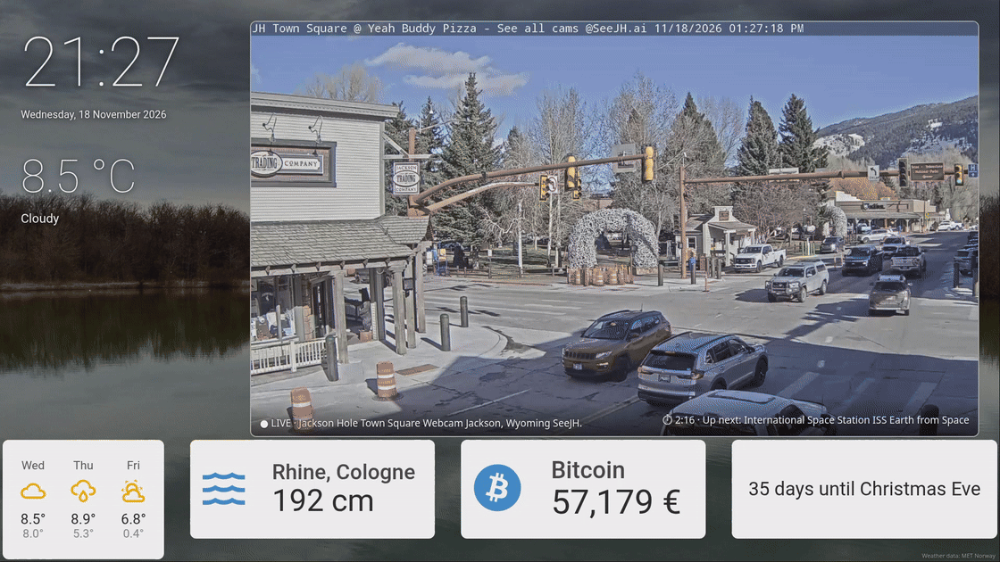

<p align="center"><sub>Recorded on a demo instance, shortened: the live cam and the values change by themselves. Animation not playing? <a href="docs/tour/01-tv-living-room.jpg">Still picture</a>.</sub></p>

### Quick start

**Try it first in the browser:** [**live demo**](https://thefrozn.github.io/signagecast/?sprache=en) – the real TV page with
sample data (four templates, time of day), no installation, no tracking. The admin is shown in the
[screenshot tour](docs/TOUR.md).

**Proxmox VE** – one command on the shell of the Proxmox host:

```bash
bash -c "$(curl -fsSL https://raw.githubusercontent.com/thefrozn/signagecast/main/proxmox/ct.sh)"
```

**Docker / Podman** – `SC_HOST_IP` is the IP of your Docker host:

```bash
docker run -d --name signagecast --restart unless-stopped --device /dev/dri \
  -p 8888:8888 -p 19090:19090 -v signagecast:/data \
  -e TZ=Europe/Berlin -e SC_HOST_IP=192.168.1.20 ghcr.io/thefrozn/signagecast:latest
```

To try it out, Docker without `/dev/dri` is enough (software fallback) – just leave out `--device /dev/dri`.

**Own computer (ISO)** – mini PC or old laptop with UEFI: write `signagecast-server-vX.Y.Z.iso` from the
[latest release](https://github.com/thefrozn/signagecast/releases/latest) to a USB stick and boot from it. The
computer can also show the TV page itself via HDMI – no second device needed
([details](docs/INSTALL.md#own-computer-installation-iso)).

Other ways (Debian, Windows, QNAP, Synology) and what to open afterwards: [Installation](#installation).

SignageCast shows clock, weather and – if you like – values from **Home Assistant** next to a large window with **live
nature and wildlife cams**, always from a place where it is daytime. You design the screen in a **drag-and-drop editor**
and manage everything in the browser, also from your phone. A small Linux container draws the page and streams it to the
TV as video, or a Raspberry Pi or PC at the TV shows it directly.

Made for living rooms, waiting rooms and company receptions. Self-hosted, no cloud, no account – free and open source.

## What it does

<table>
<tr>
<td valign="top" width="50%">

**The screen**
- Live window to the world: YouTube live cams that rotate and skip bad streams by themselves
- Clock, weather and forecast worldwide (MET Norway), official severe weather warnings for Germany (DWD)
- Backgrounds that follow the real sun at your location
- [Templates for many places](docs/TEMPLATES.md): living room, waiting room, reception, menu board, shopping centre,
  hospital, hotel, gym, canteen, picture frame and night

</td>
<td valign="top" width="50%">

**Content**
- Layout editor with live preview: drag elements from a bar, select several, align, zoom; notes on text that is too
  small or has too little contrast – or let an AI build a layout
- Home Assistant values, own JSON/RSS sources (assistant: pick values by clicking), charts, calendars
- IP cameras, web pages, PDFs, internet radio, clips at fixed times
- Messages, announcements and a red emergency screen on all TVs

</td>
</tr>
<tr>
<td valign="top">

**Players**
- Any TV browser that plays H.265 – just open one address
- Raspberry Pi or PC from a ready image, managed centrally
- Direct mode: the player shows the page itself, no encoding on the server
- Offline copy: if the server or the network fails, the player keeps showing its last layout – also after a cold start ([details](docs/PLAYER.md#offline-copy-since-051))
- Browser device: a secret link for a smart TV or kiosk browser
- Players at another site through Tailscale or Headscale ([REMOTE.md](docs/REMOTE.md))

</td>
<td valign="top">

**Operation**
- **Works offline:** no cloud, no account; without internet the screen shows your own media or a calm picture
- **Installation ISO** for a computer of its own, optionally with the picture via HDMI
- Admin in Cockpit, German and English, with a to-do list
- Signed updates that roll back by themselves
- Backup and restore, notifications via Telegram, e-mail or Home Assistant
- Rendering runs only while someone watches
- Picture check, calm fallback when the internet is gone, change log and layout versions

</td>
</tr>
</table>

<details>
<summary><b>All features in detail</b></summary>

- **Live window to the world** – fixed and automatically discovered YouTube live streams (safari, sea, birds, bears;
  also cities, beaches, mountains, harbours, airports, trains, space and natural wonders – switch on what you like),
  rotating every few minutes, only where it is daytime. Bad streams (not starting, buffering, frozen, low resolution)
  are skipped; favourites can be protected, unwanted ones rejected. For private use – see
  [YouTube and commercial use](#youtube-and-commercial-use).
- **Layout editor** – clock, date, weather, forecast, rooms, tiles with any Home Assistant value, live video, radio,
  free text and ticker, logo, camera, calendar / waste collection, messages from Home Assistant. Conditions (“only show
  when …”), fonts, colours, 9 text positions. The canvas shows the **real TV page as live preview** before saving;
  elements come from a bar (click or drag), several can be moved, aligned and distributed together, undo/redo and
  shortcuts. Each element's settings are split into *Content*, *Look* and *When* with a short help per field; zoom up to
  200 %. **Notes (⚠)** mark text that is too small to read from 3 m, low contrast or content that does not fit.
- **Your own data sources** – any JSON API, RSS/Atom feed or picture address, fetched at your interval (paste a `curl`
  command, pick values by clicking in the response). Elements: value, list / feed (also as ticker), picture, gauge,
  countdown, QR code, placeholders like `{source:path}` in any text.
- **Cameras, charts, calendars, web pages** – IP cameras (RTSP, HLS, MJPEG; e.g. the doorbell only when it rings),
  history charts, calendars from iCal addresses or uploaded .ics/.csv files, web pages live or as a regular screenshot.
- **Templates for many places** – 16 ready layouts: Standard, Large video, Video only, Info without video, *Window to
  the world*, *Gallery full screen*, Night, *Practice – calm*, *Practice – info*, *Company – corporate design*, *Snack
  bar – menu board*, *Shopping centre – info*, *Hospital – lobby*, *Hotel / guest house – lobby*, *Gym / sports club* and *Canteen – weekly
  menu*; each one a starting point you change in the editor ([pictures](docs/TEMPLATES.md)).
- **Lists** – menus with prices, opening hours, directories with floors: typed in the editor or from a CSV file.
- **Backgrounds by time of day** – picture sets for sunrise, day, sunset and night, weather pictures, slideshow or your
  own pictures.
- **Internet radio** – own streams or suggestions for your location; or the original sound of the cams. In public or
  business places you need a music licence (e.g. GEMA) – see [YouTube and commercial use](#youtube-and-commercial-use).
- **Clips at fixed times** – e.g. *tagesschau in 100 Sekunden* on the hour.
- **Several TVs** – each with its own address, layout, schedule, sound and topics.
- **Live videos** – one area for the collection (list with panel), topics with search words, automatic stream search
  and rules, clips.
- **Raspberry Pi as player** (experimental) – a ready SD card image per screen (Wi-Fi included, hotspot with QR code
  as fallback) or one image for many Pis with a pairing code; status, screenshot, TV on/off via HDMI-CEC, rotation,
  updates; optional terminal in the browser. [PLAYER.md](docs/PLAYER.md)
- **PC as player** (experimental) – a PC or thin client (x86-64, UEFI, Secure Boot may stay on) starts from a USB stick
  and shows the page itself. [PLAYER.md](docs/PLAYER.md#pc-as-player-since-036-experimental)
- **Messages and notifications** – DWD warnings as an element (Germany only; weather itself works worldwide via MET Norway); banners from other systems via a webhook; notifications
  when a TV fails, an update or backup fails or Home Assistant is disconnected.
- **Elements with a period** – e.g. “Closed from 23 Dec to 2 Jan” appears and disappears by itself.
- **Emergency screen and announcement panel** – a red full-screen message on all TVs; a separate reception page that
  sends calls like “Mrs Baker, please go to room 2”, read aloud offline (Piper) – and, if allowed, ticker messages,
  a layout for a while and switching TVs on/off.
- **Energy saving** – schedules switch a TV to night mode or black, and really off and on via Home Assistant.
- **Offline mode** – no cloud and no account; everything runs on your own server. Without internet the video window
  shows your own media or a calm picture by time of day (no error on the TV), values keep their last state. **Offline
  copy** (since 0.51): players in direct mode keep showing their last layout when the server or the network fails –
  also after a restart – and mark it with a small crossed-out globe ([details](docs/PLAYER.md#offline-copy-since-051)).
- **Installation ISO** (since 0.52) – for a mini PC or old laptop without Proxmox: the official Debian 13 installer with
  preset answers on a USB stick (UEFI, Secure Boot may stay on); optionally the computer shows a channel itself via
  HDMI ([details](docs/INSTALL.md#own-computer-installation-iso)). Not tested on many real computers yet.
- **Built to run unattended** – when the internet is gone the video window shows your own media or a calm picture
  instead of an error; a picture check notices a black or frozen TV and repairs it (reload, restart, notify).
- **Change log and layout versions** – who changed what and when (admin, panel, webhook, system – never values); the
  last 10 versions of every layout, also of deleted ones.
- **AI assistants via MCP** – Claude, Cursor, VS Code and other assistants manage layouts, TVs, tickers, pictures
  and streams, look at preview pictures; connect a computer with one click in the admin (Claude Desktop: a file to
  double-click), remove it any time; every change lands in the log ([MCP.md](docs/MCP.md)). Since 0.60 also templates,
  data sources, files (PDF, media, gallery), topics, stream search, clips and radio – and `preview` returns the same
  readability notes as the layout editor (text size, contrast, fit).
- **Layouts from an AI** – copy the instructions with the complete [layout format](docs/LAYOUT-FORMAT.md) into
  ChatGPT, Claude or Gemini and paste the answer; the import repairs what it can and tells you what.

</details>

### Templates for many places

<table>
<tr>
<td width="33%" align="center"><a href="docs/templates/praxis.md">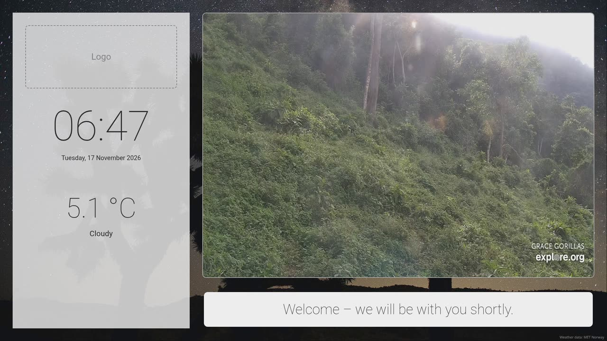</a><br><sub>Waiting room</sub></td>
<td width="33%" align="center"><a href="docs/templates/firma.md">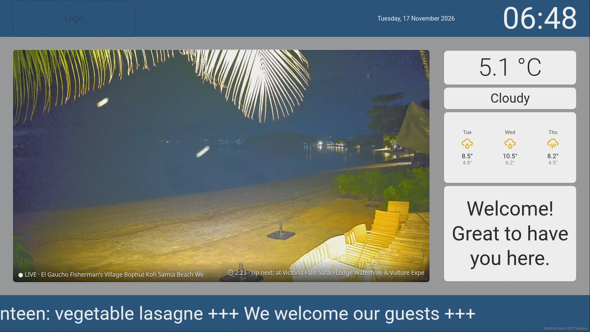</a><br><sub>Reception</sub></td>
<td width="33%" align="center"><a href="docs/templates/imbiss.md">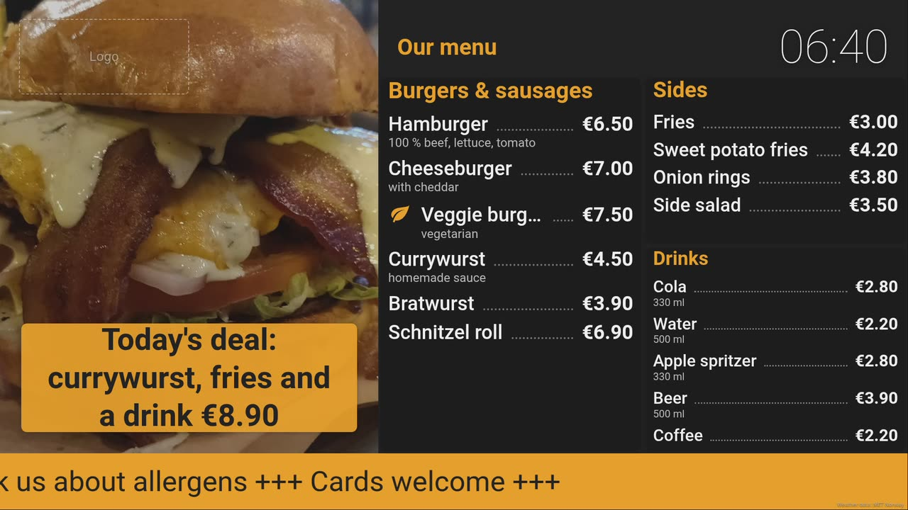</a><br><sub>Menu board</sub></td>
</tr>
<tr>
<td align="center"><a href="docs/templates/klinik.md">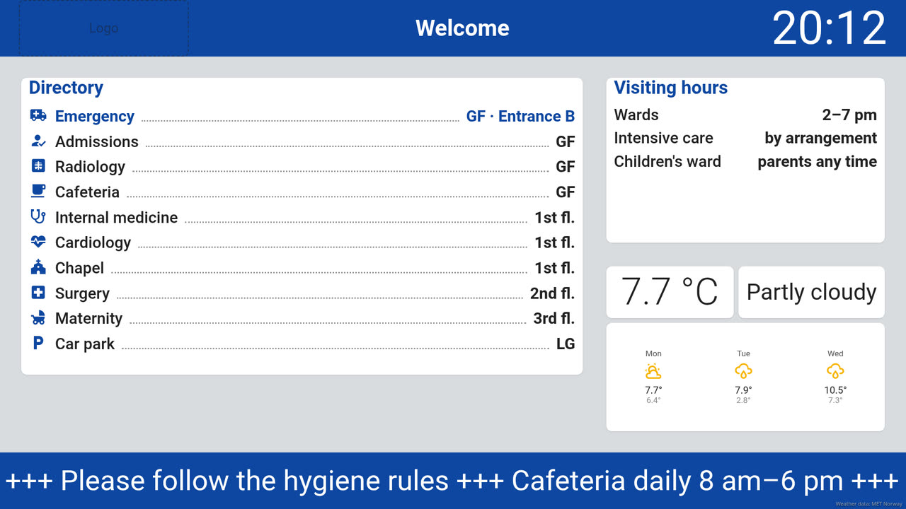</a><br><sub>Hospital lobby</sub></td>
<td align="center"><a href="docs/templates/hotel.md">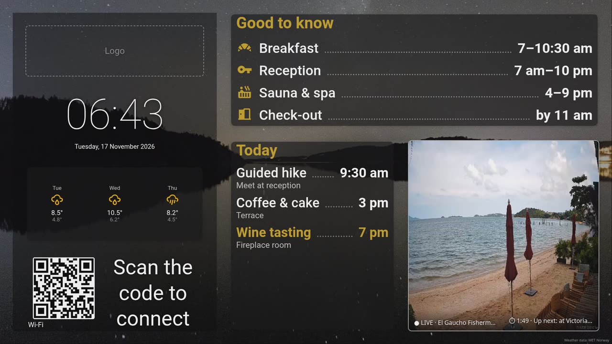</a><br><sub>Hotel lobby</sub></td>
<td align="center"><a href="docs/templates/kantine.md">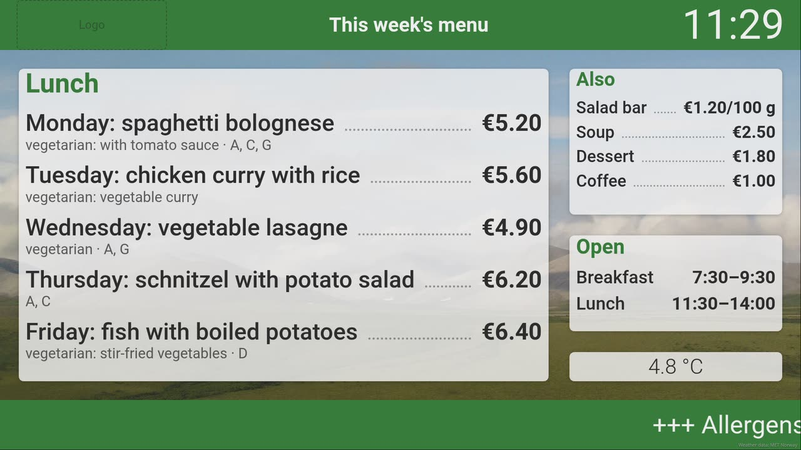</a><br><sub>Canteen</sub></td>
</tr>
</table>
<p align="center"><a href="docs/TEMPLATES.md">All 16 templates – each with a moving picture and the elements used</a></p>

### Admin, offline and installation

<table>
<tr>
<td width="50%" align="center">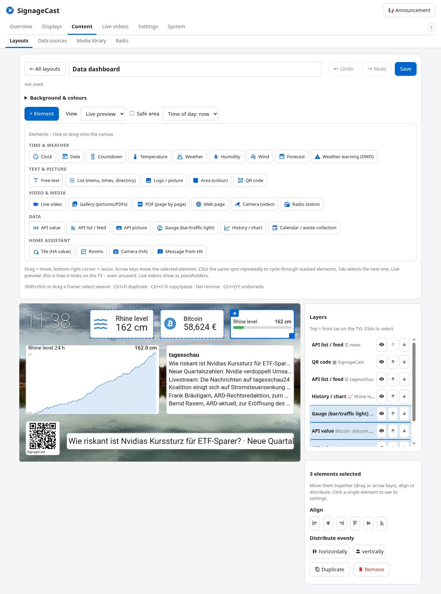<br><sub>Layout editor with live preview</sub></td>
<td width="50%" align="center">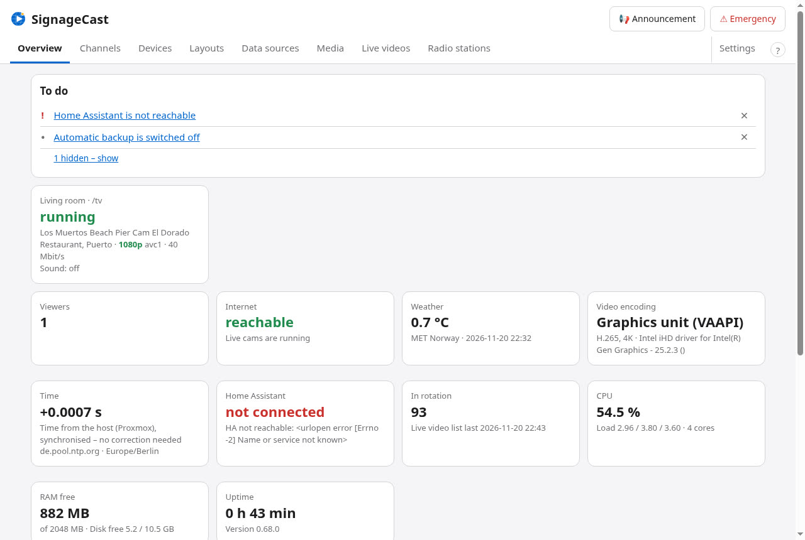<br><sub>Overview of all screens</sub></td>
</tr>
<tr>
<td align="center">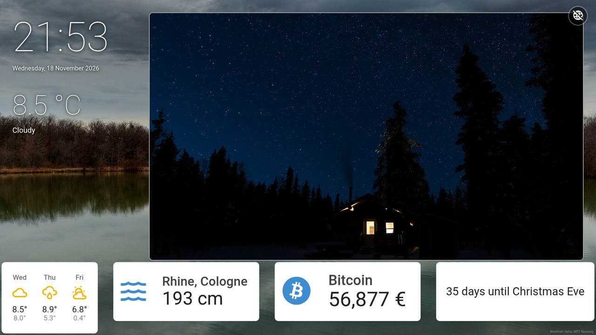<br><sub>Offline: the player keeps its last layout</sub></td>
<td align="center">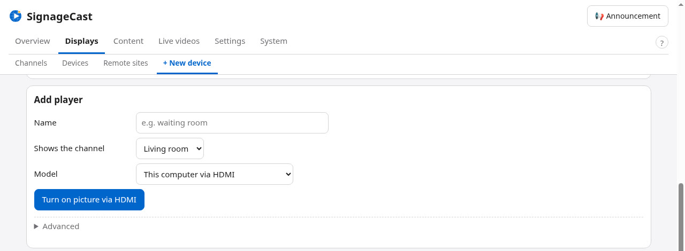<br><sub>Installed from the ISO: picture via HDMI</sub></td>
</tr>
</table>

## Installation

You need an **x86 computer with Intel graphics** (e.g. a mini PC with Intel N100) and a TV whose browser plays H.265 –
or a Raspberry Pi or PC as player. Without usable graphics a Full HD software fallback runs. Details:
[hardware](docs/HARDWARE.md).

| Where | How | Guide |
|---|---|---|
| **Proxmox VE** | one command on the Proxmox host shell (below) | [Installation](docs/INSTALL.md#proxmox-ve) |
| **Own computer** (mini PC, laptop) | installation ISO on a USB stick – Debian installer, optionally with picture via HDMI | [Installation](docs/INSTALL.md#own-computer-installation-iso) |
| **Debian 13** (LXC, VM, PC) | `curl -fsSL https://raw.githubusercontent.com/thefrozn/signagecast/main/install.sh \| sh` | [Installation](docs/INSTALL.md#debian-13) |
| **Docker / Podman** | `docker run …` or [`compose.yaml`](compose.yaml) | [Installation](docs/INSTALL.md#docker--podman) |
| **Windows PC** | Docker Desktop + one PowerShell command (Full HD) – *not tested on real Windows yet* | [Windows guide](docs/install/WINDOWS.md) |
| **QNAP NAS** | by mouse in Container Station | [QNAP guide](docs/install/QNAP.md) |
| **Synology NAS** | by mouse in Container Manager | [Synology guide](docs/install/SYNOLOGY.md) |

```bash
bash -c "$(curl -fsSL https://raw.githubusercontent.com/thefrozn/signagecast/main/proxmox/ct.sh)"
```

Then open the admin – **https://&lt;IP&gt;:9090** (Proxmox/Debian, user `tvadmin`) or **http://&lt;host&gt;:19090**
(Docker/NAS, password in the container log) – follow the short assistant and open **http://&lt;IP&gt;:8888/tv** on the TV.

## Principles

Three goals rank equally – none is traded for another:

- **Rock-stable** – a screen runs for months unattended; every part restarts itself, updates roll back on failure.
- **Secure** – signed releases, secrets stay on the server, nothing listens that does not have to, no cloud needed.
- **Light** – runs on a small mini PC; every release is measured (CPU, memory, lost frames) before it is published.

## Thanks

Special thanks to **[RaspiSignage](https://github.com/boschkundendienst/raspisignage)** by boschkundendienst – the
Raspberry Pi signage project that inspired the idea of a self-hosted screen that “normal” people manage in the browser.
SignageCast contains no code from it; the approach (server-side rendering and streaming) is different.

## Support

Questions, ideas and showing your screen: [GitHub Discussions](https://github.com/thefrozn/signagecast/discussions).
Bugs: [GitHub issues](https://github.com/thefrozn/signagecast/issues).

## License

MIT – see [LICENSE](LICENSE). Pictures, icons and the logo font: see [NOTICE.md](NOTICE.md).

## YouTube and commercial use

The live cams come from YouTube through the official embed player. YouTube's terms allow **private, non-commercial
use** only. If you run SignageCast in a practice, shop, restaurant, hotel, club or any other public or business place,
showing YouTube streams there is your responsibility: check YouTube's terms, the camera operator's conditions and – for
sound – music licensing (e.g. GEMA in Germany). The simple way: show **own media only**. The templates for businesses
do this from 0.61 on (video window → *What to show* → “own media only”); for other layouts set it there or per channel
(Displays → Channels → *Video window shows*). In **stream mode** the server records the picture and passes it on to
the TVs; that is fine for private use at home – for business or public use prefer **direct mode**, where every TV
plays the official player itself, or switch off *Show YouTube in stream mode too* for the channel (since 0.63; the
stream then shows own media, TVs and players in direct mode keep YouTube).

**Search and checks:** without further setup SignageCast fetches public YouTube pages automatically (nightly search,
live checks) – sparingly and pausing when YouTube says “too many requests”, but YouTube's terms do not really allow
automated access. Since 0.63 you can enter your own free key for the **YouTube Data API v3** (not yet tested with a real key) (Live videos →
Automation): search and checks then use the official interface (about 100 units per search term and night, of 10,000
free per day). Or switch the search off and keep only streams you added yourself.

**Music and sound in public:** as soon as SignageCast plays sound in a public or business place – internet radio, the
original sound of the live cams, clips or own videos – that is a public performance. Almost everywhere it needs a licence
from the music rights organisation in charge, e.g. GEMA (Germany), AKM (Austria), SUISA (Switzerland), PRS for Music/PPL
(UK), ASCAP, BMI, SESAC or GMR (USA), SACEM (France) or SIAE (Italy). A station being freely audible on the internet does
not replace this licence. If you use SignageCast in public, this is your responsibility – without a licence better switch
the sound off or use only music you have licensed yourself. At home it does not apply. This is not legal advice.

## Liability and warranty

SignageCast is free of charge and provided without consideration; you use it at your own risk. Liability is limited to
intent and gross negligence and to injury to life, body or health, as far as mandatory law requires (for defects only
if fraudulently concealed). No warranty for availability or freedom from errors, for content and services of third
parties (e.g. YouTube streams, data sources, weather, Tailscale), or for damage to devices, data or networks. Make a
backup before updates; remote access, remote maintenance and connected services are the responsibility of whoever
runs them. The disclaimer of the [MIT license](LICENSE) applies in addition, as far as it is valid under the applicable
law (for users in Germany: German law, see the German version in [README.de.md](README.de.md#haftung-und-gewährleistung)).
