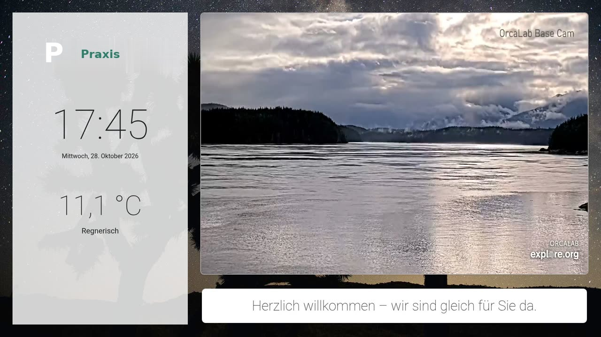
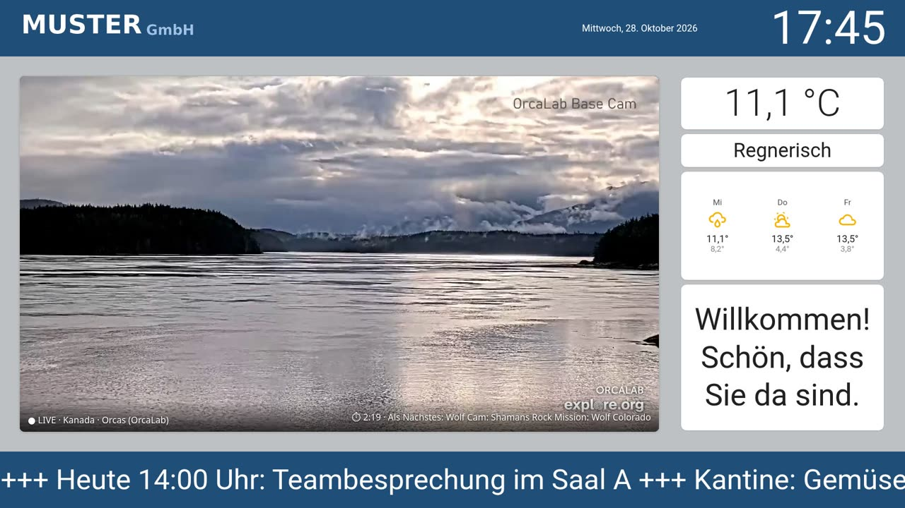
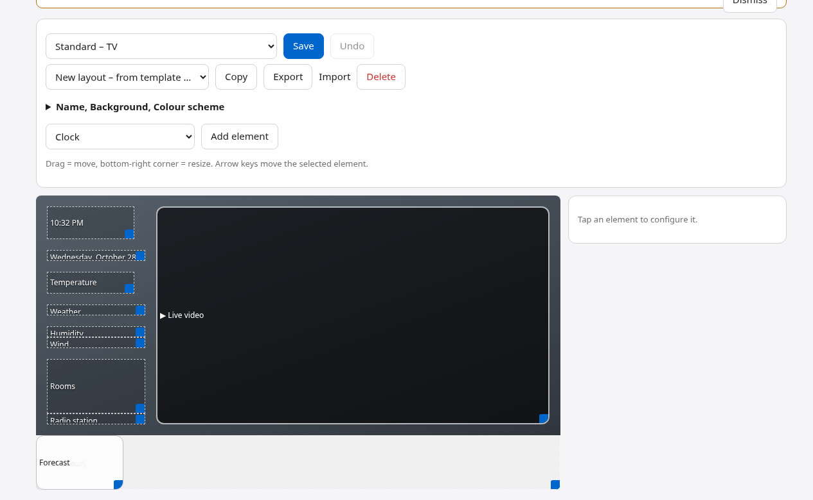

# SignageCast

**Turn any TV into a calm information screen – with live wildlife cams from around the world.**

SignageCast shows clock, weather (MET Norway) and – optionally – any values from **Home Assistant** together with a large window of
**live nature and wildlife cams** (YouTube) – always where it is currently daytime. Everything is rendered in a small
Linux container and sent to the TV as a **4K video stream**; the TV only has to open one address in its browser.
You design the screen in a **drag-and-drop editor** and manage everything in the browser, also from your phone.

Made for the living room, waiting rooms of practices and company receptions. Free and open source (MIT).

*Deutsche Kurzfassung weiter unten.*



## Features

- **Live window to the world** – fixed and automatically discovered YouTube live streams (safari, sea, birds, bears …),
  rotating every few minutes, only where it is daytime. Bad streams (not starting, buffering, frozen, low resolution) are
  skipped automatically; favourites can be protected, unwanted ones rejected.
- **Layout editor** – drag, resize and configure elements on a 48 × 27 grid: clock, date, weather, forecast, rooms, tiles
  with any Home Assistant value, live video, radio station, free text and ticker, logo, camera, calendar / waste
  collection, messages from Home Assistant. Conditions (“only show when …”), fonts, colours, 9 text positions.
- **Your own data sources** – any JSON API, RSS/Atom feed or picture address, fetched by the container at your interval
  (paste a `curl` command, test it, pick values by clicking in the response tree; API keys stay in the container).
  Elements: API value, API list / feed (also as ticker), API picture, gauge (bar or traffic light), countdown, QR code,
  placeholders like `{source:path}` in any text, and conditions on API values.
- **Cameras, charts, calendars, web pages** – IP cameras (RTSP, HLS or MJPEG; e.g. the doorbell only when it rings),
  history charts (Home Assistant history or recorded API values), calendars from any iCal address (waste collection,
  Google/Outlook – without Home Assistant), and embedded web pages that allow it (zoom, crop, reload interval).
- **Templates** – Standard, Video large, Video only, Info without video, *Practice – calm (waiting room)*,
  *Company – corporate design*, *Window to the world*, Night.
- **Backgrounds by time of day** – picture sets (nature, city, sky, mountains, sea) for sunrise, day, sunset and night,
  following the real sun position at your location; optionally weather pictures, slideshow or your own pictures.
- **Internet radio** – own streams or suggestions for your location; or the original sound of the cams.
- **Clips at fixed times** – e.g. the German news *tagesschau in 100 Sekunden* on the hour and half hour.
- **Several TVs** – each with its own address, layout, schedule, sound and categories.
- **Energy saving** – rendering runs only while someone watches; schedules can switch a TV to night mode or black.
- **Admin in Cockpit** – overview with preview picture, system pages, backup/restore, German and English.

<p align="center"> </p>
<p align="center"></p>

## Requirements

- A PC with **Intel graphics** (Quick Sync / VAAPI, e.g. a mini PC with Intel N100 or an Intel CPU from the 7th generation on – see “Hardware”),
  running **Proxmox VE**, **Debian 13** or **Docker / Podman**. 2–4 cores, 10 GB disk and about 1 GB RAM per TV.
  Without usable graphics SignageCast falls back to H.264 in Full HD on the CPU (about 1–2 cores while someone watches).
- Optional: **Home Assistant** in the same network (for your own values; weather comes from MET Norway).
- A TV whose browser plays **H.265 / HEVC** (for 4K; most smart TVs from about 2018). Full HD output is also possible.

## Hardware

SignageCast renders the TV page in a browser, records it and encodes a video stream. The graphics unit does the
encoding (H.265/HEVC in 4K via VAAPI); the CPU mainly runs the browser, which decodes the live video in software.

| | Recommendation |
|---|---|
| **Minimum (recommended)** | Mini PC with **Intel N100 / N95** (Alder Lake-N): H.264 and H.265 encoding in hardware up to 4K, 6–10 W, inexpensive |
| **Good** | Any Intel CPU with integrated graphics from the **7th generation** (Kaby Lake) on, e.g. Core i5-7500T |
| **Works** | Intel 6th generation (Skylake): H.265 only 8 bit |
| **Without usable graphics** | Software fallback: H.264 in Full HD on the CPU (about one more core while someone is watching) |
| **AMD graphics** | VAAPI drivers are installed, but untested so far |
| **Raspberry Pi** | Not suitable as a server: the Pi 5 has **no** hardware video encoder, the Pi 4 only H.264 up to 1080p and too little CPU for browser + video. A “player mode” (Pi at the TV showing the page directly via HDMI, no encoding) is an idea for later. |

Per TV: about 1 GB RAM and one CPU core for the browser; disk 10 GB. The TV's browser must play **H.265** for 4K
(most smart TVs from about 2018); Full HD output with H.264 is possible as well.

**Our experience** (author's setup): Proxmox VE on a mini PC with **Intel Core i5-7500T / HD Graphics 630**, SignageCast
in an LXC container with 4 cores and 3 GB RAM, one Samsung TV (4K H.265, 16 Mbit/s, 25 fps):

| Measured (CPU package via RAPL) | Value |
|---|---|
| Idle, nobody watching (rendering stops automatically) | about 1.2 W |
| Streaming 4K with a live video (1080p) and sound | about **10–11 W**; Chromium ~50 %, ffmpeg ~11 %, Xvfb ~6 % of one core |
| Earlier prototype rendering the full Home Assistant dashboard in 4K | about 16–23 W – the light own TV page and Full HD rendering with GPU upscaling saved more than half |
| Software fallback test (no GPU, 2 cores) | ffmpeg ~70 % of one core for H.264 1080p25 |

YouTube in the container is decoded in software; the small extension `render/h264-fluessig` keeps YouTube at 720p/1080p
instead of 144p (see “Good to know”).

## Installation

**Proxmox VE** – run on the Proxmox host shell, answer the questions (Enter = suggestion):

```bash
bash -c "$(curl -fsSL https://raw.githubusercontent.com/thefrozn/signagecast/main/proxmox/ct.sh)"
```

It creates a Debian 13 container, passes the Intel GPU through and installs SignageCast.

**Existing Debian 13** (LXC, VM or a real computer with `/dev/dri/renderD128`) – as root:

```bash
curl -fsSL https://raw.githubusercontent.com/thefrozn/signagecast/main/install.sh | sh
```

Running the same command again updates SignageCast; settings and data are kept. If port 8888 is taken, choose another
stream port: `curl -fsSL …/install.sh | SC_STREAM_PORT=8899 sh` (it is remembered for updates).

**Docker / Podman** (any Linux host, also NAS systems like Unraid, Synology, TrueNAS) – one line:

```bash
docker run -d --name signagecast --restart unless-stopped --device /dev/dri \
  -p 8888:8888 -p 19090:19090 -v signagecast:/data \
  -e TZ=Europe/Berlin -e SC_HOST_IP=192.168.1.20 ghcr.io/thefrozn/signagecast:latest
```

or with [`compose.yaml`](compose.yaml): `docker compose up -d`. Podman: the same command with `podman`.

- `--device /dev/dri` passes the graphics through; leave it out on systems without Intel graphics (software fallback).
  Rootless Podman additionally needs `--group-add keep-groups`.
- **Admin:** http://&lt;host&gt;:**19090** – the initial password is printed in the log: `docker logs signagecast`
  (or set your own with `-e SC_PASSWORT=…`). Change it under **Connection**. No Cockpit inside the container.
- `SC_HOST_IP` = the IP of the Docker host; the Home Assistant guide in the admin shows it (HA sees the host's IP).
- All settings and data are in the volume `/data`. **Update:** `docker pull ghcr.io/thefrozn/signagecast:latest`, then
  recreate the container (`docker compose up -d`, or `docker rm -f signagecast` and the `docker run` line again).

**Manual:** download a release, unpack it and run `sh installieren.sh`.

### Ports, login and Cockpit per installation type

| Installation | Admin | TV stream | Initial login |
|---|---|---|---|
| Proxmox LXC (`ct.sh`) or Debian **container** | **https://&lt;IP&gt;:9090** (Cockpit) | `http://<IP>:8888/<tv>` | user `tvadmin`, password `tvadmin` – please change it |
| Debian **VM / real computer** (`install.sh`, “native”) | **https://&lt;IP&gt;:9090** (Cockpit) | `http://<IP>:8888/<tv>`, other port with `SC_STREAM_PORT` | user `tvadmin` with a **random password shown once** at the end of the installation – or your own Cockpit user |
| **Docker / Podman** | **http://&lt;host&gt;:19090** (own login, no Cockpit) | `http://<host>:8888/<tv>` | random password in `docker logs signagecast` (or `SC_PASSWORT`) |

- **Cockpit already installed?** On a native installation SignageCast integrates into your existing Cockpit: it only
  adds the menu entry **“SignageCast”** (files in `/usr/share/cockpit/signagecast`) – no second port, no second login,
  your Cockpit settings stay untouched, and the system pages (services, logs, updates) remain available.
  Note: Cockpit cannot hide an extension per user – everyone who may log in to this Cockpit can also configure SignageCast.
- **Why 19090 for Docker/Podman?** Many servers already run Cockpit on 9090. With host networking (recommended for
  rootless Podman) both would collide. Change it with `SC_VERWALTUNG_PORT`, the stream port with `SC_STREAM_PORT`.
- **Why a random password on native installations?** `tvadmin` is a Linux account that can log in to Cockpit; on a real
  computer a known default password would be a risk. In a container it only affects the container.
- The installer checks whether the stream port is free and stops with a hint if another program uses it.

## First steps

1. Open **https://&lt;container-IP&gt;:9090** (accept the certificate warning), log in as **tvadmin** with the initial
   password **tvadmin** – then please change it (top right → Accounts → tvadmin → Set password).
   (Native installation: the random password shown at the end of the installation, or your own Cockpit user.
   Docker / Podman: **http://&lt;host&gt;:19090**, password from the log – see above.)
2. Menu **SignageCast → Connection**: enter the Home Assistant address and follow the guide shown there. Home Assistant
   trusts the container via `trusted_networks` – no password or token is stored. Take the location from Home Assistant.
3. **Display**: weather comes from MET Norway (or choose a Home Assistant weather entity). **Layout**: adapt the standard layout or start from a template.
4. On the TV open **http://&lt;container-IP&gt;:8888/tv** in the browser and set it as start page.
5. Optional: **Radio**, **Clips**, more **TVs**, schedules.

## How it works

| Part | Where | Task |
|---|---|---|
| Data service `signagecast` | `/opt/signagecast/app/`, only 127.0.0.1:8080 | TV page, Home Assistant values, stream list, search, quality watch, API for the admin |
| Render chain | `/opt/signagecast/render/tv-render.sh` | Xvfb + Chromium (Full HD) → ffmpeg → Intel GPU (upscale, H.265) + AAC → MediaMTX |
| MediaMTX `signagecast-mediamtx` | `/opt/mediamtx`, port 8888 | HLS stream, starts rendering on demand |
| Admin | `/usr/share/cockpit/signagecast`, port 9090 | Cockpit extension (Docker/Podman: same page served by `app/verwaltung.py` with its own login) |
| Settings / data | `/etc/signagecast/`, `/var/lib/signagecast/` | backup and restore in the admin |

Only the Python standard library and Debian packages are used. Third-party components and picture sources:
see [NOTICE.md](NOTICE.md).

## Good to know

- Only public YouTube pages and the **official embed player** are used; streams whose operators do not allow embedding
  are not shown. If YouTube reports too many requests, SignageCast pauses for an hour. Nothing is circumvented.
- The small browser extension `render/h264-fluessig` tells YouTube that H.264 up to 1080p plays smoothly – Chromium in
  the container decodes without GPU and would otherwise report “not smooth”, and YouTube would deliver only 144p.
- The admin user `tvadmin` has no administrator rights in the container.
- **Data sources:** only http/https, response at most 1 MB (pictures 5 MB), 10 s timeout, interval 30 s to 24 h; on
  errors the next attempt waits longer (up to 1 h). Secret headers are shown as •••• and left out of backups unless you
  tick “include secrets”. The TV page only receives the finished values, never addresses or keys.
- **Cameras:** RTSP/HLS cameras are pulled by MediaMTX only while a TV shows them and can only be read inside the
  container (not on port 8888 from the network). The camera must deliver **H.264** (Chromium in the container cannot
  decode H.265). Rootless Podman with the default port forwarder may hide the client address – use host networking there.
- **Web pages** are embedded only if the site allows it (X-Frame-Options / frame-ancestors); nothing is circumvented.

## Updates and backups

**Updates tab** (LXC and native installations): available Debian updates (security updates marked) and the latest
SignageCast release, with buttons to check, install all, install security updates only, update SignageCast and return
to the previous version. Optionally automatic – system (all or security only) and SignageCast separately – but only
within a maintenance window and only while nobody is watching. Default: notify only.

- **Signed releases:** from v0.13.0 every release is signed with [minisign](https://jedisct1.github.io/minisign/).
  The in-app update and `install.sh` only install a package whose signature matches the public key built into
  SignageCast – a checksum alone would not help if the GitHub account were taken over.
  Public key: `RWS+1ozfjYuftY7DYt4RjDJLsJKenGkFL7prSxRjeDuk3c+++cclZqgD`
  (check manually: `minisign -Vm signagecast-vX.Y.Z.tar.gz -P <key>`).
- **Safe update:** settings and data are backed up first; the previous version is kept. If SignageCast does not run
  within a minute after the update, it returns to the previous version automatically.
- **How it works:** the admin page runs without root rights. It only drops a request file with one word (`pruefen`,
  `system`, `sicherheit`, `signagecast`, `zurueck`); a systemd path unit starts the fixed root script
  `werkzeug/aktualisieren.sh`, which accepts only these actions – no sudo, no polkit.
- **Docker / Podman:** updates come with the image (`docker pull …`, `podman auto-update`); the tab shows the commands.

**Backup tab:** see the changelog for v0.12.0 – ZIP with settings, stream list, pictures and history; credentials only
in an AES-256 encrypted ZIP with a strong password; automatic backups; restore in the admin or when installing
(`SC_SICHERUNG=… SC_SICHERUNG_PASSWORT=…`).

## Thanks

Special thanks to **[RaspiSignage](https://github.com/boschkundendienst/raspisignage)** by boschkundendienst – a
Raspberry Pi based digital signage player and CMS. It was the inspiration for the idea behind SignageCast: a self-hosted
screen that “normal” people can manage in the browser, without online services or subscriptions. SignageCast does not
contain code from RaspiSignage (different approach: server-side rendering and streaming), but the thinking started there.

## Support

Questions, bugs and ideas: [GitHub issues](https://github.com/thefrozn/signagecast/issues).

---

## Deutsch (kurz)

SignageCast macht aus einem Fernseher einen ruhigen Infobildschirm: Uhr, Wetter (MET Norway) und auf Wunsch Werte aus **Home Assistant**,
dazu ein großes Fenster mit **Live-Kameras von Tieren und Natur** aus aller Welt – nur dort, wo gerade Tag ist.
Gezeichnet wird in einem kleinen Linux-Container, der Fernseher öffnet nur eine Adresse im Browser. Das Bild gestaltest
du im **Layout-Editor** (Bausteine ziehen, Größe ändern, Vorlagen für Wohnzimmer, Wartezimmer und Firma),
dazu Hintergründe nach Tageszeit, Internetradio, Einspieler wie „tagesschau in 100 Sekunden“, mehrere Fernseher.

**Installation auf Proxmox** (in der Shell des Proxmox-Hosts):

```bash
bash -c "$(curl -fsSL https://raw.githubusercontent.com/thefrozn/signagecast/main/proxmox/ct.sh)"
```

**In einem vorhandenen Debian 13** (als root; LXC, VM oder echter Rechner): `curl -fsSL https://raw.githubusercontent.com/thefrozn/signagecast/main/install.sh | sh`
– anderer Stream-Port mit `… | SC_STREAM_PORT=8899 sh`.

**Docker / Podman:** `docker run -d --name signagecast --restart unless-stopped --device /dev/dri -p 8888:8888 -p 19090:19090 -v signagecast:/data -e TZ=Europe/Berlin -e SC_HOST_IP=<IP des Hosts> ghcr.io/thefrozn/signagecast:latest`
(oder `compose.yaml`). Verwaltung **http://&lt;Host&gt;:19090**, Startpasswort steht im Protokoll (`docker logs signagecast`).

**Ports und Anmeldung je Installationsweg:**

| Weg | Verwaltung | Stream | Erste Anmeldung |
|---|---|---|---|
| Proxmox-LXC bzw. Debian-**Container** | https://&lt;IP&gt;:9090 (Cockpit) | :8888 | `tvadmin` / `tvadmin` (bitte ändern) |
| Debian **VM / echter Rechner** (nativ) | https://&lt;IP&gt;:9090 (Cockpit) | :8888, änderbar mit `SC_STREAM_PORT` | `tvadmin` mit **zufälligem Passwort**, das am Ende der Installation einmal angezeigt wird – oder dein eigener Cockpit-Benutzer |
| **Docker / Podman** | http://&lt;Host&gt;:**19090** (eigene Anmeldung) | :8888 | zufälliges Passwort im Protokoll |

**Schon Cockpit installiert?** Bei der nativen Installation fügt sich SignageCast in dein vorhandenes Cockpit ein – es
kommt nur der Menüpunkt „SignageCast“ dazu, kein zweiter Port, keine zweite Anmeldung, deine Einstellungen bleiben.
Hinweis: Cockpit kann Erweiterungen nicht pro Benutzer ausblenden – wer sich an diesem Cockpit anmelden darf, kann auch
SignageCast einstellen. Docker/Podman nutzt 19090, weil auf vielen Servern Cockpit schon 9090 belegt.
Ohne Intel-Grafik läuft ein Notbetrieb mit H.264 in Full HD per CPU.

Danach die Verwaltung öffnen (siehe Tabelle) und
unter **Verbindung** Home Assistant einrichten (Anleitung steht dort), am Fernseher **http://&lt;IP&gt;:8888/tv** öffnen.
Eigene Daten: Reiter **Datenquellen** (JSON-API, RSS-Feed, Bild; curl-Befehl einfügen, Wert im Antwort-Baum anklicken) und
die Bausteine API-Wert, API-Liste, API-Bild, Anzeige (Balken/Ampel), Countdown, QR-Code sowie Platzhalter `{quelle:pfad}`.
Dazu Kameras (RTSP/HLS/MJPEG), Verlauf-Diagramme, Kalender per iCal-Adresse und eingebettete Webseiten.
Voraussetzungen: Intel-Grafik, ein Fernseher-Browser mit H.265; Home Assistant optional.

**Hardware:** Empfohlenes Minimum ist ein Mini-PC mit **Intel N100/N95** (H.265 in 4K per Hardware, 6–10 W); jede
Intel-CPU mit Grafik ab der 7. Generation läuft gut. Ohne nutzbare Grafik gibt es einen Notbetrieb (H.264 Full HD per CPU).
**Raspberry Pi** eignet sich nicht als Server: Der Pi 5 hat keinen Video-Encoder, der Pi 4 nur H.264 bis 1080p und zu
wenig CPU für Browser und Video. Erfahrung des Autors: Core i5-7500T mit HD 630 unter Proxmox, LXC mit 4 Kernen/3 GB,
4K-Stream mit Live-Video und Ton bei etwa **10–11 W** CPU-Paket, im Leerlauf etwa 1,2 W (Details oben).

**Updates & Sicherung:** Reiter „Updates“ (System- und SignageCast-Updates per Knopf oder automatisch im Wartungsfenster,
nur wenn niemand zuschaut; Rückkehr zur vorigen Version, automatisch bei Fehlern) und „Sicherung“ (ZIP, mit Zugangsdaten
nur AES-256 mit starkem Passwort). Ab v0.13.0 sind alle Releases mit minisign **signiert**; Updates installieren nur
Pakete mit gültiger Signatur (öffentlicher Schlüssel `RWS+1ozfjYuftY7DYt4RjDJLsJKenGkFL7prSxRjeDuk3c+++cclZqgD`).

**Danke** an **[RaspiSignage](https://github.com/boschkundendienst/raspisignage)** von boschkundendienst – das
Raspberry-Pi-Signage-Projekt war die Inspiration für die Überlegungen hinter SignageCast (selbst betrieben, im Browser
verwaltbar, ohne Online-Dienste). SignageCast enthält keinen Code daraus, der Ansatz ist ein anderer.

## License

MIT – see [LICENSE](LICENSE). Pictures and icons: see [NOTICE.md](NOTICE.md).
