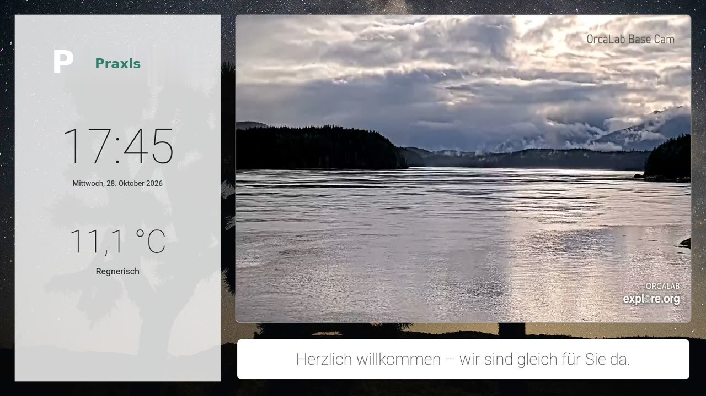
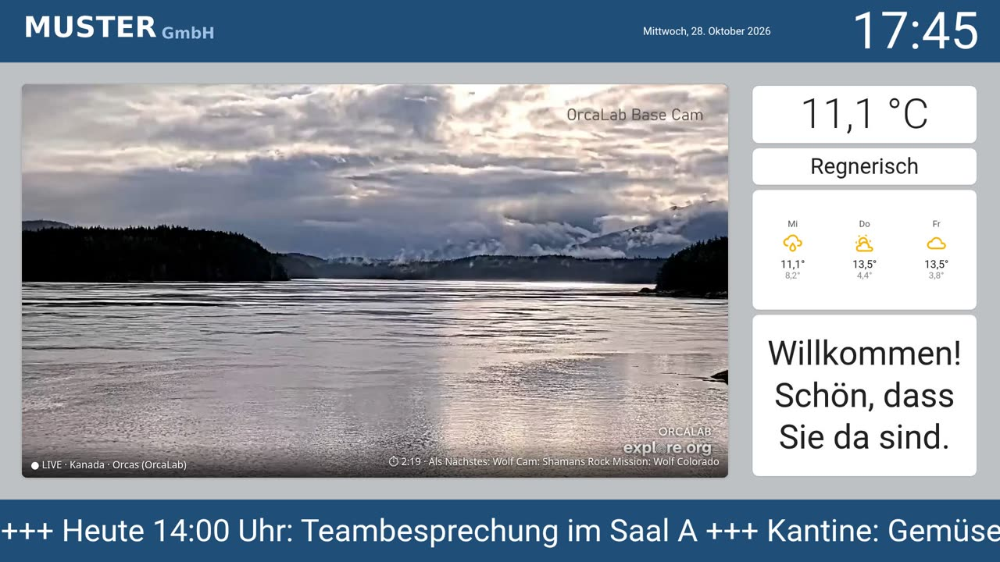
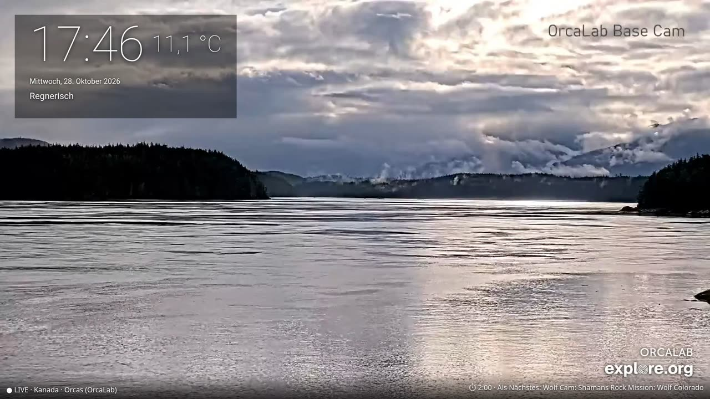
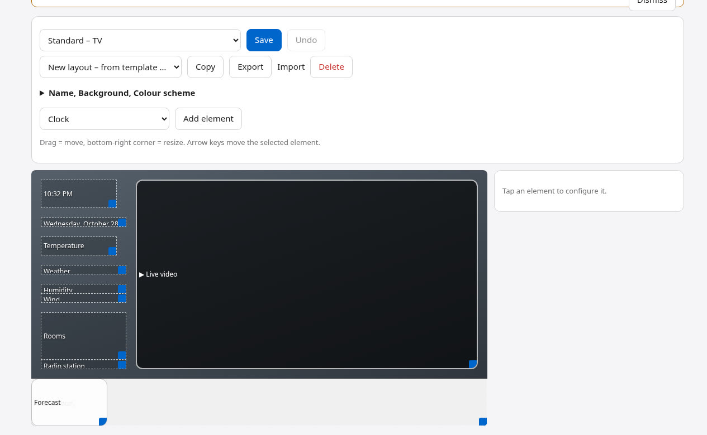

# SignageCast

**Turn any TV into a calm information screen – with live wildlife cams from around the world.**

SignageCast shows clock, weather (MET Norway) and – optionally – any values from **Home Assistant** together with a large window of
**live nature and wildlife cams** (YouTube) – always where it is currently daytime. Everything is rendered in a small
Linux container and sent to the TV as a **video stream** (Full HD or 4K); the TV only has to open one address in its browser.
You design the screen in a **drag-and-drop editor** and manage everything in the browser, also from your phone.

Made for the living room, waiting rooms of practices and company receptions. Free and open source (MIT).

**📸 [Screenshot tour](docs/TOUR.md)** – the TV and every page of the admin, step by step.

**Docs:** [Installation](docs/INSTALL.md) · [Hardware](docs/HARDWARE.md) · [Raspberry Pi player](docs/PLAYER.md) · [Manual & FAQ](docs/MANUAL.md) · [How it works](docs/HOW-IT-WORKS.md) · [Changelog](CHANGELOG.md)

*Deutsche Kurzfassung weiter unten.*



## Features

- **Live window to the world** – fixed and automatically discovered YouTube live streams (safari, sea, birds, bears …;
  since 0.32 also cities, beaches, mountains, harbours, airports, trains, space and natural wonders – switch on what you like),
  rotating every few minutes, only where it is daytime. Bad streams (not starting, buffering, frozen, low resolution) are
  skipped automatically; favourites can be protected, unwanted ones rejected.
- **Layout editor** – drag, resize and configure elements on a 48 × 27 grid: clock, date, weather, forecast, rooms, tiles
  with any Home Assistant value, live video, radio station, free text and ticker, logo, camera, calendar / waste
  collection, messages from Home Assistant. Conditions (“only show when …”), fonts, colours, 9 text positions.
- **Your own data sources** – any JSON API, RSS/Atom feed or picture address, fetched by the container at your interval
  (paste a `curl` command, test it, pick values by clicking in the response tree; API keys stay in the container).
  Elements: API value, API list / feed (also as ticker), API picture, gauge (bar or traffic light), countdown, QR code,
  placeholders like `{source:path}` in any text, and conditions on API values.
- **Cameras, charts, calendars, web pages** – IP cameras (RTSP, HLS or MJPEG; e.g. the doorbell only when it rings),
  history charts (Home Assistant history or recorded API values), calendars from any iCal address (waste collection,
  Google/Outlook – without Home Assistant) or from an uploaded .ics/.csv file (CSV import with column selection), and web pages – embedded live where the site allows it, otherwise as a screenshot refreshed every few minutes
  (zoom, crop, interval).
- **Templates** – Standard, Video large, Video only, Info without video, *Practice – calm (waiting room)*,
  *Company – corporate design*, *Window to the world*, Night.
- **Backgrounds by time of day** – picture sets (nature, city, sky, mountains, sea) for sunrise, day, sunset and night,
  following the real sun position at your location; optionally weather pictures, slideshow or your own pictures.
- **Internet radio** – own streams or suggestions for your location; or the original sound of the cams.
- **Clips at fixed times** – e.g. the German news *tagesschau in 100 Sekunden* on the hour and half hour.
- **Several TVs** – each with its own address, layout, schedule, sound and categories.
- **Raspberry Pi as player** (experimental) – create a ready SD card image per screen in the admin (Wi-Fi included,
  hotspot with QR code if it finds no network) or one image for many Pis that pair with a code on the TV, then manage all Pis centrally: status, screenshot, TV on/off via
  HDMI-CEC, rotation, Wi-Fi change with fallback, updates; optional *direct mode* (Pi 4/5 shows the page itself, no
  encoding on the server); optional **terminal in the browser** to each Pi (off by default, the Pi must allow it) –
  see [PLAYER.md](docs/PLAYER.md).
- **Messages and notifications** – official severe weather warnings of the DWD (Germany) as a layout element; short
  messages from other systems (e.g. Home Assistant) as a banner on the TVs via a webhook with a secret key; notifications
  via Telegram, e-mail or Home Assistant when a TV fails, an update or backup fails or Home Assistant is disconnected.
- **PDF** – a PDF (price list, menu, presentation) page by page.
- **Elements with a period** – e.g. “Closed from 23 Dec to 2 Jan” appears and disappears by itself.
- **Emergency screen** – a red full-screen message on all TVs until someone ends it (admin, panel or webhook).
- **Announcement panel** – a separate page for the reception: send a call like “Mrs Baker, please go to room 2” to
  chosen TVs, read aloud offline (Piper, female or male voice), without access to any settings.
- **Energy saving** – rendering runs only while someone watches; schedules can switch a TV to night mode or black –
  and really switch it off and on again via Home Assistant.
- **Clear admin** – six areas with a to-do list on the overview, setup assistant on a new installation, marked unsaved
  changes, own address per page, one menu on the phone.
- **Admin in Cockpit** – overview with preview picture, system pages, backup/restore, German and English.

<p align="center"> </p>
<p align="center"></p>

## Installation

You need an **x86 computer with Intel graphics** (e.g. a mini PC with Intel N100) and a TV whose browser plays H.265 –
details in [hardware](docs/HARDWARE.md). Without usable graphics a Full HD software fallback runs.

| Where | How | Guide |
|---|---|---|
| **Proxmox VE** | one command on the Proxmox host shell (below) | [Installation](docs/INSTALL.md#proxmox-ve) |
| **Debian 13** (LXC, VM, PC) | `curl -fsSL https://raw.githubusercontent.com/thefrozn/signagecast/main/install.sh \| sh` | [Installation](docs/INSTALL.md#debian-13) |
| **Docker / Podman** | `docker run …` or [`compose.yaml`](compose.yaml) | [Installation](docs/INSTALL.md#docker--podman) |
| **QNAP NAS** | by mouse in Container Station | [QNAP guide](docs/install/QNAP.md) |
| **Synology NAS** | by mouse in Container Manager | [Synology guide](docs/install/SYNOLOGY.md) |

```bash
bash -c "$(curl -fsSL https://raw.githubusercontent.com/thefrozn/signagecast/main/proxmox/ct.sh)"
```

Then open the admin – **https://&lt;IP&gt;:9090** (Proxmox/Debian, user `tvadmin`) or **http://&lt;host&gt;:19090**
(Docker/NAS, password in the container log) – follow the short assistant and open **http://&lt;IP&gt;:8888/tv** on the TV.
Ports, logins and updates per way: [installation](docs/INSTALL.md).

## Principles

Three goals rank equally – none is traded for another:

- **Rock-stable:** a screen runs for months without anyone looking after it. Every part restarts itself, updates roll
  back automatically when SignageCast does not run afterwards, and a broken data source never blacks out the TV.
- **Secure:** signed releases, secrets never leave the server in clear text, nothing listens that does not have to,
  no cloud services or accounts needed.
- **Light:** it runs on a small mini PC. Chains only run while someone watches, the graphics unit encodes, the browser
  draws only as much as needed (capture size per TV), and every release is measured – CPU, memory and lost frames –
  before it is published (`werkzeug/leistung_messen.py`).

## Thanks

Special thanks to **[RaspiSignage](https://github.com/boschkundendienst/raspisignage)** by boschkundendienst – a
Raspberry Pi based digital signage player and CMS. It was the inspiration for the idea behind SignageCast: a self-hosted
screen that “normal” people can manage in the browser, without online services or subscriptions. SignageCast does not
contain code from RaspiSignage (different approach: server-side rendering and streaming), but the thinking started there.

## Support

Questions, bugs and ideas: [GitHub issues](https://github.com/thefrozn/signagecast/issues).

---

## Deutsch (kurz)

SignageCast macht aus einem Fernseher einen ruhigen Infobildschirm: Uhr, Wetter (MET Norway) und auf Wunsch Werte aus **Home Assistant**,
dazu ein großes Fenster mit **Live-Kameras von Tieren und Natur** aus aller Welt – nur dort, wo gerade Tag ist.
Gezeichnet wird in einem kleinen Linux-Container, der Fernseher öffnet nur eine Adresse im Browser. Das Bild gestaltest
du im **Layout-Editor** (Bausteine ziehen, Größe ändern, Vorlagen für Wohnzimmer, Wartezimmer und Firma),
dazu Hintergründe nach Tageszeit, Internetradio, Raspberry Pi als Player am Fernseher ([Anleitung](docs/PLAYER.md#deutsch-raspberry-pi-als-player)), Einspieler wie „tagesschau in 100 Sekunden“, mehrere Fernseher,
eigene Datenquellen (JSON-API, RSS, Bilder), Kameras, Kalender, Webseiten, Unwetterwarnungen des DWD, Meldungen per
Webhook und Benachrichtigungen über Telegram, E-Mail oder Home Assistant, PDFs Seite für Seite, Bausteine mit Zeitraum
(„vom 23.12. bis 2.1. geschlossen“), ein Notfall-Vollbild für alle Fernseher und echtes Aus-/Einschalten der Fernseher
über Home Assistant.

**Installation:** Proxmox (Einzeiler oben, in der Shell des Proxmox-Hosts), Debian 13, Docker/Podman,
**QNAP** ([Anleitung](docs/install/QNAP.md)) oder **Synology** ([Anleitung](docs/install/SYNOLOGY.md)) – alle Wege,
Ports und Anmeldung: [Installation](docs/INSTALL.md). Nötig ist ein x86-Rechner mit Intel-Grafik (z. B. Mini-PC mit
N100), ohne Grafik läuft ein Notbetrieb in Full HD – siehe [Hardware](docs/HARDWARE.md).

**Mehr:** [Bildschirm-Tour](docs/TOUR.md) · [Handbuch & FAQ](docs/MANUAL.md) · [Technik, Updates, Sicherheit](docs/HOW-IT-WORKS.md)
(alle Seiten englisch mit deutscher Kurzfassung, die NAS-Anleitungen komplett auch auf Deutsch).

**Grundsätze:** Stabilität, Sicherheit und geringer Verbrauch sind gleich wichtig – keins wird für ein anderes
geopfert. Jede Version wird vor dem Veröffentlichen gemessen (CPU, Arbeitsspeicher, verlorene Bilder).

**Danke** an **[RaspiSignage](https://github.com/boschkundendienst/raspisignage)** von boschkundendienst – das
Raspberry-Pi-Signage-Projekt war die Inspiration für die Überlegungen hinter SignageCast (selbst betrieben, im Browser
verwaltbar, ohne Online-Dienste). SignageCast enthält keinen Code daraus, der Ansatz ist ein anderer.

## License

MIT – see [LICENSE](LICENSE). Pictures and icons: see [NOTICE.md](NOTICE.md).
