# Vorlagen

*[English](TEMPLATES.md)*

Jedes neue Layout kann mit einer Vorlage beginnen: **Inhalte → Layouts → + Neues Layout → Ausgangspunkt**. Alle Vorlagen gibt es auf Deutsch und Englisch (je nach Sprache der Verwaltung). Die Texte sind Beispiele – im Editor ersetzen, Logo hochladen, wo vorhanden Galerie-Ordner oder Datenquelle wählen. Telefonnummern, Zeiten und Preise vor dem Einsatz prüfen.

**Klick auf ein Bild** öffnet die Seite der Vorlage mit bewegtem Bild, allen verwendeten Elementen und Tipps zum Anpassen.

## Für Branchen

<table><tr><td width="50%" valign="top"><a href="templates/imbiss.de.md">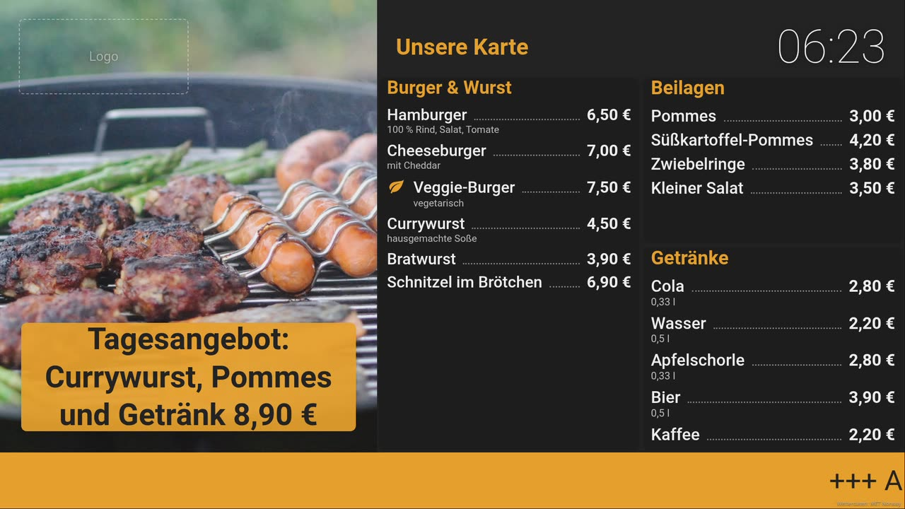</a><br><b><a href="templates/imbiss.de.md">Imbiss – Menütafel</a></b><br><sub>Imbiss, Döner, Café, Kiosk, Foodtruck</sub></td><td width="50%" valign="top"><a href="templates/center.de.md">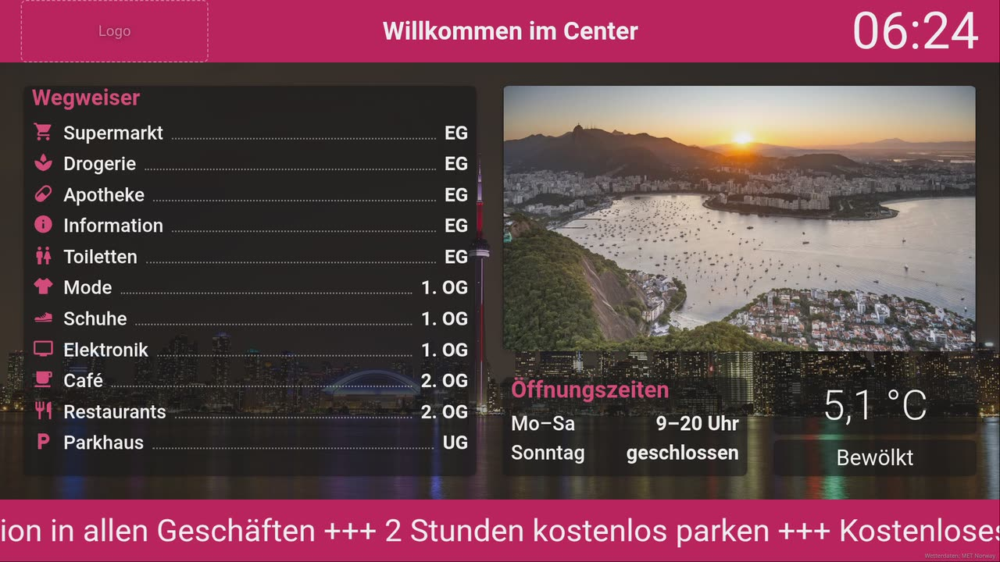</a><br><b><a href="templates/center.de.md">Einkaufszentrum – Info</a></b><br><sub>Einkaufszentrum, Kaufhaus, Bürogebäude, Rathaus</sub></td></tr></table>

<table><tr><td width="50%" valign="top"><a href="templates/praxisinfo.de.md">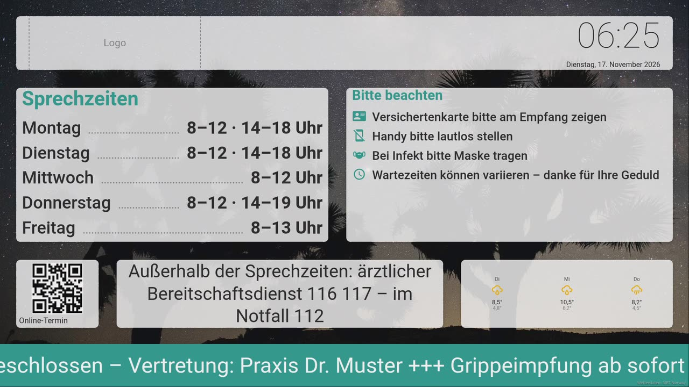</a><br><b><a href="templates/praxisinfo.de.md">Praxis – Info (Sprechzeiten)</a></b><br><sub>Arztpraxis, Zahnarzt, Physiotherapie, Tierarzt</sub></td><td width="50%" valign="top"><a href="templates/klinik.de.md">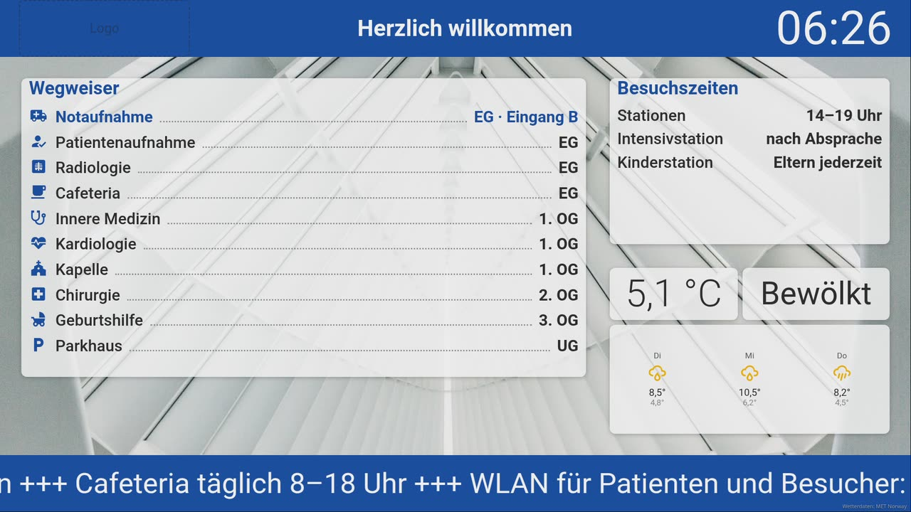</a><br><b><a href="templates/klinik.de.md">Krankenhaus – Foyer</a></b><br><sub>Krankenhaus, Pflegeheim, Ärztehaus, Behörde</sub></td></tr></table>

<table><tr><td width="50%" valign="top"><a href="templates/hotel.de.md">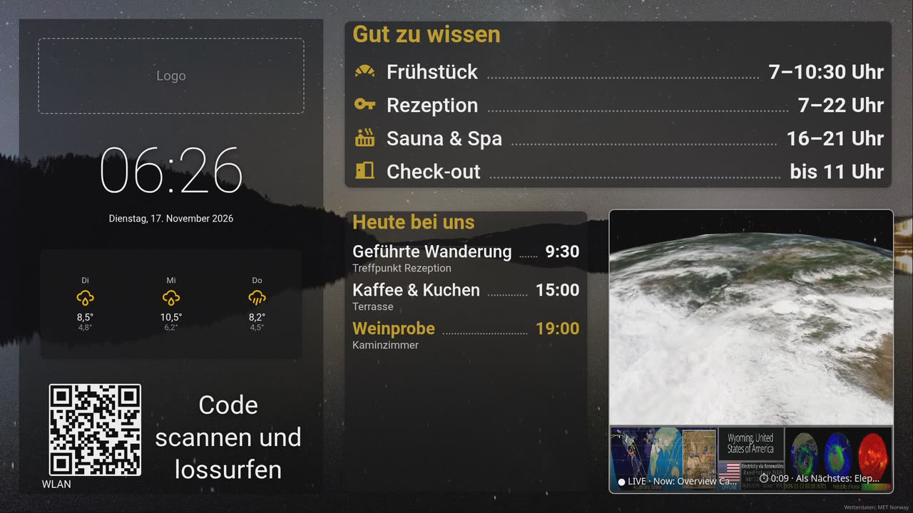</a><br><b><a href="templates/hotel.de.md">Hotel / Pension – Lobby</a></b><br><sub>Hotel, Pension, Ferienwohnung, Jugendherberge</sub></td><td width="50%" valign="top"><a href="templates/fitness.de.md">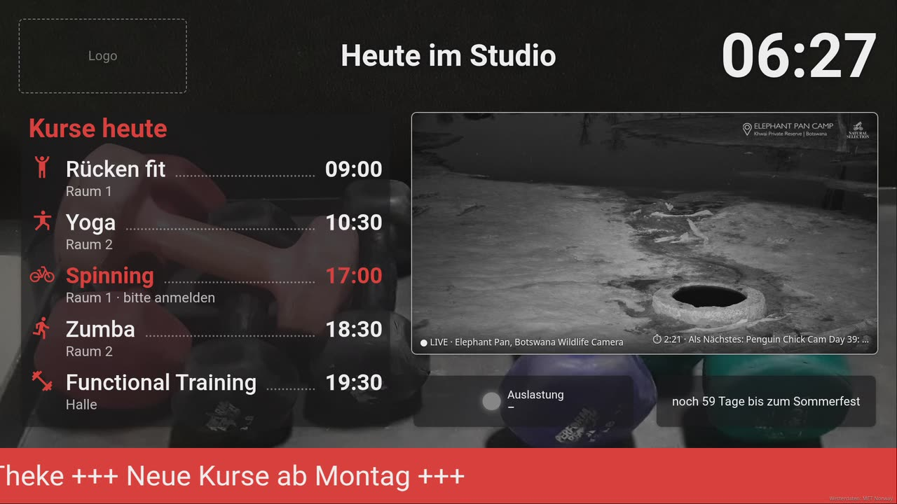</a><br><b><a href="templates/fitness.de.md">Fitnessstudio / Verein</a></b><br><sub>Fitnessstudio, Sportverein, Tanzschule, Kletterhalle</sub></td></tr></table>

<table><tr><td width="50%" valign="top"><a href="templates/kantine.de.md">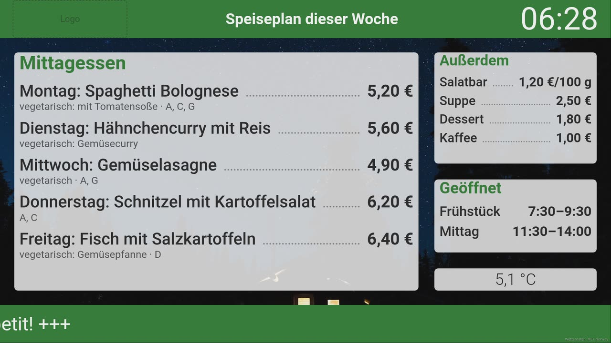</a><br><b><a href="templates/kantine.de.md">Kantine – Speiseplan</a></b><br><sub>Kantine, Mensa, Schule, Betriebsrestaurant</sub></td></tr></table>

## Allgemein

<table><tr><td width="50%" valign="top"><a href="templates/standard.de.md">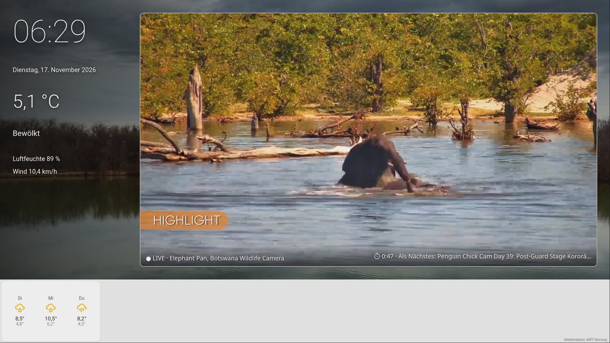</a><br><b><a href="templates/standard.de.md">Standard</a></b><br><sub>Zuhause, Vereinsheim, Werkstatt – der Klassiker</sub></td><td width="50%" valign="top"><a href="templates/videogross.de.md">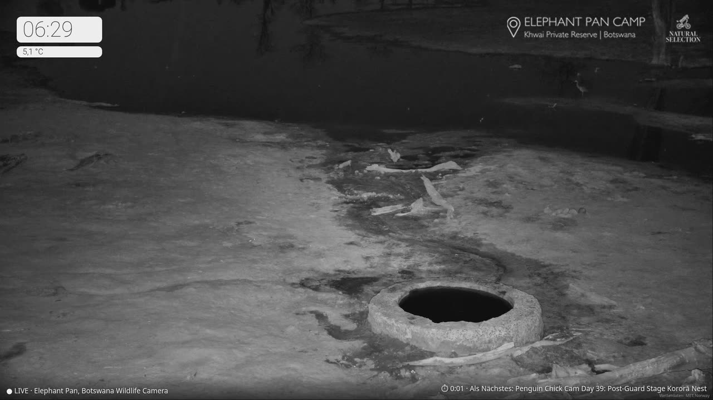</a><br><b><a href="templates/videogross.de.md">Video groß</a></b><br><sub>Empfang, Aufenthaltsraum – Bild zuerst</sub></td></tr></table>

<table><tr><td width="50%" valign="top"><a href="templates/nurvideo.de.md">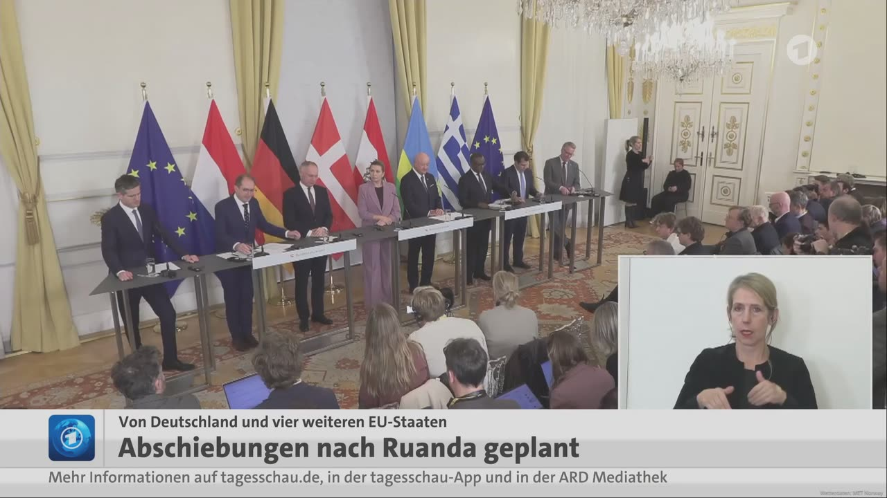</a><br><b><a href="templates/nurvideo.de.md">Nur Video</a></b><br><sub>Deko-Bildschirm, Schaufenster</sub></td><td width="50%" valign="top"><a href="templates/info.de.md">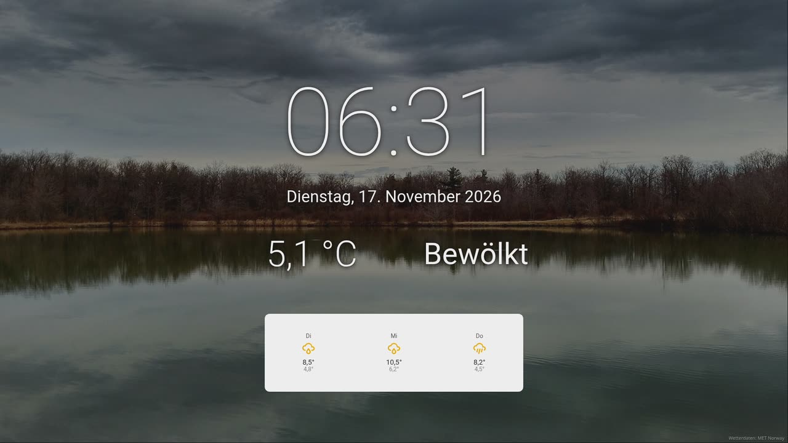</a><br><b><a href="templates/info.de.md">Info ohne Video</a></b><br><sub>Flur, Eingang – ruhig und sparsam</sub></td></tr></table>

<table><tr><td width="50%" valign="top"><a href="templates/praxis.de.md">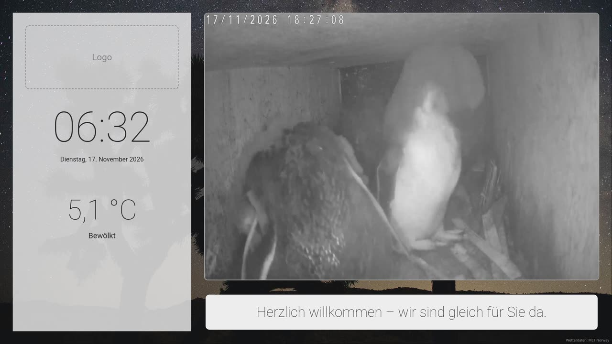</a><br><b><a href="templates/praxis.de.md">Praxis – ruhig (Wartezimmer)</a></b><br><sub>Wartezimmer</sub></td><td width="50%" valign="top"><a href="templates/firma.de.md">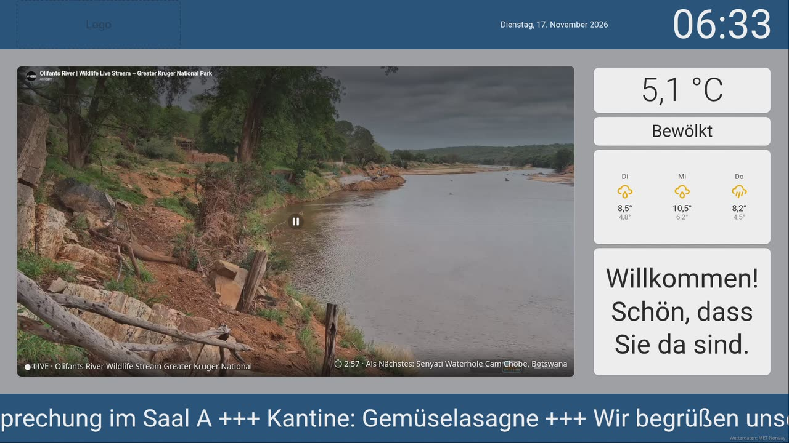</a><br><b><a href="templates/firma.de.md">Firma – Corporate Design</a></b><br><sub>Firma, Büro, Empfang – im eigenen Farbton</sub></td></tr></table>

<table><tr><td width="50%" valign="top"><a href="templates/fenster.de.md">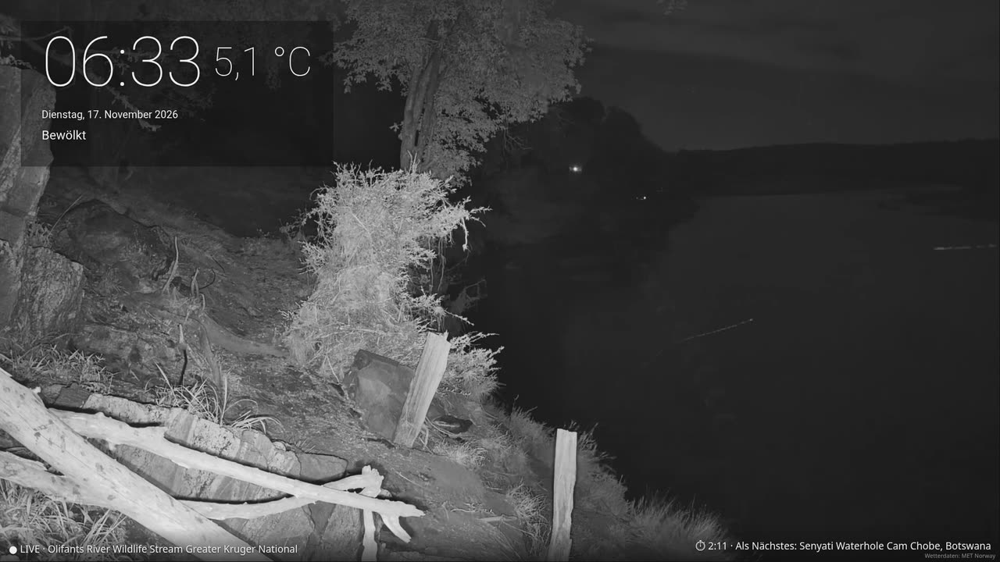</a><br><b><a href="templates/fenster.de.md">Fenster zur Welt</a></b><br><sub>Wohnzimmer, Lounge – ein Fenster in die Welt</sub></td><td width="50%" valign="top"><a href="templates/galerie.de.md">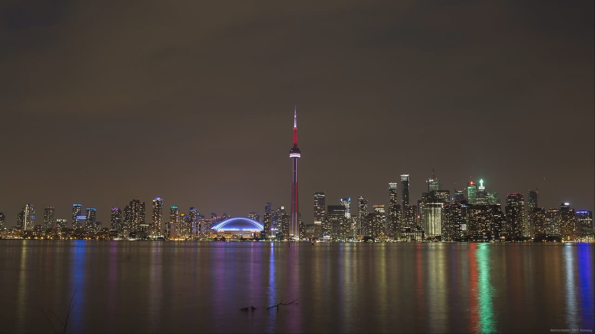</a><br><b><a href="templates/galerie.de.md">Galerie Vollbild</a></b><br><sub>Bilderrahmen, Fotowand, Speisekarte als PDF</sub></td></tr></table>

<table><tr><td width="50%" valign="top"><a href="templates/nacht.de.md">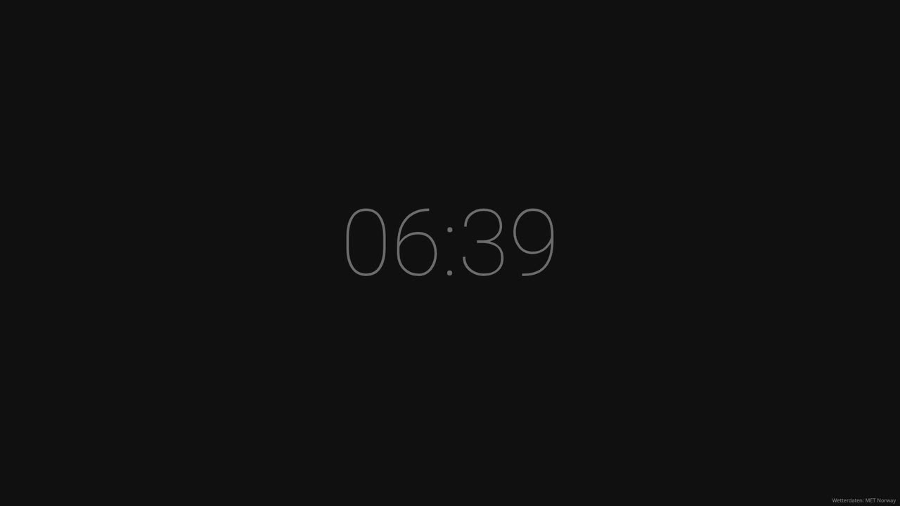</a><br><b><a href="templates/nacht.de.md">Nacht (nur Uhr, gedimmt)</a></b><br><sub>Schlafzimmer, Flur bei Nacht</sub></td></tr></table>

## Der Baustein „Liste“

Die meisten Branchen-Vorlagen nutzen den Baustein **Liste (Speisekarte, Zeiten, Wegweiser)**: Text links, kleiner Zusatz darunter, Wert rechts, optional Symbol und Hervorhebung, bis 20 Zeilen in 1–3 Spalten. Die Schrift passt sich der Größe an und wird kleiner, statt Namen abzuschneiden. Statt fester Zeilen geht eine **Datenquelle**, z. B. eine CSV-Datei mit den Spalten `text`, `info`, `wert`:

```csv
text;info;wert
Currywurst;hausgemachte Soße;4,50 €
Pommes;;3,00 €
```

Andere Spaltennamen gehen über Platzhalter wie `{Gericht}` und `{Preis} €`.

## Bilder, die sich bewegen

Seit 0.54 haben die Branchen-Vorlagen echte Hintergründe: Essensfotos, Sportbilder, Architektur, Stadt, Himmel, Berge und Natur (alle CC0). Mit **„Bilder langsam bewegen“** (Editor → Hintergrund) zoomen sie sanft – in einer Diashow je Bild einmal hinein bzw. heraus, mit weicher Überblendung. Das übernimmt der Grafik-Compositor; Listen und Texte werden dabei nicht neu gezeichnet. **Durchscheinende Karten** (Editor → Karten) lassen das Bild hinter Listen und Wetter durchschimmern.

Vorlagen ohne Live-Video brauchen etwa die Hälfte der Rechenleistung. Die Messwerte stehen im Changelog.
