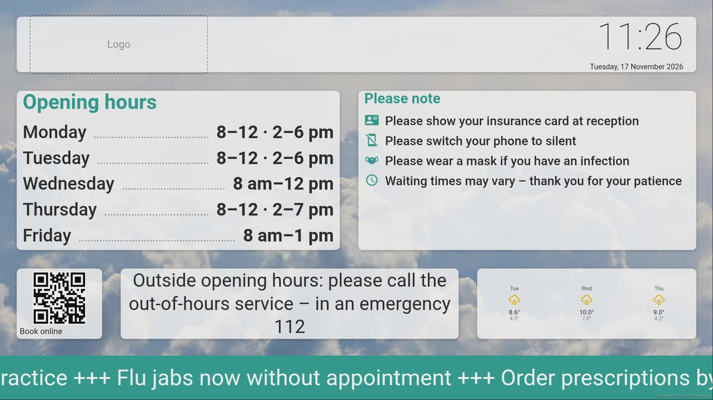
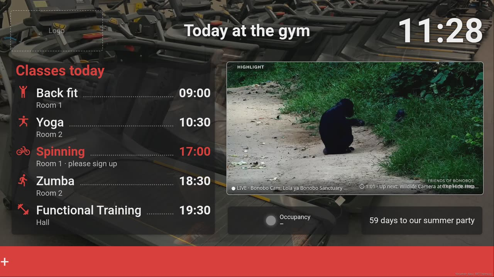
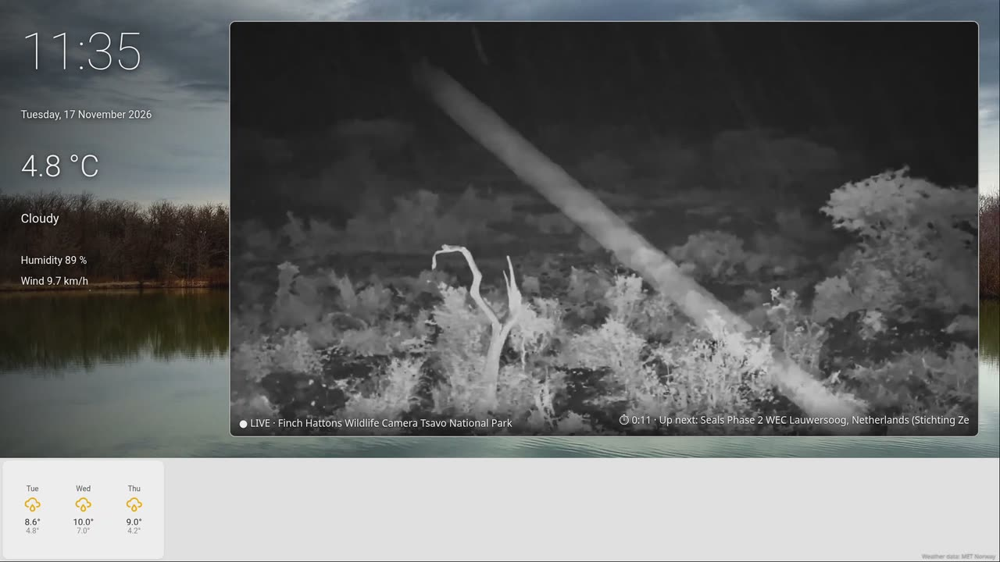
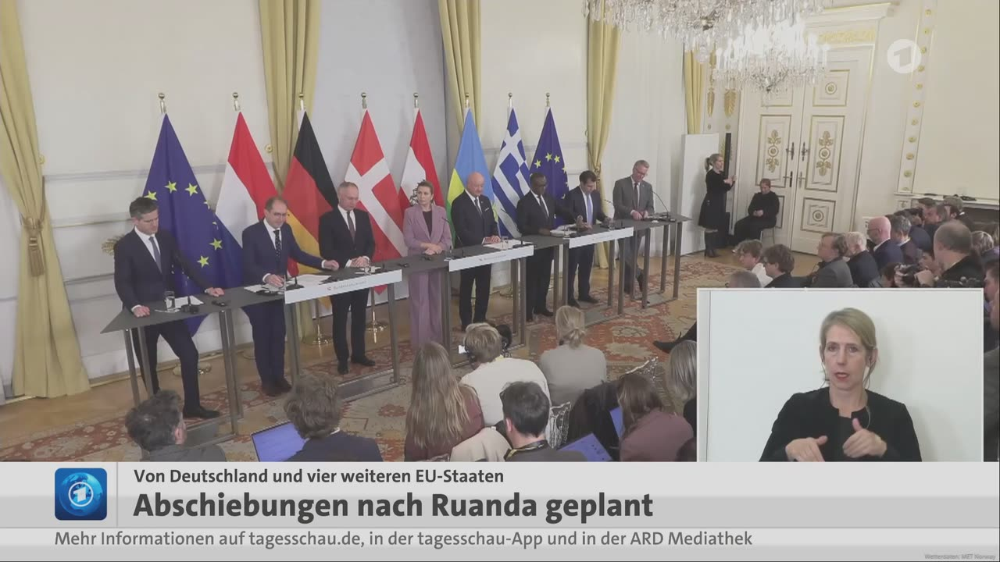
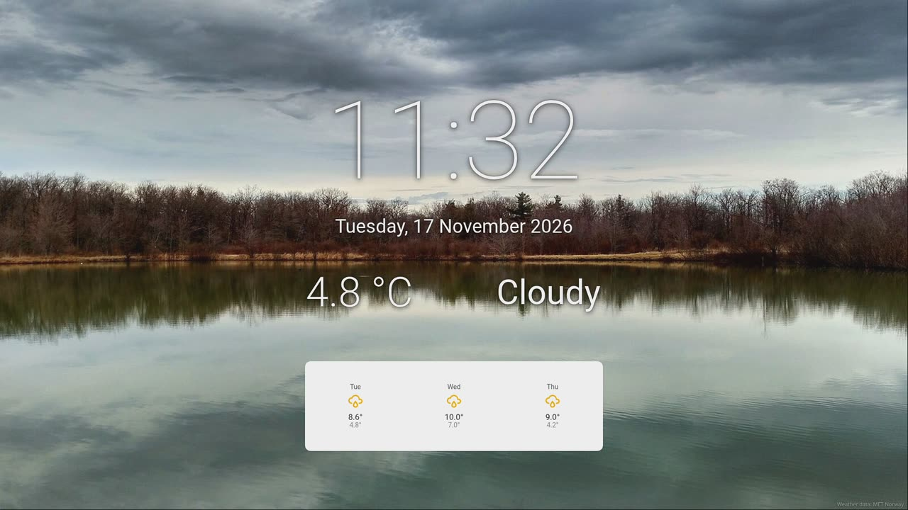
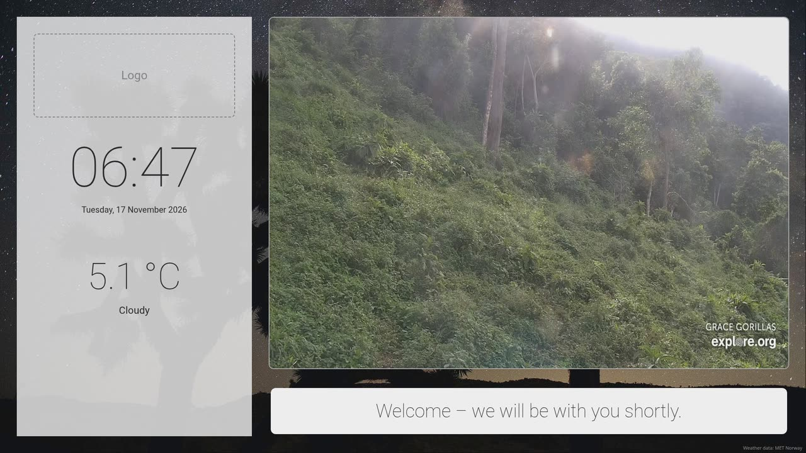
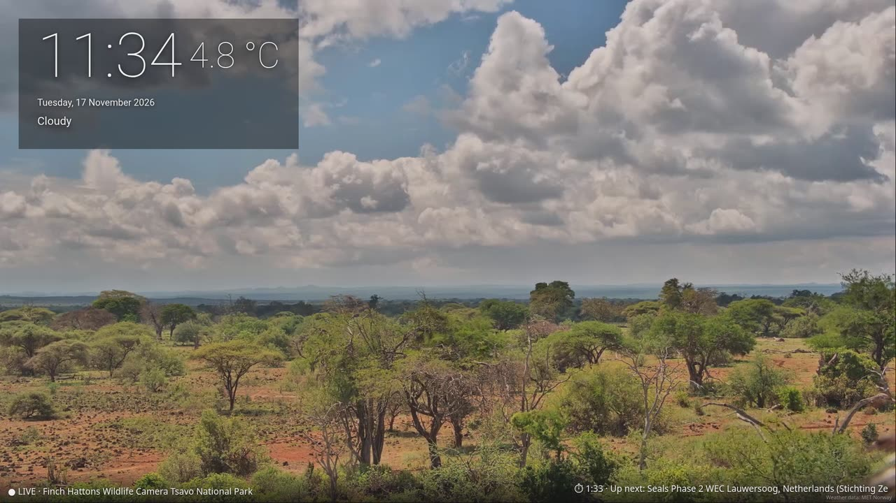

# Templates

*[Deutsch](TEMPLATES.de.md)*

Every new layout can start from a template: **Layouts → + New layout → Start from**. All templates exist in German and English (the language of the admin decides). The texts are examples – replace them in the editor, upload your logo and pick a gallery folder or data source where the template has one. Check phone numbers, times and prices before the screen goes live.

**Click a picture** to open the template's page with a moving picture, all elements used and tips to make it yours.

## For businesses

<table><tr><td width="50%" valign="top"><a href="templates/imbiss.md"></a><br><b><a href="templates/imbiss.md">Snack bar – menu board</a></b><br><sub>snack bar, kebab shop, café, kiosk, food truck</sub></td><td width="50%" valign="top"><a href="templates/center.md"></a><br><b><a href="templates/center.md">Shopping centre – info</a></b><br><sub>shopping centre, department store, office building, town hall</sub></td></tr></table>

<table><tr><td width="50%" valign="top"><a href="templates/praxisinfo.md"></a><br><b><a href="templates/praxisinfo.md">Practice – info (opening hours)</a></b><br><sub>doctor's practice, dentist, physiotherapy, vet</sub></td><td width="50%" valign="top"><a href="templates/klinik.md"></a><br><b><a href="templates/klinik.md">Hospital – lobby</a></b><br><sub>hospital, care home, medical centre, public office</sub></td></tr></table>

<table><tr><td width="50%" valign="top"><a href="templates/hotel.md"></a><br><b><a href="templates/hotel.md">Hotel / guest house – lobby</a></b><br><sub>hotel, guest house, holiday flat, hostel</sub></td><td width="50%" valign="top"><a href="templates/fitness.md"></a><br><b><a href="templates/fitness.md">Gym / sports club</a></b><br><sub>gym, sports club, dance school, climbing hall</sub></td></tr></table>

<table><tr><td width="50%" valign="top"><a href="templates/kantine.md"></a><br><b><a href="templates/kantine.md">Canteen – weekly menu</a></b><br><sub>canteen, school, university, company restaurant</sub></td></tr></table>

## General

<table><tr><td width="50%" valign="top"><a href="templates/standard.md"></a><br><b><a href="templates/standard.md">Standard</a></b><br><sub>home, club house, workshop – the classic</sub></td><td width="50%" valign="top"><a href="templates/videogross.md"></a><br><b><a href="templates/videogross.md">Large video</a></b><br><sub>reception, lounge – picture first</sub></td></tr></table>

<table><tr><td width="50%" valign="top"><a href="templates/nurvideo.md"></a><br><b><a href="templates/nurvideo.md">Video only</a></b><br><sub>decoration screen, shop window</sub></td><td width="50%" valign="top"><a href="templates/info.md"></a><br><b><a href="templates/info.md">Info without video</a></b><br><sub>hallway, entrance – calm and frugal</sub></td></tr></table>

<table><tr><td width="50%" valign="top"><a href="templates/praxis.md"></a><br><b><a href="templates/praxis.md">Practice – calm (waiting room)</a></b><br><sub>waiting room</sub></td><td width="50%" valign="top"><a href="templates/firma.md"></a><br><b><a href="templates/firma.md">Company – corporate design</a></b><br><sub>company, office, reception – in your own colour</sub></td></tr></table>

<table><tr><td width="50%" valign="top"><a href="templates/fenster.md"></a><br><b><a href="templates/fenster.md">Window to the world</a></b><br><sub>living room, lounge – a window to the world</sub></td><td width="50%" valign="top"><a href="templates/galerie.md"></a><br><b><a href="templates/galerie.md">Gallery full screen</a></b><br><sub>picture frame, photo wall, menu as PDF</sub></td></tr></table>

<table><tr><td width="50%" valign="top"><a href="templates/nacht.md"></a><br><b><a href="templates/nacht.md">Night (clock only, dimmed)</a></b><br><sub>bedroom, hallway at night</sub></td></tr></table>

## The element “List”

Most business templates use the element **List (menu, times, directory)**: text on the left, a small extra line below, value on the right, optionally an icon and highlight, up to 20 rows in 1–3 columns. The font fits the size and gets smaller instead of cutting off names. Instead of fixed rows a **data source** works, e.g. a CSV file with the columns `text`, `info`, `wert`:

```csv
text;info;wert
Currywurst;homemade sauce;4,50 €
Fries;;3,00 €
```

Other column names work with placeholders such as `{Dish}` and `{Price} €`.

## Pictures that move

Since 0.54 the business templates have real backgrounds: food photos, sports pictures, architecture, city, sky, mountains and nature (all CC0). With **“Move pictures slowly”** (editor → background) they zoom gently – in a slideshow once in and once out per picture, with a soft cross-fade. The graphics compositor does that; lists and texts are not redrawn. **See-through cards** (editor → cards) let the picture shimmer through lists and weather.

Templates without live video need about half the computing power. The measurements are in the changelog.
