# Templates

*[Deutsch](#deutsch)*

Every new layout can start from a template: **Content → Layouts → + New layout → Start from**. Since 0.53 there are
templates for typical places, all in German and English (the language of the admin decides). The texts are examples –
replace them in the editor, upload your logo and pick a gallery folder or data source where the template has one.

| Template | For | Elements |
|---|---|---|
| **Snack bar – menu board** | snack bar, café, kiosk | three lists with prices, today's deal, ticker – no video |
| **Shopping centre – info** | shopping centre, department store, office building | directory with floors, gallery for promotions, opening hours, weather, ticker |
| **Practice – info** | doctor, dentist, physiotherapy | opening hours, notes, QR code for online booking, out-of-hours note, forecast |
| **Hospital – lobby** | hospital, care home | directory, visiting hours, message from Home Assistant, weather, ticker |
| **Hotel / guest house – lobby** | hotel, guest house, holiday flat | clock and weather on a picture, good to know, today's events, Wi-Fi QR code, live video |
| **Gym / sports club** | gym, sports club, dance school | classes today, occupancy (traffic light), countdown to an event, live video, ticker |
| **Canteen – weekly menu** | canteen, school, company restaurant | menu Monday–Friday with prices and allergens, extras, opening hours, ticker |

The older templates (Standard, Large video, Practice – calm, Company, Window to the world, Gallery full screen, Night)
are still there.

## The element “List”

Most new templates use the element **List (menu, times, directory)**: rows with a text on the left, a small extra line
below (description, allergens, room) and a value on the right (price, time, floor), optionally with an icon and
highlighted in the accent colour. Up to 20 rows, one to three columns, with or without a dotted line to the value.
The font grows and shrinks with the element; a name is never cut off as long as the font can get smaller.

**Rows from a file:** instead of typing the rows in the editor, choose a **data source** – e.g. a CSV file uploaded under
Content → Data sources (also from a NAS via storage locations). With the columns `text`, `info` and `wert` nothing else
is needed:

```csv
text;info;wert
Currywurst;homemade sauce;4,50 €
Fries;;3,00 €
```

Other column names work with placeholders in the element (*Text*, *Extra line*, *Value right*), e.g. `{Dish}` and
`{Price} €`. When the file changes, the TVs show the new rows after the next fetch of the data source.

## Pictures

<p align="center">
  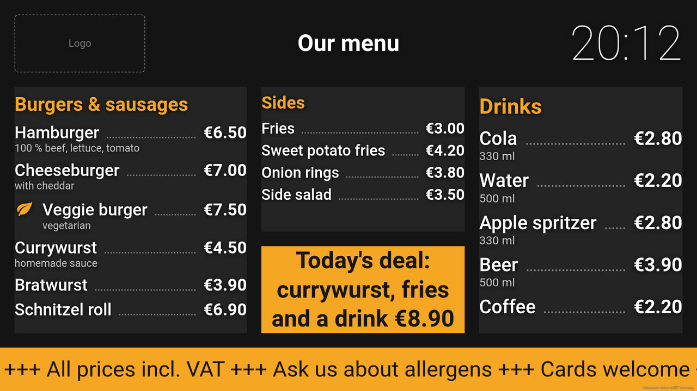
  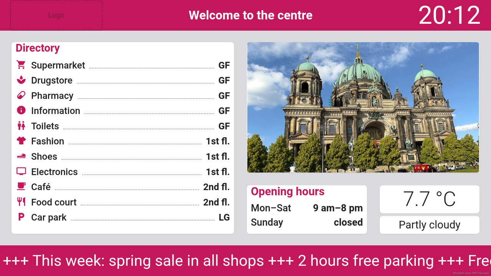
</p>
<p align="center">
  
  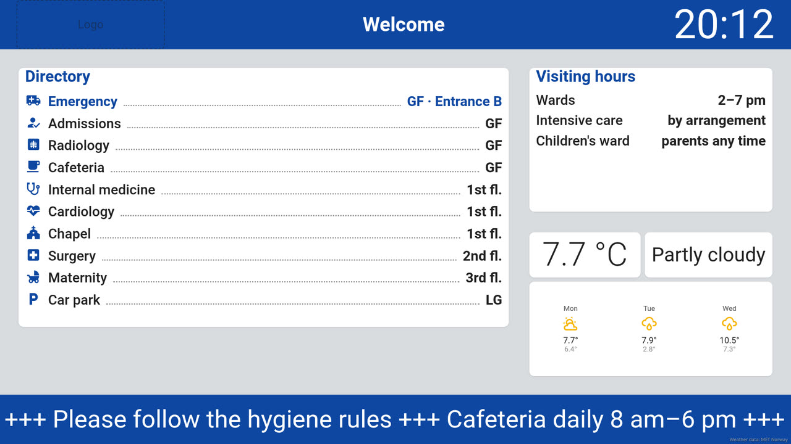
</p>
<p align="center">
  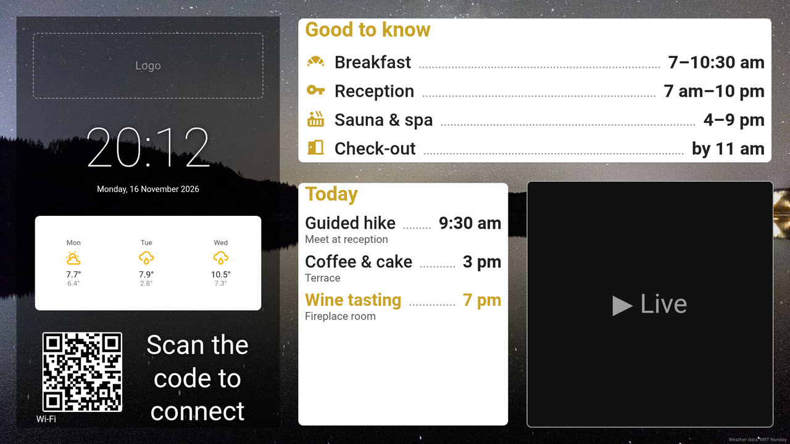
  
</p>
<p align="center">
  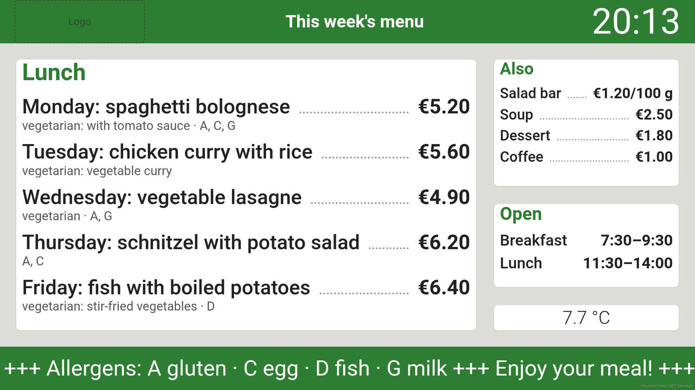
</p>

The pictures show the templates unchanged: “Logo” is the placeholder until you upload one, “▶ Live” is where the live
video runs, the photos in the shopping centre are an example gallery folder.

**Good to know:** templates without the live video (menu board, practice info, hospital, canteen) need about half the
CPU on the server (measured with the menu board: 63 % of a core and 780 MB instead of 129 % and 1040 MB with live video). Phone numbers, opening hours and prices are examples – check them before the screen goes live.

## Deutsch

Jedes neue Layout kann mit einer Vorlage beginnen: **Inhalte → Layouts → + Neues Layout → Ausgangspunkt**. Seit 0.53
gibt es Vorlagen für typische Orte, auf Deutsch und Englisch (je nach Sprache der Verwaltung): **Imbiss – Menütafel**,
**Einkaufszentrum – Info**, **Praxis – Info (Sprechzeiten)**, **Krankenhaus – Foyer**, **Hotel / Pension – Lobby**,
**Fitnessstudio / Verein** und **Kantine – Speiseplan**. Die Texte sind Beispiele – im Editor ersetzen, Logo hochladen,
wo vorhanden Galerie-Ordner oder Datenquelle wählen. Telefonnummern, Zeiten und Preise vor dem Einsatz prüfen.

Die meisten nutzen den neuen Baustein **Liste (Speisekarte, Zeiten, Wegweiser)**: Text links, kleiner Zusatz darunter,
Wert rechts, optional Symbol und Hervorhebung, bis 20 Zeilen in 1–3 Spalten. Statt fester Zeilen geht eine
**Datenquelle**, z. B. eine CSV-Datei mit den Spalten `text`, `info`, `wert` (andere Spaltennamen über Platzhalter wie
`{Gericht}`). Vorlagen ohne Live-Video brauchen etwa die Hälfte an CPU (gemessen mit der Menütafel: 63 % eines Kerns
und 780 MB statt 129 % und 1040 MB mit Live-Video).

<p align="center">
  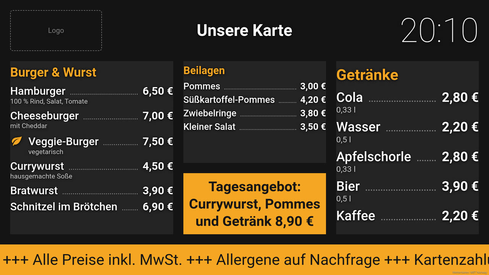
  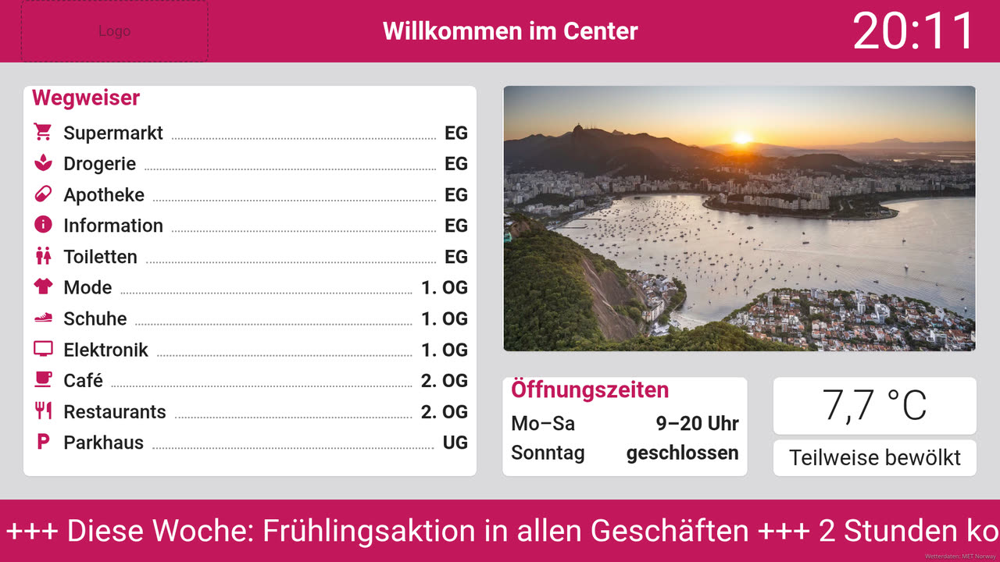
</p>
<p align="center">
  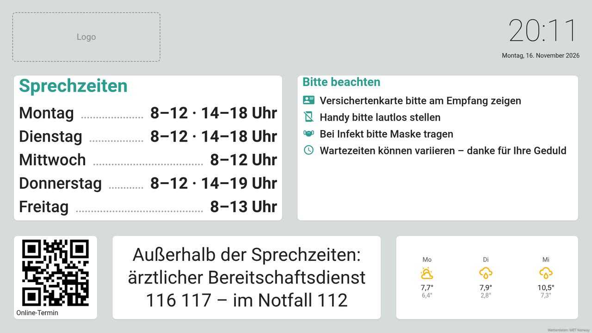
  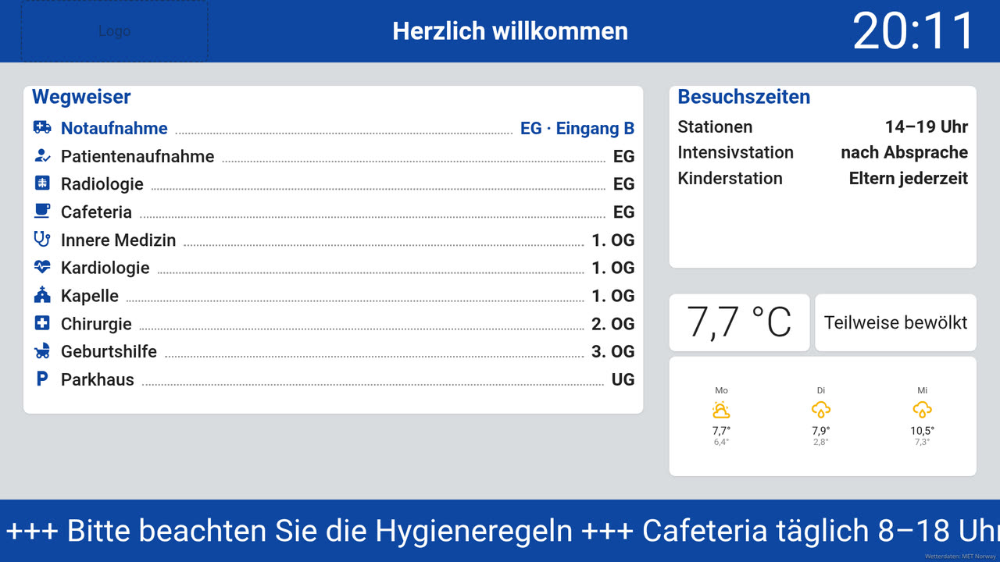
</p>
<p align="center">
  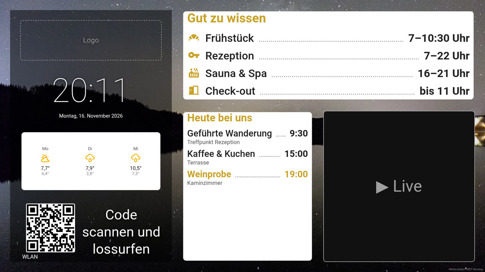
  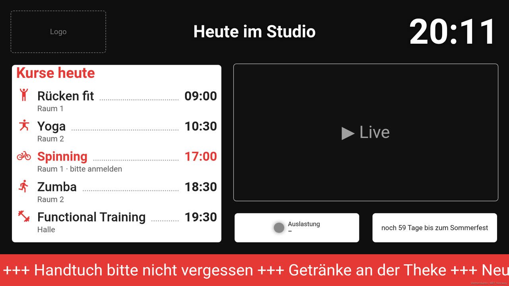
</p>
<p align="center">
  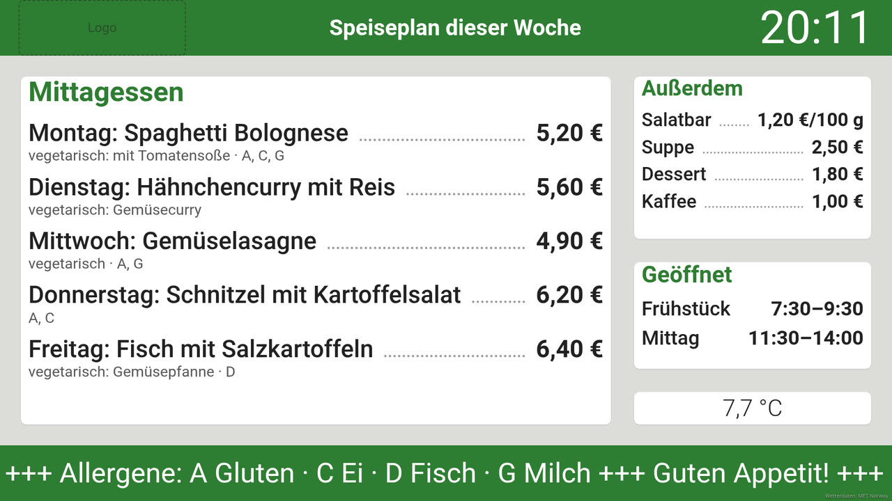
</p>
