# SignageCast – Bildschirm-Tour

Ein Rundgang durch SignageCast: was der Fernseher zeigt und wie du alles im Browser einstellst. Alle Bilder stammen
aus einer Demo-Installation (Standort Berlin, öffentliche bzw. erfundene Beispieldaten, kein Home Assistant
angebunden). Die Verwaltung zeigt Version 0.33 (Player-Karte 0.34, Übersicht 0.35) mit den sechs Bereichen Übersicht, Fernseher, Inhalte, Live-Videos,
Einstellungen und System.

**🇬🇧 [English version](TOUR.md)**

[← README](../README.md) · [Installation (englisch)](INSTALL.md) · [Handbuch (englisch)](MANUAL.md) · [Technik (englisch)](HOW-IT-WORKS.md)

---

## Auf dem Fernseher

### 1. Live-Fenster zur Welt
Eine Live-Tierkamera von dort, wo gerade Tag ist, daneben Uhr, Datum und Wetter von MET Norway. Die Leiste unten
mischt die Vorhersage mit eigenen Daten: Rheinpegel in Köln und Bitcoin-Kurs aus öffentlichen Schnittstellen und ein
Countdown bis Heiligabend. Unten im Videobild steht, was läuft und was als Nächstes kommt.

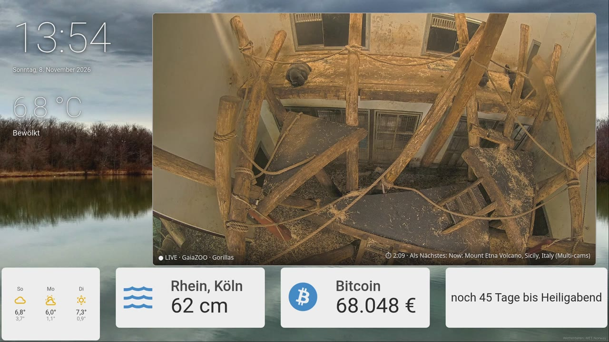

Derselbe Fernseher mit dem Layout „Fenster zur Welt“: das Video im Vollbild, Uhr und Wetter auf einer Glasfläche und
oben rechts der Baustein *Kalender / Müllabfuhr* als **reine Symbole** – Restmüll und Gelber Sack werden morgen
abgeholt, die Biotonne am Dienstag (Beispieldaten aus einer CSV-Datei). Die Symbole erscheinen drei Tage vor der
Abholung und verschwinden danach von selbst.

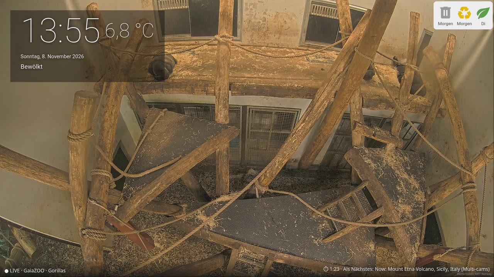

### 2. Daten-Dashboard
Ein Layout nur aus Datenquellen: Rheinpegel als Wert, als Balken und als 24-Stunden-Verlauf (echte Messwerte von
PEGELONLINE), Bitcoin-Kurs, die Nachrichten der tagesschau als Liste und als Laufband und ein QR-Code. Der Hintergrund
ist ein Wetterbild passend zur Tageszeit.

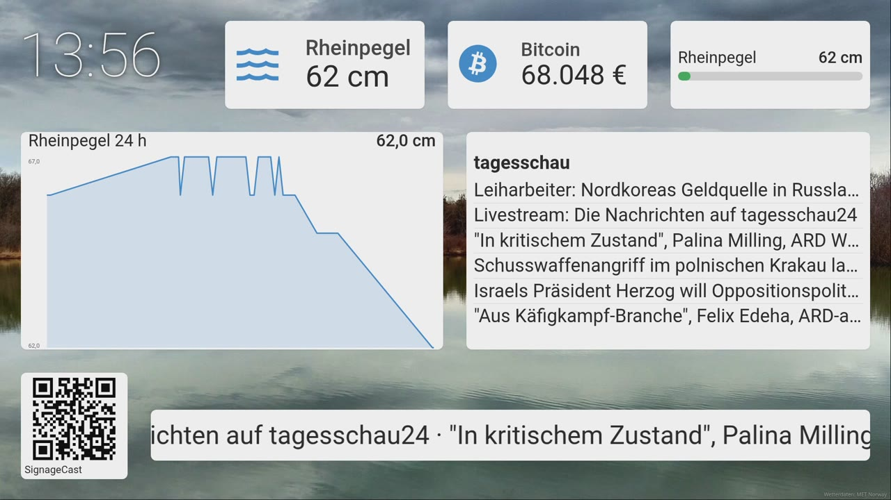

### 3. Empfang mit PDF, Webseite und Zeitraum
Ein Layout für den Empfang: ein **PDF** (Preisliste und Öffnungszeiten, die Seiten wechseln nach Zeit), eine
**Webseite als Bildschirmfoto** – GitHub verbietet das Einbetten, deshalb lädt SignageCast die Seite selbst und zeigt
alle 30 Minuten ein frisches Bild – und ein Hinweis mit **Zeitraum**: „Vom 24. Dezember bis 1. Januar geschlossen“
erscheint ab 1. November und verschwindet nach Neujahr von selbst. Unten läuft ein Laufband.

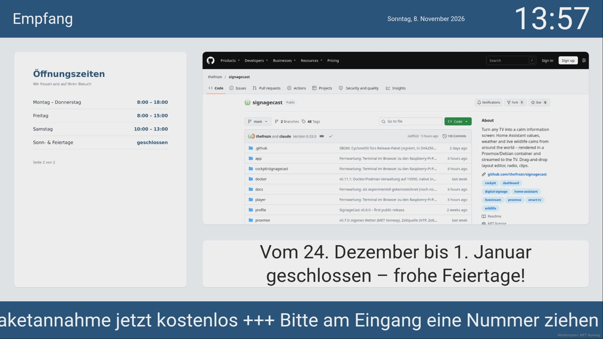

### 4. Notfall-Vollbild
Ein Klick in der Verwaltung, am Durchsage-Pult oder per Webhook: ein rotes Vollbild mit deinem Text über jedem Layout,
auch nachts („schwarz“), auf Wunsch mit einem Warnton alle 10 Sekunden.

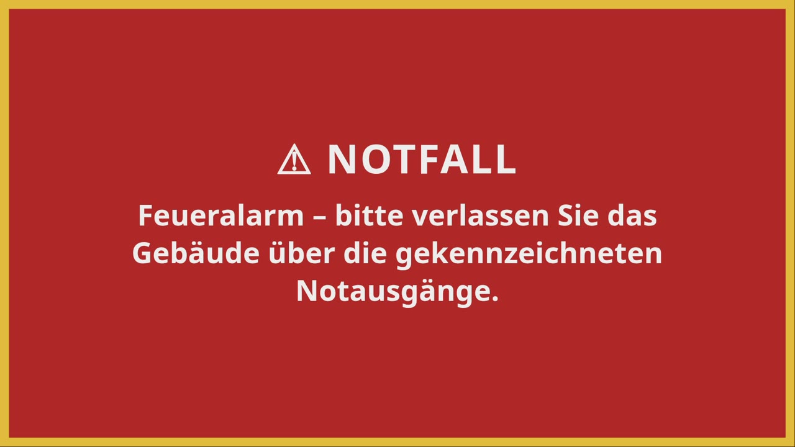

---

## Die Verwaltung

### 5. In Cockpit
Bei Proxmox-LXC und nativer Debian-Installation ist die Verwaltung eine Cockpit-Erweiterung – „SignageCast“ ist ein
Menüpunkt neben Cockpits eigenen Seiten. Läuft auf deinem Server schon Cockpit, fügt sich SignageCast dort ein.

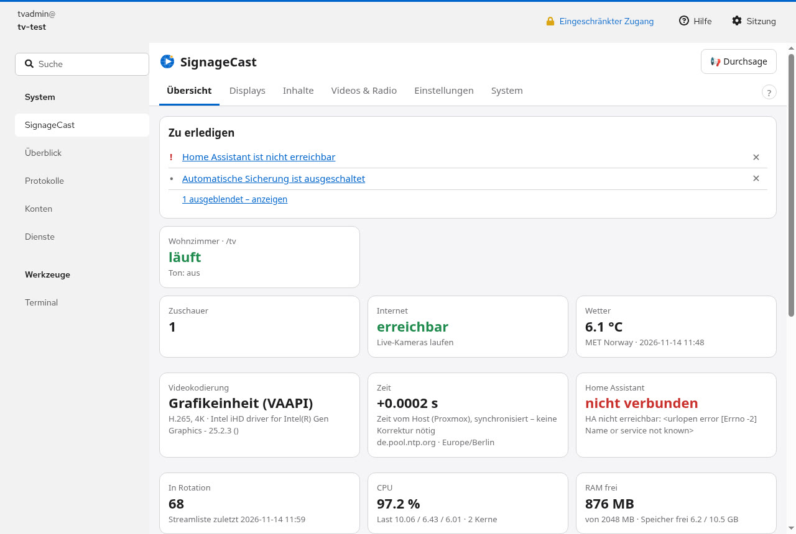

### 6. Übersicht
Oben die Liste **Zu erledigen**: zuerst Probleme (z. B. Home Assistant nicht erreichbar), dann Tipps (automatische
Sicherung aus, keine Benachrichtigung eingerichtet) – jeder Eintrag führt zur Seite, auf der du es behebst; das ✕ blendet ihn aus (Tipps dauerhaft, Probleme bis
sie einmal behoben waren, seit 0.35). Darunter
jeder Fernseher mit Zustand, aktuellem Stream, Auflösung und Ton, dann Zuschauer, Wetter, Zeitabgleich mit NTP („Zeit
vom Host, synchronisiert“), Videokodierung (Grafikeinheit oder Software), Home Assistant, Streams in Rotation, CPU,
RAM und Laufzeit.

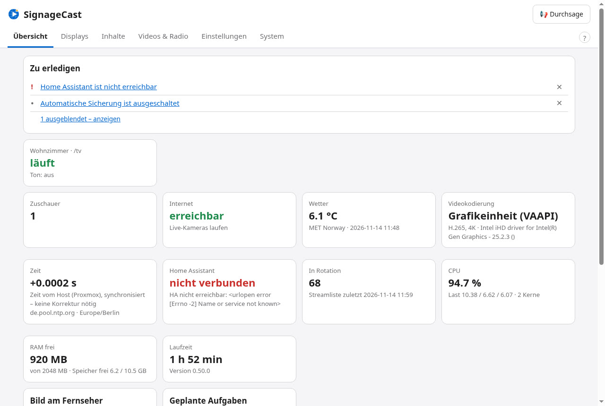

### 7. Fernseher
Jeder Fernseher hat eine eigene Adresse und eine Karte in drei Teilen: **Anzeige** (Layout, optionaler Zeitplan mit
anderem Layout oder schwarz zu bestimmten Zeiten, Layout-Karussell, Ein- und Ausschalten über Home Assistant),
**Live-Video** (an/aus, was das Videofenster zeigt, Kategorien) und **Ton** (Radio oder Originalton der Kameras,
Lautstärke). Unter *Videostream*: Ausgabe Full HD (Standard) oder 4K, die **Aufnahmegröße**, in der der Browser zeichnet
(720p spart CPU, 1440p ist schärfer), Bitrate und Codec.

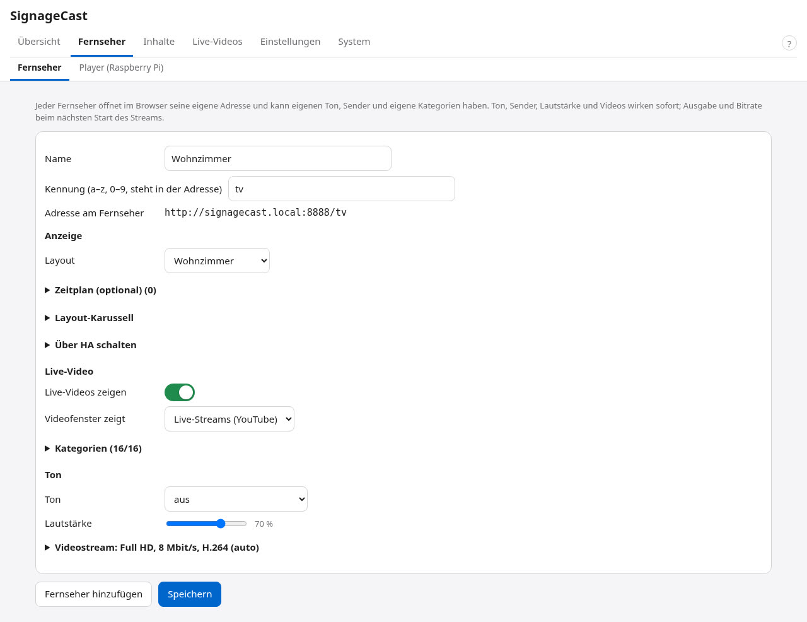

Unter *Videostream* → **Kodierung (für Fortgeschrittene)**: Encoder (Automatisch, Intel/AMD-Grafik, Quick Sync, NVENC,
Software), Preset, Tune und B-Frames je Fernseher. Eine Änderung wird erst kurz ausprobiert; läuft sie hier nicht,
bleibt SignageCast bei „Automatisch“. Felder, die für den aktiven Encoder nicht gelten, sind direkt dort erklärt.

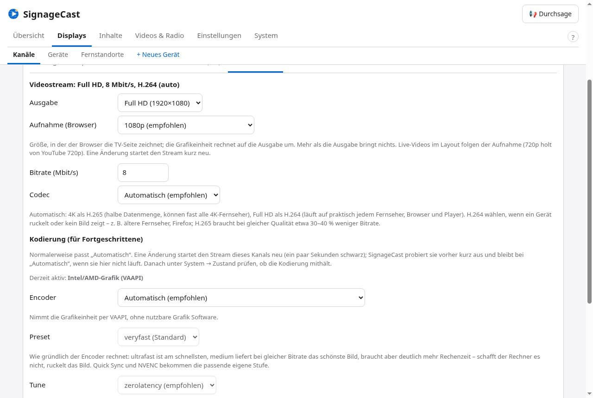

### 8. Raspberry Pi als Player (experimentell)
Fernseher → *Player*: Ein Pi am Fernseher zeigt den fertigen Stream per HDMI – auch an Fernsehern ohne
brauchbaren Browser. Name eingeben, Fernseher und Netzwerk (LAN oder WLAN) wählen, fertiges Image herunterladen und auf
eine SD-Karte schreiben; am Pi musst du nichts eintippen. Oder ein Image für viele Pis: Jeder zeigt einen 6-stelligen
Code auf dem Fernseher, den du hier zum Koppeln eingibst. Welcher Pi passt, steht gleich bei der Modellwahl: Für den Stream
reicht 1 GB Arbeitsspeicher, für den Direktmodus (Pi zeigt die Seite selbst) mindestens 2 GB, besser 4 GB (seit 0.34).
Danach verwaltest du jeden Pi hier: online, Modell mit Arbeitsspeicher, IP,
Bildschirm, Video, Temperatur, Knöpfe für Bildschirmfoto, TV ein/aus (HDMI-CEC), Neustart und Systemupdate und
WLAN-Wechsel mit automatischer Rückkehr ins alte Netz. Der Pi auf diesen Bildern ist simuliert (echter Agent-Code) –
am echten Gerät ist der Player noch nicht getestet ([Details](PLAYER.md#deutsch-raspberry-pi-als-player)). Seit 0.36 kann auch ein PC (x86-64 mit UEFI)
Player sein – er startet vom USB-Stick und zeigt die Seite selbst –, und ein *Browser-Gerät* ist nur ein geheimer Link
für einen Smart-TV oder einen Kiosk-Browser.

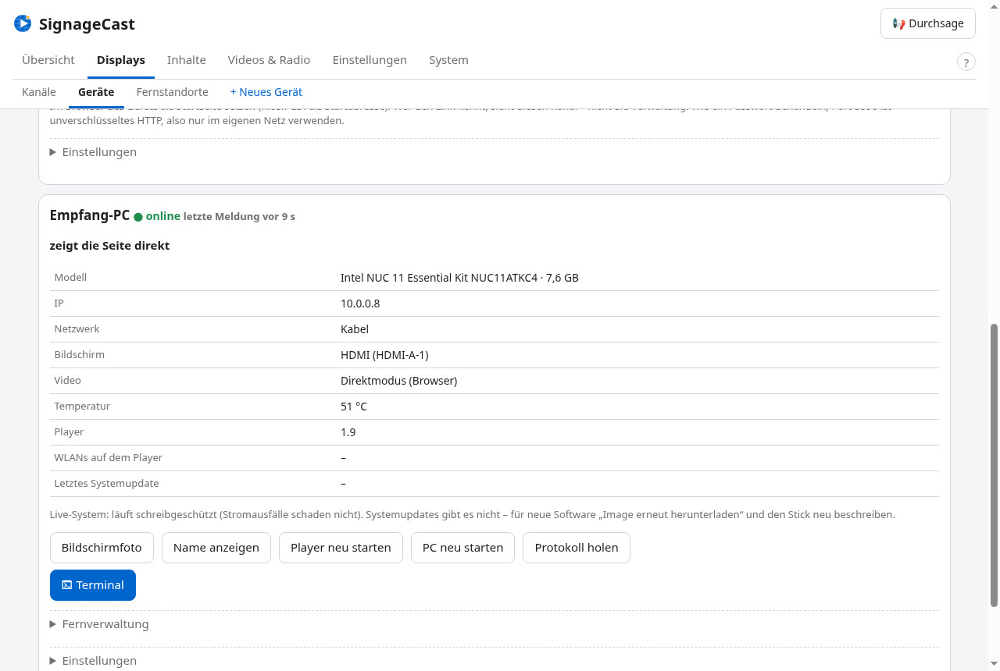

### 9. Fernwartung – Terminal zum Pi (experimentell, seit 0.33)
**Terminal** auf der Karte des Pi öffnet eine root-Shell im Browser, gezeichnet wie Cockpits eigenes Terminal. Ab Werk
aus: Der Pi selbst muss es erlauben (Haken beim Erstellen des Images oder auf seiner Einrichtungsseite) – so kommt auch
jemand, der den Server übernimmt, nicht auf Pis, die es nicht erlauben. Am Pi ist kein Port offen und kein SSH nötig;
Ein- und Ausgabe sind verschlüsselt. Auf dem Fernseher steht solange „Fernwartung aktiv“, nach 10 Minuten ohne Eingabe
oder spätestens nach 60 Minuten endet die Sitzung.

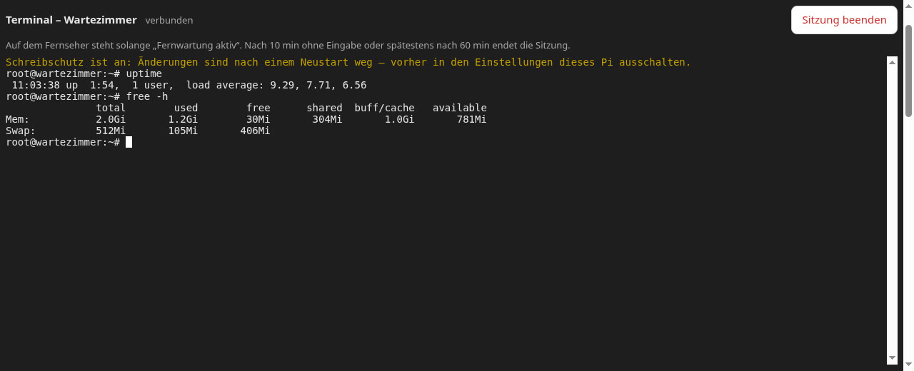

### 10. Layouts und Editor
Inhalte → Layout beginnt mit allen Layouts als Kacheln – Mini-Vorschau, auf welchem Fernseher es läuft, Bearbeiten
sowie Kopieren / Exportieren / Löschen im Menü „⋯“. „Neues Layout“ fragt nach Name und Ausgangspunkt (leer, Vorlage
oder Kopie), so wird nie ein bestehendes Layout überschrieben.

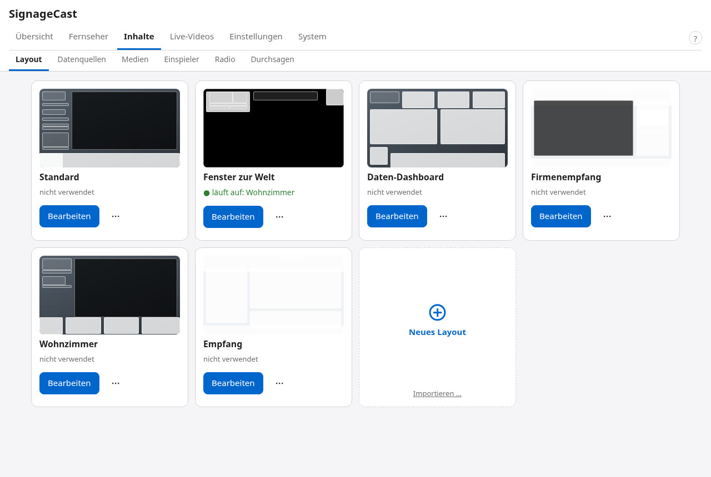

Im Editor ziehst du Bausteine auf einem Raster von 48 × 27 Feldern und änderst ihre Größe. Daneben die **Ebenen**
(oben = vorne, wie am Fernseher; ein-/ausblenden, nach vorne / nach hinten) und der gewählte Baustein – hier ein
Verlauf: den Wert wählst du mit „wählen …“ per Klick in der Antwort der Datenquelle. Mehrmals auf dieselbe Stelle
klicken wählt übereinanderliegende Bausteine, Tab den nächsten.

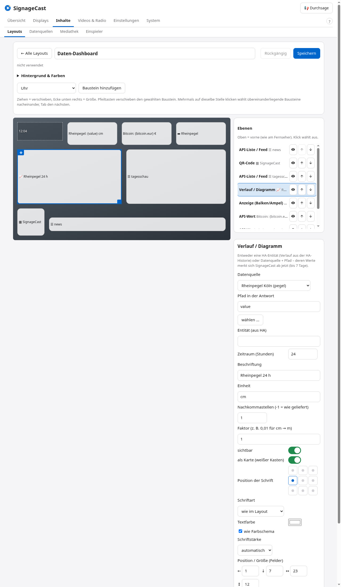

Jeder Baustein lässt sich auf einen **Zeitraum** begrenzen („Nur im Zeitraum …“: Datum, auf Wunsch mit Uhrzeit) – das
⏱ in den Ebenen und auf der Fläche markiert ihn. Bausteine wie **PDF** (bis 50 Seiten) und **Webseite** mit der
Darstellung „Bildschirmfoto“ für Seiten, die das Einbetten verbieten, ergeben Layouts wie den Empfang oben.

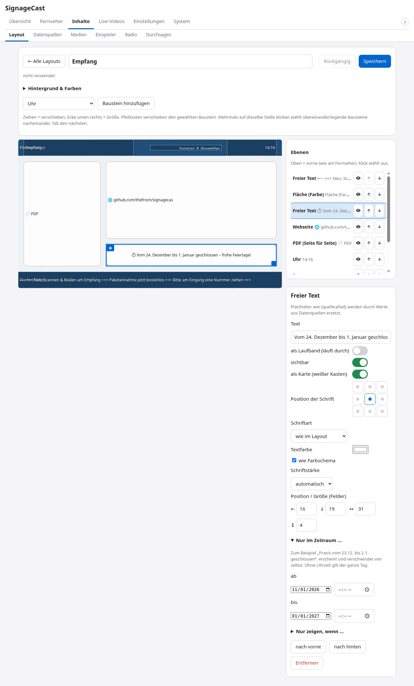

### 11. Datenquellen
Eigene JSON-Schnittstellen, RSS-/Atom-Feeds, Bilder, iCal-Kalender und Kameras, vom Container im gewählten Abstand
abgerufen. „Daten ansehen“ zeigt die Antwort als Baum; ein Klick kopiert den Pfad für Bausteine und Platzhalter. Statt
einer Adresse geht auch eine hochgeladene Datei (bis 1 MB) – z. B. der Abfuhrkalender deiner Stadt als `.ics` oder
`.csv`, wenn es keine Abo-Adresse gibt.

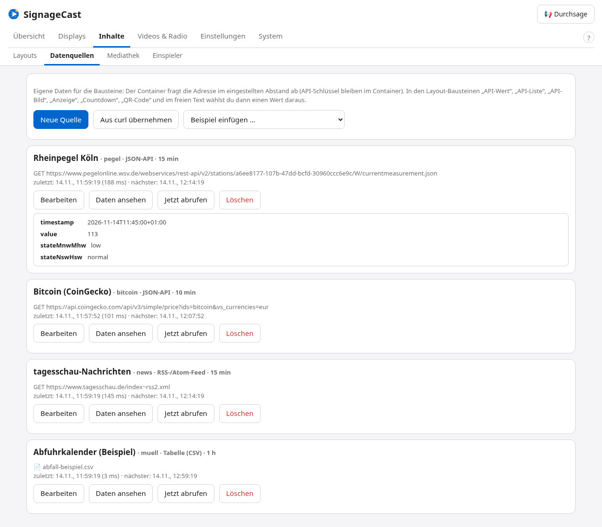

Bei CSV wählst du Trennzeichen, Anführungszeichen, Kopfzeile und Zeichensatz (alles wird erkannt), welche Spalten unter
welchem Namen übernommen werden, optionale Zeilenfilter und eine Datumsspalte: Die Zeilen erscheinen dann als Termine im
Baustein *Kalender / Müllabfuhr*. Hier ein Abfuhrkalender mit dem Filter *ORTSTEIL ist leer* – er wirft die Sperrmüll-
und Schadstofftermine eines anderen Ortsteils hinaus.

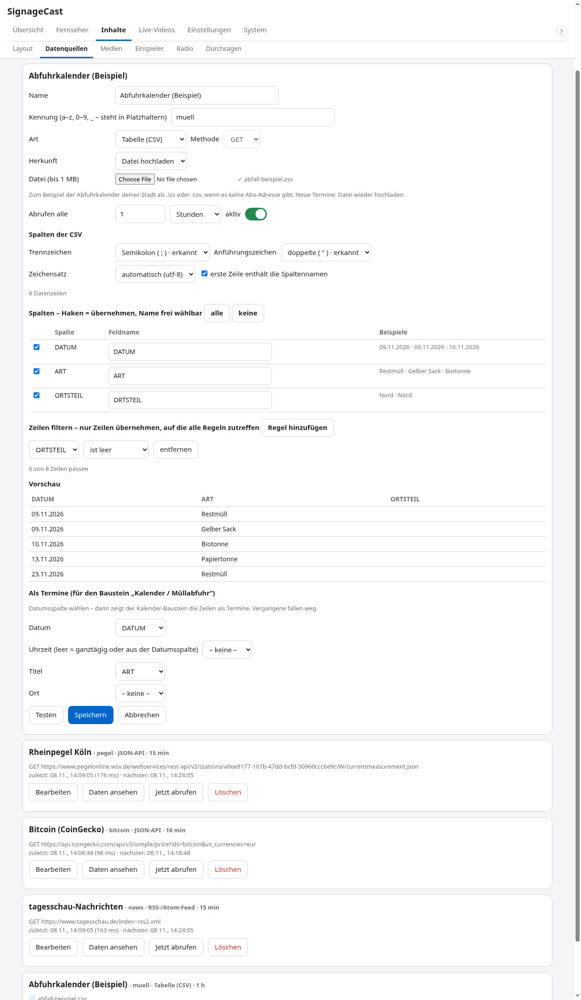

### 12. Aus curl übernehmen
Einen `curl`-Befehl aus einer API-Anleitung einfügen – Adresse, Methode und Kopfzeilen werden ausgefüllt,
`Authorization` wird automatisch als geheim markiert (nach dem Speichern nur als •••• sichtbar, nicht in Sicherungen,
außer du wählst es). Der Befehl wird nur gelesen, nie ausgeführt.

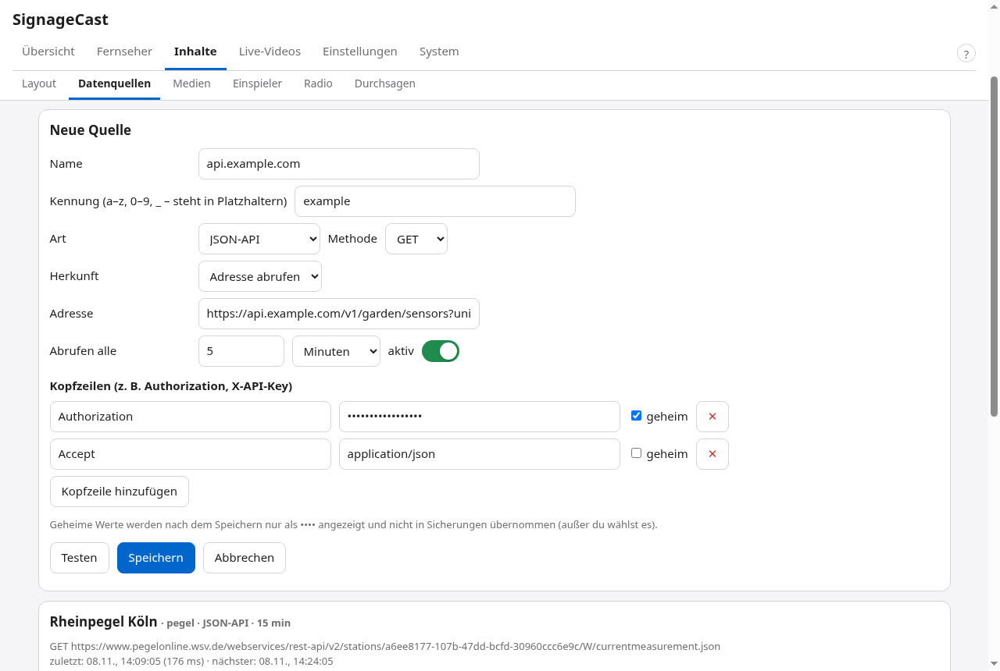

### 13. Live-Videos – Streams
Die eingebaute Liste mit Tier- und Natur-Livestreams plus die Funde der nächtlichen Suche. Jeder Stream hat einen
**Zustand** – bereit, Nacht (mit „Tageslicht in …“), nicht live, Auflösung zu gering, nach Strike pausiert, Ort
unbekannt –, und die Knöpfe über der Liste filtern danach (mit Anzahl), dazu Text, Kategorie und Herkunft (fest /
gefunden). Die Qualität wird beim Abspielen gemessen, und der nächste Stream wird bei YouTube geprüft, bevor er
angekündigt wird. Lieblinge schützen, Unerwünschtes ablehnen.

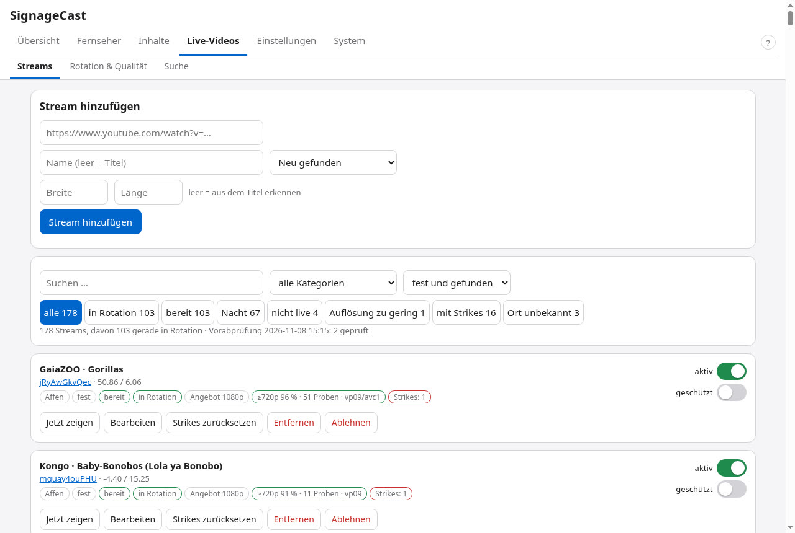

### 14. Live-Videos – Rotation & Qualität
Minuten je Stream, nur Streams, wo vor Ort Tag ist, Mindest-Sonnenhöhe; unter *Erweitert* die Mindestqualität
(360p … 1080p) und die Strike-Regeln. Die Kategorien sind in **Tiere** und **Weitere Themen** gegliedert (seit 0.32:
Städte & Plätze, Strände & Küsten, Berge & Ski, Häfen & Schiffe, Flughäfen & Flugzeuge, Züge & Bahn, Weltraum & Erde,
Naturschauspiele). Kategorien, die ein Update neu bringt, starten auf bestehenden Installationen ausgeschaltet.

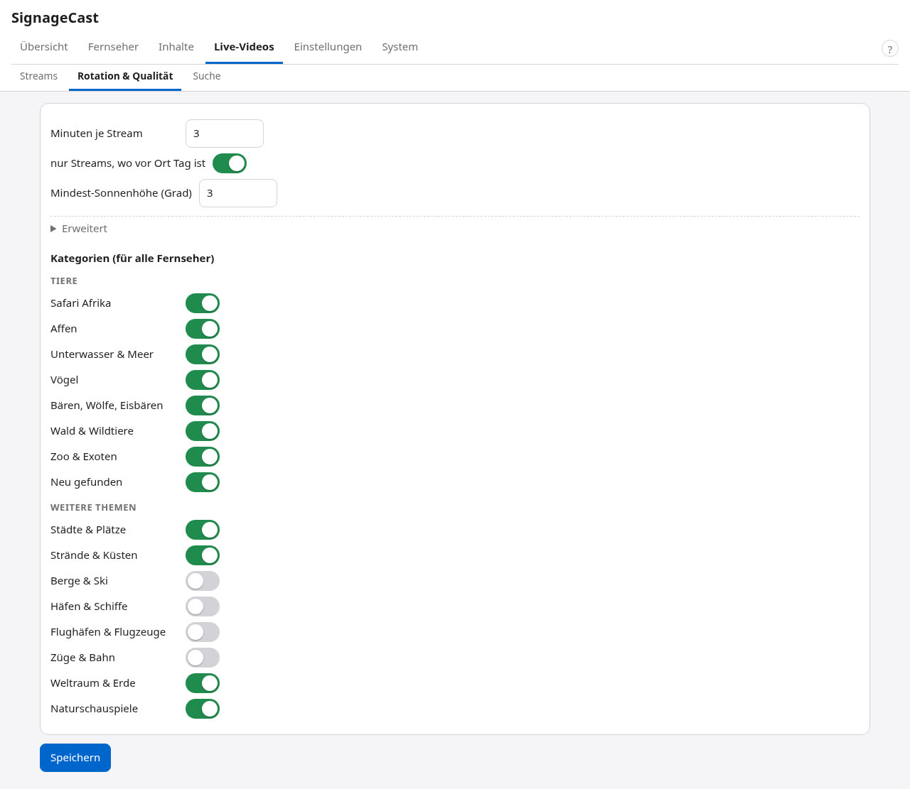

### 15. Radio
Inhalte → Radio: eigene Sender (MP3/AAC, auch .m3u/.pls), Vorschläge für deinen Standort von radio-browser.info und ein
Puffer, der kurze Aussetzer überbrückt.

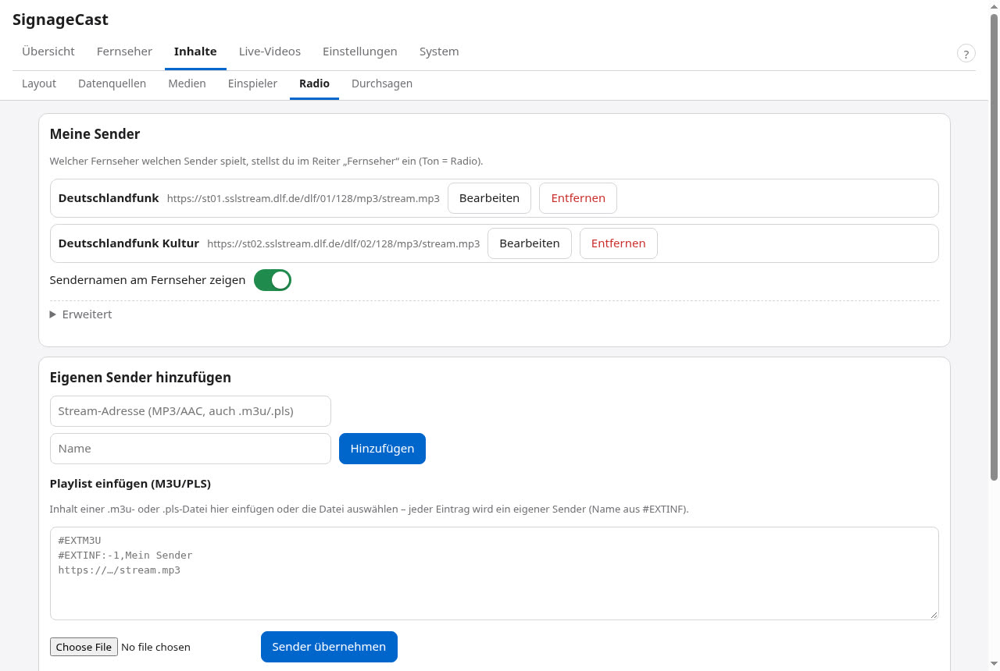

### 16. Einspieler
Zu festen Minuten unterbricht ein Einspieler die Rotation – z. B. „tagesschau in 100 Sekunden“. Puffer: Der Container
lädt jede neue Ausgabe vorab (ganz oder nur das erste MB), damit der Einspieler ohne Stocken läuft.

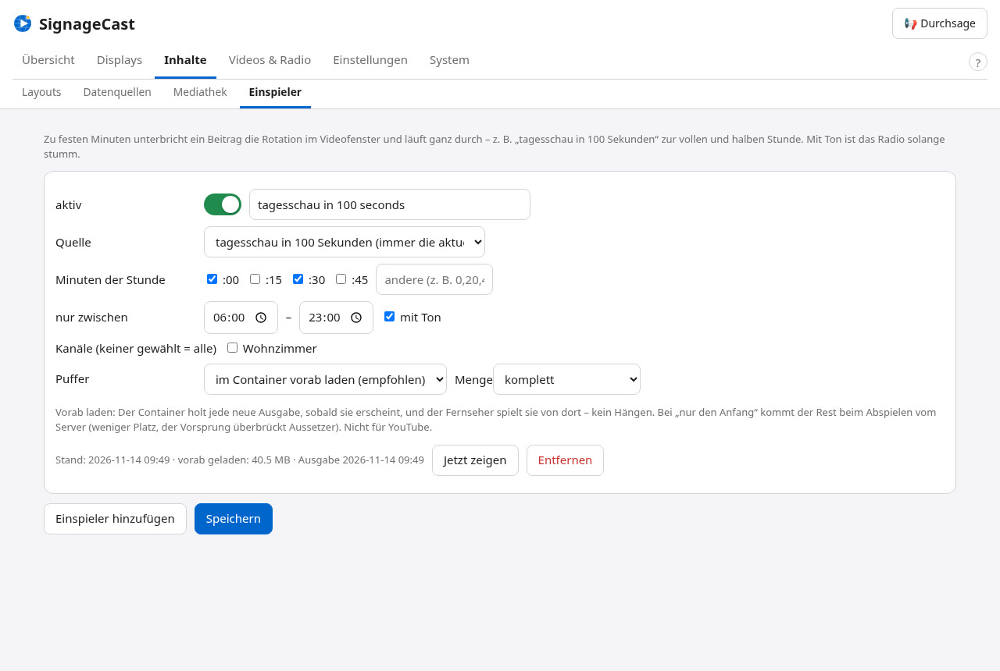

### 17. Einstellungen → Allgemein
Sprache und Wetterquelle, Standort per Ortssuche, Zeitquelle: NTP-Server (Standard: der Pool des Landes) und Zeitzone –
hält der Host seine Uhr synchron, wird nichts korrigiert. Home Assistant und Benachrichtigungen haben eigene Seiten
daneben. Ungespeicherte Änderungen werden an ihrer Karte markiert, und vor dem Verlassen der Seite wird gefragt.

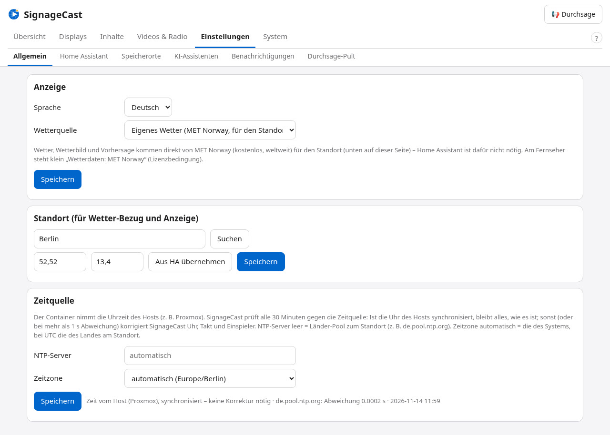

### 18. Updates
Debian- und SignageCast-Updates per Klick oder automatisch in einem Wartungsfenster, nur wenn niemand zuschaut. Releases
sind signiert und haben eine Stückliste (SBOM); installiert wird nur mit gültiger Signatur, und läuft SignageCast danach
nicht, geht es automatisch auf die vorige Version zurück.

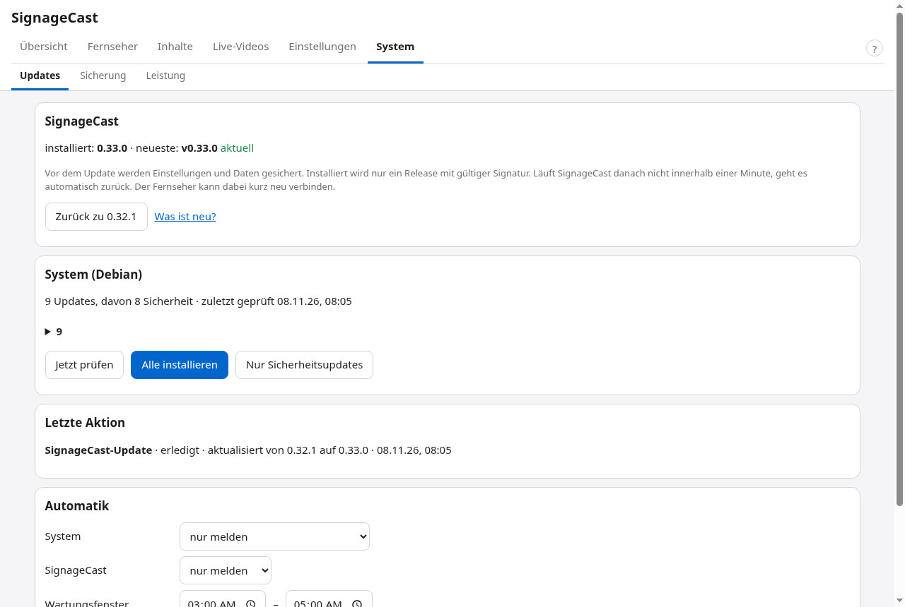

### 19. Sicherung
Ein ZIP mit Einstellungen, Streamliste, Bildern und Verlauf der Diagramme. Ob Zugangsdaten und Passwörter mit hinein
sollen, wird ausdrücklich gefragt – dann ist das ZIP mit AES-256 verschlüsselt und ein starkes Passwort Pflicht.
Automatische Sicherung täglich oder wöchentlich; Einspielen in der Verwaltung oder bei der Installation einer neuen
Instanz.

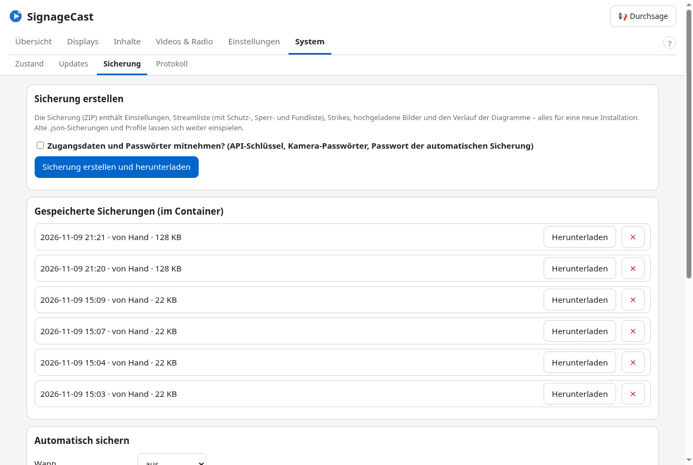

### 20. Docker / Podman
Im Container-Image gibt es kein Cockpit: Dieselbe Verwaltung kommt mit eigener Anmeldung auf Port 19090; das
Startpasswort steht im Container-Protokoll. Geändert wird es unter Einstellungen → Zugang.

### 21. Auf dem Handy
Die Verwaltung geht auch auf dem Handy – die Bereiche werden zu einem Menü; Bausteine ein- und ausschalten, Größen,
Ton, Quellen ändern.

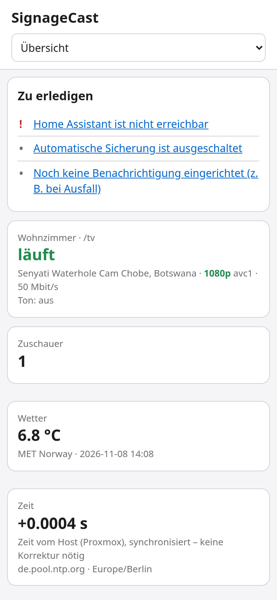

### 22. Benachrichtigungen
Telegram, E-Mail (SMTP) und Home Assistant, jeweils mit Test-Knopf; selten gebrauchte Optionen unter „Erweitert“, und
wann gemeldet wird: Fernseher ausgefallen, Update oder Sicherung fehlgeschlagen, Home Assistant getrennt, Fernseher
ruckelt.

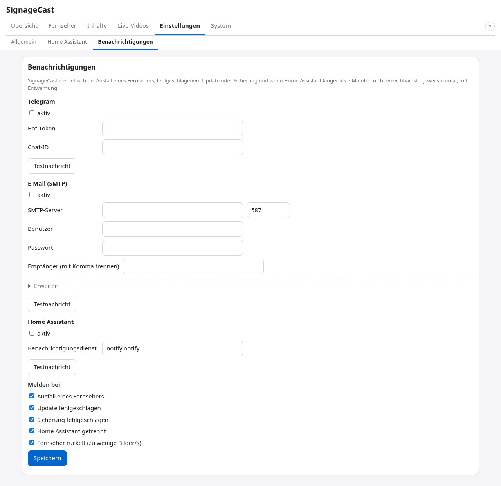

### 23. Leistungstest
System → Leistung misst 10 Sekunden lang, wie flüssig jeder laufende Fernseher gezeichnet und kodiert wird – Bilder/s
der TV-Seite und des Encoders, Tempo, verworfene oder doppelte Bilder, CPU je Fernseher, Speicher, Grafikeinheit – und
gibt konkrete Empfehlungen. Eine zweite Seite, auf dem Abspielgerät geöffnet, misst dort Übertragung und Wiedergabe.
Darunter: nach wie vielen Sekunden ohne Zuschauer der Videostream eines Fernsehers abschaltet.

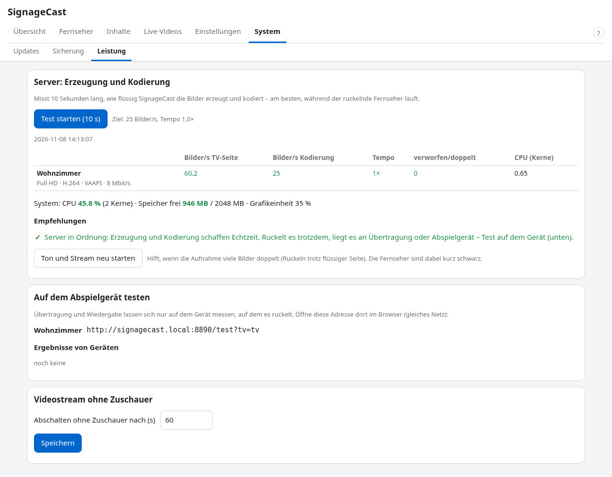

### 24. Durchsagen, Notfall-Vollbild und Webhook
Inhalte → Durchsagen: das Pult für den Empfang (`http://<IP>:8890/pult` – es kann nur Durchsagen senden und beenden),
die Stimme (offline mit Piper: Kerstin oder Thorsten), Gong, Zugänge mit eigenem Passwort und den Fernsehern, die sie
erreichen dürfen, und Vorlagen. Weiter unten das **Notfall-Vollbild** mit Vorlagen und Webhook-Befehlen und die
**Meldung per Webhook**: Andere Systeme (z. B. Home Assistant) legen ein kurzes Banner auf die Fernseher, mit einem
Schlüssel, der nur einmal angezeigt wird.

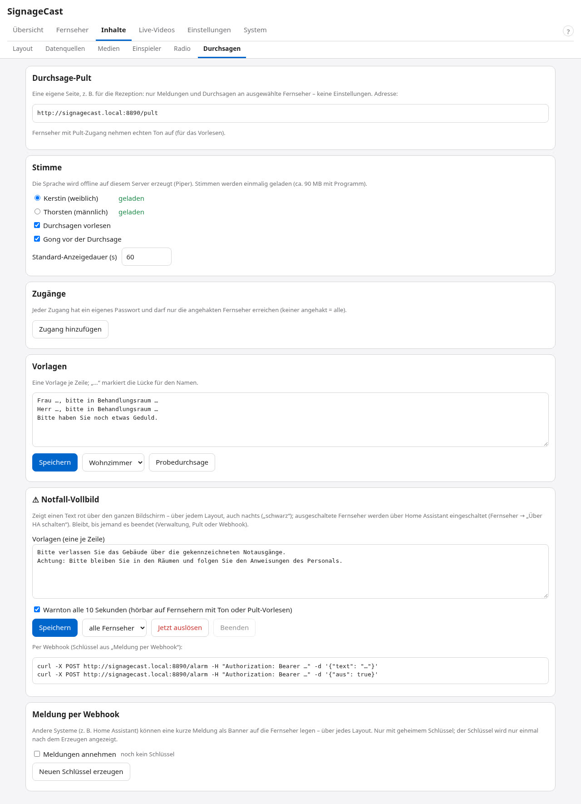
