# SignageCast – Tour

Ein Rundgang durch SignageCast: was der Fernseher zeigt und wie du alles im Browser einstellst. Alle Bilder stammen
aus einer Demo-Installation (Standort Berlin, öffentliche bzw. erfundene Beispieldaten, kein Home Assistant
angebunden). Die Verwaltung zeigt Version 0.68: Das Menü nennt die Dinge, die du verwaltest – Übersicht, Kanäle, Geräte,
Layouts, Datenquellen, Medien, Live-Videos, Radiosender –, rechts davon die **Einstellungen** als Kacheln und oben rechts
die Knöpfe **📢 Durchsage** und **⚠ Notfall** ([UI-Regel](UI-RULES.de.md)).

**🇬🇧 [English version](TOUR.md)**

[← README](../README.md) · [Live-Demo](https://thefrozn.github.io/signagecast/?sprache=de) · [Installation (englisch)](INSTALL.md) · [Handbuch (englisch)](MANUAL.md) · [Technik (englisch)](HOW-IT-WORKS.md)

---

## Auf dem Fernseher

### 1. Live-Fenster zur Welt
Eine Live-Tierkamera von dort, wo gerade Tag ist, daneben Uhr, Datum und Wetter von MET Norway. Die Leiste unten
mischt die Vorhersage mit eigenen Daten: Rheinpegel in Köln und Bitcoin-Kurs aus öffentlichen Schnittstellen und ein
Countdown bis Heiligabend. Unten im Videobild steht, was läuft und was als Nächstes kommt.

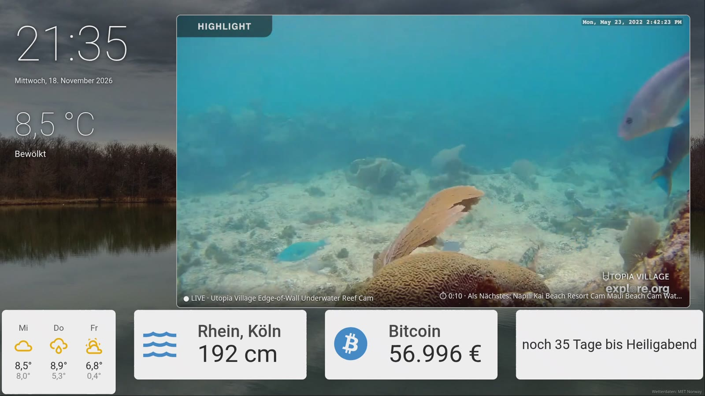

Derselbe Fernseher mit dem Layout „Fenster zur Welt“: das Video im Vollbild, Uhr und Wetter auf einer Glasfläche und
oben rechts der Baustein *Kalender / Müllabfuhr* als **reine Symbole** – Restmüll und Gelber Sack werden morgen
abgeholt, die Biotonne am Dienstag (Beispieldaten aus einer CSV-Datei). Die Symbole erscheinen drei Tage vor der
Abholung und verschwinden danach von selbst.

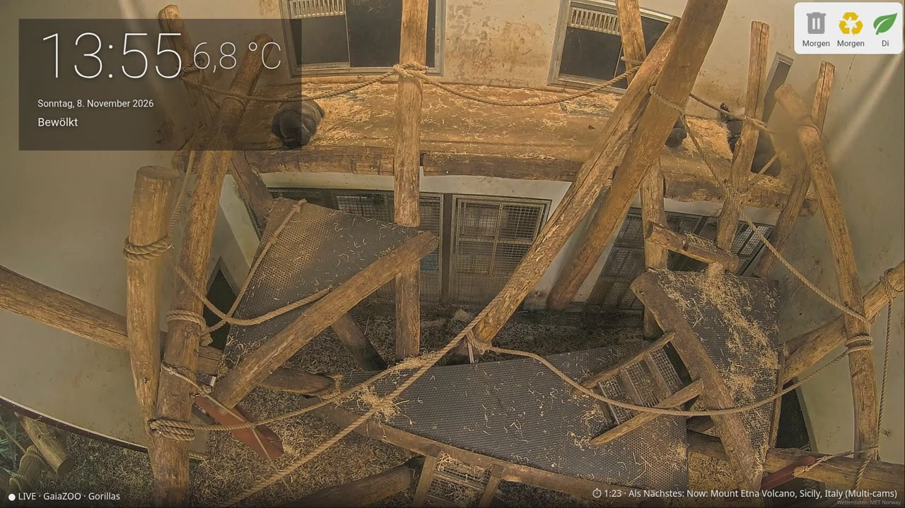

### 2. Daten-Dashboard
Ein Layout nur aus Datenquellen: Rheinpegel als Wert, als Balken und als 24-Stunden-Verlauf (echte Messwerte von
PEGELONLINE), Bitcoin-Kurs, die Nachrichten der tagesschau als Liste und als Laufband und ein QR-Code. Der Hintergrund
ist ein Wetterbild passend zur Tageszeit.

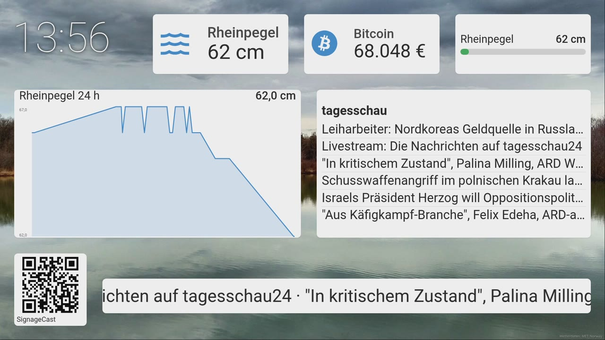

### 3. Empfang mit PDF, Webseite und Zeitraum
Ein Layout für den Empfang: ein **PDF** (Preisliste und Öffnungszeiten, die Seiten wechseln nach Zeit), eine
**Webseite als Bildschirmfoto** – GitHub verbietet das Einbetten, deshalb lädt SignageCast die Seite selbst und zeigt
alle 30 Minuten ein frisches Bild – und ein Hinweis mit **Zeitraum**: „Vom 24. Dezember bis 1. Januar geschlossen“
erscheint ab 1. November und verschwindet nach Neujahr von selbst. Unten läuft ein Laufband.

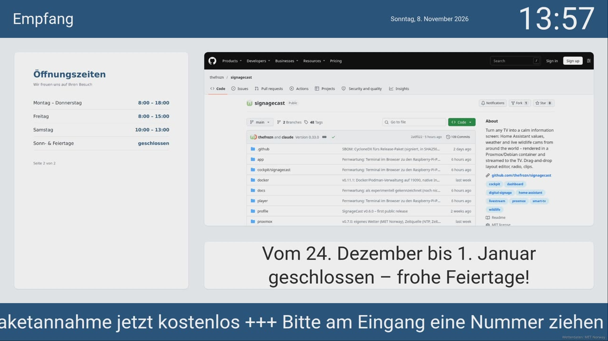

### 4. Notfall-Vollbild
Ein Klick in der Verwaltung, am Durchsage-Pult oder per Webhook: ein rotes Vollbild mit deinem Text über jedem Layout,
auch nachts („schwarz“), auf Wunsch mit einem Warnton alle 10 Sekunden.

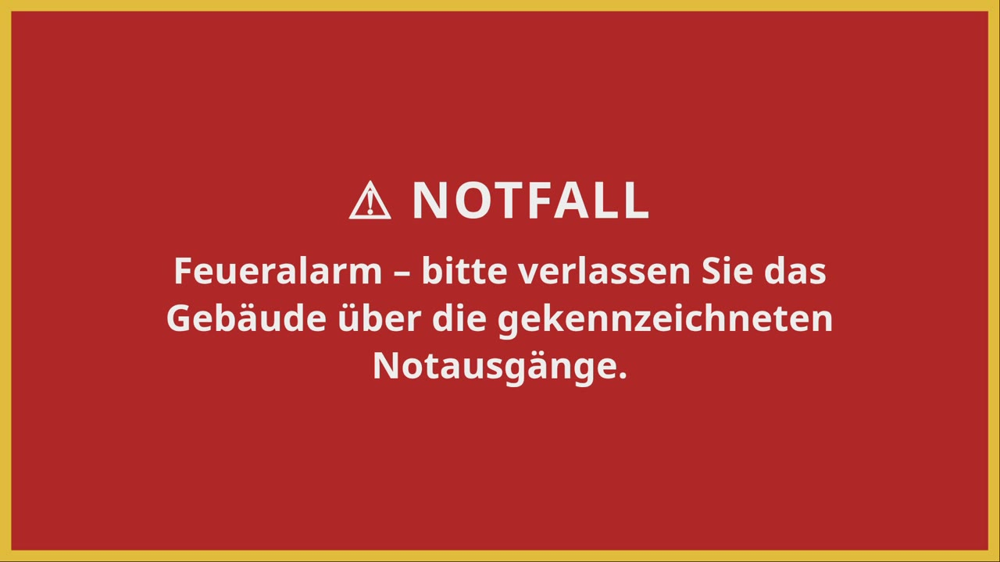

---

## Die Verwaltung

### 5. In Cockpit
Bei Proxmox-LXC und nativer Debian-Installation ist die Verwaltung eine Cockpit-Erweiterung – „SignageCast“ ist ein
Menüpunkt neben Cockpits eigenen Seiten. Läuft auf deinem Server schon Cockpit, fügt sich SignageCast dort ein.

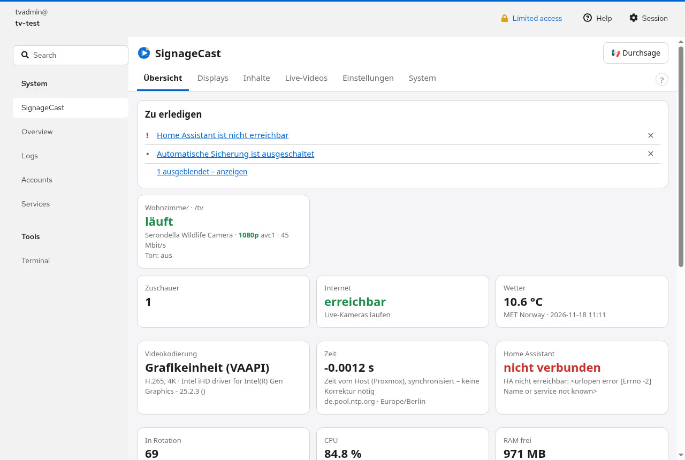

### 6. Übersicht
Oben die Liste **Zu erledigen**: zuerst Probleme (z. B. Home Assistant nicht erreichbar), dann Tipps (automatische
Sicherung aus, keine Benachrichtigung eingerichtet) – jeder Eintrag führt zur Seite, auf der du es behebst; das ✕ blendet ihn aus (Tipps dauerhaft, Probleme bis
sie einmal behoben waren, seit 0.35). Darunter
jeder Kanal mit Zustand, aktuellem Stream, Auflösung und Ton, dann Zuschauer, Wetter, Zeitabgleich mit NTP („Zeit
vom Host, synchronisiert“), Videokodierung (Grafikeinheit oder Software), Home Assistant, Live-Videos in Rotation, CPU,
RAM und Laufzeit. Seit 0.38 zeigt eine Kachel, ob das **Internet** erreichbar ist (ohne zeigen die Fernseher eigene
Medien oder ein ruhiges Bild), und die Karte eines Kanals sagt, wenn die **Bildprüfung** ein schwarzes oder
stehendes Bild gefunden hat.

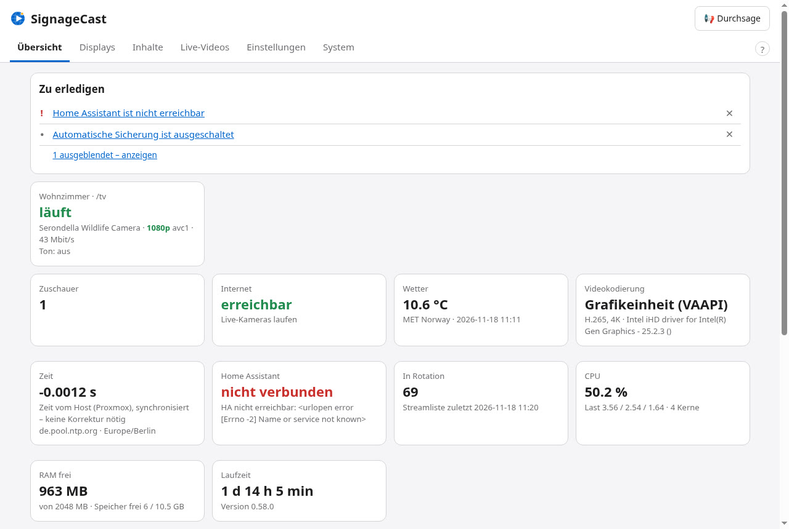

### 7. Kanäle
Ein **Kanal** ist das, was ein Fernseher zeigt – mit eigener Adresse, die ein Gerät oder der Browser des Fernsehers
öffnet. Die Liste ist eine Tabelle: je Kanal der Zustand in Klartext mit dem Layout, welche Geräte ihn zeigen (online
oder offline) und die letzte Änderung, darüber eine Suche und oben rechts *+ Neuer Kanal*.

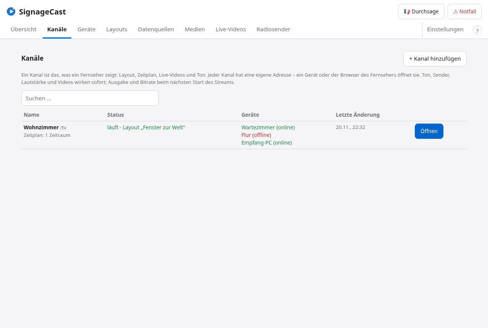

*Öffnen* zeigt einen Kanal mit Reitern in fester Reihenfolge: **Übersicht** (Zustand, gerade laufendes Live-Video, Ton,
Geräte, Adresse und die Schnellaktionen *TV-Seite neu laden*, *Stream neu starten* und ein frisches Bild dieses Kanals),
**Anzeige & Zeitplan**, **Live-Video**, **Ton**, **Videostream** und **Verlauf** (was genau mit diesem Kanal passiert
ist). *Löschen* steht unten und sagt, wo der Kanal noch verwendet wird.

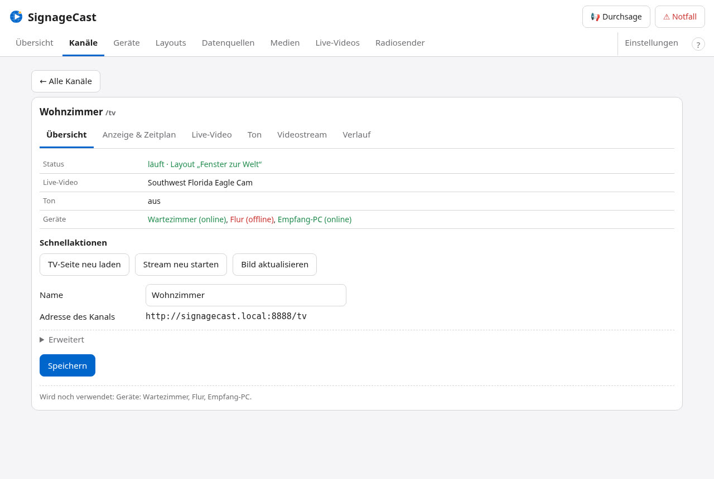

**Anzeige & Zeitplan** enthält das Layout, einen optionalen Zeitplan mit anderem Layout oder schwarz zu bestimmten Zeiten,
das Layout-Karussell und – seit 0.66 im selben Reiter – *Ein/Aus über Home Assistant* (Schalten, Zustand laut HA, nach dem
Einschalten Quelle wählen und die TV-Seite öffnen). **Videostream** stellt Ausgabe Full HD oder 4K, Aufnahmegröße,
Bitrate und Codec ein; gespeichert wird je Kanal.

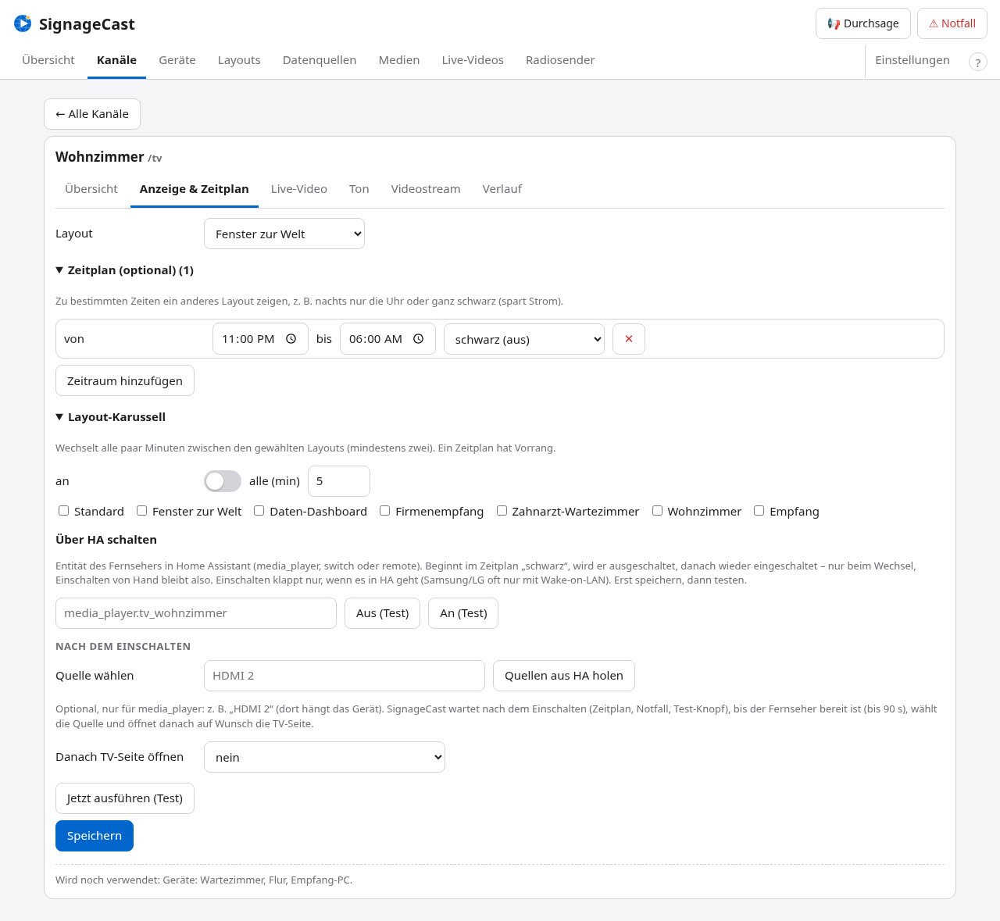

Im Reiter *Videostream* → **Kodierung (für Fortgeschrittene)**: Encoder (Automatisch, Intel/AMD-Grafik, Quick Sync, NVENC,
Software), Preset, Tune und B-Frames je Kanal. Eine Änderung wird erst kurz ausprobiert; läuft sie hier nicht,
bleibt SignageCast bei „Automatisch“.

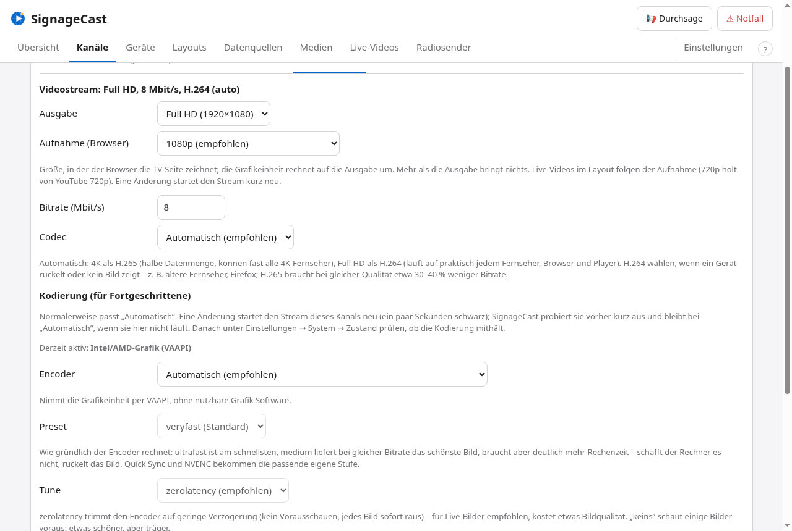

### 8. Geräte – Raspberry Pi, PC oder Browser (experimentell)
Ein **Gerät** am Fernseher zeigt einen Kanal – auch an Fernsehern ohne brauchbaren Browser. *+ Neues Gerät* → *Gerät
hinzufügen*: Name eingeben, Kanal, **Modell** und Netzwerk (LAN oder WLAN) wählen, fertiges Image herunterladen und auf
eine SD-Karte oder einen USB-Stick schreiben; am Gerät musst du nichts eintippen. Oder ein Image für viele Geräte: Jedes
zeigt einen 6-stelligen Code auf dem Fernseher, den du unter *Geräte koppeln* eingibst.

- **Raspberry Pi** – zeigt den fertigen Stream per HDMI; dafür reicht 1 GB Arbeitsspeicher. Im Direktmodus (der Pi
  zeigt die Seite selbst, der Server muss nichts kodieren) mindestens 2 GB, besser 4 GB.
- **PC** (seit 0.36) – ein normaler PC, Mini-PC oder Thin Client (x86-64 mit UEFI, Secure Boot darf an bleiben) startet
  vom USB-Stick, ohne seine Festplatte anzufassen, und zeigt die Seite im Direktmodus selbst.
- **Browser-Gerät** (seit 0.36) – ganz ohne Image, nur ein geheimer Link für einen Smart-TV, einen Fire-TV-Stick oder
  einen Kiosk-Browser.

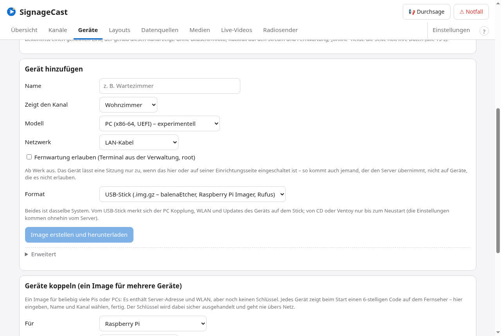

Die Geräteliste zeigt jedes Gerät mit seinem Zustand in Klartext („online“, „offline seit …“), seinem Kanal und der
letzten Änderung. *Öffnen* zeigt die Reiter **Übersicht** (Zustand, Bildschirmfoto, Modell, IP, Bildschirm, Temperatur
und Befehle wie *Wiedergabe neu starten*, TV ein/aus per HDMI-CEC oder Systemupdate), **Fernverwaltung** (was ans Gerät
ging und wann es abgeholt wurde), **Einstellungen** (Name, Kanal, Modell, Drehung, Direktmodus, WLAN, neues Image) und
**Verlauf**; *Entfernen* steht unten. Die Geräte auf diesen Bildern sind simuliert (echter Agent-Code)
([Details](PLAYER.md#deutsch-raspberry-pi-als-player)).

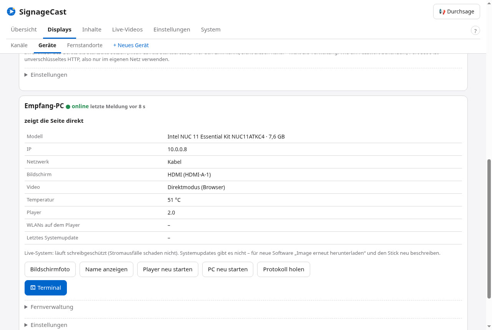

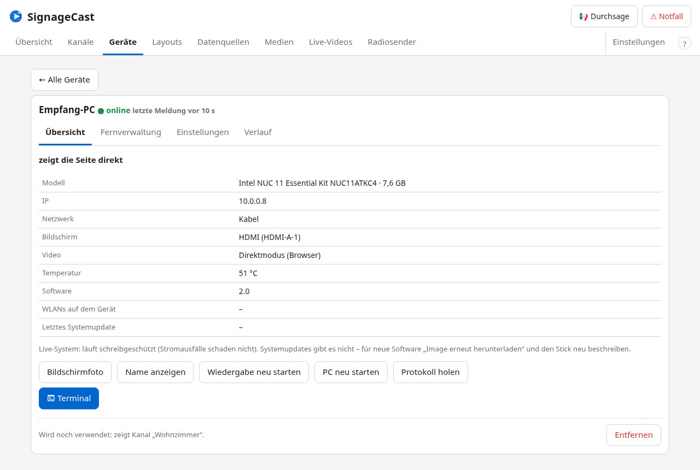

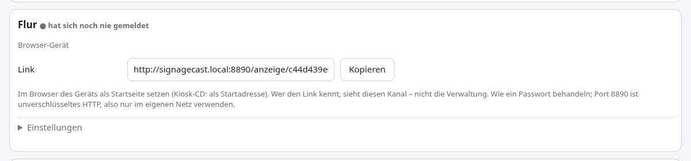

### 9. Fernwartung – Terminal zum Pi (experimentell, seit 0.33)
**Terminal** im Reiter *Übersicht* des Pi öffnet eine root-Shell im Browser, gezeichnet wie Cockpits eigenes Terminal. Ab Werk
aus: Der Pi selbst muss es erlauben (Haken beim Erstellen des Images oder auf seiner Einrichtungsseite) – so kommt auch
jemand, der den Server übernimmt, nicht auf Pis, die es nicht erlauben. Am Pi ist kein Port offen und kein SSH nötig;
Ein- und Ausgabe sind verschlüsselt. Auf dem Fernseher steht solange „Fernwartung aktiv“, nach 10 Minuten ohne Eingabe
oder spätestens nach 60 Minuten endet die Sitzung.

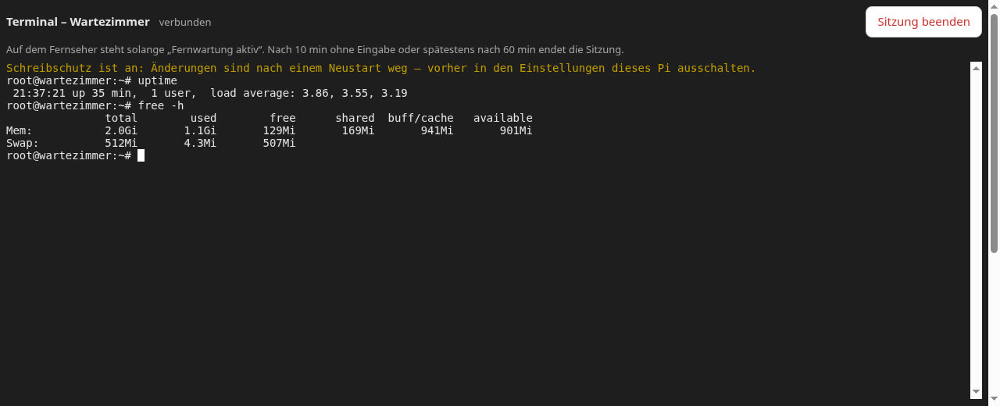

### 10. Layouts und Editor
Layouts beginnt mit allen Layouts als Kacheln – Mini-Vorschau, auf welchem Kanal es läuft und die letzte Änderung,
darüber eine Suche und oben rechts *+ Neues Layout*. „Neues Layout“ fragt nach Name und Ausgangspunkt (leer, Vorlage
oder Kopie), so wird nie ein bestehendes Layout überschrieben.

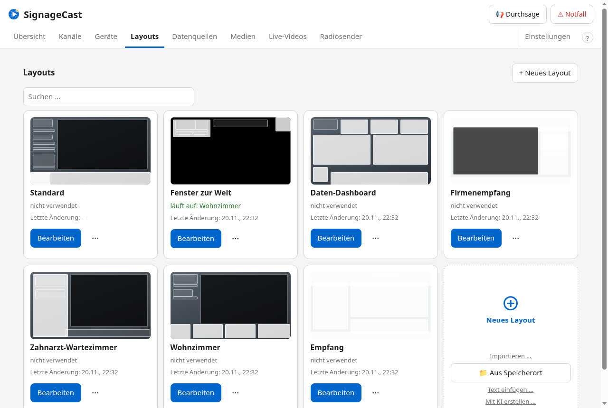

Ein geöffnetes Layout hat die Reiter **Übersicht** (Vorschau, wo es verwendet wird – Kanal, Zeitplan, Karussell –, Zahl
der Bausteine, Kopieren, Exportieren, Versionen), **Designer** (öffnet zuerst) und **Verlauf**; *Löschen* steht unten
und bleibt gesperrt, solange ein Kanal das Layout nutzt.

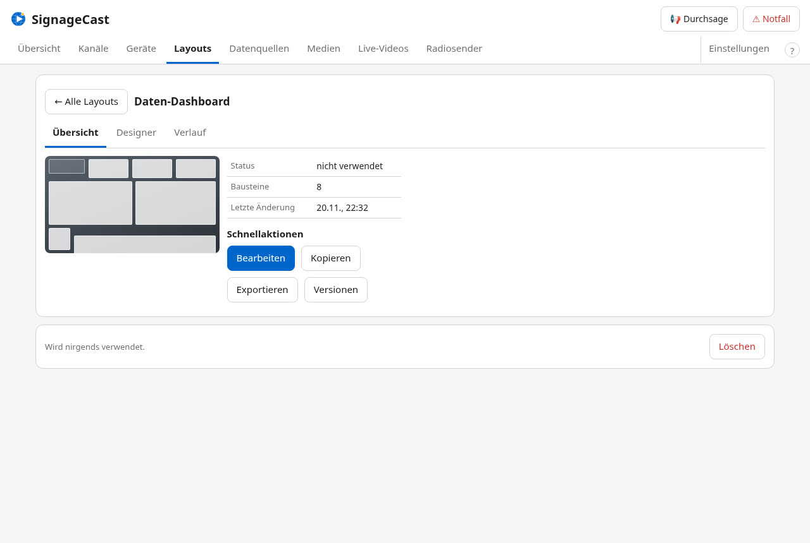

Im Editor ziehst du Bausteine auf einem Raster von 48 × 27 Feldern und änderst ihre Größe. Daneben die **Ebenen**
(oben = vorne, wie am Fernseher; ein-/ausblenden, nach vorne / nach hinten) und der gewählte Baustein – hier ein
Verlauf: den Wert wählst du mit „wählen …“ per Klick in der Antwort der Datenquelle. Mehrmals auf dieselbe Stelle
klicken wählt übereinanderliegende Bausteine, Tab den nächsten.

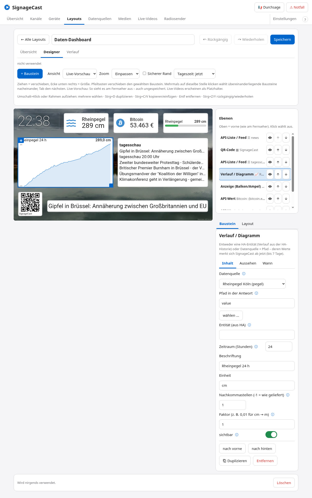

Jeder Baustein lässt sich auf einen **Zeitraum** begrenzen („Nur im Zeitraum …“: Datum, auf Wunsch mit Uhrzeit) – das
⏱ in den Ebenen und auf der Fläche markiert ihn. Bausteine wie **PDF** (bis 50 Seiten) und **Webseite** mit der
Darstellung „Bildschirmfoto“ für Seiten, die das Einbetten verbieten, ergeben Layouts wie den Empfang oben.

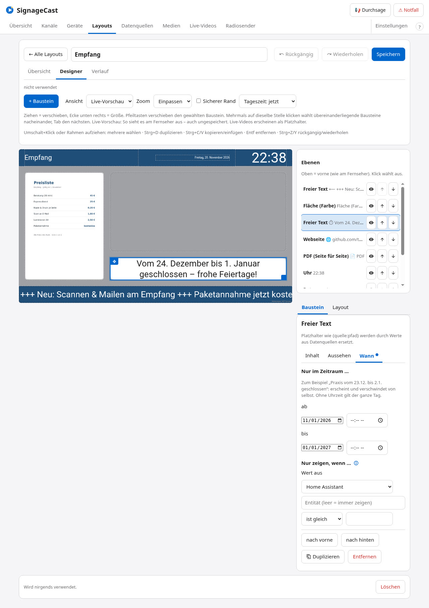

Seit 0.59 hat das Feld rechts die Reiter **Baustein** (mit *Inhalt*, *Aussehen* und *Wann* und einer ⓘ-Hilfe je
Feld) und **Layout** (Hintergrund, Farben, Schrift), und *Zoom* zeigt die Leinwand bis 200 %.

Seit 0.58 öffnet **+ Baustein** eine Leiste mit allen Bausteinen nach Gruppen – anklicken setzt ihn an eine freie
Stelle, oder du ziehst ihn auf die Leinwand. **Umschalt+Klick** oder ein aufgezogener Rahmen auf freier Fläche wählt
mehrere Bausteine: zusammen verschieben, ausrichten oder gleich verteilen, duplizieren (Strg+D) oder entfernen; Strg+Z /
Strg+Y nimmt zurück und wiederholt. Ein **⚠** markiert, was die Live-Vorschau schwer lesbar findet: Schrift aus 3 m zu
klein, wenig Kontrast, Inhalt passt nicht, verdeckte Bausteine oder mehr als ein Live-Video.

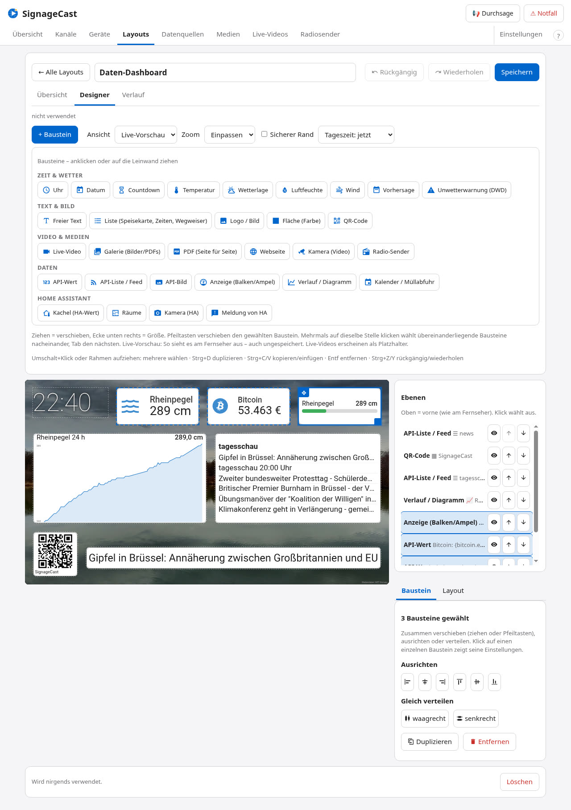

Seit 0.38 kopiert **„Mit KI erstellen …“** eine Anleitung mit dem vollständigen Layout-Format: in ChatGPT, Claude oder
Gemini einfügen, Wunsch beschreiben, die Antwort mit **„Text einfügen …“** übernehmen – SignageCast repariert, was
geht, und listet es auf. Im Menü „⋯“ hebt **Versionen** die letzten 10 Fassungen jedes Layouts auf (wiederherstellen
oder herunterladen), *Gelöschte Layouts* unter den Kacheln holt gelöschte zurück.

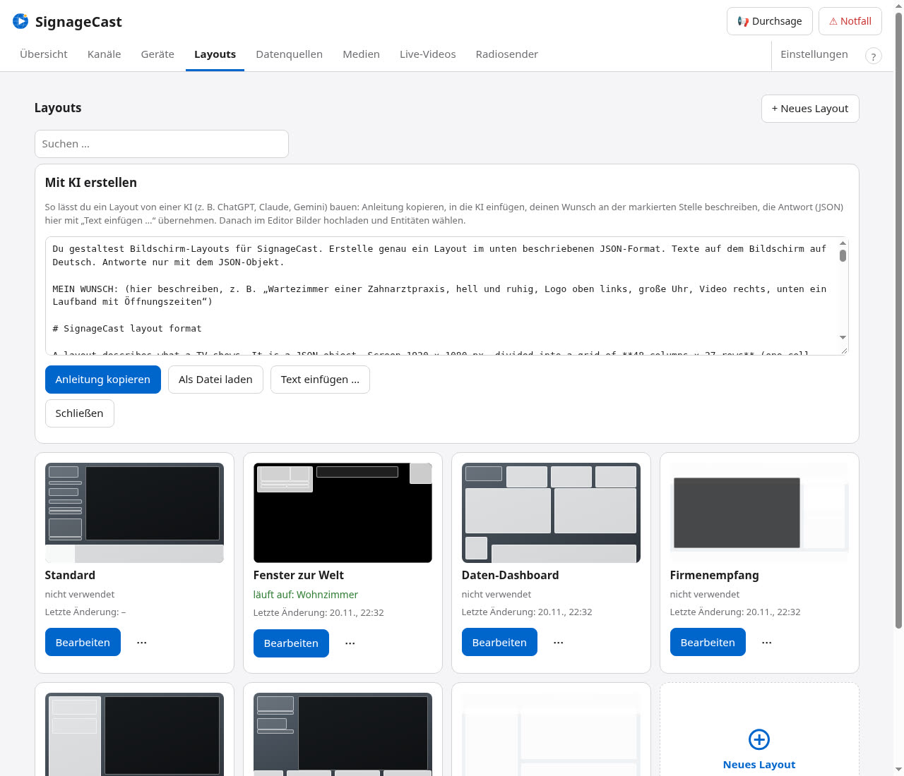

### 11. Datenquellen
Eigene JSON-Schnittstellen, RSS-/Atom-Feeds, Bilder, iCal-Kalender, Tabellen (CSV) und Kameras, vom Container im
gewählten Abstand abgerufen. Seit 0.57 ist die Seite eine **Liste**: je Quelle Art, Herkunft, Abstand, **in welchen
Layouts sie benutzt wird**, der **letzte Wert** und eine Ampel – aktuell, wartet auf den ersten Abruf oder der Fehler in
Klartext. Ein Klick öffnet rechts die Details: Zustand, *Benutzt in*, *Werte ansehen* – Wert antippen ergibt den Pfad
für Bausteine und den Platzhalter für freien Text –, die Einstellungen, der *Verlauf* dieser Quelle und unten *Löschen*.

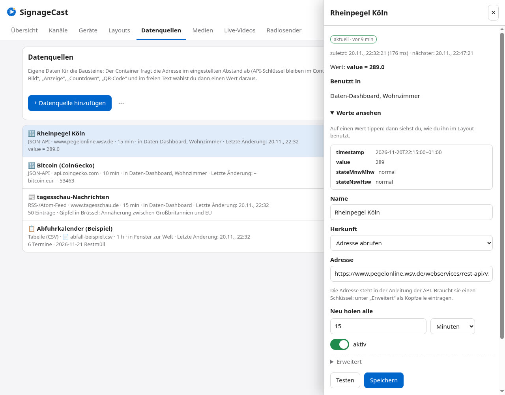

**+ Datenquelle hinzufügen** führt in drei Schritten: **Was?** (Kacheln für Nachrichten, Wert aus dem Netz, Kalender,
Tabelle, Bild, Kamera, Text – oder ein Beispiel), **Woher?** (Adresse, hochgeladene Datei bis 1 MB oder Datei aus einem
Speicherort, Abstand) und **Werte** (*Testen*, dann den gewünschten Wert antippen). Technisches – Kennung, Methode,
Kopfzeilen – steht unter *Erweitert*.

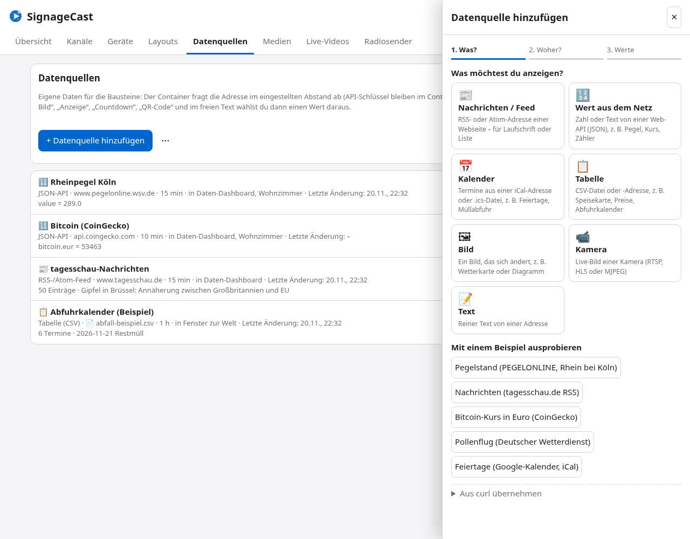

Bei CSV wählst du Trennzeichen, Anführungszeichen, Kopfzeile und Zeichensatz (alles wird erkannt), welche Spalten unter
welchem Namen übernommen werden, optionale Zeilenfilter und eine Datumsspalte: Die Zeilen erscheinen dann als Termine im
Baustein *Kalender / Müllabfuhr*. Hier ein Abfuhrkalender mit dem Filter *ORTSTEIL ist leer* – er wirft die Sperrmüll-
und Schadstofftermine eines anderen Ortsteils hinaus.

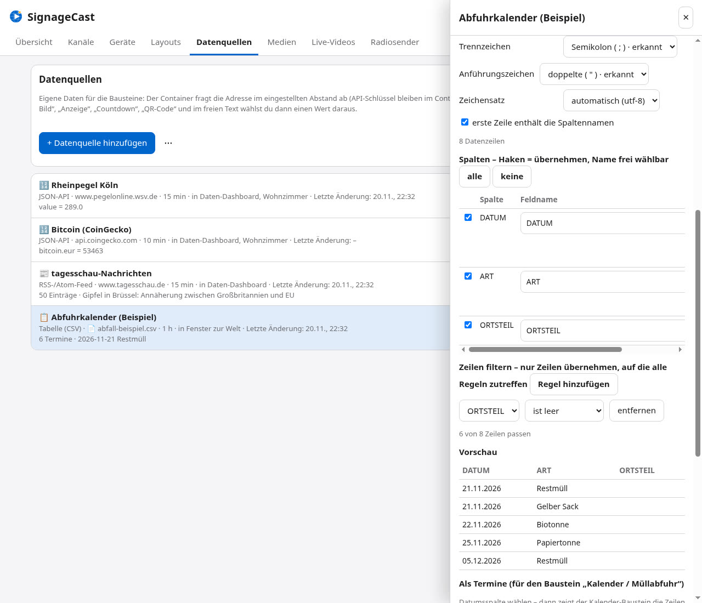

### 12. Aus curl übernehmen
⋯ → *Aus curl-Befehl übernehmen …*: einen `curl`-Befehl aus einer API-Anleitung einfügen – Adresse, Methode und
Kopfzeilen werden ausgefüllt, `Authorization` wird automatisch als geheim markiert (nach dem Speichern nur als ••••
sichtbar, nicht in Sicherungen, außer du wählst es). Der Befehl wird nur gelesen, nie ausgeführt.

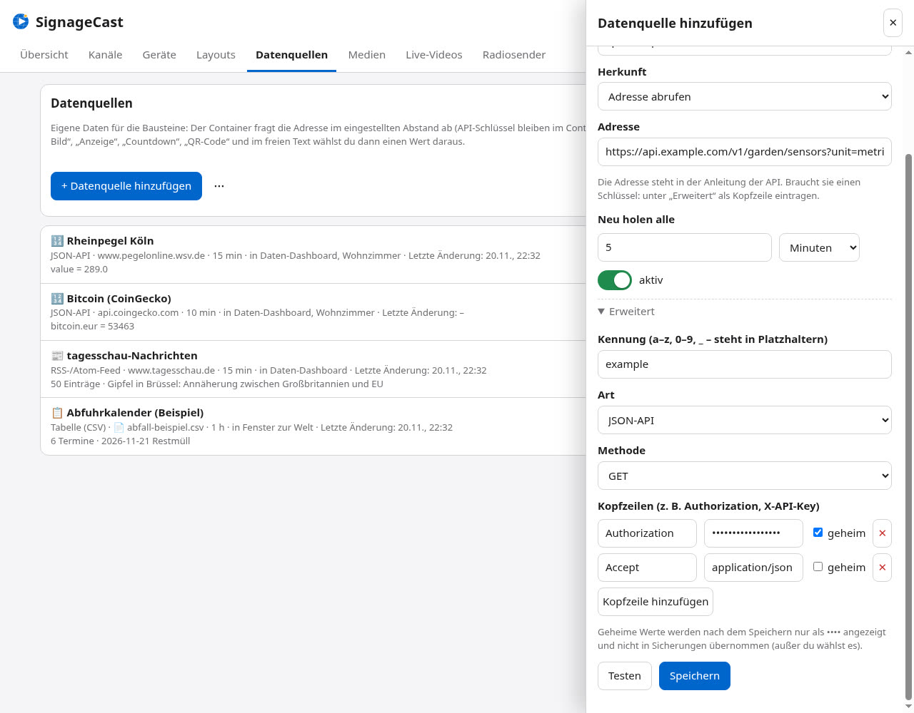

### 13. Live-Videos – Sammlung
Live-Kameras von YouTube für das Videofenster, automatisch gesucht und nur dort gezeigt, wo gerade Tag ist. Live-Videos →
**Sammlung** zeigt oben den Stand der Suche und *Jetzt suchen*, darunter jedes Live-Video als Zeile mit seinem Zustand in
Klartext („dunkel vor Ort · hell in 5:05 h“, „pausiert nach Ausfällen“), Filterknöpfen und Schalter. Was jeder Kanal
gerade zeigt, steht auf der Übersicht.

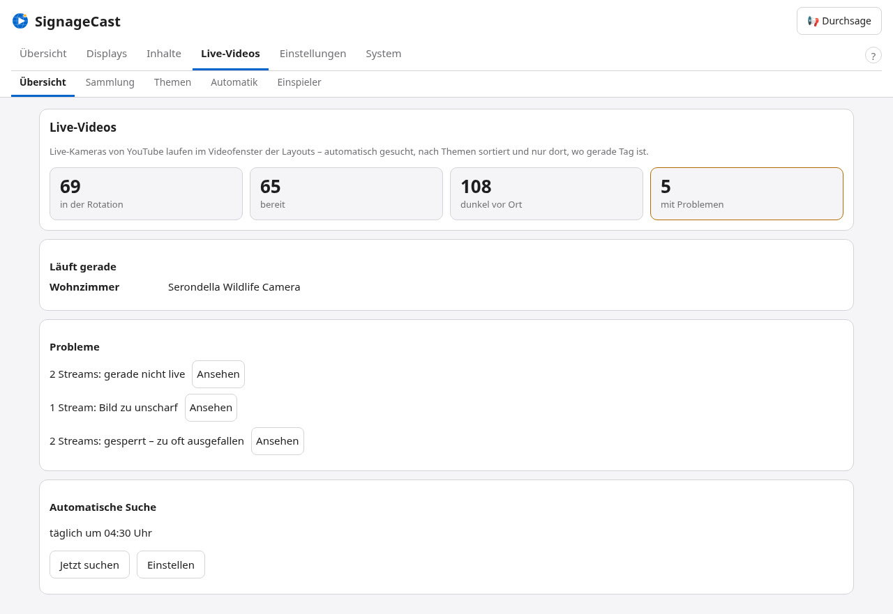

Ein Klick öffnet rechts das Seitenfeld: Name, Thema, Ort (mit Ortssuche), *Jetzt zeigen*, *Ausfälle nicht zählen*,
Technik und Entfernen – *Nie wieder vorschlagen* hält die Suche davon ab, es wieder aufzunehmen.

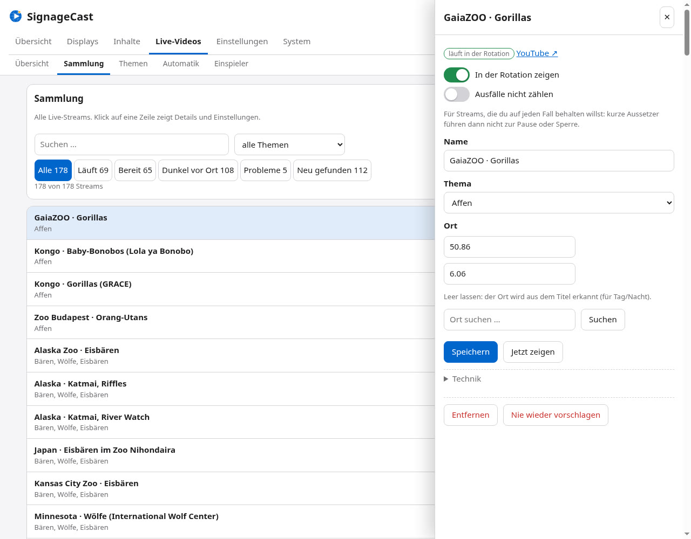

### 14. Live-Videos – Themen und Automatik
**Themen** sind in **Tiere** und **Weitere Themen** gegliedert (Städte & Plätze, Strände & Küsten, Berge & Ski, Häfen &
Schiffe, Flughäfen & Flugzeuge, Züge & Bahn, Weltraum & Erde, Naturschauspiele). Ein Klick öffnet ein Thema: Name,
Gruppe, bis zu 6 eigene YouTube-Suchbegriffe, Wörter, die im Titel stehen müssen (mit der Zahl vorhandener Live-Videos, auf
die sie passen), „Tag/Nacht egal“, ein/aus für alle Kanäle oder je Kanal. **+ Neues Thema** legt eigene mit eigener
nächtlicher Suche an.

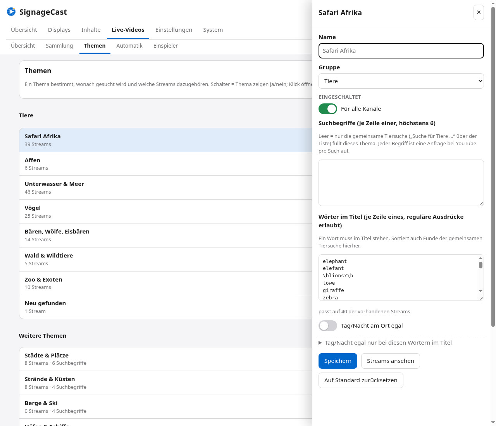

Die **Automatik** gilt für alle Kanäle, deshalb ist sie seit 0.65 eine Einstellungs-Kachel: Einstellungen →
**Live-Videos** – Minuten je Live-Video, nur Live-Videos, wo vor Ort Tag ist, Mindest-Sonnenhöhe, Uhrzeit und Grenzen der
Suche, der optionale YouTube-API-Schlüssel samt dem, was bei YouTube abgefragt wurde; unter *Erweitert* Sperrwörter und
die Ortstabelle, die Orte im Titel erkennt.

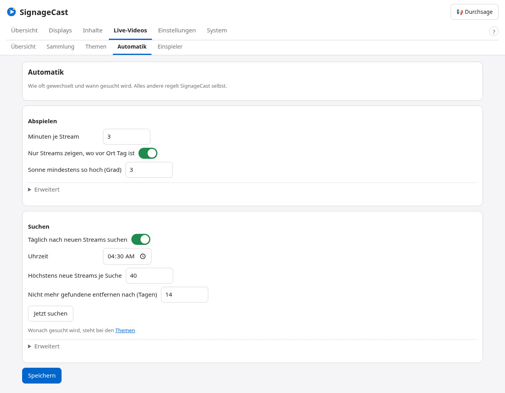

### 15. Radiosender
Radiosender: eigene Sender (MP3/AAC, auch .m3u/.pls), Vorschläge für deinen Standort von radio-browser.info und ein
Puffer, der kurze Aussetzer überbrückt.

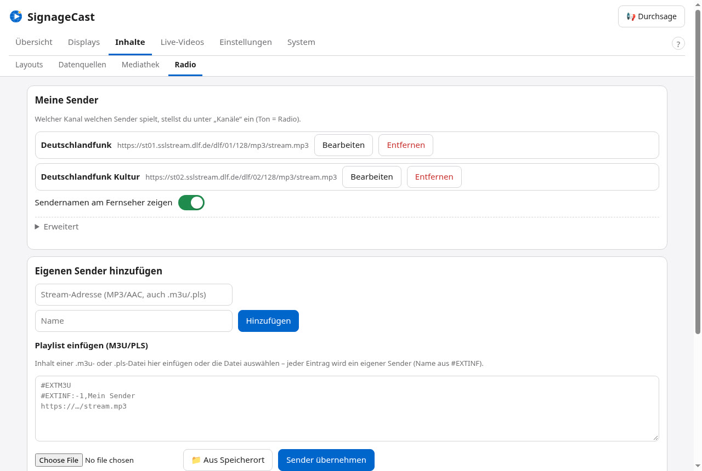

### 16. Einspieler
Medien → Einspieler: Zu festen Minuten unterbricht ein Einspieler die Rotation – z. B. „tagesschau in 100 Sekunden“.
Die Liste zeigt Zeitplan, Kanäle und den letzten Abruf; ein geöffneter Einspieler hat *Übersicht* (mit *Jetzt zeigen*),
*Einstellungen* (Quelle, Minuten, Zeitfenster, Kanäle, Puffer – der Container lädt jede neue Ausgabe vorab) und
*Verlauf*.

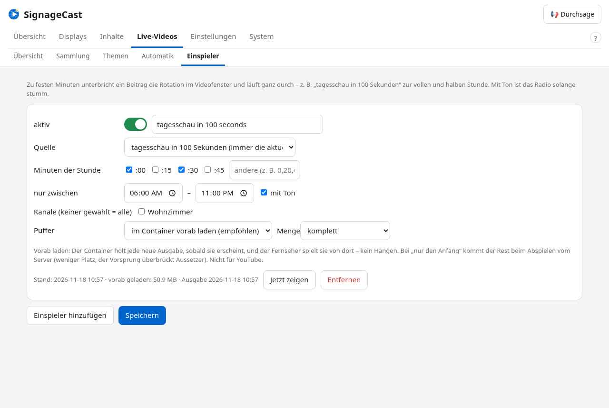

### 17. Einstellungen
Alles, was einmal für den ganzen Server eingestellt wird, steht auf einer Kachelseite rechts im Menü – jede Kachel mit
einem Satz und ihrem Zustand in Klartext („verbunden“, „2 Zugänge“, „Nachtsuche um 04:30“).

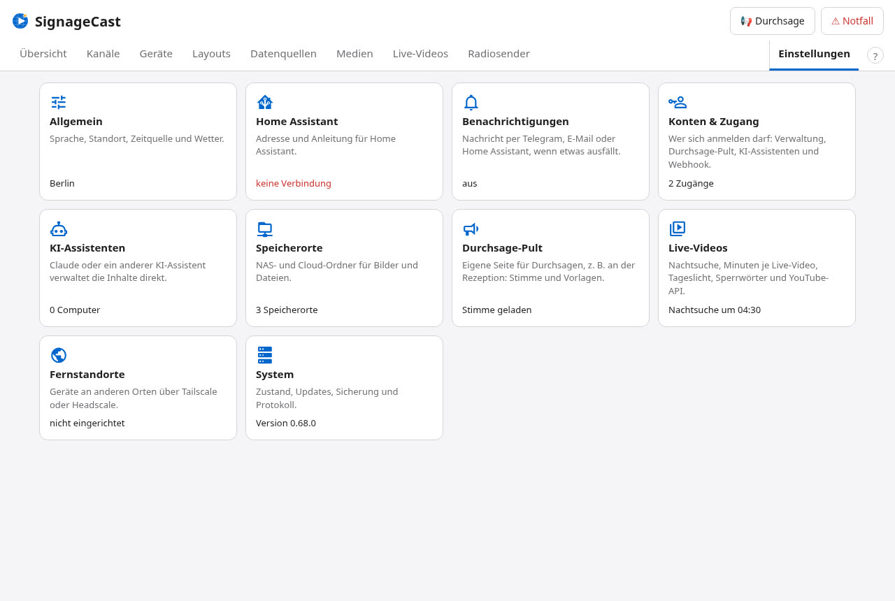

**Allgemein**: Sprache und Wetterquelle, Standort per Ortssuche, Zeitquelle (NTP-Server und Zeitzone – hält der Host
seine Uhr synchron, wird nichts korrigiert), und ausgeblendete Rechtshinweise lassen sich wieder zeigen.

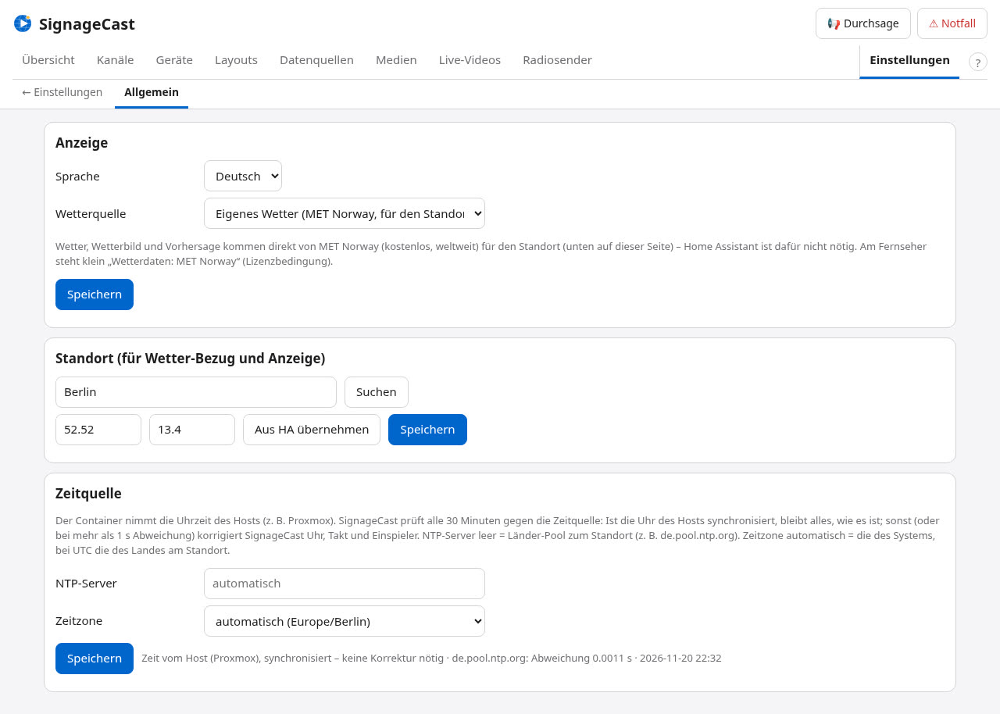

**Konten & Zugang** (seit 0.65) sammelt alle Anmeldungen bei SignageCast: die Anmeldung an der Verwaltung, die Zugänge
zum Durchsage-Pult mit ihren Rechten, die Computer der KI-Assistenten und den Webhook-Schlüssel. Schlüssel für andere
Dienste (Home-Assistant-Token, Telegram, SMB/WebDAV, YouTube-API, Tailscale) bleiben bei ihrer Verbindung; die Seite
verlinkt dorthin.

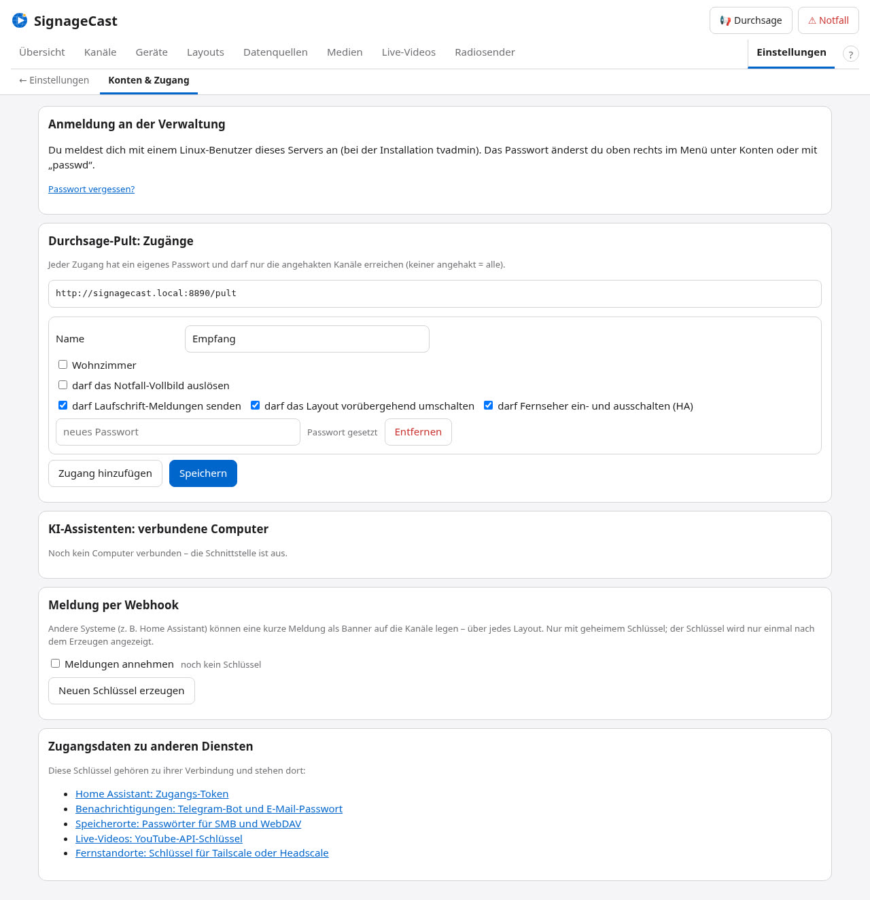

### 18. Updates
Debian- und SignageCast-Updates per Klick oder automatisch in einem Wartungsfenster, nur wenn niemand zuschaut. Releases
sind signiert und haben eine Stückliste (SBOM); installiert wird nur mit gültiger Signatur, und läuft SignageCast danach
nicht, geht es automatisch auf die vorige Version zurück. Seit 0.66 lädst du hier auch die **Player-Images** für neue
Geräte (Einstellungen → System → Updates).

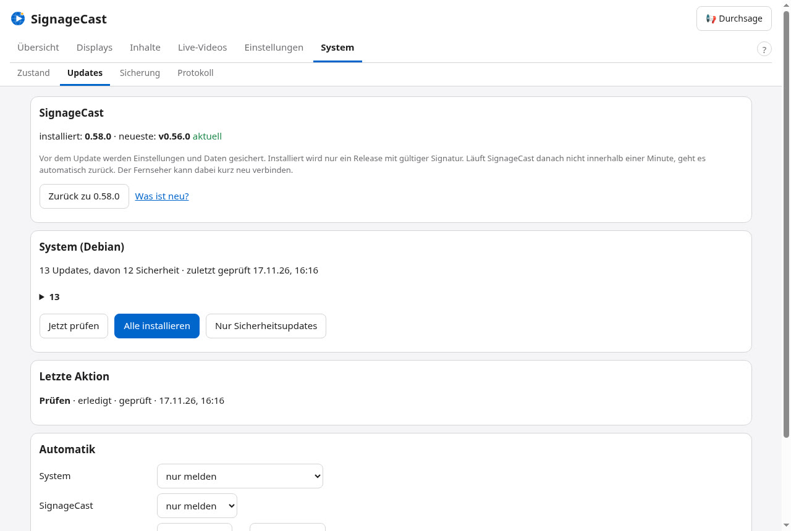

### 19. Sicherung
Ein ZIP mit Einstellungen, Live-Video-Liste, Bildern und Verlauf der Diagramme. Ob Zugangsdaten und Passwörter mit hinein
sollen, wird ausdrücklich gefragt – dann ist das ZIP mit AES-256 verschlüsselt und ein starkes Passwort Pflicht.
Automatische Sicherung täglich oder wöchentlich; Einspielen in der Verwaltung oder bei der Installation einer neuen
Instanz.

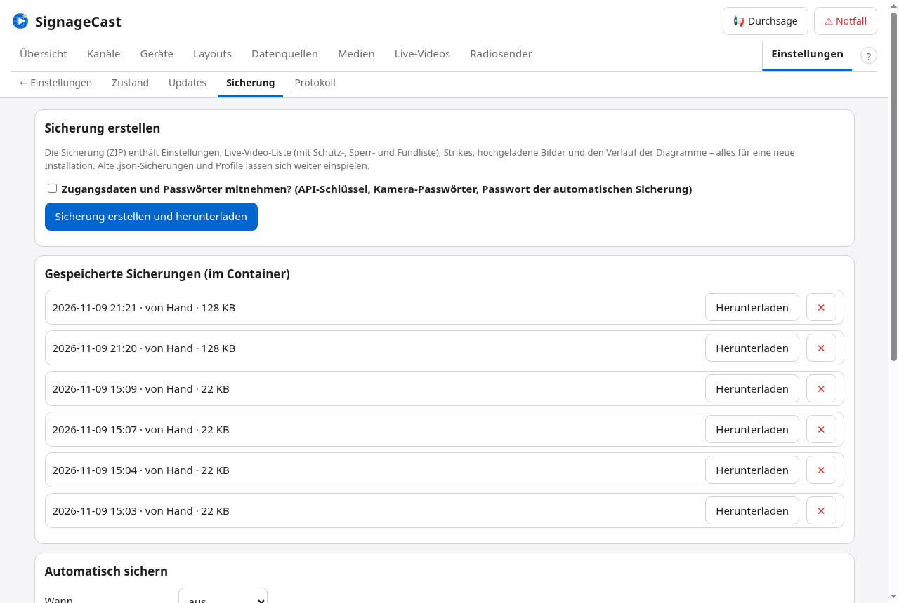

Einstellungen → System → **Protokoll** (seit 0.38) zeigt, wer wann was geändert hat – in der Verwaltung, am Pult, per Webhook oder
durch SignageCast selbst (Updates, Bildprüfung, Internet-Ausfälle). Nur Art und Bereich, nie Werte; Teil der Sicherung.

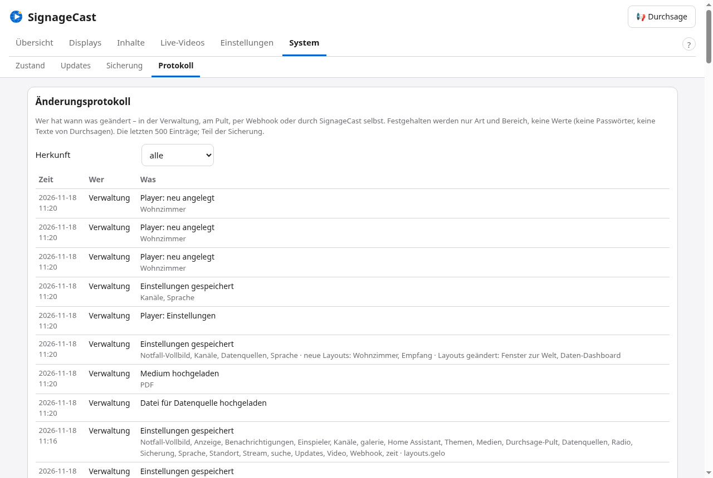

### 20. Docker / Podman
Im Container-Image gibt es kein Cockpit: Dieselbe Verwaltung kommt mit eigener Anmeldung auf Port 19090; das
Startpasswort steht im Container-Protokoll. Geändert wird es unter Einstellungen → Konten & Zugang.

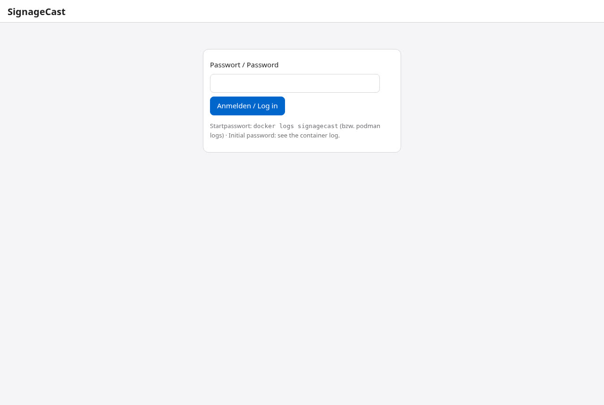

### 21. Auf dem Handy
Die Verwaltung geht auch auf dem Handy – das Menü wird zu einer Auswahlliste, Durchsage- und Notfall-Knopf bleiben oben; Bausteine ein- und ausschalten, Größen,
Ton, Quellen ändern.

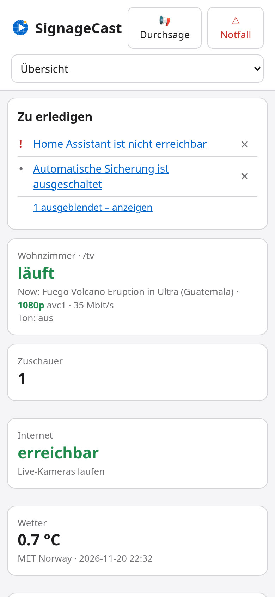

### 22. Benachrichtigungen
Telegram, E-Mail (SMTP) und Home Assistant, jeweils mit Test-Knopf; selten gebrauchte Optionen unter „Erweitert“, und
wann gemeldet wird: Kanal ausgefallen, Update oder Sicherung fehlgeschlagen, Home Assistant getrennt, Kanal ruckelt.

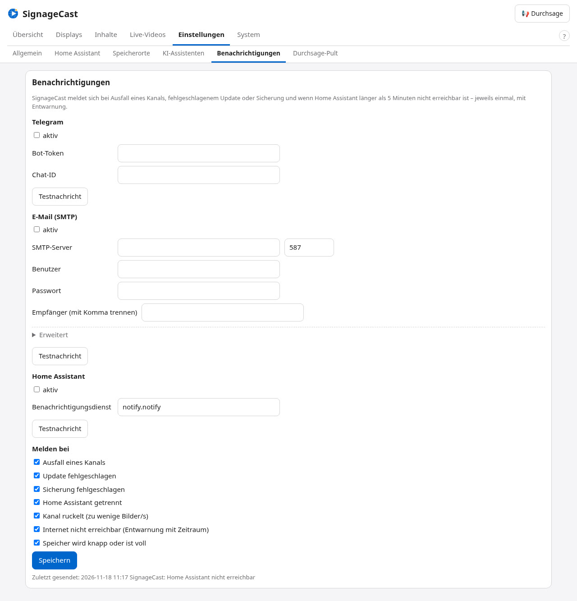

### 23. Zustand und Leistungstest
Einstellungen → System → Zustand zeigt oben, wie viel Speicher frei ist und was ihn belegt. Der **Leistungstest** misst 10 Sekunden lang, wie flüssig jeder laufende Kanal gezeichnet und kodiert wird – Bilder/s
der TV-Seite und des Encoders, Tempo, verworfene oder doppelte Bilder, CPU je Kanal, Speicher, Grafikeinheit – und
gibt konkrete Empfehlungen. Eine zweite Seite, auf dem Abspielgerät geöffnet, misst dort Übertragung und Wiedergabe.
Darunter: nach wie vielen Sekunden ohne Zuschauer der Videostream eines Kanals abschaltet.

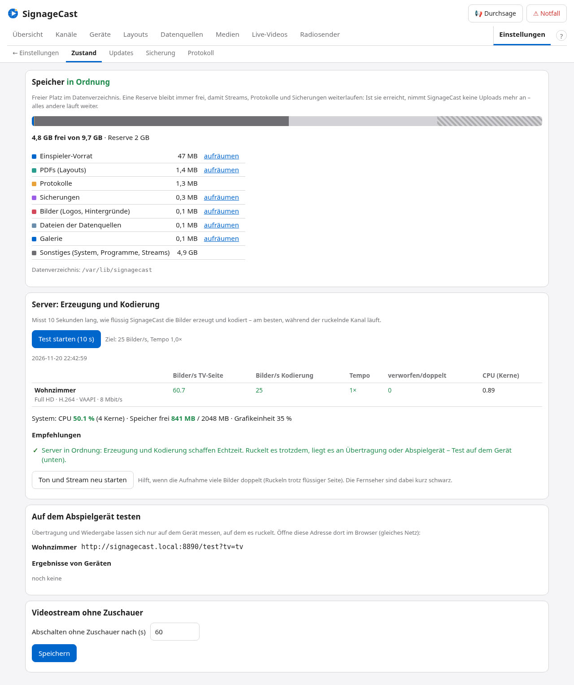

### 24. Durchsagen, Notfall-Vollbild und Webhook
**📢 Durchsage** oben rechts – auf jeder Seite: eine Durchsage groß in der Bildmitte (Vorlage wählen oder Text tippen,
Kanäle, Anzeigedauer, vorlesen) oder eine **Laufschrift** unten durchs Bild.

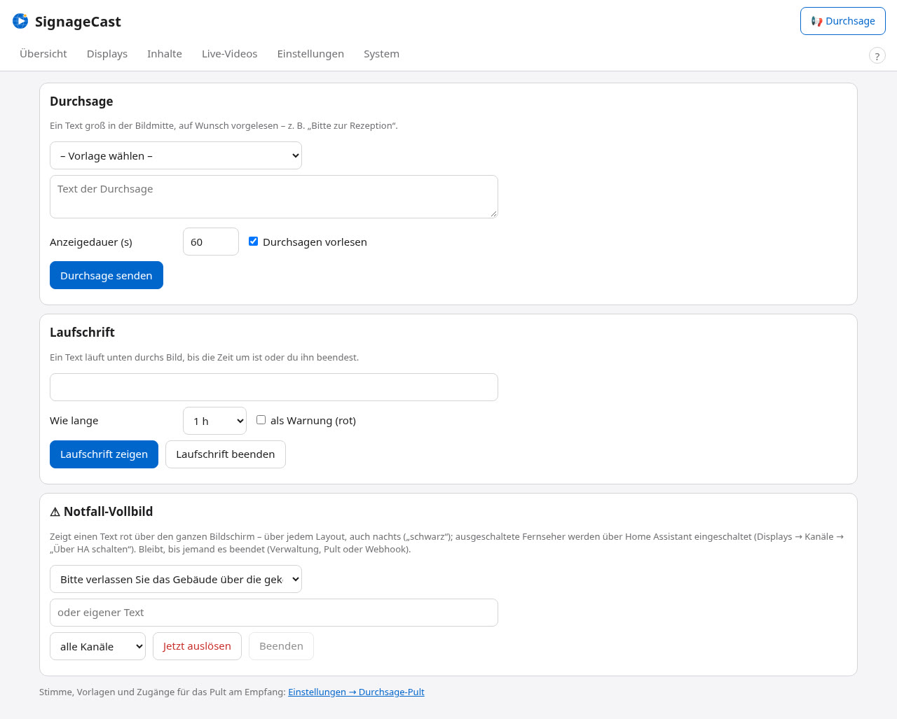

**⚠ Notfall** daneben (seit 0.65 ein eigener Knopf) löst das **Notfall-Vollbild** aus und beendet es – roter Text über
jedem Layout, auch nachts. Der Knopf wird rot, solange ein Notfall-Vollbild läuft.

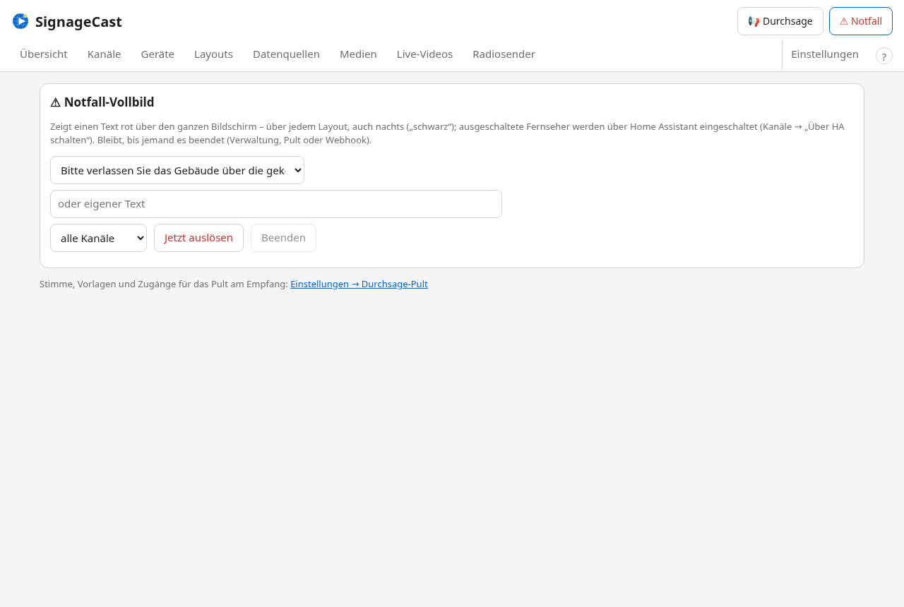

Einstellungen → Durchsage-Pult: das Pult für den Empfang (`http://<IP>:8890/pult` – es sendet und beendet Durchsagen,
mehr nur mit weiteren Rechten des Zugangs),
die Stimme (offline mit Piper: Kerstin oder Thorsten), Gong und Vorlagen, weiter unten die Vorlagen und der Warnton des
**Notfall-Vollbilds** und die Webhook-Befehle. Die Zugänge zum Pult (eigenes Passwort, Kanäle, Rechte wie
**Laufschrift**, **Layout vorübergehend umschalten**, **Fernseher ein- und ausschalten**) und der Schlüssel für die
**Meldung per Webhook** stehen unter Einstellungen → Konten & Zugang.

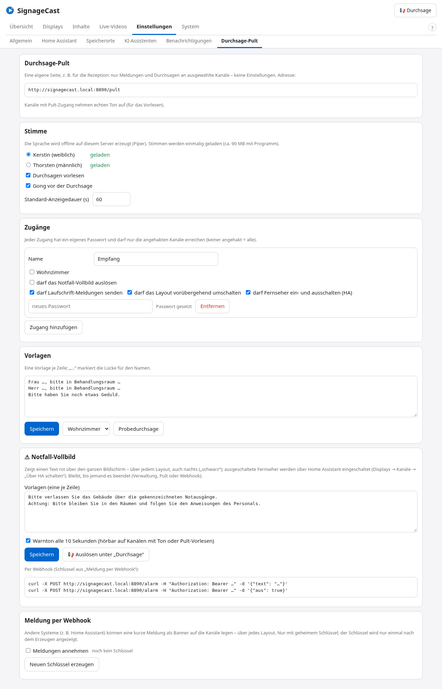
