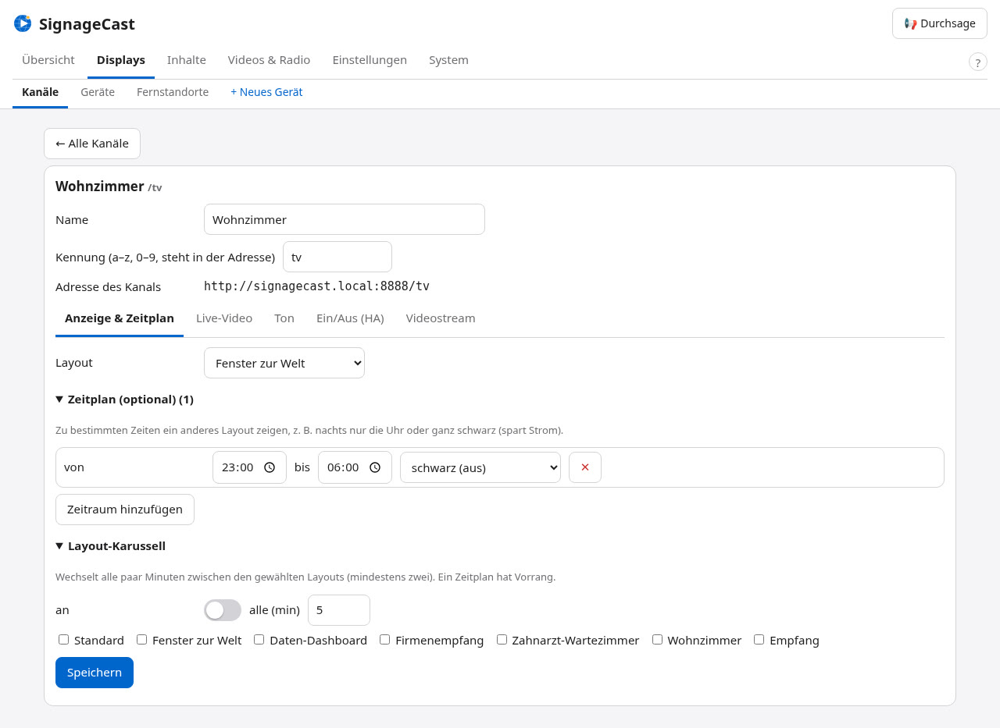
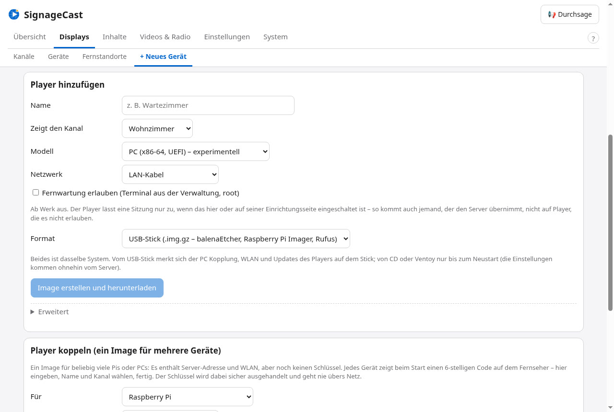
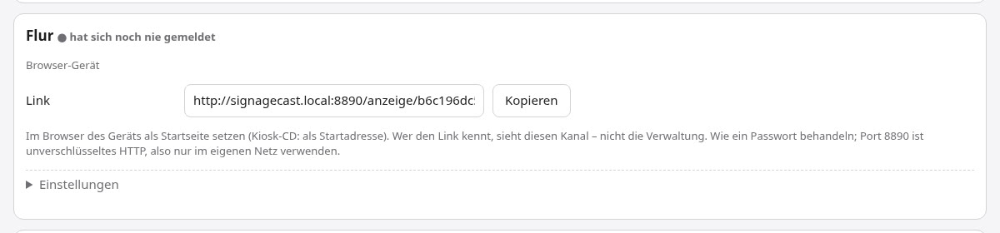
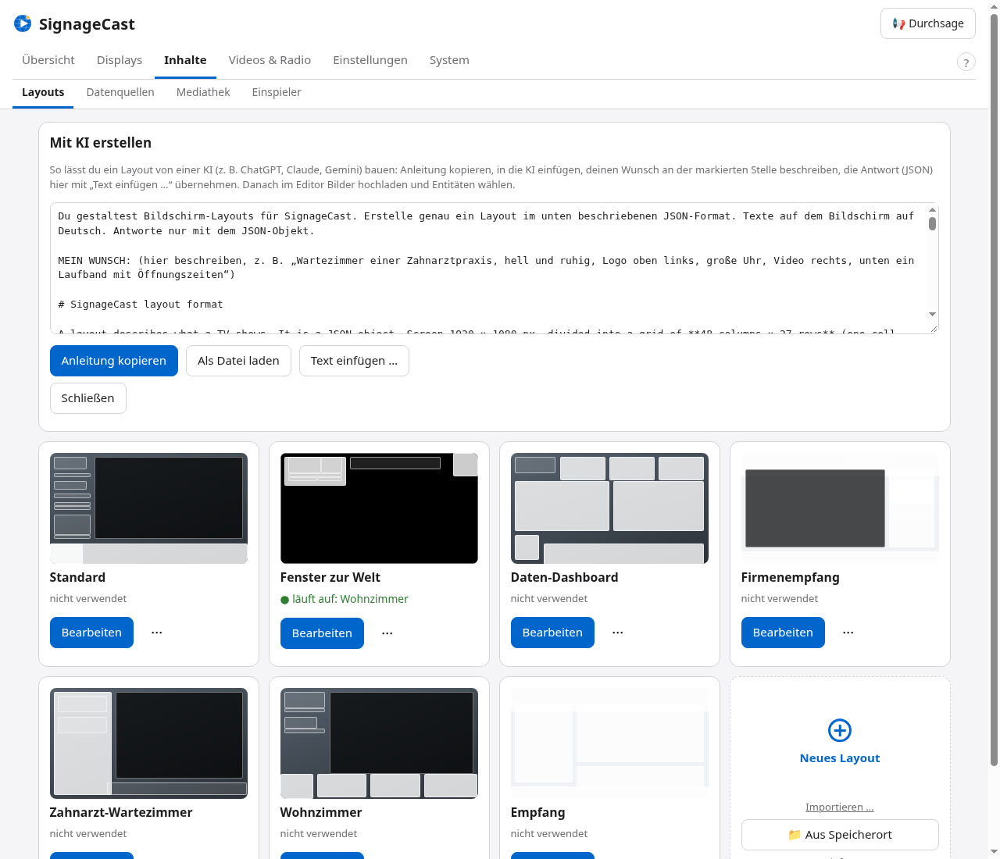
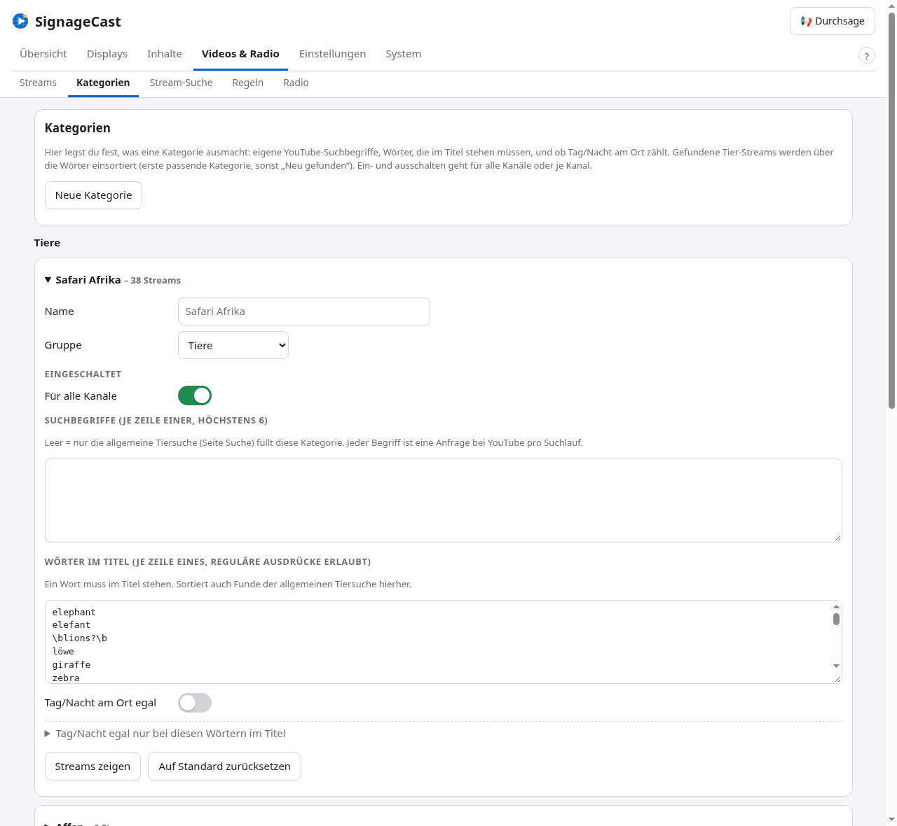
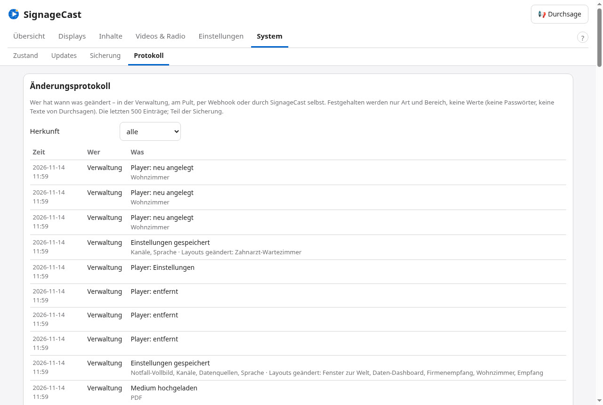
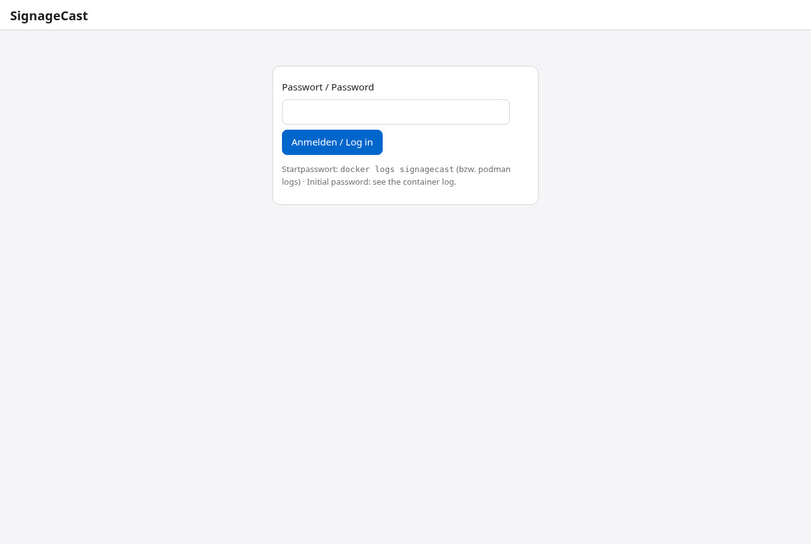
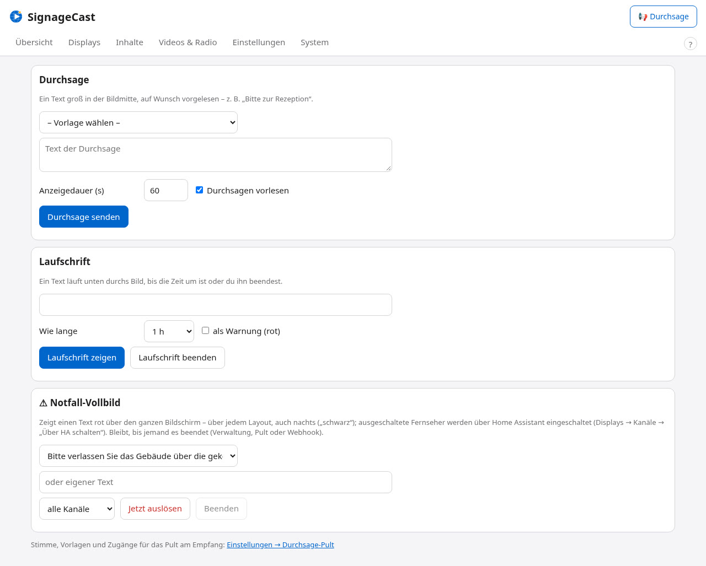

# SignageCast – Bildschirm-Tour

Ein Rundgang durch SignageCast: was der Fernseher zeigt und wie du alles im Browser einstellst. Alle Bilder stammen
aus einer Demo-Installation (Standort Berlin, öffentliche bzw. erfundene Beispieldaten, kein Home Assistant
angebunden). Die Verwaltung zeigt Version 0.50 mit den sechs Bereichen Übersicht, Displays, Inhalte, Videos & Radio,
Einstellungen und System und dem Knopf **📢 Durchsage** oben rechts.

**🇬🇧 [English version](TOUR.md)**

[← README](../README.md) · [Installation (englisch)](INSTALL.md) · [Handbuch (englisch)](MANUAL.md) · [Technik (englisch)](HOW-IT-WORKS.md)

---

## Auf dem Fernseher

### 1. Live-Fenster zur Welt
Eine Live-Tierkamera von dort, wo gerade Tag ist, daneben Uhr, Datum und Wetter von MET Norway. Die Leiste unten
mischt die Vorhersage mit eigenen Daten: Rheinpegel in Köln und Bitcoin-Kurs aus öffentlichen Schnittstellen und ein
Countdown bis Heiligabend. Unten im Videobild steht, was läuft und was als Nächstes kommt.

Derselbe Fernseher mit dem Layout „Fenster zur Welt“: das Video im Vollbild, Uhr und Wetter auf einer Glasfläche und
oben rechts der Baustein *Kalender / Müllabfuhr* als **reine Symbole** – Restmüll und Gelber Sack werden morgen
abgeholt, die Biotonne am Dienstag (Beispieldaten aus einer CSV-Datei). Die Symbole erscheinen drei Tage vor der
Abholung und verschwinden danach von selbst.

### 2. Daten-Dashboard
Ein Layout nur aus Datenquellen: Rheinpegel als Wert, als Balken und als 24-Stunden-Verlauf (echte Messwerte von
PEGELONLINE), Bitcoin-Kurs, die Nachrichten der tagesschau als Liste und als Laufband und ein QR-Code. Der Hintergrund
ist ein Wetterbild passend zur Tageszeit.

### 3. Empfang mit PDF, Webseite und Zeitraum
Ein Layout für den Empfang: ein **PDF** (Preisliste und Öffnungszeiten, die Seiten wechseln nach Zeit), eine
**Webseite als Bildschirmfoto** – GitHub verbietet das Einbetten, deshalb lädt SignageCast die Seite selbst und zeigt
alle 30 Minuten ein frisches Bild – und ein Hinweis mit **Zeitraum**: „Vom 24. Dezember bis 1. Januar geschlossen“
erscheint ab 1. November und verschwindet nach Neujahr von selbst. Unten läuft ein Laufband.

### 4. Notfall-Vollbild
Ein Klick in der Verwaltung, am Durchsage-Pult oder per Webhook: ein rotes Vollbild mit deinem Text über jedem Layout,
auch nachts („schwarz“), auf Wunsch mit einem Warnton alle 10 Sekunden.

---

## Die Verwaltung

### 5. In Cockpit
Bei Proxmox-LXC und nativer Debian-Installation ist die Verwaltung eine Cockpit-Erweiterung – „SignageCast“ ist ein
Menüpunkt neben Cockpits eigenen Seiten. Läuft auf deinem Server schon Cockpit, fügt sich SignageCast dort ein.

### 6. Übersicht
Oben die Liste **Zu erledigen**: zuerst Probleme (z. B. Home Assistant nicht erreichbar), dann Tipps (automatische
Sicherung aus, keine Benachrichtigung eingerichtet) – jeder Eintrag führt zur Seite, auf der du es behebst; das ✕ blendet ihn aus (Tipps dauerhaft, Probleme bis
sie einmal behoben waren, seit 0.35). Darunter
jeder Kanal mit Zustand, aktuellem Stream, Auflösung und Ton, dann Zuschauer, Wetter, Zeitabgleich mit NTP („Zeit
vom Host, synchronisiert“), Videokodierung (Grafikeinheit oder Software), Home Assistant, Streams in Rotation, CPU,
RAM und Laufzeit. Seit 0.38 zeigt eine Kachel, ob das **Internet** erreichbar ist (ohne zeigen die Fernseher eigene
Medien oder ein ruhiges Bild), und die Karte eines Kanals sagt, wenn die **Bildprüfung** ein schwarzes oder
stehendes Bild gefunden hat.

### 7. Displays → Kanäle
Ein **Kanal** ist das, was ein Fernseher zeigt – mit eigener Adresse, die ein Gerät oder der Browser des Fernsehers
öffnet. Die Liste zeigt je Kanal Layout, Zustand, Zeitplan und Karussell, welche Geräte ihn gerade zeigen (online oder
offline) und seine Adresse.

*Bearbeiten* öffnet einen Kanal mit fünf Reitern: **Anzeige & Zeitplan** (Layout, optionaler Zeitplan mit anderem
Layout oder schwarz zu bestimmten Zeiten, Layout-Karussell), **Live-Video** (an/aus, was das Videofenster zeigt,
Kategorien), **Ton** (Radio oder Originalton der Kameras, Lautstärke), **Ein/Aus (HA)** (Ein- und Ausschalten über Home
Assistant, Zustand laut HA, nach dem Einschalten Quelle wählen und die TV-Seite öffnen – LG webOS, Android TV / Fire TV
oder ein eigener HA-Dienst) und **Videostream** (Ausgabe Full HD oder 4K, Aufnahmegröße – 720p spart CPU, 1440p ist
schärfer –, Bitrate und Codec). Gespeichert wird je Kanal; der offene Reiter bleibt dabei stehen.

Im Reiter *Videostream* → **Kodierung (für Fortgeschrittene)**: Encoder (Automatisch, Intel/AMD-Grafik, Quick Sync, NVENC,
Software), Preset, Tune und B-Frames je Kanal. Eine Änderung wird erst kurz ausprobiert; läuft sie hier nicht,
bleibt SignageCast bei „Automatisch“. Felder, die für den aktiven Encoder nicht gelten, sind direkt dort erklärt.

### 8. Geräte – Raspberry Pi, PC oder Browser (experimentell)
Displays → *Geräte*: Ein Player am Fernseher zeigt einen Kanal – auch an Fernsehern ohne brauchbaren Browser.
Displays → *+ Neues Gerät* → *Player hinzufügen*: Name eingeben, Kanal, **Modell** und Netzwerk (LAN oder WLAN) wählen, fertiges Image
herunterladen und auf eine SD-Karte oder einen USB-Stick schreiben; am Gerät musst du nichts eintippen. Oder ein Image
für viele Geräte: Jedes zeigt einen 6-stelligen Code auf dem Fernseher, den du unter *Player koppeln* eingibst.

- **Raspberry Pi** – zeigt den fertigen Stream per HDMI; dafür reicht 1 GB Arbeitsspeicher. Im Direktmodus (der Pi
  zeigt die Seite selbst, der Server muss nichts kodieren) mindestens 2 GB, besser 4 GB.
- **PC** (seit 0.36) – ein normaler PC, Mini-PC oder Thin Client (x86-64 mit UEFI, Secure Boot darf an bleiben) startet
  vom USB-Stick, ohne seine Festplatte anzufassen, und zeigt die Seite im Direktmodus selbst. Dieselbe Datei ist auch ein
  ISO für CD, Ventoy oder eine VM.
- **Browser-Gerät** (seit 0.36) – ganz ohne Image, nur ein geheimer Link für einen Smart-TV, einen Fire-TV-Stick oder
  einen Kiosk-Browser. Es gilt als online, solange die Seite ihre Daten abruft.

Danach verwaltest du jeden Player hier: online, Modell mit Arbeitsspeicher, IP, Bildschirm, Video bzw. Direktmodus,
Temperatur, Knöpfe für Bildschirmfoto, Neustart und – beim Pi – TV ein/aus (HDMI-CEC) und Systemupdate sowie
WLAN-Wechsel mit automatischer Rückkehr ins alte Netz. Ein PC läuft als schreibgeschütztes Live-System: neue Software
kommt mit einem neuen Image. Die Geräte auf diesen Bildern sind simuliert (echter Agent-Code); das PC-Image ist in einer
UEFI-VM mit Secure Boot getestet ([Details](PLAYER.md#deutsch-raspberry-pi-als-player)).

### 9. Fernwartung – Terminal zum Pi (experimentell, seit 0.33)
**Terminal** auf der Karte des Pi öffnet eine root-Shell im Browser, gezeichnet wie Cockpits eigenes Terminal. Ab Werk
aus: Der Pi selbst muss es erlauben (Haken beim Erstellen des Images oder auf seiner Einrichtungsseite) – so kommt auch
jemand, der den Server übernimmt, nicht auf Pis, die es nicht erlauben. Am Pi ist kein Port offen und kein SSH nötig;
Ein- und Ausgabe sind verschlüsselt. Auf dem Fernseher steht solange „Fernwartung aktiv“, nach 10 Minuten ohne Eingabe
oder spätestens nach 60 Minuten endet die Sitzung.

### 10. Layouts und Editor
Inhalte → Layouts beginnt mit allen Layouts als Kacheln – Mini-Vorschau, auf welchem Kanal es läuft, Bearbeiten
sowie Kopieren / Exportieren / Löschen im Menü „⋯“. „Neues Layout“ fragt nach Name und Ausgangspunkt (leer, Vorlage
oder Kopie), so wird nie ein bestehendes Layout überschrieben.

Im Editor ziehst du Bausteine auf einem Raster von 48 × 27 Feldern und änderst ihre Größe. Daneben die **Ebenen**
(oben = vorne, wie am Fernseher; ein-/ausblenden, nach vorne / nach hinten) und der gewählte Baustein – hier ein
Verlauf: den Wert wählst du mit „wählen …“ per Klick in der Antwort der Datenquelle. Mehrmals auf dieselbe Stelle
klicken wählt übereinanderliegende Bausteine, Tab den nächsten.

Jeder Baustein lässt sich auf einen **Zeitraum** begrenzen („Nur im Zeitraum …“: Datum, auf Wunsch mit Uhrzeit) – das
⏱ in den Ebenen und auf der Fläche markiert ihn. Bausteine wie **PDF** (bis 50 Seiten) und **Webseite** mit der
Darstellung „Bildschirmfoto“ für Seiten, die das Einbetten verbieten, ergeben Layouts wie den Empfang oben.

Seit 0.38 kopiert **„Mit KI erstellen …“** eine Anleitung mit dem vollständigen Layout-Format: in ChatGPT, Claude oder
Gemini einfügen, Wunsch beschreiben, die Antwort mit **„Text einfügen …“** übernehmen – SignageCast repariert, was
geht, und listet es auf. Im Menü „⋯“ hebt **Versionen** die letzten 10 Fassungen jedes Layouts auf (wiederherstellen
oder herunterladen), *Gelöschte Layouts* unter den Kacheln holt gelöschte zurück.

### 11. Datenquellen
Eigene JSON-Schnittstellen, RSS-/Atom-Feeds, Bilder, iCal-Kalender und Kameras, vom Container im gewählten Abstand
abgerufen. „Daten ansehen“ zeigt die Antwort als Baum; ein Klick kopiert den Pfad für Bausteine und Platzhalter. Statt
einer Adresse geht auch eine hochgeladene Datei (bis 1 MB) – z. B. der Abfuhrkalender deiner Stadt als `.ics` oder
`.csv`, wenn es keine Abo-Adresse gibt.

Bei CSV wählst du Trennzeichen, Anführungszeichen, Kopfzeile und Zeichensatz (alles wird erkannt), welche Spalten unter
welchem Namen übernommen werden, optionale Zeilenfilter und eine Datumsspalte: Die Zeilen erscheinen dann als Termine im
Baustein *Kalender / Müllabfuhr*. Hier ein Abfuhrkalender mit dem Filter *ORTSTEIL ist leer* – er wirft die Sperrmüll-
und Schadstofftermine eines anderen Ortsteils hinaus.

### 12. Aus curl übernehmen
Einen `curl`-Befehl aus einer API-Anleitung einfügen – Adresse, Methode und Kopfzeilen werden ausgefüllt,
`Authorization` wird automatisch als geheim markiert (nach dem Speichern nur als •••• sichtbar, nicht in Sicherungen,
außer du wählst es). Der Befehl wird nur gelesen, nie ausgeführt.

### 13. Videos & Radio – Streams
Die eingebaute Liste mit Tier- und Natur-Livestreams plus die Funde der nächtlichen Suche. Jeder Stream hat einen
**Zustand** – bereit, Nacht (mit „Tageslicht in …“), nicht live, Auflösung zu gering, nach Strike pausiert, Ort
unbekannt –, und die Knöpfe über der Liste filtern danach (mit Anzahl), dazu Text, Kategorie und Herkunft (fest /
gefunden). Die Qualität wird beim Abspielen gemessen, und der nächste Stream wird bei YouTube geprüft, bevor er
angekündigt wird. Lieblinge schützen, Unerwünschtes ablehnen.

### 14. Videos & Radio – Kategorien und Regeln
**Kategorien** (seit 0.37 eine eigene Seite) sind in **Tiere** und **Weitere Themen** gegliedert (Städte & Plätze,
Strände & Küsten, Berge & Ski, Häfen & Schiffe, Flughäfen & Flugzeuge, Züge & Bahn, Weltraum & Erde, Naturschauspiele).
Jede lässt sich bearbeiten: Name, Gruppe, bis zu 6 eigene YouTube-Suchbegriffe, Wörter, die im Titel stehen müssen,
„Tag/Nacht egal“, ein/aus für alle Kanäle oder je Kanal – mit der Zahl ihrer Streams. Gefundene Tier-Streams
landen in der ersten Kategorie, deren Wörter passen. **Neue Kategorie** legt eigene an (z. B. Leuchttürme) mit eigener
nächtlicher Suche; eingebaute lassen sich auf den Standard zurücksetzen.

*Regeln*: Minuten je Stream, nur Streams, wo vor Ort Tag ist, Mindest-Sonnenhöhe; unter *Erweitert* die
Mindestqualität (360p … 1080p) und die Strike-Regeln.

### 15. Radio
Videos & Radio → Radio: eigene Sender (MP3/AAC, auch .m3u/.pls), Vorschläge für deinen Standort von radio-browser.info und ein
Puffer, der kurze Aussetzer überbrückt.

### 16. Einspieler
Zu festen Minuten unterbricht ein Einspieler die Rotation – z. B. „tagesschau in 100 Sekunden“. Puffer: Der Container
lädt jede neue Ausgabe vorab (ganz oder nur das erste MB), damit der Einspieler ohne Stocken läuft.

### 17. Einstellungen → Allgemein
Sprache und Wetterquelle, Standort per Ortssuche, Zeitquelle: NTP-Server (Standard: der Pool des Landes) und Zeitzone –
hält der Host seine Uhr synchron, wird nichts korrigiert. Home Assistant, Speicherorte, KI-Assistenten,
Benachrichtigungen und das Durchsage-Pult haben eigene Seiten daneben. Ungespeicherte Änderungen werden an ihrer Karte markiert, und vor dem Verlassen der Seite wird gefragt.

### 18. Updates
Debian- und SignageCast-Updates per Klick oder automatisch in einem Wartungsfenster, nur wenn niemand zuschaut. Releases
sind signiert und haben eine Stückliste (SBOM); installiert wird nur mit gültiger Signatur, und läuft SignageCast danach
nicht, geht es automatisch auf die vorige Version zurück.

### 19. Sicherung
Ein ZIP mit Einstellungen, Streamliste, Bildern und Verlauf der Diagramme. Ob Zugangsdaten und Passwörter mit hinein
sollen, wird ausdrücklich gefragt – dann ist das ZIP mit AES-256 verschlüsselt und ein starkes Passwort Pflicht.
Automatische Sicherung täglich oder wöchentlich; Einspielen in der Verwaltung oder bei der Installation einer neuen
Instanz.

System → **Protokoll** (seit 0.38) zeigt, wer wann was geändert hat – in der Verwaltung, am Pult, per Webhook oder
durch SignageCast selbst (Updates, Bildprüfung, Internet-Ausfälle). Nur Art und Bereich, nie Werte; Teil der Sicherung.

### 20. Docker / Podman
Im Container-Image gibt es kein Cockpit: Dieselbe Verwaltung kommt mit eigener Anmeldung auf Port 19090; das
Startpasswort steht im Container-Protokoll. Geändert wird es unter Einstellungen → Zugang.

### 21. Auf dem Handy
Die Verwaltung geht auch auf dem Handy – die Bereiche werden zu einem Menü, der Durchsage-Knopf bleibt oben; Bausteine ein- und ausschalten, Größen,
Ton, Quellen ändern.

### 22. Benachrichtigungen
Telegram, E-Mail (SMTP) und Home Assistant, jeweils mit Test-Knopf; selten gebrauchte Optionen unter „Erweitert“, und
wann gemeldet wird: Kanal ausgefallen, Update oder Sicherung fehlgeschlagen, Home Assistant getrennt, Kanal ruckelt.

### 23. Zustand und Leistungstest
System → Zustand zeigt oben, wie viel Speicher frei ist und was ihn belegt. Der **Leistungstest** misst 10 Sekunden lang, wie flüssig jeder laufende Kanal gezeichnet und kodiert wird – Bilder/s
der TV-Seite und des Encoders, Tempo, verworfene oder doppelte Bilder, CPU je Kanal, Speicher, Grafikeinheit – und
gibt konkrete Empfehlungen. Eine zweite Seite, auf dem Abspielgerät geöffnet, misst dort Übertragung und Wiedergabe.
Darunter: nach wie vielen Sekunden ohne Zuschauer der Videostream eines Kanals abschaltet.

### 24. Durchsagen, Notfall-Vollbild und Webhook
**📢 Durchsage** oben rechts – auf jeder Seite: eine Durchsage groß in der Bildmitte (Vorlage wählen oder Text tippen,
Kanäle, Anzeigedauer, vorlesen), eine **Laufschrift** unten durchs Bild oder das **Notfall-Vollbild** auslösen und
beenden.

Einstellungen → Durchsage-Pult: das Pult für den Empfang (`http://<IP>:8890/pult` – es sendet und beendet Durchsagen,
mehr nur mit weiteren Rechten des Zugangs),
die Stimme (offline mit Piper: Kerstin oder Thorsten), Gong, Zugänge mit eigenem Passwort und den Kanälen, die sie
erreichen dürfen, und Vorlagen. Weiter unten die Vorlagen und der Warnton des **Notfall-Vollbilds**, die Webhook-Befehle
und die **Meldung per Webhook**: Andere Systeme (z. B. Home Assistant) legen ein kurzes Banner auf die Kanäle, mit einem
Schlüssel, der nur einmal angezeigt wird. Seit 0.38 kann ein Pult-Zugang zusätzlich die Rechte bekommen,
**Laufschrift-Meldungen** zu senden, **das Layout vorübergehend umzuschalten** und **Fernseher über Home Assistant
ein- und auszuschalten**.

