# SignageCast – screenshot tour

A walk through SignageCast: what the TV shows and how you set it up in the browser. All pictures are from a demo
installation (location Berlin, public example data, no Home Assistant connected). The admin pictures show version
0.33 (player card 0.34, overview 0.35) with the six areas Overview, TVs, Content, Live videos, Settings and System.

**🇩🇪 [Deutsche Version mit deutschen Bildern](TOUR.de.md)**

[← README](../README.md) · [installation](INSTALL.md) · [manual](MANUAL.md) · [how it works](HOW-IT-WORKS.md)

---

## On the TV

### 1. Live window to the world
A live wildlife cam from wherever it is daytime right now, with clock, weather from MET Norway and the forecast.
The bar below mixes your own data: the Rhine water level and the Bitcoin price from public APIs, and a countdown.

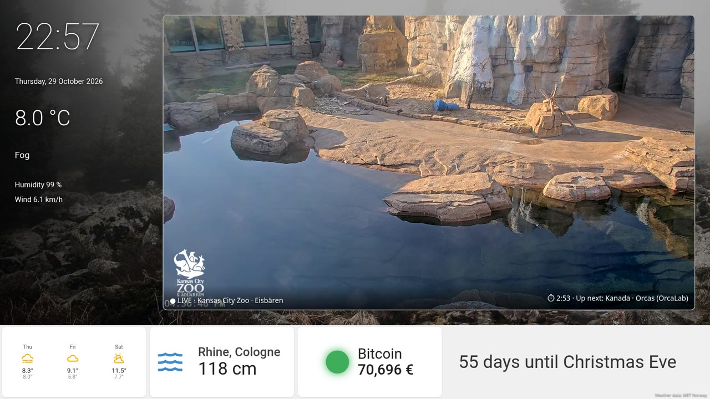

The same TV with the *Calendar / waste collection* element as **icons only** in the top right corner: residual waste
and recycling are collected tomorrow (example data from a CSV file). The icons appear three days before the pickup and
disappear afterwards by themselves.

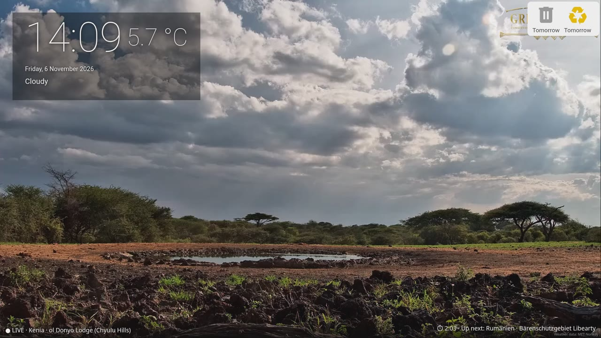

### 2. Data dashboard
A second TV with a layout built only from data sources: API value, gauge as bar and traffic light, a 24-hour chart
(real measurements of the Rhine at Cologne), public holidays from an iCal calendar, a feed list and the same feed as
ticker, a QR code and a countdown. Background: city picture set by time of day (here: night).

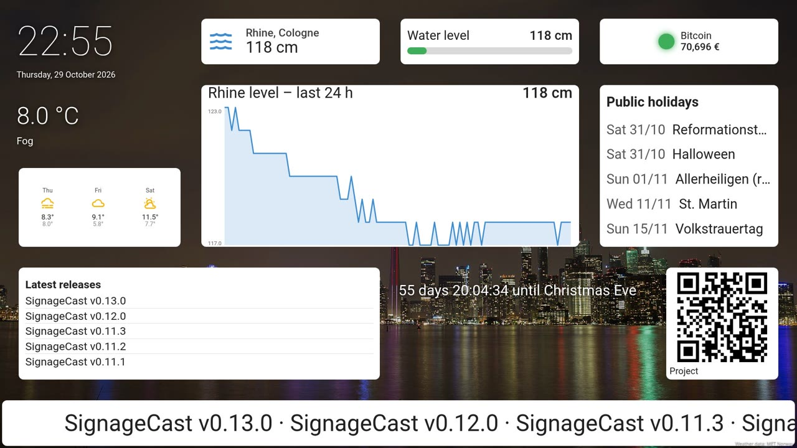

### 3. Service desk with PDF, web page and period
A reception layout: a **PDF** (price list and opening hours, the pages change by the clock), a **web page as
screenshot** – GitHub forbids embedding, so SignageCast loads the page itself and shows a fresh picture every 30 minutes
– and a notice with a **period**: “Closed from 24 December …” appears on 1 November and disappears by itself.

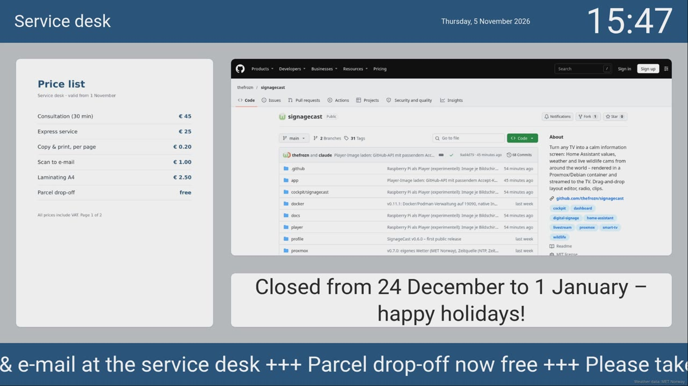

### 4. Emergency screen
One click in the admin, from the announcement panel or by webhook: a red full screen with your text above every
layout, also at night (“black”), optionally with a warning tone every 10 seconds.

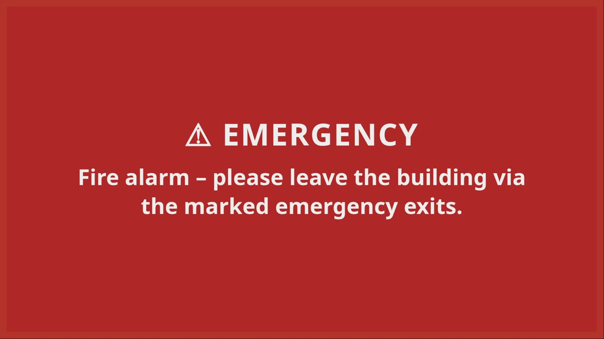

---

## The admin page

### 5. Inside Cockpit
On Proxmox LXC and native Debian installations the admin is a Cockpit extension – “SignageCast” is just a menu entry
next to Cockpit's own pages. If your server already runs Cockpit, SignageCast integrates there.

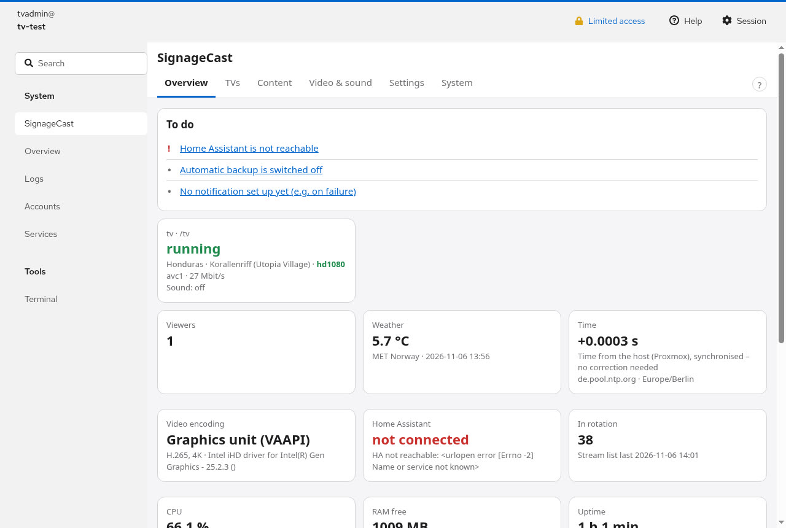

### 6. Overview
At the top a **to-do list**: problems first (e.g. Home Assistant not reachable), then tips (automatic backup off, no
notification set up) – each entry links to the page where you fix it; the ✕ hides it (tips for good, problems until they were
solved once, since 0.35). Below, every TV with its state, current stream,
resolution and sound, then viewers, weather source, time check against NTP (“time from the host, synchronised”), video
encoding (graphics unit or software fallback), Home Assistant connection, streams in rotation, CPU, RAM and uptime.

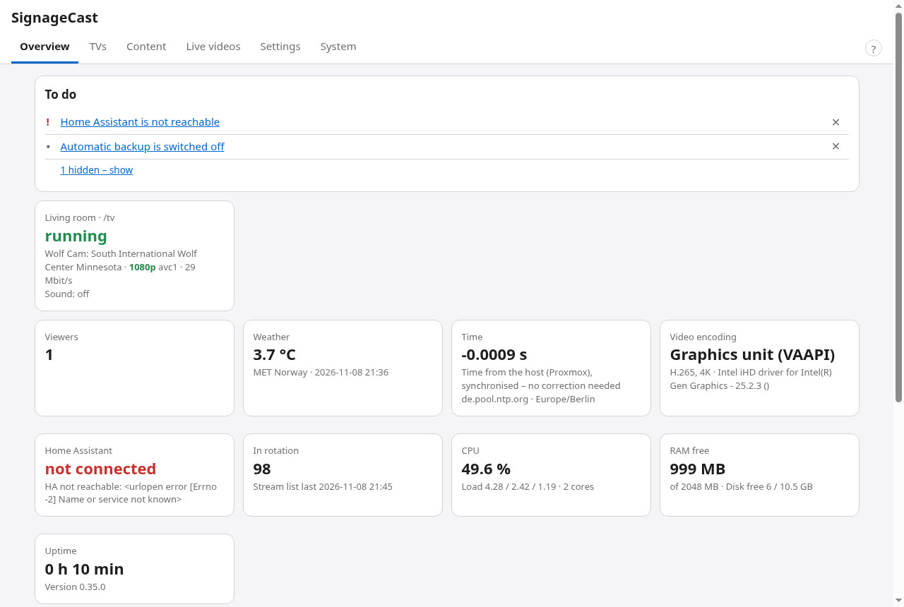

### 7. TVs
Each TV has its own address and a card in three parts: **Display** (layout, optional schedule with another layout or
black at certain times, layout carousel, switching the TV via Home Assistant), **Live video** (on/off, what the video
window shows, categories) and **Sound** (radio or the original sound of the cams, volume). Under *Video stream*: output
Full HD (default) or 4K, the **capture size** the browser draws in (720p saves CPU, 1440p is sharper), bitrate and codec.

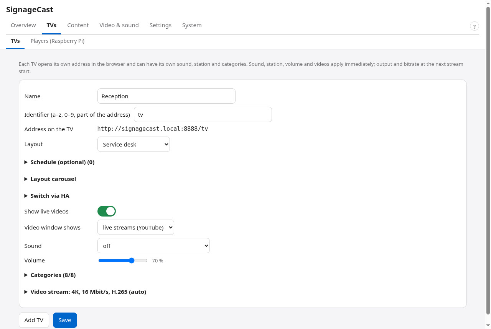

Under *Video stream* → **Encoding (advanced)**: encoder (Automatic, Intel/AMD graphics, Quick Sync, NVENC, software),
preset, tune and B-frames per TV. A change is tried briefly first; if it does not work here, SignageCast stays with
“Automatic”. Fields that do not apply to the active encoder are explained right there.

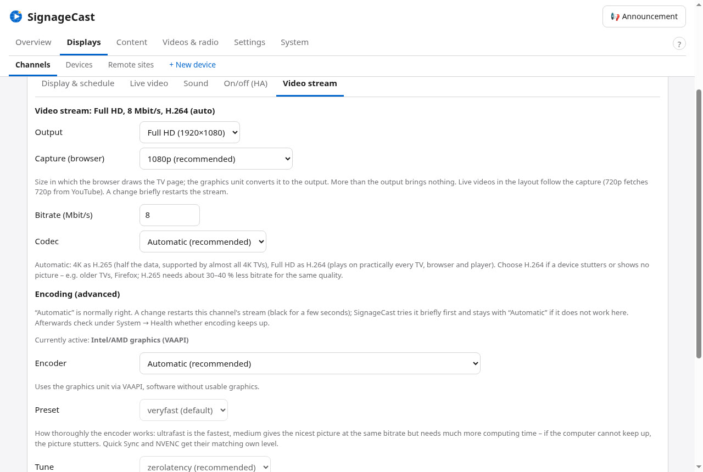

### 8. Raspberry Pi as player (experimental)
TVs → *Players (Raspberry Pi)*: a Pi at the TV plays the finished stream via HDMI – also on TVs without a usable
browser. Enter a name, pick the TV and the network (LAN or Wi-Fi), download a ready image and write it to an SD card;
nothing to type on the Pi. Or download one image for many Pis: each shows a 6-digit code on the TV, which you enter
here to pair it. The model choice says which Pi fits: 1 GB of memory is enough for the stream,
direct mode (the Pi shows the page itself) needs at least 2 GB, better 4 GB (since 0.34). Afterwards every Pi is managed
here: online state, model with memory, IP, screen, video, temperature, buttons for
screenshot, TV on/off (HDMI-CEC), restart and system update, and Wi-Fi changes with automatic return to the old network.
The Pi in these pictures is simulated (real agent code) – the player has not been tested on real hardware yet
([details](PLAYER.md)).

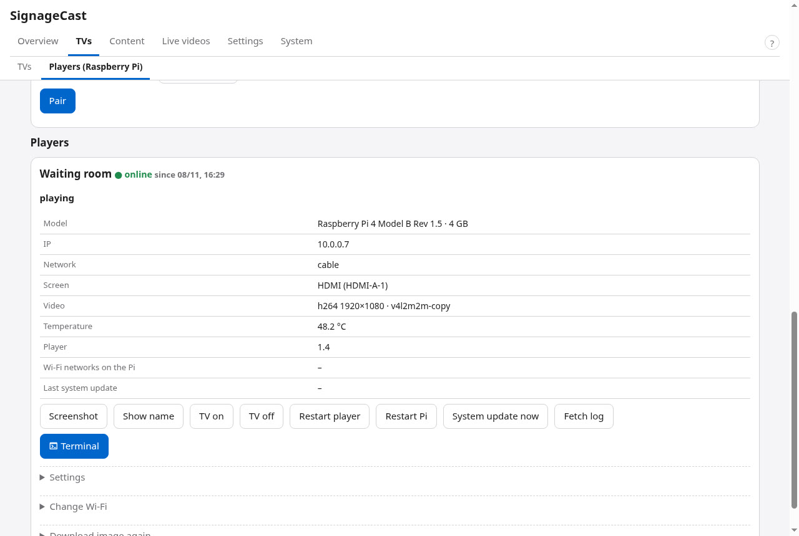

### 9. Remote maintenance – terminal to a Pi (experimental, since 0.33)
**Terminal** on the Pi's card opens a root shell in the browser, drawn like Cockpit's own terminal. Off by default:
the Pi itself must allow it (box when creating the image, or its setup page), so someone who takes over the server
cannot reach Pis that do not. No open port and no SSH on the Pi; input and output are encrypted. The TV shows
*Remote maintenance active* meanwhile, and a session ends after 10 minutes without input or 60 minutes at the latest.

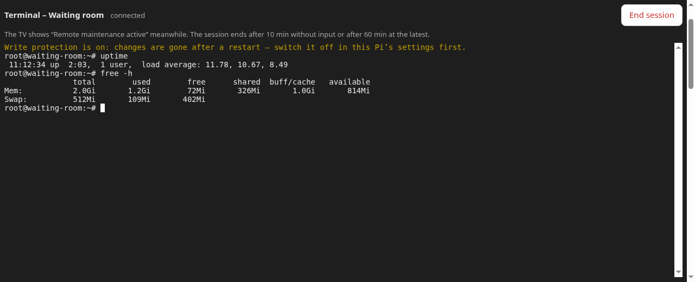

### 10. Layouts and editor
Content → Layouts starts with all layouts as tiles – mini preview, on which TV each one is shown, edit, and copy /
export / delete in the “⋯” menu. “New layout” asks for a name and a starting point (empty, template or copy), so an
existing layout is never overwritten.

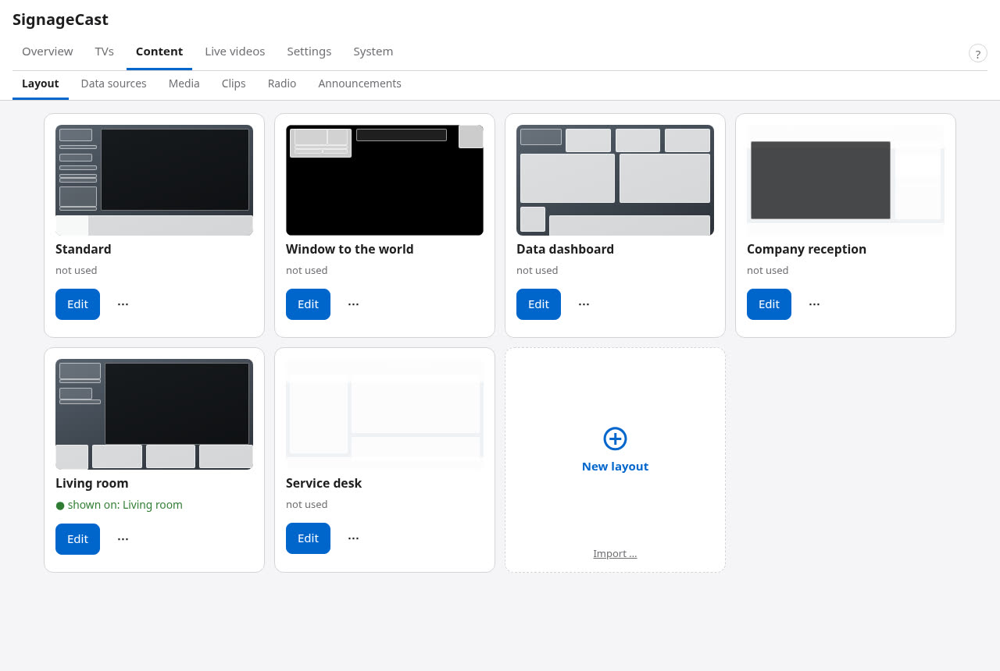

In the editor, drag and resize elements on a 48 × 27 grid. Next to it the **layers** (top = front, as on the TV; show
or hide, bring forward / send backward) and the selected element – here a chart: pick the value with “pick …” by
clicking it in the data source's response. Click the same spot again to reach stacked elements, Tab selects the next one.

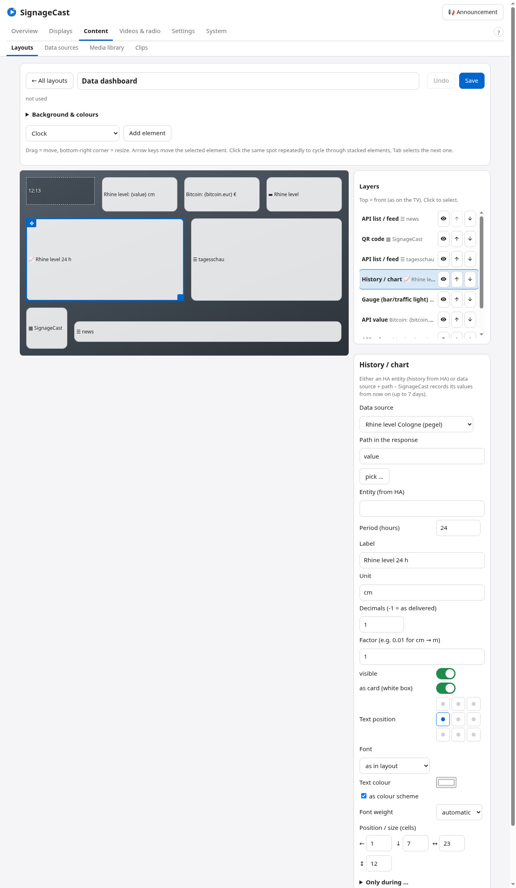

Every element can be limited to a **period** (“Only during …”: date, optionally with time) – the ⏱ in the layers and on
the canvas marks it. Elements such as **PDF** (up to 50 pages) and **web page** with the display “Screenshot” for pages
that forbid embedding make layouts like the service desk above.

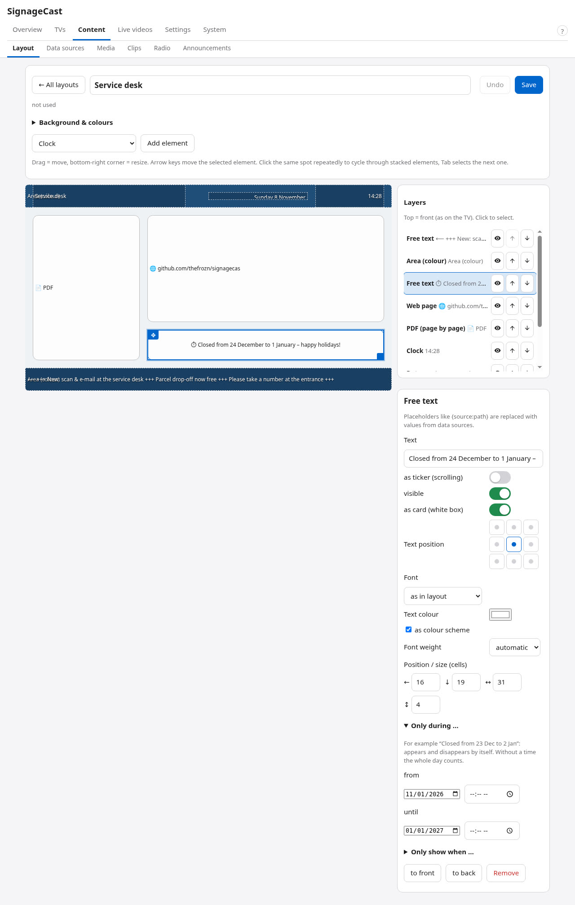

### 11. Data sources
Your own JSON APIs, RSS/Atom feeds, pictures, iCal calendars and cameras, fetched by the container at the interval you
choose. “View data” shows the response as a tree; a click copies the path for use in elements and placeholders.
Instead of an address, a source can also be an uploaded file (up to 1 MB) – e.g. the waste collection calendar of your
town as `.ics` or `.csv` when it offers no subscription address.

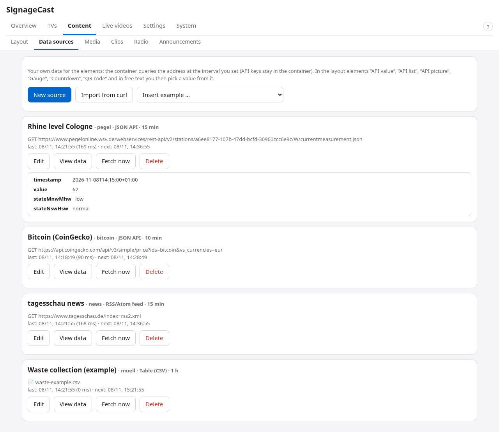

For CSV you choose delimiter, quote character, header row and character set (all detected automatically), which columns
to import under which name, optional row filters and optionally a date column: the rows then appear as events in the
*Calendar / waste collection* element. Here a waste calendar with the row filter *DISTRICT is empty* – it drops the
bulky and hazardous waste dates of another district.

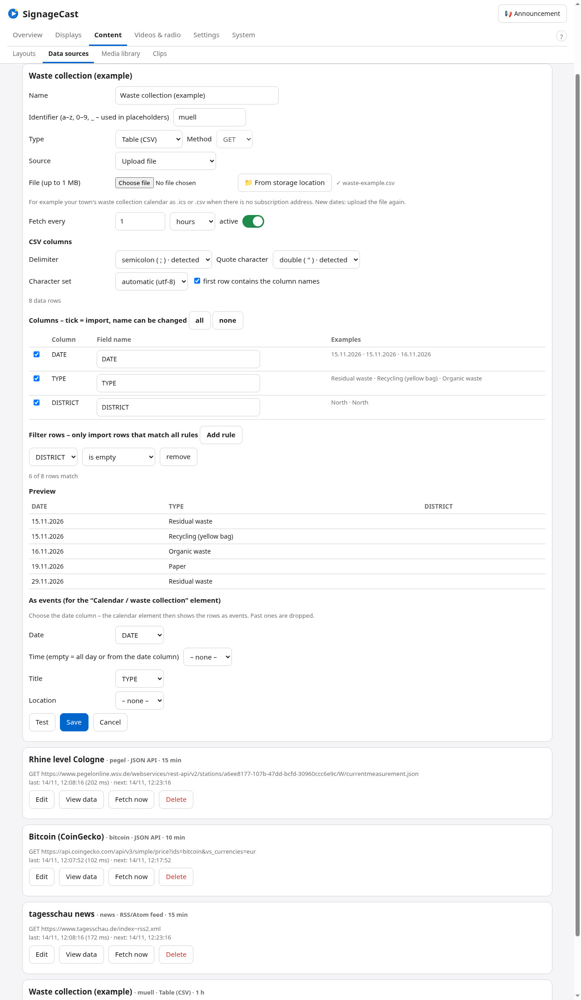

### 12. Import from curl
Paste a `curl` command from an API guide – address, method and headers are filled in, `Authorization` is marked as a
secret automatically (shown as •••• after saving, kept out of backups unless you choose otherwise). The command is only
parsed, never executed.

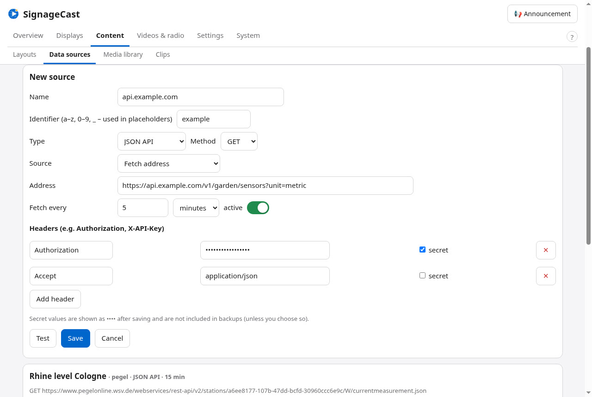

### 13. Live videos – streams
The built-in list of wildlife and nature live streams, plus streams found by the nightly search. Every stream has a
**state** – ready, night (with “daylight in …”), not live, resolution too low, paused after a strike, location
unknown – and the chips above the list filter by it (with counts), next to text, category and origin (fixed / found).
Quality is measured while playing, and the next stream is checked on YouTube before it is announced. Protect
favourites, reject unwanted ones.

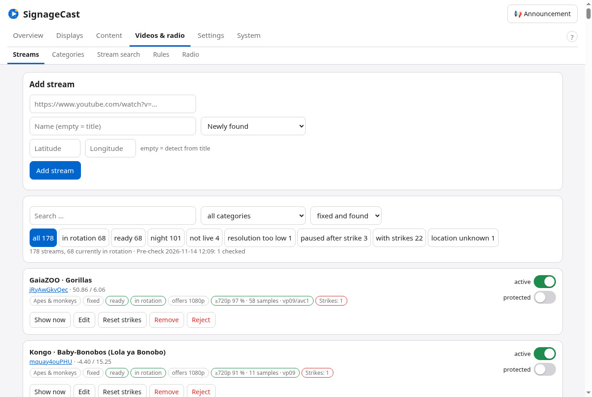

### 14. Live videos – rotation & quality
Minutes per stream, only streams where it is daytime, minimum sun elevation; under *Advanced* the minimum quality
(360p … 1080p) and the strike rules. The categories are grouped into **Animals** and **More topics** (since 0.32:
cities & squares, beaches & coasts, mountains & ski, harbours & ships, airports & planes, trains & railways, space &
Earth, natural wonders). Categories added by an update start switched off on existing installations.

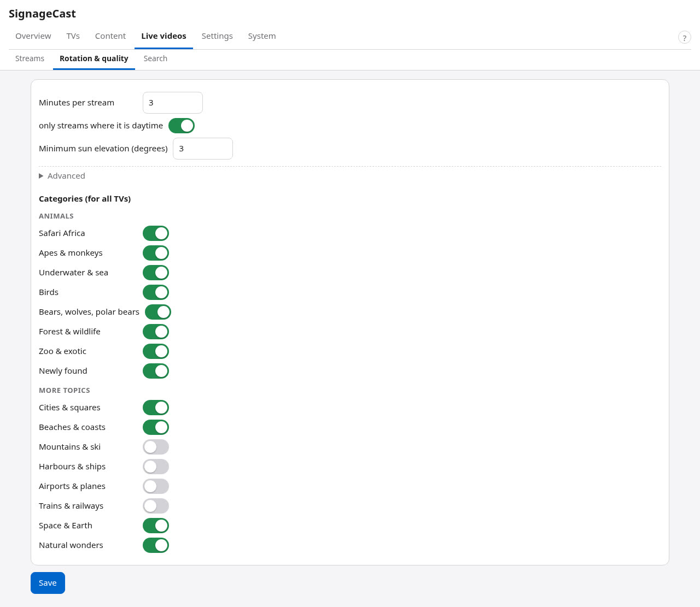

### 15. Radio
Content → Radio: your own stations (MP3/AAC, also .m3u/.pls), suggestions for your location from radio-browser.info,
a buffer that bridges short dropouts.

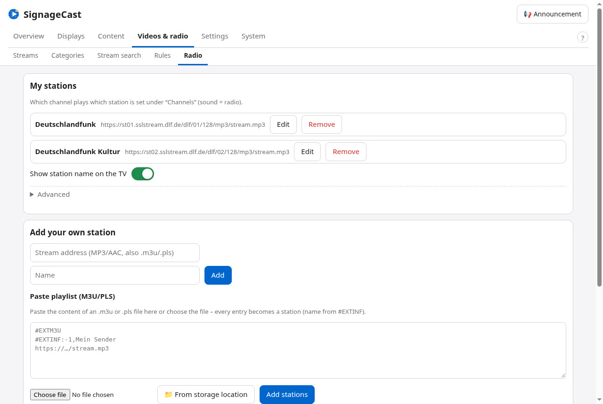

### 16. Clips
At fixed minutes a clip interrupts the rotation – e.g. the German news “tagesschau in 100 Sekunden”. Buffer: the
container preloads each new edition (complete or only the first MB), so the clip plays without stalling.

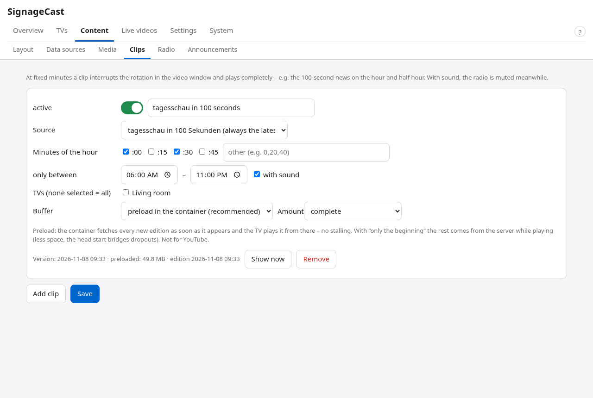

### 17. Settings → General
Language and weather source, location by place search, time source: NTP server (default: the country pool) and time
zone – if the host keeps its clock synchronised, nothing is corrected. Home Assistant and notifications have their own
pages next to it. Unsaved changes are marked on their card, and you are asked before leaving the page.

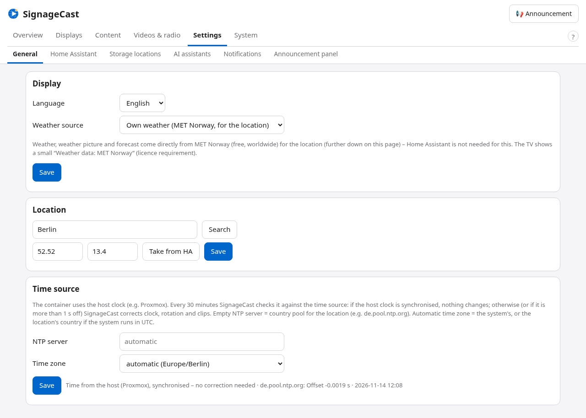

### 18. Updates
System (Debian) and SignageCast updates with one click or automatically within a maintenance window, only while
nobody is watching. Releases are signed and carry a software bill of materials (SBOM); an update is installed only with
a valid signature and returns to the previous version automatically if SignageCast does not run afterwards.

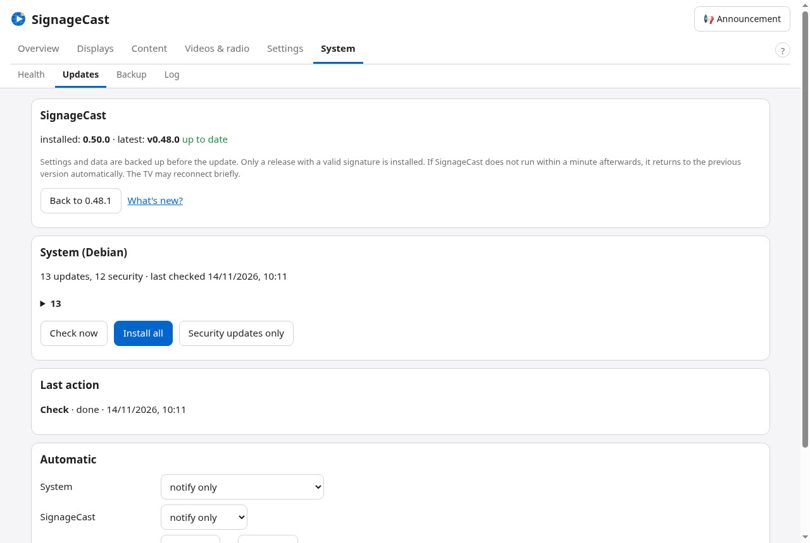

### 19. Backup
A ZIP with settings, stream list, pictures and chart history. You are asked explicitly whether credentials and
passwords should be included – then the ZIP is AES-256 encrypted and a strong password is required. Automatic backups
daily or weekly; restore in the admin or when installing a new instance.

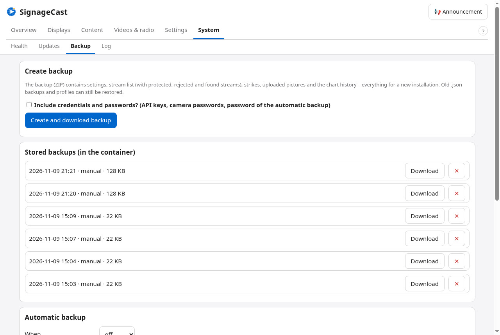

### 20. Docker / Podman
In the container image there is no Cockpit: the same admin page is served with its own login on port 19090; the
initial password is printed in the container log. The password is changed under Settings → Access.

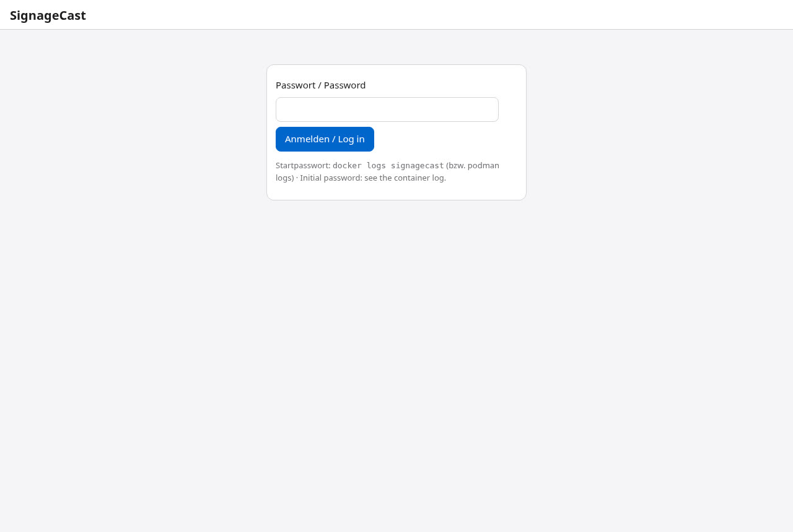

### 21. On the phone
The admin works on a phone as well – the areas become one menu; switch elements on and off, change sizes, sound, sources.

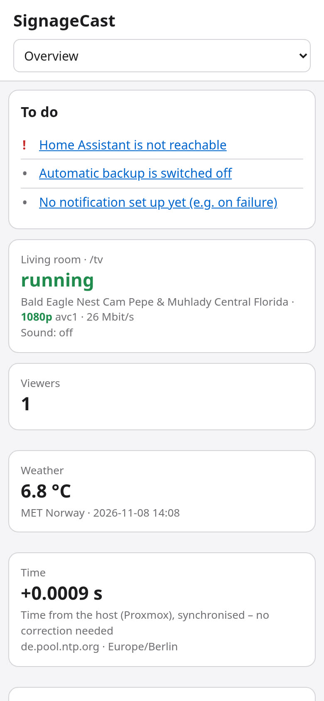

### 22. Notifications
Telegram, e-mail (SMTP) and Home Assistant, each with a test button; rarely needed options under “Advanced”, and what
to report: TV failure, failed update or backup, Home Assistant disconnected, TV stutters.

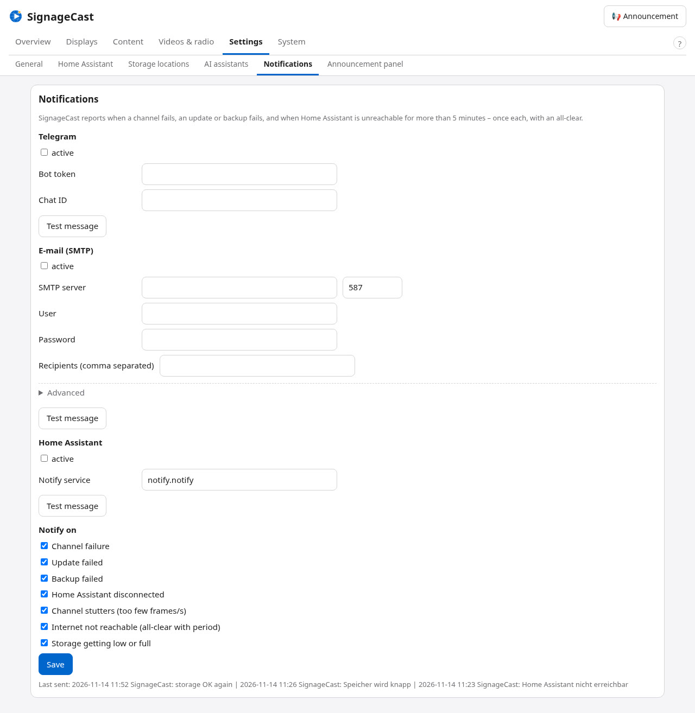

### 23. Performance test
System → Performance measures for 10 seconds how smoothly every running TV is rendered and encoded – frames/s of the
TV page and of the encoder, speed, dropped or duplicated frames, CPU per TV, memory, graphics unit – and gives concrete
recommendations. A second page, opened on the playback device, measures transfer and playback there. Below: after how
many seconds without viewers a TV's video stream switches off.

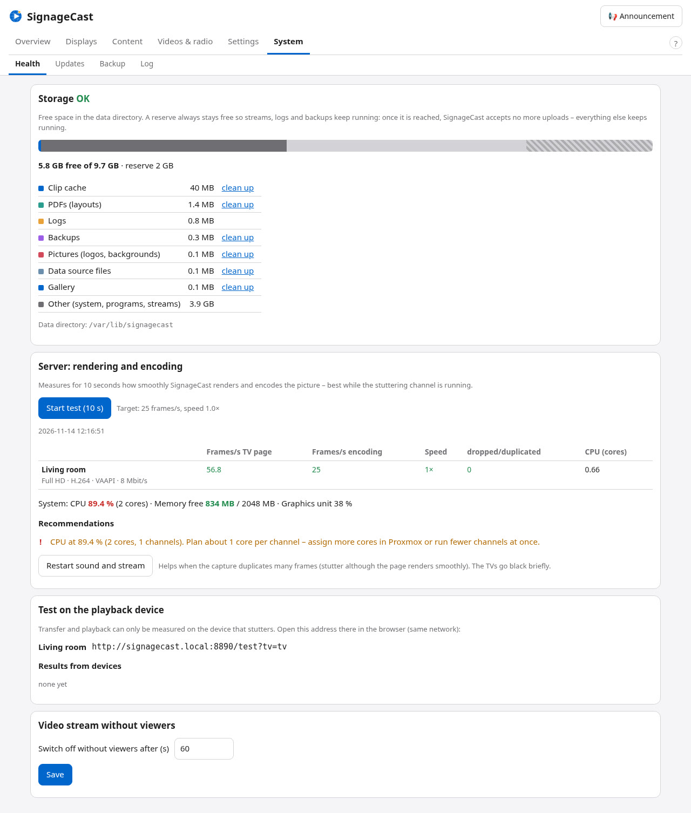

### 24. Announcements, emergency screen and webhook
Content → Announcements: the panel for the reception (`http://<IP>:8890/pult` – it can only send and end
announcements), the voice (offline with Piper: Kerstin or Thorsten), chime, accounts with their own password and the
TVs they may reach, and templates. Further down the **emergency screen** with its templates and webhook commands, and
**messages via webhook**: other systems (e.g. Home Assistant) put a short banner on the TVs, with a key shown only once.

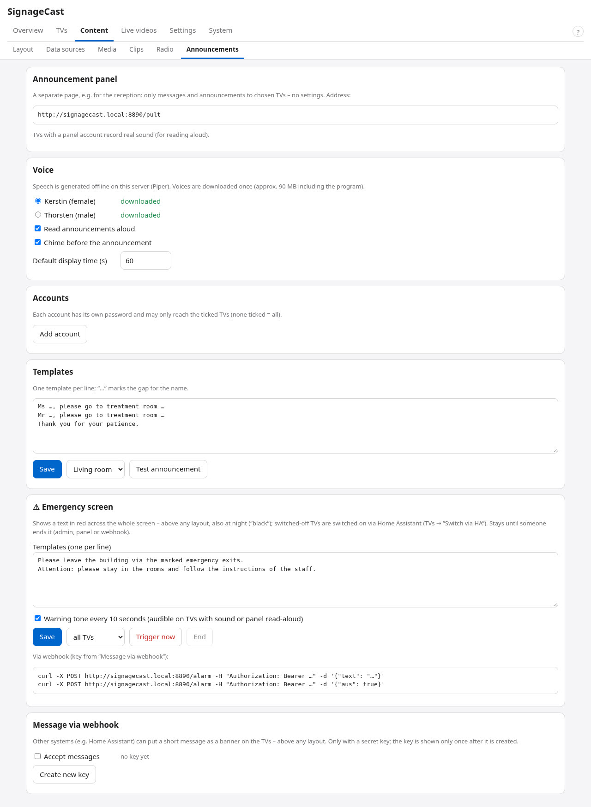
