# SignageCast – screenshot tour

A walk through SignageCast: what the TV shows and how you set it up in the browser. All pictures are from a demo
installation (location Berlin, public example data, no Home Assistant connected) running version 0.13.

[← back to the README](../README.md)

---

## On the TV

### 1. Live window to the world
A live wildlife cam from wherever it is daytime right now, with clock, weather from MET Norway and the forecast.
The bar below mixes your own data: the Rhine water level and the Bitcoin price from public APIs, and a countdown.

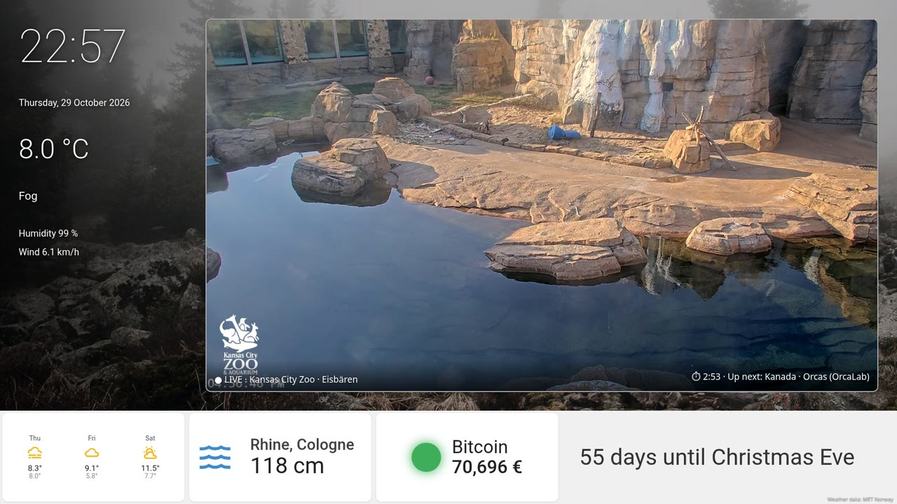

### 2. Data dashboard
A second TV with a layout built only from data sources: API value, gauge as bar and traffic light, a 24-hour chart
(real measurements of the Rhine at Cologne), public holidays from an iCal calendar, a feed list and the same feed as
ticker, a QR code and a countdown. Background: city picture set by time of day (here: night).

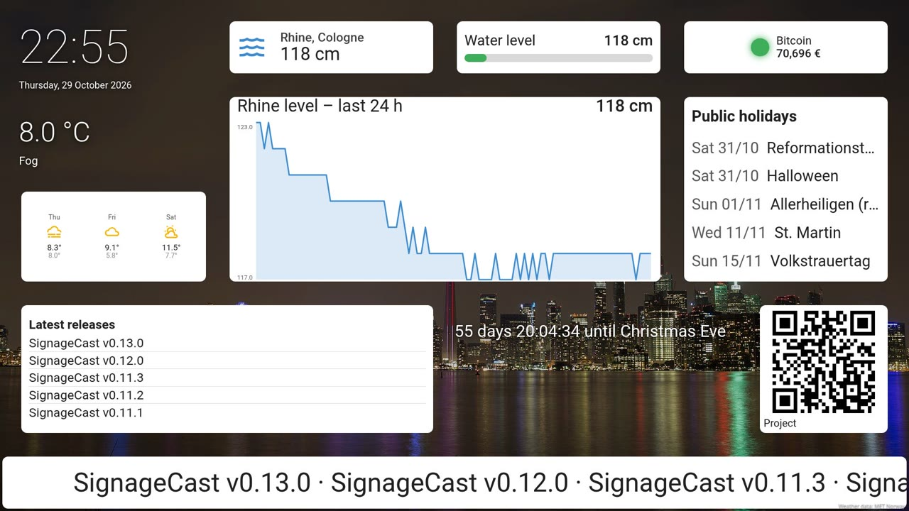

---

## The admin page

### 3. Inside Cockpit
On Proxmox LXC and native Debian installations the admin is a Cockpit extension – “SignageCast” is just a menu entry
next to Cockpit's own pages. If your server already runs Cockpit, SignageCast integrates there.

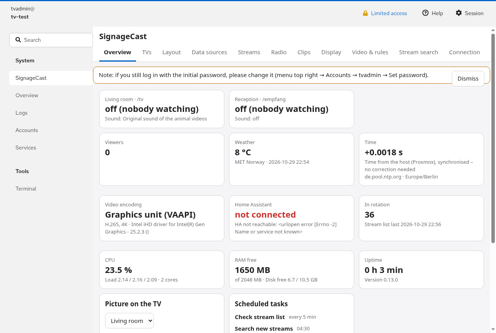

### 4. Overview
Every TV with its state and sound, viewers, weather source, time check against NTP (“time from the host,
synchronised”), video encoding (graphics unit or software fallback), Home Assistant connection, CPU, RAM, uptime.

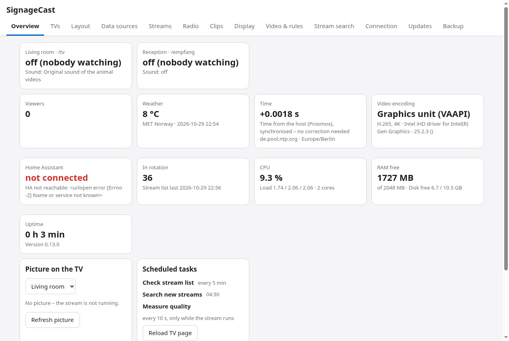

### 5. TVs
Each TV has its own address, layout, optional schedule (other layout or black at certain times), sound (radio or the
original sound of the cams), volume, categories and video settings (4K/Full HD, bitrate).

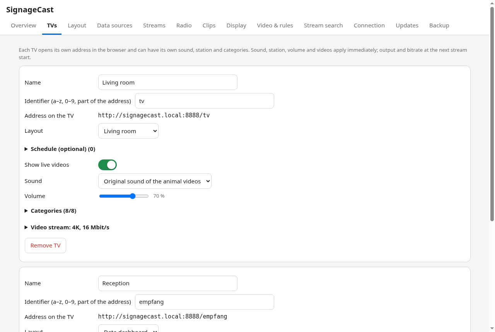

### 6. Layout editor
Drag and resize elements on a 48 × 27 grid; templates for living room, waiting room and company reception. On the
right the selected element – here a chart: pick the value by clicking it in the data source's response.

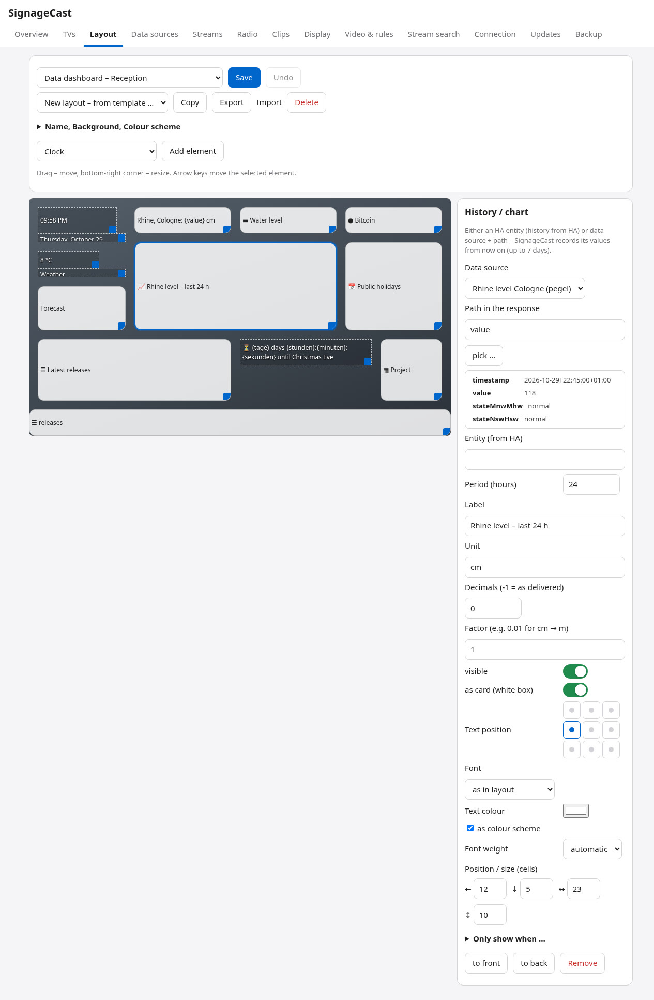

### 7. Data sources
Your own JSON APIs, RSS/Atom feeds, pictures, iCal calendars and cameras, fetched by the container at the interval you
choose. “View data” shows the response as a tree; a click copies the path for use in elements and placeholders.

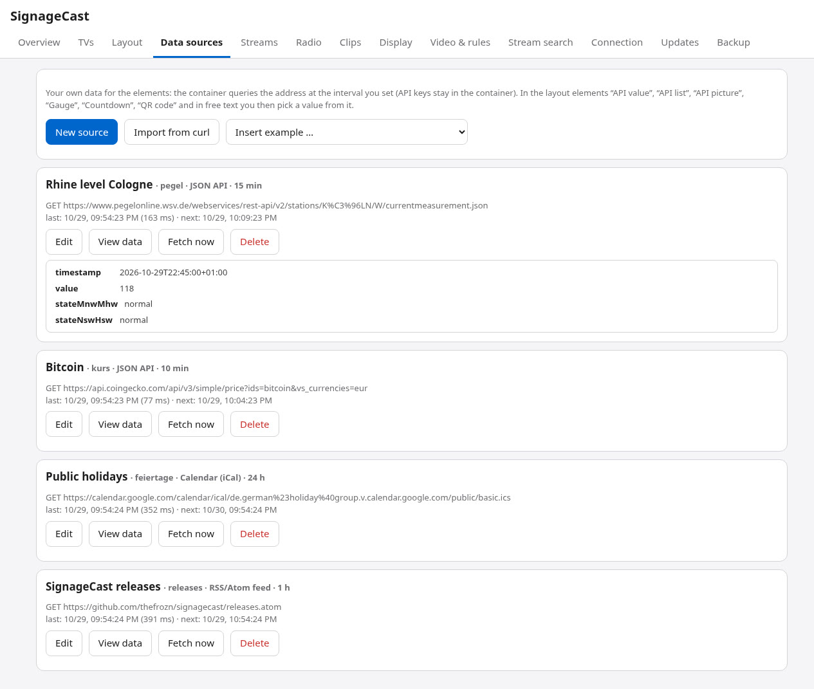

### 8. Import from curl
Paste a `curl` command from an API guide – address, method and headers are filled in, `Authorization` is marked as a
secret automatically (shown as •••• after saving, kept out of backups unless you choose otherwise). The command is only
parsed, never executed.

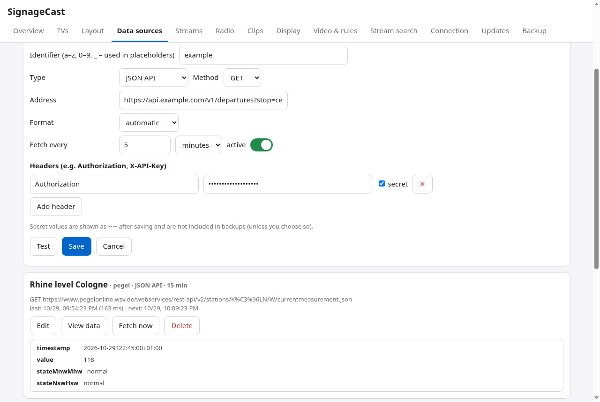

### 9. Streams
The built-in list of wildlife and nature live streams, plus streams found by the nightly search. Quality is measured
while playing; streams that stall or only deliver low resolution get strikes and are skipped. Protect favourites,
reject unwanted ones.

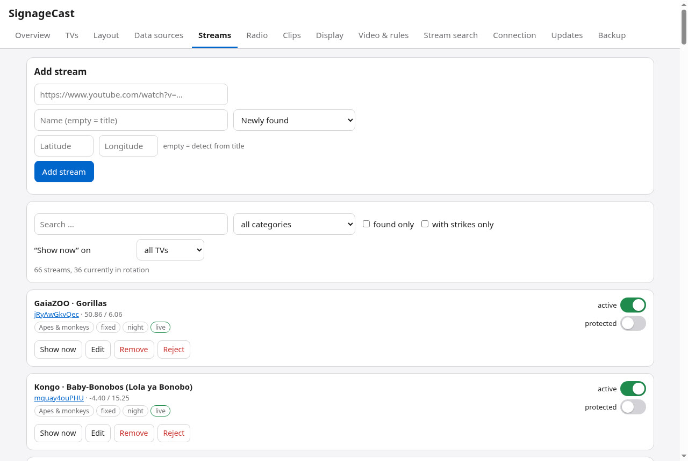

### 10. Radio
Your own stations (MP3/AAC, also .m3u/.pls), suggestions for your location from radio-browser.info, a buffer that
bridges short dropouts.

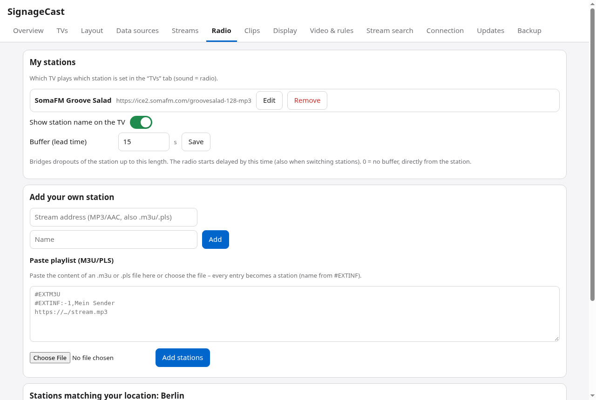

### 11. Clips
At fixed minutes a clip interrupts the rotation – e.g. the German news “tagesschau in 100 Sekunden”. Buffer: the
container preloads each new edition (complete or only the first MB), so the clip plays without stalling.

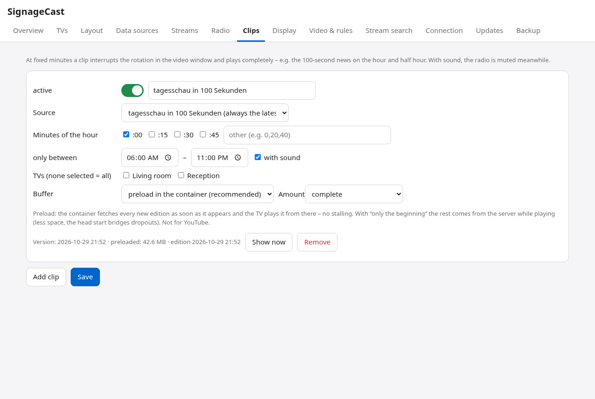

### 12. Connection
Home Assistant address (optional), location by place search, time source: NTP server (default: the country pool) and
time zone – if the host keeps its clock synchronised, nothing is corrected.

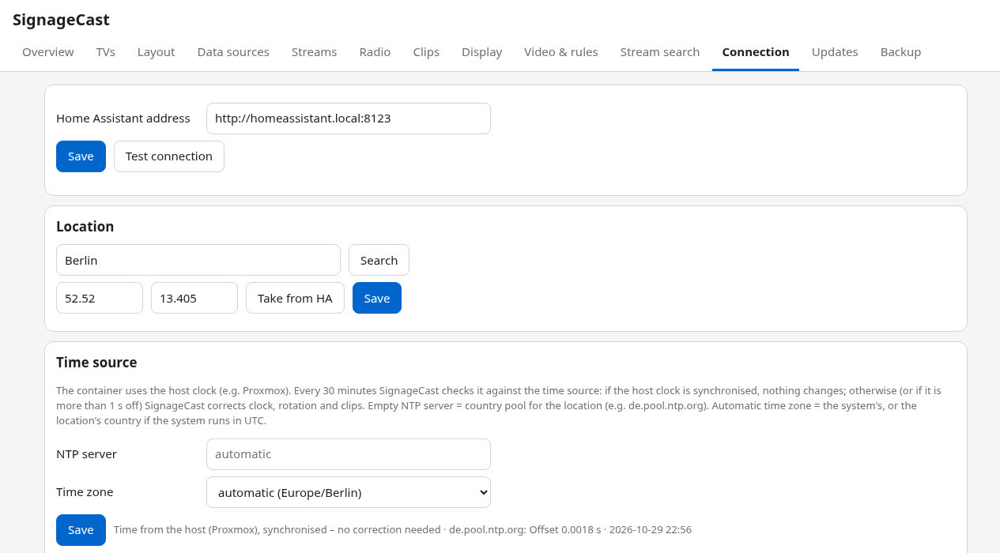

### 13. Updates
System (Debian) and SignageCast updates with one click or automatically within a maintenance window, only while
nobody is watching. Releases are signed; an update is installed only with a valid signature and returns to the
previous version automatically if SignageCast does not run afterwards.

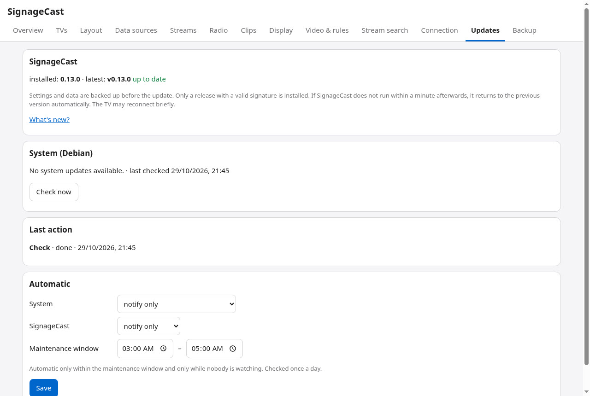

### 14. Backup
A ZIP with settings, stream list, pictures and chart history. You are asked explicitly whether credentials and
passwords should be included – then the ZIP is AES-256 encrypted and a strong password is required. Automatic backups
daily or weekly; restore in the admin or when installing a new instance.

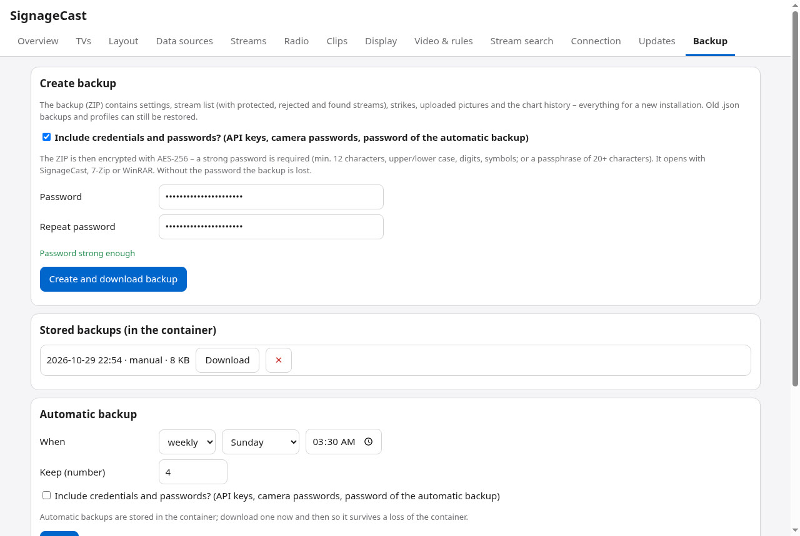

### 15. Docker / Podman
In the container image there is no Cockpit: the same admin page is served with its own login on port 19090; the
initial password is printed in the container log.

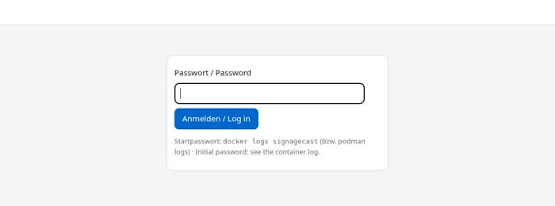

### 16. On the phone
The admin works on a phone as well – switch elements on and off, change sizes, sound, sources.

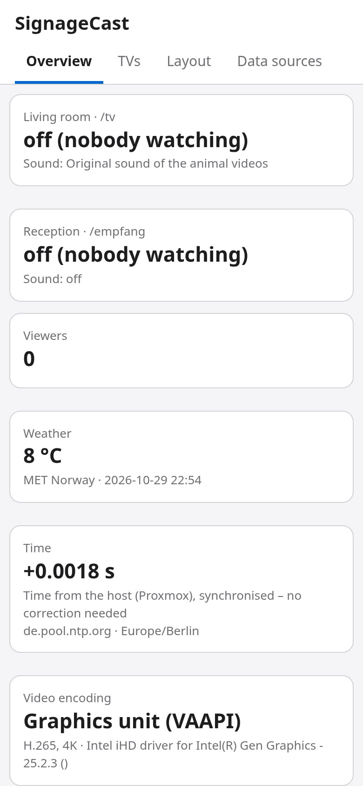

---

## Deutsch (kurz)

Die Tour zeigt zuerst zwei Fernseher – Live-Tierkamera mit Wetter und eigenen Daten (Rheinpegel, Bitcoin, Countdown)
sowie ein reines Daten-Layout (Diagramm mit echten Pegelwerten, Feiertage per iCal, Feed, QR-Code). Danach die
Verwaltung: SignageCast als Menüpunkt in Cockpit, Übersicht, Fernseher, Layout-Editor mit Pfad-Auswahl, Datenquellen
mit Antwort-Baum und curl-Import, Streams, Radio, Einspieler mit Puffer, Verbindung mit Zeitquelle, Updates
(signiert, mit Rückkehr bei Fehlern), Sicherung (AES-256 mit Zugangsdaten), die Anmeldeseite im Docker-Betrieb und
die Ansicht auf dem Handy. Alle Bilder stammen aus einer Demo-Installation ohne private Daten.
