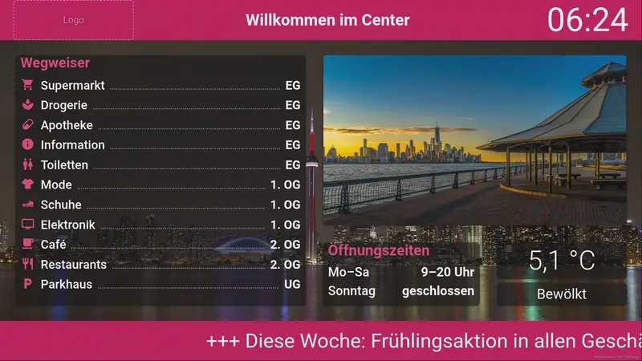

# Einkaufszentrum – Info

*[English](center.md)* · [Alle Vorlagen](../TEMPLATES.de.md)

Aufnahme aus dem echten Fernseher-Stream

**Wofür:** Einkaufszentrum, Kaufhaus, Bürogebäude, Rathaus

## Was man sieht

Hinter allem liegt ein Stadtbild, das mit der Tageszeit wechselt (Morgen, Tag, Abend, Nacht) und sich langsam bewegt. Kopfleiste in der Akzentfarbe mit Logo, Begrüßung und Uhr. Links der Wegweiser mit Symbol und Etage, rechts eine Galerie für Aktionen und Angebote, darunter Öffnungszeiten und Wetter – alles auf dunklen, durchscheinenden Karten.

**Hintergrund:** Bilderset *Stadt*, wechselt mit der Tageszeit; **Bilder bewegen sich langsam** (sanfter Zoom); Karten dunkel durchscheinend. Farbschema *dunkel*, Akzent `#e0457b`, Schrift Open Sans.

## Verwendete Elemente

| Element | Zeigt |
|---|---|
| Fläche (Farbe) | `#c2185b`, 100 % deckend |
| Logo / Bild | eigenes Logo hochladen |
| Freier Text | „Willkommen im Center“ |
| Uhr | aktuelle Uhrzeit |
| Liste | **Wegweiser** – 11 Zeilen |
| Galerie (Bilder/PDFs) | Galerie-Ordner, alle 10 s |
| Liste | **Öffnungszeiten** – 2 Zeilen |
| Temperatur | Außentemperatur (Home Assistant oder eigenes Wetter) |
| Wetterlage | Wetterlage in Worten |
| Fläche (Farbe) | `#c2185b`, 100 % deckend |
| Freier Text | Laufband: „+++ Diese Woche: Frühlingsaktion in allen Geschäften +++ 2 Stunden ko…“ |

## Anpassen

Neues Layout aus der Vorlage: **Inhalte → Layouts → + Neues Layout → Ausgangspunkt**.

- Galerie: im Editor einen Ordner wählen (Bilder vom NAS, aus der Cloud oder hochgeladen).
- Wegweiser: Zeilen ändern oder per CSV pflegen; mit *hervorheben* eine Zeile in der Akzentfarbe zeigen.
- Eigene Farbe: Akzentfarbe und die Kopfleiste (Fläche *kopf*) anpassen.

*Ohne Live-Video: etwa die Hälfte der Rechenleistung einer Vorlage mit Video.*
