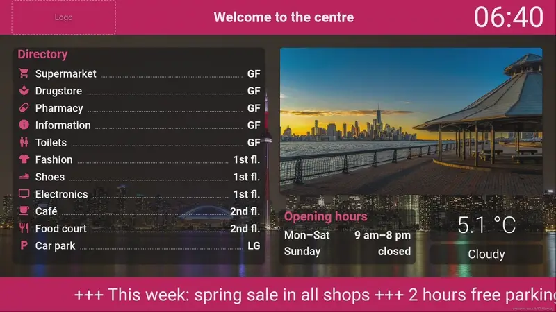

# Shopping centre – info

*[Deutsch](center.de.md)* · [All templates](../TEMPLATES.md)

Recorded from the real TV stream

**For:** shopping centre, department store, office building, town hall

## What you see

Behind everything is a city picture that changes with the time of day (morning, day, evening, night) and moves slowly. Header in the accent colour with logo, greeting and clock. On the left the directory with icon and floor, on the right a gallery for promotions, below it opening hours and weather – all on dark, see-through cards.

**Background:** picture set *City*, changes with the time of day; **pictures move slowly** (gentle zoom); cards see-through dark. Colour scheme *dunkel*, accent `#e0457b`, font Open Sans.

## Elements used

| Element | Shows |
|---|---|
| Area (colour) | `#c2185b`, 100 % opaque |
| Logo / picture | upload your logo |
| Free text | “Welcome to the centre” |
| Clock | current time |
| List | **Directory** – 11 rows |
| Gallery (pictures/PDFs) | gallery folder, every 10 s |
| List | **Opening hours** – 2 rows |
| Temperature | outside temperature (Home Assistant or own weather) |
| Weather | weather in words |
| Area (colour) | `#c2185b`, 100 % opaque |
| Free text | ticker: “+++ This week: spring sale in all shops +++ 2 hours free parking +++…” |

## Make it yours

New layout from the template: **Content → Layouts → + New layout → Start from**.

- Gallery: pick a folder in the editor (pictures from a NAS, the cloud or uploaded).
- Directory: change the rows or keep them in a CSV file; *highlight* shows a row in the accent colour.
- Own colours: change the accent colour and the header (area *kopf*).

*Without live video: about half the computing power of a template with video.*
