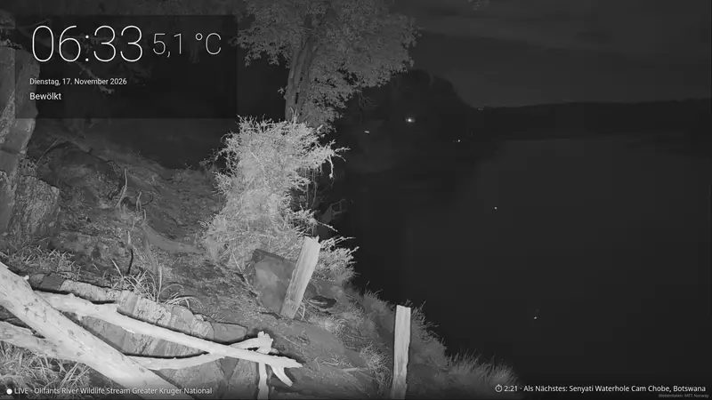

# Fenster zur Welt

*[English](fenster.md)* · [Alle Vorlagen](../TEMPLATES.de.md)

Aufnahme aus dem echten Fernseher-Stream

**Wofür:** Wohnzimmer, Lounge – ein Fenster in die Welt

## Was man sieht

Das Live-Video über den ganzen Bildschirm, oben links eine dunkle Glastafel mit Uhr, Temperatur, Datum und Sender, oben mittig ein Meldungsbanner aus Home Assistant.

**Hintergrund:** einfarbig `#000000`. Farbschema *dunkel*, Akzent `#ffcc66`, Schrift Open Sans.

## Verwendete Elemente

| Element | Zeigt |
|---|---|
| Live-Video | Live-Kameras (Natur, Tiere) oder eigene Medien |
| Fläche (Farbe) | `#000000`, 45 % deckend |
| Uhr | aktuelle Uhrzeit |
| Temperatur | Außentemperatur (Home Assistant oder eigenes Wetter) |
| Datum | Wochentag und Datum |
| Wetterlage | Wetterlage in Worten |
| Radio-Sender | laufender Radio-Sender |
| Meldung von HA | Text-Entität aus Home Assistant (leer = unsichtbar) |

## Anpassen

Neues Layout aus der Vorlage: **Inhalte → Layouts → + Neues Layout → Ausgangspunkt**.

- Meldung: Text-Entität aus Home Assistant eintragen – ohne bleibt das Banner unsichtbar.

*Mit Live-Video: rund 1 Kern Rechenleistung am Server.*
