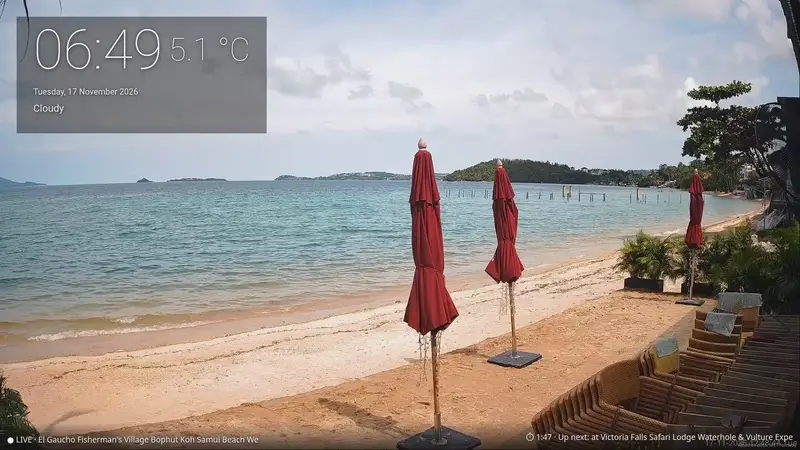

# Window to the world

*[Deutsch](fenster.de.md)* · [All templates](../TEMPLATES.md)

Recorded from the real TV stream

**For:** living room, lounge – a window to the world

## What you see

The live video across the whole screen, a dark glass panel with clock, temperature, date and station at the top left, a message banner from Home Assistant at the top centre.

**Background:** plain colour `#000000`. Colour scheme *dunkel*, accent `#ffcc66`, font Open Sans.

## Elements used

| Element | Shows |
|---|---|
| Live video | live cameras (nature, animals) or own media |
| Area (colour) | `#000000`, 45 % opaque |
| Clock | current time |
| Temperature | outside temperature (Home Assistant or own weather) |
| Date | weekday and date |
| Weather | weather in words |
| Radio station | radio station playing |
| Message from HA | text entity from Home Assistant (empty = invisible) |

## Make it yours

New layout from the template: **Content → Layouts → + New layout → Start from**.

- Message: enter a text entity from Home Assistant – without it the banner stays invisible.

*With live video: about one core of computing power on the server.*
