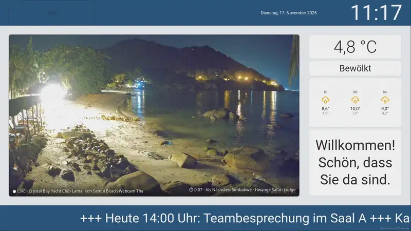

# Firma – Corporate Design

*[English](firma.md)* · [Alle Vorlagen](../TEMPLATES.de.md)

Aufnahme aus dem echten Fernseher-Stream

**Wofür:** Firma, Büro, Empfang – im eigenen Farbton

## Was man sieht

Kopfleiste und Laufband in der Firmenfarbe, Logo, Datum und Uhr, großes Video, rechts Wetter, Vorhersage und Begrüßung.

**Hintergrund:** einfarbig `#eef1f5`. Farbschema *hell*, Akzent `#1f4e79`, Schrift Montserrat.

## Verwendete Elemente

| Element | Zeigt |
|---|---|
| Fläche (Farbe) | `#1f4e79`, 100 % deckend |
| Logo / Bild | eigenes Logo hochladen |
| Datum | Wochentag und Datum |
| Uhr | aktuelle Uhrzeit |
| Live-Video | Live-Kameras (Natur, Tiere) oder eigene Medien |
| Temperatur | Außentemperatur (Home Assistant oder eigenes Wetter) |
| Wetterlage | Wetterlage in Worten |
| Vorhersage | Vorhersage der nächsten Tage |
| Freier Text | „Willkommen! Schön, dass Sie da sind.“ |
| Fläche (Farbe) | `#1f4e79`, 100 % deckend |
| Freier Text | Laufband: „+++ Heute 14:00 Uhr: Teambesprechung im Saal A +++ Kantine: Gemüselas…“ |

## Anpassen

Neues Layout aus der Vorlage: **Inhalte → Layouts → + Neues Layout → Ausgangspunkt**.

- Firmenfarbe: Akzentfarbe sowie die Flächen *kopf* und *band* ändern.

*Mit Live-Video: rund 1 Kern Rechenleistung am Server.*
