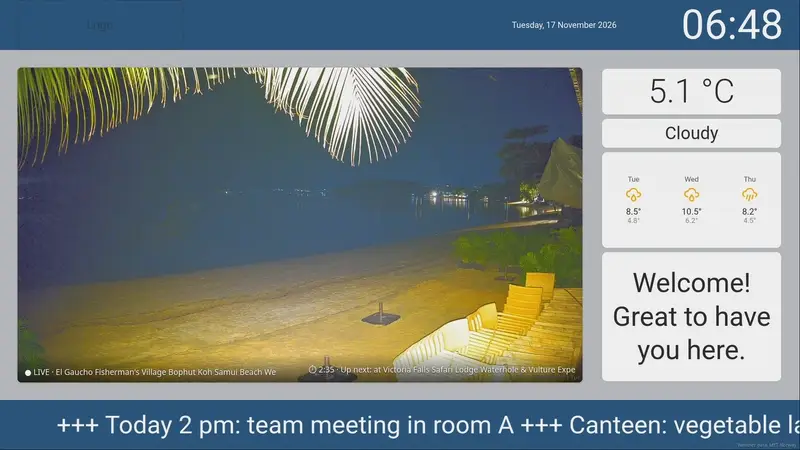

# Company – corporate design

*[Deutsch](firma.de.md)* · [All templates](../TEMPLATES.md)

Recorded from the real TV stream

**For:** company, office, reception – in your own colour

## What you see

Header and ticker in the company colour, logo, date and clock, a large video, weather, forecast and greeting on the right.

**Background:** plain colour `#eef1f5`. Colour scheme *hell*, accent `#1f4e79`, font Montserrat.

## Elements used

| Element | Shows |
|---|---|
| Area (colour) | `#1f4e79`, 100 % opaque |
| Logo / picture | upload your logo |
| Date | weekday and date |
| Clock | current time |
| Live video | live cameras (nature, animals) or own media |
| Temperature | outside temperature (Home Assistant or own weather) |
| Weather | weather in words |
| Forecast | forecast for the next days |
| Free text | “Welcome! Great to have you here.” |
| Area (colour) | `#1f4e79`, 100 % opaque |
| Free text | ticker: “+++ Today 2 pm: team meeting in room A +++ Canteen: vegetable lasagne…” |

## Make it yours

New layout from the template: **Content → Layouts → + New layout → Start from**.

- Company colour: change the accent colour and the areas *kopf* and *band*.

*With live video: about one core of computing power on the server.*
