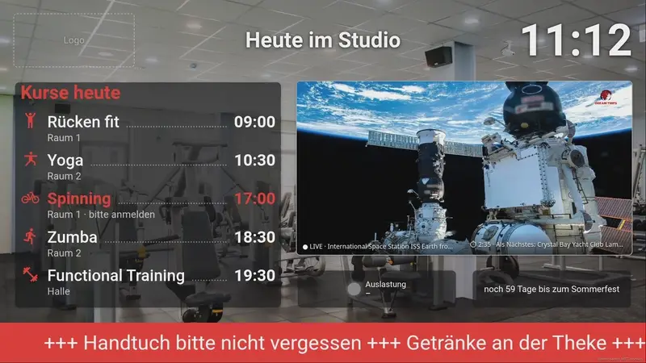

# Fitnessstudio / Verein

*[English](fitness.md)* · [Alle Vorlagen](../TEMPLATES.de.md)

Aufnahme aus dem echten Fernseher-Stream

**Wofür:** Fitnessstudio, Sportverein, Tanzschule, Kletterhalle

## Was man sieht

Sportbilder (Langhantel, Gerätepark, Kurzhanteln, Laufbänder) als langsame Diashow, leicht abgedunkelt. Darauf dunkle, durchscheinende Karten: Kurse von heute mit Uhrzeit, Raum und Symbol, ein Live-Video, die Auslastung als Ampel aus einer Datenquelle und ein Countdown zum nächsten Fest. Laufband in Rot.

**Hintergrund:** Bilderset *Sport* als Diashow, 15 s je Bild; **Bilder bewegen sich langsam** (sanfter Zoom); Karten dunkel durchscheinend. Farbschema *dunkel*, Akzent `#e53935`, Schrift Montserrat.

## Verwendete Elemente

| Element | Zeigt |
|---|---|
| Fläche (Farbe) | `#000000`, 35 % deckend |
| Logo / Bild | eigenes Logo hochladen |
| Freier Text | „Heute im Studio“ |
| Uhr | aktuelle Uhrzeit |
| Liste | **Kurse heute** – 5 Zeilen |
| Live-Video | Live-Kameras (Natur, Tiere) oder eigene Medien |
| Anzeige (Balken/Ampel) | Auslastung (ampel) |
| Countdown | noch {tage} Tage bis zum Sommerfest |
| Fläche (Farbe) | `#e53935`, 100 % deckend |
| Freier Text | Laufband: „+++ Handtuch bitte nicht vergessen +++ Getränke an der Theke +++ Neue…“ |

## Anpassen

Neues Layout aus der Vorlage: **Inhalte → Layouts → + Neues Layout → Ausgangspunkt**.

- Auslastung: eine Datenquelle (z. B. Zähler am Eingang, HA-Sensor) wählen; Grenzen für gelb/rot im Baustein.
- Kursplan per CSV pflegen – ein Tag pro Datei oder mit Zeilenfilter.
- Countdown: Datum und Text eintragen; danach zeigt er den Ende-Text.

*Mit Live-Video: rund 1 Kern Rechenleistung am Server.*
