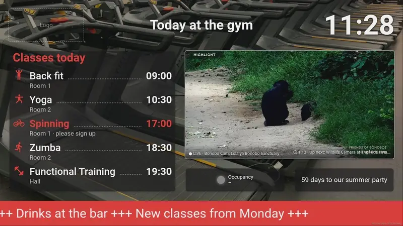

# Gym / sports club

*[Deutsch](fitness.de.md)* · [All templates](../TEMPLATES.md)

Recorded from the real TV stream

**For:** gym, sports club, dance school, climbing hall

## What you see

Sports pictures (barbell, machines, dumbbells, treadmills) as a slow slideshow, slightly darkened. On top dark, see-through cards: today's classes with time, room and icon, a live video, the occupancy as a traffic light from a data source and a countdown to the next party. Ticker in red.

**Background:** picture set *Sport* as slideshow, 15 s per picture; **pictures move slowly** (gentle zoom); cards see-through dark. Colour scheme *dunkel*, accent `#e53935`, font Montserrat.

## Elements used

| Element | Shows |
|---|---|
| Area (colour) | `#000000`, 35 % opaque |
| Logo / picture | upload your logo |
| Free text | “Today at the gym” |
| Clock | current time |
| List | **Classes today** – 5 rows |
| Live video | live cameras (nature, animals) or own media |
| Gauge (bar/traffic light) | Occupancy (ampel) |
| Countdown | {tage} days to our summer party |
| Area (colour) | `#e53935`, 100 % opaque |
| Free text | ticker: “+++ Please bring a towel +++ Drinks at the bar +++ New classes from M…” |

## Make it yours

New layout from the template: **Content → Layouts → + New layout → Start from**.

- Occupancy: pick a data source (e.g. an entrance counter, an HA sensor); limits for yellow/red in the element.
- Keep the timetable in a CSV file – one day per file or with a row filter.
- Countdown: enter date and text; afterwards it shows the end text.

*With live video: about one core of computing power on the server.*
