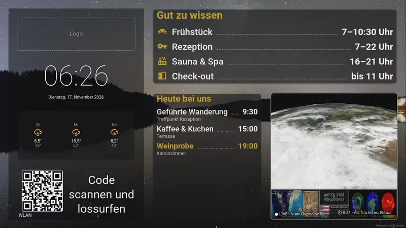

# Hotel / Pension – Lobby

*[English](hotel.md)* · [Alle Vorlagen](../TEMPLATES.de.md)

Aufnahme aus dem echten Fernseher-Stream

**Wofür:** Hotel, Pension, Ferienwohnung, Jugendherberge

## Was man sieht

Ein Bergbild nach Tageszeit, das sich langsam bewegt. Links eine dunkle Glastafel mit Logo, Uhr, Datum, Vorhersage und WLAN-QR-Code (Gäste scannen und sind online). Rechts „Gut zu wissen“ (Frühstück, Rezeption, Sauna, Check-out), „Heute bei uns“ mit den Programmpunkten des Tages und ein kleines Live-Video.

**Hintergrund:** Bilderset *Berge*, wechselt mit der Tageszeit; **Bilder bewegen sich langsam** (sanfter Zoom); Karten dunkel durchscheinend. Farbschema *dunkel*, Akzent `#c9a227`, Schrift Noto Serif.

## Verwendete Elemente

| Element | Zeigt |
|---|---|
| Fläche (Farbe) | `#000000`, 50 % deckend |
| Logo / Bild | eigenes Logo hochladen |
| Uhr | aktuelle Uhrzeit |
| Datum | Wochentag und Datum |
| Vorhersage | Vorhersage der nächsten Tage |
| QR-Code | WLAN → `WIFI:T:WPA;S:Hotel-Gast;P:bitte-aendern;;` |
| Freier Text | „Code scannen und lossurfen“ |
| Liste | **Gut zu wissen** – 4 Zeilen |
| Liste | **Heute bei uns** – 3 Zeilen |
| Live-Video | Live-Kameras (Natur, Tiere) oder eigene Medien |

## Anpassen

Neues Layout aus der Vorlage: **Inhalte → Layouts → + Neues Layout → Ausgangspunkt**.

- WLAN-QR-Code: Netzname und Passwort eintragen (`WIFI:T:WPA;S:<Name>;P:<Passwort>;;`).
- Programm aus einem Kalender: Liste „Heute bei uns“ durch den Baustein *Kalender* ersetzen.
- Am Meer? Hintergrund-Stil *Meer* wählen.

*Mit Live-Video: rund 1 Kern Rechenleistung am Server.*
