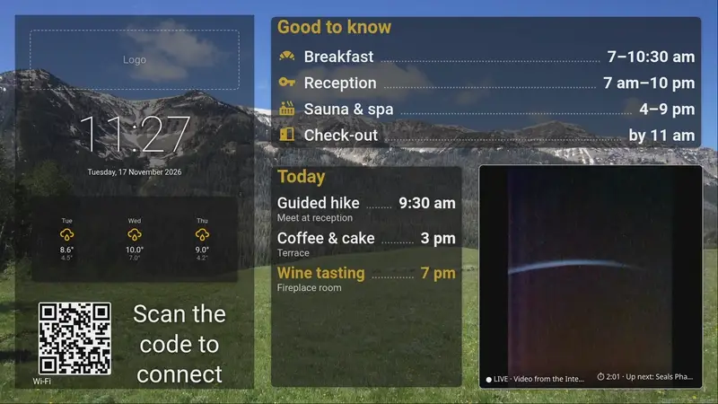

# Hotel / guest house – lobby

*[Deutsch](hotel.de.md)* · [All templates](../TEMPLATES.md)

Recorded from the real TV stream

**For:** hotel, guest house, holiday flat, hostel

## What you see

A mountain picture by time of day that moves slowly. On the left a dark glass panel with logo, clock, date, forecast and a Wi-Fi QR code (guests scan it and are online). On the right “Good to know” (breakfast, reception, sauna, check-out), “Today” with the day's programme and a small live video.

**Background:** picture set *Mountains*, changes with the time of day; **pictures move slowly** (gentle zoom); cards see-through dark. Colour scheme *dunkel*, accent `#c9a227`, font Noto Serif.

## Elements used

| Element | Shows |
|---|---|
| Area (colour) | `#000000`, 50 % opaque |
| Logo / picture | upload your logo |
| Clock | current time |
| Date | weekday and date |
| Forecast | forecast for the next days |
| QR code | Wi-Fi → `WIFI:T:WPA;S:Hotel-Gast;P:bitte-aendern;;` |
| Free text | “Scan the code to connect” |
| List | **Good to know** – 4 rows |
| List | **Today** – 3 rows |
| Live video | live cameras (nature, animals) or own media |

## Make it yours

New layout from the template: **Content → Layouts → + New layout → Start from**.

- Wi-Fi QR code: enter network name and password (`WIFI:T:WPA;S:<name>;P:<password>;;`).
- Programme from a calendar: replace the list “Today” with the *Calendar* element.
- By the sea? Pick the background style *Sea*.

*With live video: about one core of computing power on the server.*
