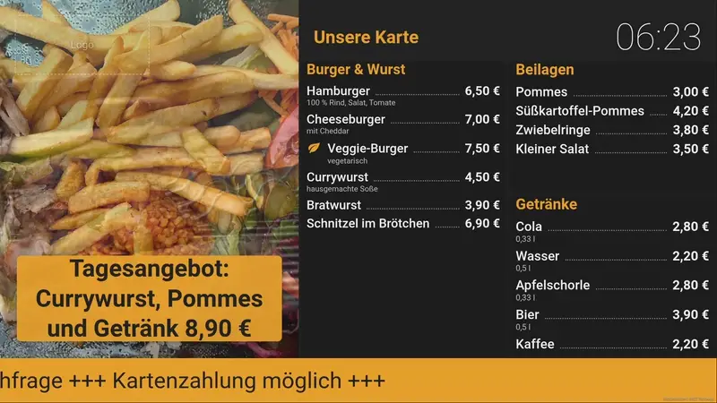

# Imbiss – Menütafel

*[English](imbiss.md)* · [Alle Vorlagen](../TEMPLATES.de.md)

Aufnahme aus dem echten Fernseher-Stream

**Wofür:** Imbiss, Döner, Café, Kiosk, Foodtruck

## Was man sieht

Links laufen appetitliche Essensfotos als langsame Diashow – jedes Bild zoomt sanft heran, dann blendet das nächste über. Darauf leuchtet das Tagesangebot. Rechts steht die Karte auf dunklen, leicht durchscheinenden Karten: Burger & Wurst, Beilagen, Getränke, jeweils mit Preis, kleiner Beschreibung und Punktlinie. Unten läuft ein Laufband in der Akzentfarbe. Ohne Live-Video – das spart etwa die Hälfte der Rechenleistung.

**Hintergrund:** Bilderset *Essen* als Diashow, 12 s je Bild – nur auf der linken Fläche; **Bilder bewegen sich langsam** (sanfter Zoom); Karten dunkel durchscheinend. Farbschema *dunkel*, Akzent `#f5a623`, Schrift Montserrat.

## Verwendete Elemente

| Element | Zeigt |
|---|---|
| Logo / Bild | eigenes Logo hochladen |
| Freier Text | „Unsere Karte“ |
| Uhr | aktuelle Uhrzeit |
| Liste | **Burger & Wurst** – 6 Zeilen |
| Liste | **Beilagen** – 4 Zeilen |
| Fläche (Farbe) | `#f5a623`, 94 % deckend |
| Freier Text | „Tagesangebot: Currywurst, Pommes und Getränk 8,90 €“ |
| Liste | **Getränke** – 5 Zeilen |
| Fläche (Farbe) | `#f5a623`, 100 % deckend |
| Freier Text | Laufband: „+++ Alle Preise inkl. MwSt. +++ Allergene auf Nachfrage +++ Kartenzah…“ |

## Anpassen

Neues Layout aus der Vorlage: **Inhalte → Layouts → + Neues Layout → Ausgangspunkt**.

- Eigene Fotos: Hintergrund → *Eigenes Bild* oder *Galerie* (z. B. ein Ordner mit euren Gerichten); „Bilder langsam bewegen“ bleibt an.
- Preise und Gerichte direkt in den drei Listen ändern – oder die Karte als CSV-Datei pflegen (Spalten `text`, `info`, `wert`) und als Datenquelle wählen.
- Tagesangebot: Text im orangen Feld ändern; mit *Zeitraum* nur mittags zeigen.
- Echte Videos (z. B. vom eigenen Grill): unter Medien hochladen und einen Baustein *Live-Video* auf die Fotofläche legen.

*Ohne Live-Video: etwa die Hälfte der Rechenleistung einer Vorlage mit Video.*
