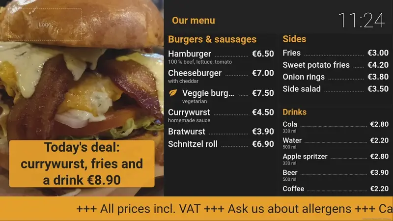

# Snack bar – menu board

*[Deutsch](imbiss.de.md)* · [All templates](../TEMPLATES.md)

Recorded from the real TV stream

**For:** snack bar, kebab shop, café, kiosk, food truck

## What you see

On the left, appetising food photos run as a slow slideshow – each picture zooms in gently, then the next one fades in. Today's deal glows on top. On the right, the menu sits on dark, slightly see-through cards: burgers & sausages, sides, drinks, each with price, a short description and a dotted line. A ticker in the accent colour runs at the bottom. No live video – that saves about half of the computing power.

**Background:** picture set *Food* as slideshow, 12 s per picture – on the left area only; **pictures move slowly** (gentle zoom); cards see-through dark. Colour scheme *dunkel*, accent `#f5a623`, font Montserrat.

## Elements used

| Element | Shows |
|---|---|
| Logo / picture | upload your logo |
| Free text | “Our menu” |
| Clock | current time |
| List | **Burgers & sausages** – 6 rows |
| List | **Sides** – 4 rows |
| Area (colour) | `#f5a623`, 94 % opaque |
| Free text | “Today's deal: currywurst, fries and a drink €8.90” |
| List | **Drinks** – 5 rows |
| Area (colour) | `#f5a623`, 100 % opaque |
| Free text | ticker: “+++ All prices incl. VAT +++ Ask us about allergens +++ Cards welcome…” |

## Make it yours

New layout from the template: **Content → Layouts → + New layout → Start from**.

- Own photos: background → *Own picture* or *Gallery* (e.g. a folder with your dishes); keep “Move pictures slowly” on.
- Change prices and dishes right in the three lists – or keep the menu in a CSV file (columns `text`, `info`, `wert`) and pick it as data source.
- Today's deal: change the text in the orange box; use *Period* to show it only at lunchtime.
- Real videos (e.g. of your own grill): upload them under Media and put a *Live video* element on the photo area.

*Without live video: about half the computing power of a template with video.*
