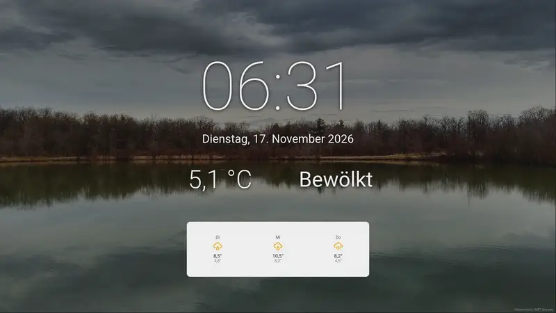

# Info ohne Video

*[English](info.md)* · [Alle Vorlagen](../TEMPLATES.de.md)

Aufnahme aus dem echten Fernseher-Stream

**Wofür:** Flur, Eingang – ruhig und sparsam

## Was man sieht

Wetterbild, groß in der Mitte Uhr und Datum, darunter Temperatur, Wetterlage und Vorhersage. Ohne Video.

**Hintergrund:** Wetterbild passend zum aktuellen Wetter. Farbschema *dunkel*, Akzent `#3d8cd0`, Schrift Roboto.

## Verwendete Elemente

| Element | Zeigt |
|---|---|
| Uhr | aktuelle Uhrzeit |
| Datum | Wochentag und Datum |
| Temperatur | Außentemperatur (Home Assistant oder eigenes Wetter) |
| Wetterlage | Wetterlage in Worten |
| Vorhersage | Vorhersage der nächsten Tage |
| Radio-Sender | laufender Radio-Sender |

## Anpassen

Neues Layout aus der Vorlage: **Inhalte → Layouts → + Neues Layout → Ausgangspunkt**.

- Spart Rechenleistung – gut für ältere Server oder viele Fernseher.

*Ohne Live-Video: etwa die Hälfte der Rechenleistung einer Vorlage mit Video.*
