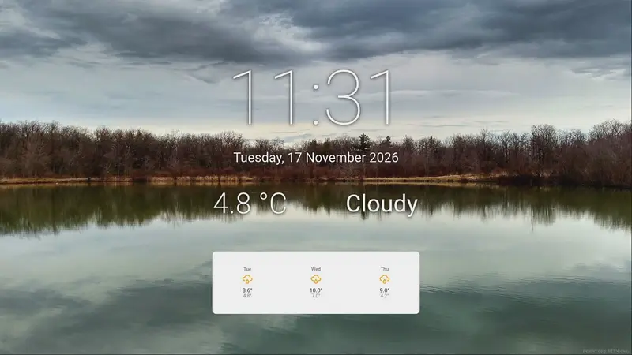

# Info without video

*[Deutsch](info.de.md)* · [All templates](../TEMPLATES.md)

Recorded from the real TV stream

**For:** hallway, entrance – calm and frugal

## What you see

Weather picture, large clock and date in the middle, temperature, weather and forecast below. No video.

**Background:** weather picture matching the current weather. Colour scheme *dunkel*, accent `#3d8cd0`, font Roboto.

## Elements used

| Element | Shows |
|---|---|
| Clock | current time |
| Date | weekday and date |
| Temperature | outside temperature (Home Assistant or own weather) |
| Weather | weather in words |
| Forecast | forecast for the next days |
| Radio station | radio station playing |

## Make it yours

New layout from the template: **Content → Layouts → + New layout → Start from**.

- Saves computing power – good for older servers or many TVs.

*Without live video: about half the computing power of a template with video.*
