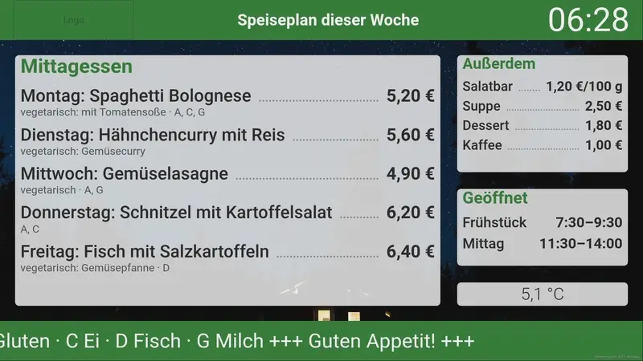

# Kantine – Speiseplan

*[English](kantine.md)* · [Alle Vorlagen](../TEMPLATES.de.md)

Aufnahme aus dem echten Fernseher-Stream

**Wofür:** Kantine, Mensa, Schule, Betriebsrestaurant

## Was man sieht

Ein Naturbild nach Tageszeit, das sich langsam bewegt, mit grüner Kopfleiste. Der Speiseplan Montag bis Freitag steht auf einer großen hellen, durchscheinenden Karte – mit Preis, vegetarischer Alternative und Allergenen. Rechts Extras, Öffnungszeiten und Temperatur, unten die Allergen-Legende als Laufband. Ohne Video.

**Hintergrund:** Bilderset *Natur*, wechselt mit der Tageszeit; **Bilder bewegen sich langsam** (sanfter Zoom); Karten hell durchscheinend. Farbschema *hell*, Akzent `#2e7d32`, Schrift Lato.

## Verwendete Elemente

| Element | Zeigt |
|---|---|
| Fläche (Farbe) | `#2e7d32`, 100 % deckend |
| Logo / Bild | eigenes Logo hochladen |
| Freier Text | „Speiseplan dieser Woche“ |
| Uhr | aktuelle Uhrzeit |
| Liste | **Mittagessen** – 5 Zeilen |
| Liste | **Außerdem** – 4 Zeilen |
| Liste | **Geöffnet** – 2 Zeilen |
| Temperatur | Außentemperatur (Home Assistant oder eigenes Wetter) |
| Fläche (Farbe) | `#2e7d32`, 100 % deckend |
| Freier Text | Laufband: „+++ Allergene: A Gluten · C Ei · D Fisch · G Milch +++ Guten Appetit!…“ |

## Anpassen

Neues Layout aus der Vorlage: **Inhalte → Layouts → + Neues Layout → Ausgangspunkt**.

- Speiseplan jede Woche als CSV-Datei hochladen (oder vom NAS holen) und als Datenquelle der Liste wählen.
- Tagesgericht hervorheben: Zeile auf *hervorheben* stellen.
- Für die Mittagszeit: Layout per Zeitplan nur 11–14 Uhr zeigen.

*Ohne Live-Video: etwa die Hälfte der Rechenleistung einer Vorlage mit Video.*
