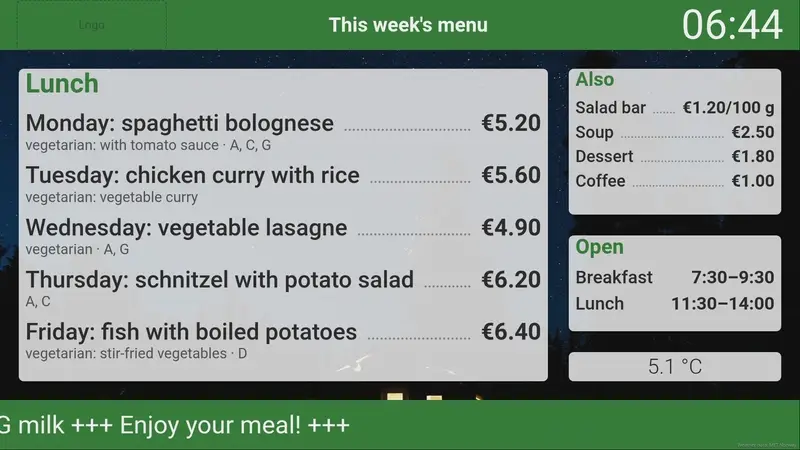

# Canteen – weekly menu

*[Deutsch](kantine.de.md)* · [All templates](../TEMPLATES.md)

Recorded from the real TV stream

**For:** canteen, school, university, company restaurant

## What you see

A nature picture by time of day that moves slowly, with a green header. The menu Monday to Friday sits on a large, light, see-through card – with price, vegetarian option and allergens. On the right extras, opening hours and temperature, the allergen legend runs as a ticker at the bottom. No video.

**Background:** picture set *Nature*, changes with the time of day; **pictures move slowly** (gentle zoom); cards see-through light. Colour scheme *hell*, accent `#2e7d32`, font Lato.

## Elements used

| Element | Shows |
|---|---|
| Area (colour) | `#2e7d32`, 100 % opaque |
| Logo / picture | upload your logo |
| Free text | “This week's menu” |
| Clock | current time |
| List | **Lunch** – 5 rows |
| List | **Also** – 4 rows |
| List | **Open** – 2 rows |
| Temperature | outside temperature (Home Assistant or own weather) |
| Area (colour) | `#2e7d32`, 100 % opaque |
| Free text | ticker: “+++ Allergens: A gluten · C egg · D fish · G milk +++ Enjoy your meal…” |

## Make it yours

New layout from the template: **Content → Layouts → + New layout → Start from**.

- Upload the menu every week as a CSV file (or fetch it from a NAS) and pick it as the list's data source.
- Highlight today's dish: set the row to *highlight*.
- For lunchtime only: show the layout 11 am – 2 pm with a schedule.

*Without live video: about half the computing power of a template with video.*
