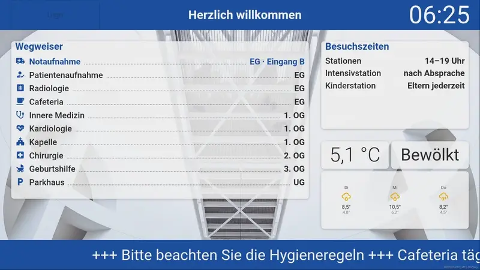

# Krankenhaus – Foyer

*[English](klinik.md)* · [Alle Vorlagen](../TEMPLATES.de.md)

Aufnahme aus dem echten Fernseher-Stream

**Wofür:** Krankenhaus, Pflegeheim, Ärztehaus, Behörde

## Was man sieht

Helle, ruhige Architekturbilder laufen als langsame Diashow (alle 30 Sekunden ein neues Bild, sanfter Zoom). Kopfleiste in Klinik-Blau. Großer Wegweiser mit Symbolen und Etagen – die Notaufnahme ist hervorgehoben –, daneben Besuchszeiten und Wetter. Ein Meldungsfeld zeigt Texte aus Home Assistant (z. B. „Aufzug B außer Betrieb“). Ohne Video.

**Hintergrund:** Bilderset *Architektur* als Diashow, 30 s je Bild; **Bilder bewegen sich langsam** (sanfter Zoom); Karten hell durchscheinend. Farbschema *hell*, Akzent `#0d47a1`, Schrift Noto Sans.

## Verwendete Elemente

| Element | Zeigt |
|---|---|
| Fläche (Farbe) | `#0d47a1`, 100 % deckend |
| Logo / Bild | eigenes Logo hochladen |
| Freier Text | „Herzlich willkommen“ |
| Uhr | aktuelle Uhrzeit |
| Liste | **Wegweiser** – 10 Zeilen |
| Liste | **Besuchszeiten** – 3 Zeilen |
| Temperatur | Außentemperatur (Home Assistant oder eigenes Wetter) |
| Wetterlage | Wetterlage in Worten |
| Vorhersage | Vorhersage der nächsten Tage |
| Meldung von HA | Text-Entität aus Home Assistant (leer = unsichtbar) |
| Fläche (Farbe) | `#0d47a1`, 100 % deckend |
| Freier Text | Laufband: „+++ Bitte beachten Sie die Hygieneregeln +++ Cafeteria täglich 8–18 U…“ |

## Anpassen

Neues Layout aus der Vorlage: **Inhalte → Layouts → + Neues Layout → Ausgangspunkt**.

- Meldung: eine Text-Entität aus Home Assistant eintragen; leer bleibt das Feld unsichtbar.
- Wegweiser für mehrere Häuser: Liste mit 2 Spalten nutzen.
- Eigene Fotos vom Haus: Hintergrund → *Galerie*.

*Ohne Live-Video: etwa die Hälfte der Rechenleistung einer Vorlage mit Video.*
