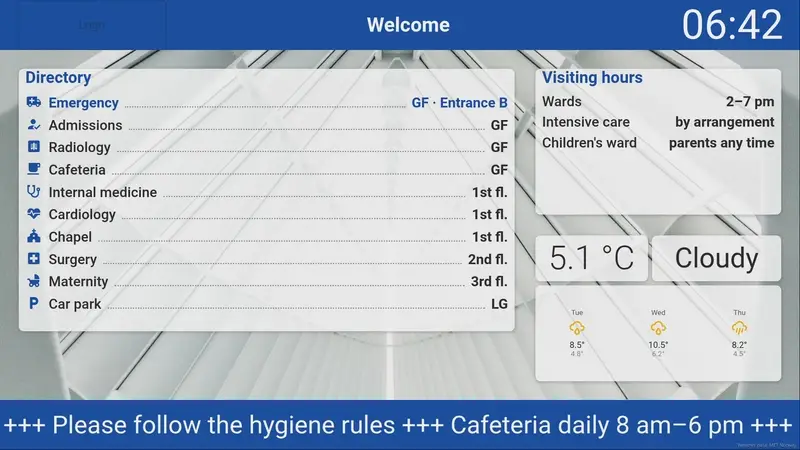

# Hospital – lobby

*[Deutsch](klinik.de.md)* · [All templates](../TEMPLATES.md)

Recorded from the real TV stream

**For:** hospital, care home, medical centre, public office

## What you see

Bright, calm architecture pictures run as a slow slideshow (a new picture every 30 seconds, gentle zoom). Header in hospital blue. A large directory with icons and floors – the emergency department is highlighted – next to it visiting hours and weather. A message box shows texts from Home Assistant (e.g. “Lift B out of order”). No video.

**Background:** picture set *Architecture* as slideshow, 30 s per picture; **pictures move slowly** (gentle zoom); cards see-through light. Colour scheme *hell*, accent `#0d47a1`, font Noto Sans.

## Elements used

| Element | Shows |
|---|---|
| Area (colour) | `#0d47a1`, 100 % opaque |
| Logo / picture | upload your logo |
| Free text | “Welcome” |
| Clock | current time |
| List | **Directory** – 10 rows |
| List | **Visiting hours** – 3 rows |
| Temperature | outside temperature (Home Assistant or own weather) |
| Weather | weather in words |
| Forecast | forecast for the next days |
| Message from HA | text entity from Home Assistant (empty = invisible) |
| Area (colour) | `#0d47a1`, 100 % opaque |
| Free text | ticker: “+++ Please follow the hygiene rules +++ Cafeteria daily 8 am–6 pm +++…” |

## Make it yours

New layout from the template: **Content → Layouts → + New layout → Start from**.

- Message: enter a text entity from Home Assistant; when empty, the box stays invisible.
- Directory for several buildings: use the list with 2 columns.
- Own photos of the building: background → *Gallery*.

*Without live video: about half the computing power of a template with video.*
