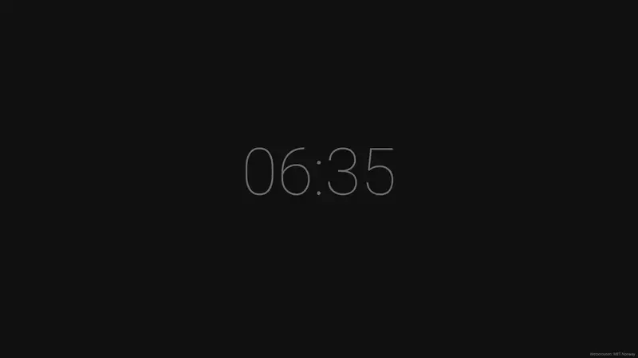

# Nacht (nur Uhr, gedimmt)

*[English](nacht.md)* · [Alle Vorlagen](../TEMPLATES.de.md)

Aufnahme aus dem echten Fernseher-Stream (Zeitraffer)

**Wofür:** Schlafzimmer, Flur bei Nacht

## Was man sieht

Nur eine gedimmte Uhr auf Schwarz – für den Zeitplan in der Nacht.

**Hintergrund:** einfarbig `#000000`. Farbschema *gedimmt*, Akzent `#555555`, Schrift Roboto.

## Verwendete Elemente

| Element | Zeigt |
|---|---|
| Uhr | aktuelle Uhrzeit |

## Anpassen

Neues Layout aus der Vorlage: **Inhalte → Layouts → + Neues Layout → Ausgangspunkt**.

- Per Zeitplan z. B. 22–6 Uhr auf dieses Layout schalten oder den Bildschirm ganz ausschalten.

*Ohne Live-Video: etwa die Hälfte der Rechenleistung einer Vorlage mit Video.*
