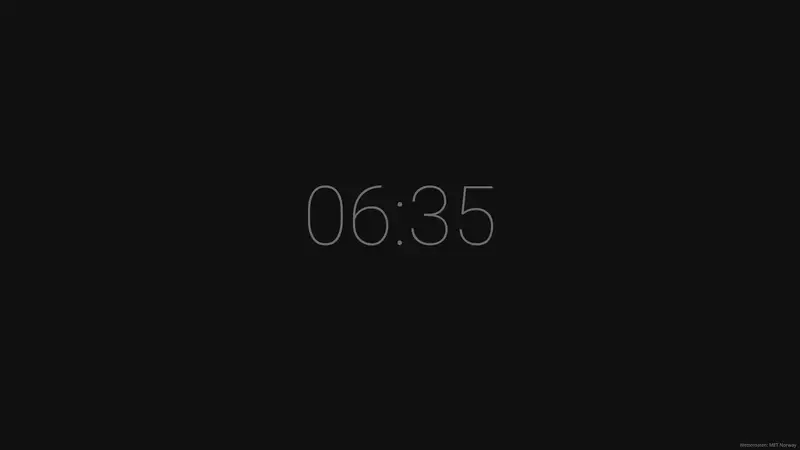

# Night (clock only, dimmed)

*[Deutsch](nacht.de.md)* · [All templates](../TEMPLATES.md)

Recorded from the real TV stream (time-lapse)

**For:** bedroom, hallway at night

## What you see

Only a dimmed clock on black – for the night schedule.

**Background:** plain colour `#000000`. Colour scheme *gedimmt*, accent `#555555`, font Roboto.

## Elements used

| Element | Shows |
|---|---|
| Clock | current time |

## Make it yours

New layout from the template: **Content → Layouts → + New layout → Start from**.

- Switch to this layout with a schedule, e.g. 10 pm – 6 am, or switch the screen off entirely.

*Without live video: about half the computing power of a template with video.*
