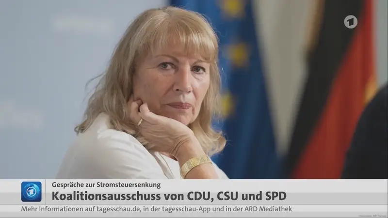

# Video only

*[Deutsch](nurvideo.de.md)* · [All templates](../TEMPLATES.md)

Recorded from the real TV stream

**For:** decoration screen, shop window

## What you see

Only the live video, without bar and without text.

**Background:** plain colour `#000000`. Colour scheme *dunkel*, accent `#3d8cd0`, font Roboto.

## Elements used

| Element | Shows |
|---|---|
| Live video | live cameras (nature, animals) or own media, without bar |

## Make it yours

New layout from the template: **Content → Layouts → + New layout → Start from**.

- Own videos instead of live cameras: upload them under Media and choose *own media* for the TV.

*With live video: about one core of computing power on the server.*
