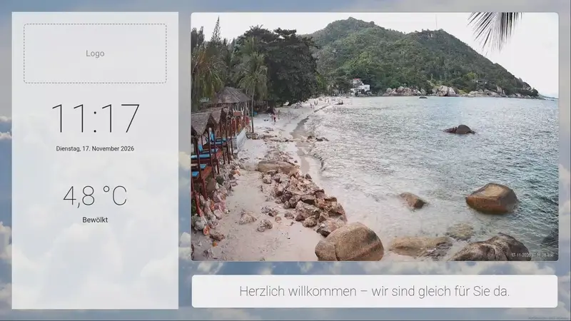

# Praxis – ruhig (Wartezimmer)

*[English](praxis.md)* · [Alle Vorlagen](../TEMPLATES.de.md)

Aufnahme aus dem echten Fernseher-Stream

**Wofür:** Wartezimmer

## Was man sieht

Ruhiger Himmel, links eine helle Tafel mit Logo, Uhr, Datum und Wetter, rechts ein ruhiges Live-Video ohne Leiste, darunter ein Willkommenstext.

**Hintergrund:** Bilderset *Himmel*, wechselt mit der Tageszeit. Farbschema *hell*, Akzent `#5bb5a2`, Schrift Lato.

## Verwendete Elemente

| Element | Zeigt |
|---|---|
| Fläche (Farbe) | `#ffffff`, 82 % deckend |
| Logo / Bild | eigenes Logo hochladen |
| Uhr | aktuelle Uhrzeit |
| Datum | Wochentag und Datum |
| Temperatur | Außentemperatur (Home Assistant oder eigenes Wetter) |
| Wetterlage | Wetterlage in Worten |
| Live-Video | Live-Kameras (Natur, Tiere) oder eigene Medien, ohne Leiste |
| Freier Text | „Herzlich willkommen – wir sind gleich für Sie da.“ |

## Anpassen

Neues Layout aus der Vorlage: **Inhalte → Layouts → + Neues Layout → Ausgangspunkt**.

- Für ruhige Bilder die Kategorien auf Meer, Vögel und Wald beschränken.

*Mit Live-Video: rund 1 Kern Rechenleistung am Server.*
