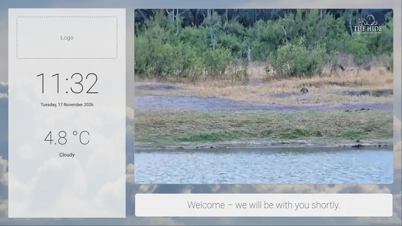

# Practice – calm (waiting room)

*[Deutsch](praxis.de.md)* · [All templates](../TEMPLATES.md)

Recorded from the real TV stream

**For:** waiting room

## What you see

Calm sky, on the left a light panel with logo, clock, date and weather, on the right a calm live video without bar, a welcome text below.

**Background:** picture set *Sky*, changes with the time of day. Colour scheme *hell*, accent `#5bb5a2`, font Lato.

## Elements used

| Element | Shows |
|---|---|
| Area (colour) | `#ffffff`, 82 % opaque |
| Logo / picture | upload your logo |
| Clock | current time |
| Date | weekday and date |
| Temperature | outside temperature (Home Assistant or own weather) |
| Weather | weather in words |
| Live video | live cameras (nature, animals) or own media, without bar |
| Free text | “Welcome – we will be with you shortly.” |

## Make it yours

New layout from the template: **Content → Layouts → + New layout → Start from**.

- For calm pictures limit the categories to sea, birds and forest.

*With live video: about one core of computing power on the server.*
