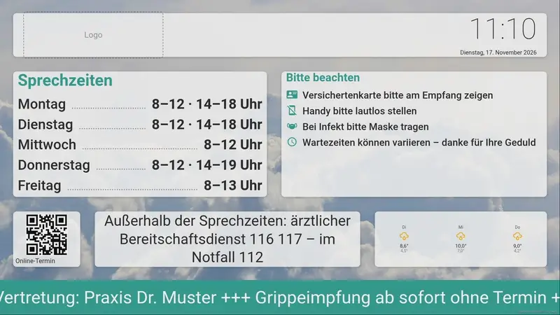

# Praxis – Info (Sprechzeiten)

*[English](praxisinfo.md)* · [Alle Vorlagen](../TEMPLATES.de.md)

Aufnahme aus dem echten Fernseher-Stream

**Wofür:** Arztpraxis, Zahnarzt, Physiotherapie, Tierarzt

## Was man sieht

Ein ruhiger Himmel nach Tageszeit, der sich kaum merklich bewegt. Darauf helle, durchscheinende Karten: oben Logo, Datum und Uhr, darunter Sprechzeiten und Hinweise mit Symbolen, unten ein QR-Code zur Online-Terminbuchung, der Hinweis auf den Bereitschaftsdienst und die Wettervorhersage. Das Laufband nennt Urlaub, Vertretung und Aktuelles. Ohne Video.

**Hintergrund:** Bilderset *Himmel*, wechselt mit der Tageszeit; **Bilder bewegen sich langsam** (sanfter Zoom); Karten hell durchscheinend. Farbschema *hell*, Akzent `#2a9d8f`, Schrift Lato.

## Verwendete Elemente

| Element | Zeigt |
|---|---|
| Fläche (Farbe) | `#ffffff`, 84 % deckend |
| Logo / Bild | eigenes Logo hochladen |
| Uhr | aktuelle Uhrzeit |
| Datum | Wochentag und Datum |
| Liste | **Sprechzeiten** – 5 Zeilen |
| Liste | **Bitte beachten** – 4 Zeilen |
| QR-Code | Online-Termin → `https://example.org/termin` |
| Freier Text | „Außerhalb der Sprechzeiten: ärztlicher Bereitschaftsdienst 116 117 –…“ |
| Vorhersage | Vorhersage der nächsten Tage |
| Fläche (Farbe) | `#2a9d8f`, 100 % deckend |
| Freier Text | Laufband: „+++ Vom 23.12. bis 2.1. geschlossen – Vertretung: Praxis Dr. Muster +…“ |

## Anpassen

Neues Layout aus der Vorlage: **Inhalte → Layouts → + Neues Layout → Ausgangspunkt**.

- QR-Code: Adresse eurer Terminbuchung eintragen.
- Urlaub: Text im Laufband ändern – mit *Zeitraum* erscheint es nur in den Wochen vorher.
- Wer Wartezimmer-Fernsehen will: die Vorlage *Praxis – ruhig* mit ruhigem Live-Video nehmen.

*Ohne Live-Video: etwa die Hälfte der Rechenleistung einer Vorlage mit Video.*
