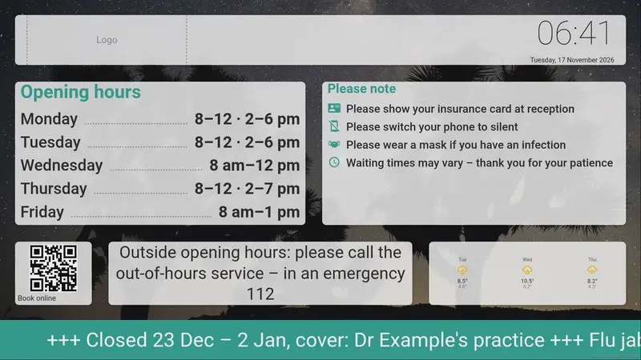

# Practice – info (opening hours)

*[Deutsch](praxisinfo.de.md)* · [All templates](../TEMPLATES.md)

Recorded from the real TV stream

**For:** doctor's practice, dentist, physiotherapy, vet

## What you see

A calm sky by time of day that moves almost imperceptibly. On top, light see-through cards: logo, date and clock at the top, opening hours and notes with icons below, and at the bottom a QR code for online booking, the out-of-hours note and the forecast. The ticker announces holidays, cover and news. No video.

**Background:** picture set *Sky*, changes with the time of day; **pictures move slowly** (gentle zoom); cards see-through light. Colour scheme *hell*, accent `#2a9d8f`, font Lato.

## Elements used

| Element | Shows |
|---|---|
| Area (colour) | `#ffffff`, 84 % opaque |
| Logo / picture | upload your logo |
| Clock | current time |
| Date | weekday and date |
| List | **Opening hours** – 5 rows |
| List | **Please note** – 4 rows |
| QR code | Book online → `https://example.org/termin` |
| Free text | “Outside opening hours: please call the out-of-hours service – in an e…” |
| Forecast | forecast for the next days |
| Area (colour) | `#2a9d8f`, 100 % opaque |
| Free text | ticker: “+++ Closed 23 Dec – 2 Jan, cover: Dr Example's practice +++ Flu jabs…” |

## Make it yours

New layout from the template: **Content → Layouts → + New layout → Start from**.

- QR code: enter the address of your booking page.
- Holidays: change the ticker text – with *Period* it only shows in the weeks before.
- For waiting-room TV use the template *Practice – calm* with a calm live video.

*Without live video: about half the computing power of a template with video.*
