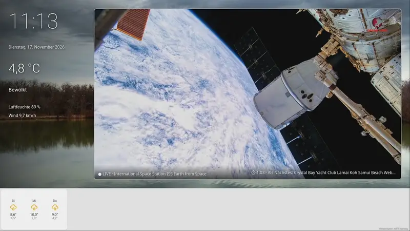

# Standard

*[English](standard.md)* · [Alle Vorlagen](../TEMPLATES.de.md)

Aufnahme aus dem echten Fernseher-Stream

**Wofür:** Zuhause, Vereinsheim, Werkstatt – der Klassiker

## Was man sieht

Wetterbild passend zum aktuellen Wetter, links Uhr, Datum, Temperatur, Wetterlage, Luftfeuchte, Wind, Räume aus Home Assistant und der Radiosender, rechts groß das Live-Video, unten die Vorhersage.

**Hintergrund:** Wetterbild passend zum aktuellen Wetter. Farbschema *dunkel*, Akzent `#3d8cd0`, Schrift Roboto.

## Verwendete Elemente

| Element | Zeigt |
|---|---|
| Fläche (Farbe) | `#f0f0f0`, 100 % deckend |
| Uhr | aktuelle Uhrzeit |
| Datum | Wochentag und Datum |
| Temperatur | Außentemperatur (Home Assistant oder eigenes Wetter) |
| Wetterlage | Wetterlage in Worten |
| Luftfeuchte | Luftfeuchte |
| Wind | Wind |
| Räume | Räume aus Home Assistant |
| Radio-Sender | laufender Radio-Sender |
| Live-Video | Live-Kameras (Natur, Tiere) oder eigene Medien |
| Vorhersage | Vorhersage der nächsten Tage |

## Anpassen

Neues Layout aus der Vorlage: **Inhalte → Layouts → + Neues Layout → Ausgangspunkt**.

- Räume und Kacheln: Entitäten aus Home Assistant eintragen.
- Ohne Home Assistant einfach die Räume löschen.

*Mit Live-Video: rund 1 Kern Rechenleistung am Server.*
