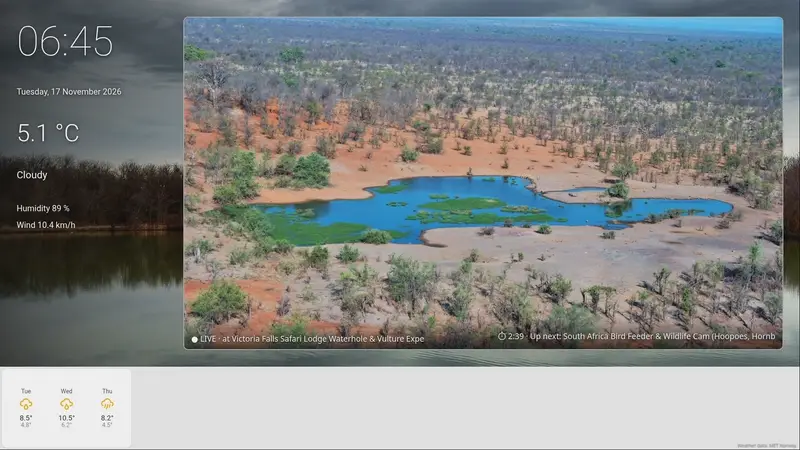

# Standard

*[Deutsch](standard.de.md)* · [All templates](../TEMPLATES.md)

Recorded from the real TV stream

**For:** home, club house, workshop – the classic

## What you see

Weather picture matching the current weather, on the left clock, date, temperature, weather, humidity, wind, rooms from Home Assistant and the radio station, on the right a large live video, forecast at the bottom.

**Background:** weather picture matching the current weather. Colour scheme *dunkel*, accent `#3d8cd0`, font Roboto.

## Elements used

| Element | Shows |
|---|---|
| Area (colour) | `#f0f0f0`, 100 % opaque |
| Clock | current time |
| Date | weekday and date |
| Temperature | outside temperature (Home Assistant or own weather) |
| Weather | weather in words |
| Humidity | humidity |
| Wind | wind |
| Rooms | rooms from Home Assistant |
| Radio station | radio station playing |
| Live video | live cameras (nature, animals) or own media |
| Forecast | forecast for the next days |

## Make it yours

New layout from the template: **Content → Layouts → + New layout → Start from**.

- Rooms and tiles: enter entities from Home Assistant.
- Without Home Assistant just delete the rooms.

*With live video: about one core of computing power on the server.*
