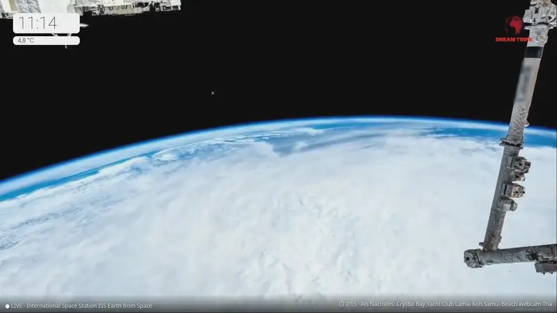

# Video groß

*[English](videogross.md)* · [Alle Vorlagen](../TEMPLATES.de.md)

Aufnahme aus dem echten Fernseher-Stream

**Wofür:** Empfang, Aufenthaltsraum – Bild zuerst

## Was man sieht

Das Live-Video füllt den ganzen Bildschirm, oben links eine kleine Karte mit Uhr und Temperatur.

**Hintergrund:** einfarbig `#000000`. Farbschema *dunkel*, Akzent `#3d8cd0`, Schrift Roboto.

## Verwendete Elemente

| Element | Zeigt |
|---|---|
| Live-Video | Live-Kameras (Natur, Tiere) oder eigene Medien |
| Uhr | aktuelle Uhrzeit |
| Temperatur | Außentemperatur (Home Assistant oder eigenes Wetter) |

## Anpassen

Neues Layout aus der Vorlage: **Inhalte → Layouts → + Neues Layout → Ausgangspunkt**.

- Die Kategorien der Live-Kameras (Meer, Vögel, Wald …) unter *Inhalte → Live-Kameras* einschränken.

*Mit Live-Video: rund 1 Kern Rechenleistung am Server.*
