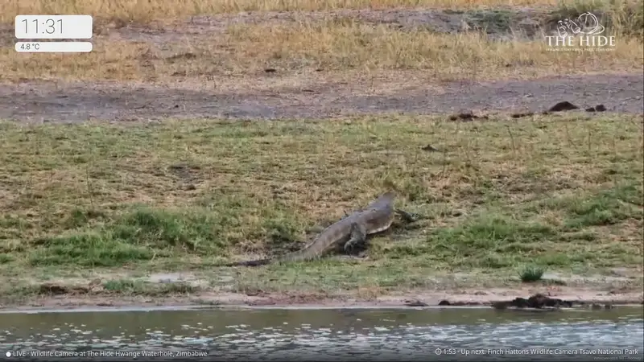

# Large video

*[Deutsch](videogross.de.md)* · [All templates](../TEMPLATES.md)

Recorded from the real TV stream

**For:** reception, lounge – picture first

## What you see

The live video fills the whole screen, with a small card for clock and temperature at the top left.

**Background:** plain colour `#000000`. Colour scheme *dunkel*, accent `#3d8cd0`, font Roboto.

## Elements used

| Element | Shows |
|---|---|
| Live video | live cameras (nature, animals) or own media |
| Clock | current time |
| Temperature | outside temperature (Home Assistant or own weather) |

## Make it yours

New layout from the template: **Content → Layouts → + New layout → Start from**.

- Limit the live camera categories (sea, birds, forest …) under *Content → Live cameras*.

*With live video: about one core of computing power on the server.*
